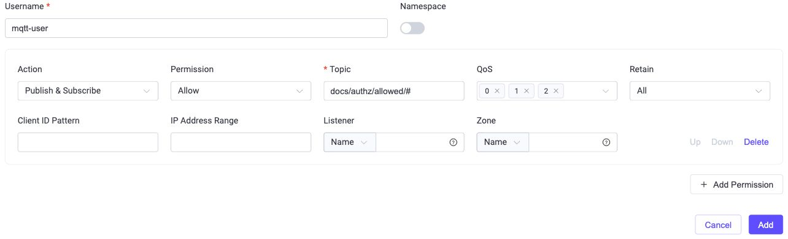

# Authorize MQTT Operations with the Built-in Database

Store permission rules in EMQX and manage them through the EMQX Dashboard or management API. This example allows the authenticated user `mqtt-user` to publish and subscribe within `docs/authz/allowed/#`.

## Prerequisites

Complete the [controlled test setup](index.md#prepare-a-controlled-test): use a normal authenticated user, remove conflicting test authorizers, set `no_match = deny`, and disable caches while verifying the policy. The authorization database stores rules; it does not create an MQTT password or authenticate a connection.

## Create the Authorizer in the Dashboard

1. Open **Access Control** -> **Authorization**.
2. Select **Create** -> **Built-in Database** -> **Next**. If it already exists, edit that authorizer.
3. Keep **Max Rules** at `100` for this example. This is the maximum number of rules per client or user.
4. Leave **Precondition** empty, confirm that the authorizer is enabled, and save the configuration.
5. Open **Permissions** from the authorizer's **Actions** column.

For configuration details, see [Authorizer Options](#authorizer-options).

## Authorizer Options

- **Max Rules** (`max_rules`): Maximum number of rules per client or user. The default is `100`. A high rule count may affect performance; test the policy under the expected load before increasing the limit.
- **Precondition** (`precondition`): Optional Variform expression that selects when EMQX invokes this authorizer. Omit it or leave it empty to apply no precondition. If it does not evaluate to `true`, EMQX skips the authorizer. See [Authorizer Preconditions](../../guides/access-control/authz/authz.md#authorizer-preconditions).

## Create the Authorizer with a Configuration File

Use this method instead of creating the authorizer in the Dashboard. The authorizer object below belongs in `authorization.sources`; adding it does not populate the rule database:

```hocon
{
  type = built_in_database
  enable = true
  max_rules = 100
}
```

Manage permission records separately through the Dashboard or API. See [configuration ownership and authorizer order](../../guides/access-control/authz/authz.md#manage-authorizers).

## Configure Authorization Rules

Use the Dashboard to choose a rule scope and configure its permissions. For an API workflow, see [Use the Management API](#use-the-management-api).

### Choose the Rule Scope

| Scope | Selector | Use |
| --- | --- | --- |
| Client ID | Exact client ID | Permissions for connections using a specific client ID. |
| Username | Exact username | Permissions for connections using a specific username. |
| All Users | No required exact identity | Common rules, optionally constrained by identity patterns, IP range, listener, or zone. |

Within a rule list, order matters: the first matching rule decides. Keep overlapping scope policies deliberate and test the effective result instead of assuming that every matching scope is combined.

### Common Rule Fields

The following Dashboard fields are available across rule scopes:

| Field | Description and Options |
| --- | --- |
| **Action** | Operation to match: **Publish**, **Subscribe**, or **Publish & Subscribe**. |
| **Permission** | Decision for a matching operation: **Allow** or **Deny**. |
| **Topic** | Topic or topic filter to match. Supports `+`, `#`, and [topic placeholders](../../guides/access-control/authz/authz.md#topic-placeholders). See [topic matching](../../guides/access-control/authz/authz.md) for subscription and literal `eq` matching semantics. |
| **QoS** | QoS levels to match. Select one or more of `0`, `1`, and `2`. |
| **Retain** | Publishing Retain flag to match: `true`, `false`, or **All**. This restriction applies to publishing, not subscribing. |
| **IP Address Range** | Exact client IP address or CIDR range, such as `192.168.1.0/24`. |
| **Listener** | Listener in `{type}:{name}` format, such as `tcp:default` or `ws:default`. |
| **Zone** | Zone in which the rule applies. |

### Scope-Specific Fields

| Scope | Required Field | Optional Identity Filters |
| --- | --- | --- |
| **Client ID** | **Client ID**: Exact client ID. | **Username Pattern**: Regular expression matching usernames. |
| **Username** | **Username**: Exact username. | **Client ID Pattern**: Regular expression matching client IDs. |
| **All Users** | No exact client ID or username. | **Client ID Pattern** and **Username Pattern**. |

For example, `^device-user-.*` matches usernames starting with `device-user-`; `^sensor-.*` matches client IDs starting with `sensor-`. These patterns are regular expressions, not MQTT topic filters.

### Add a Username Rule

1. On the authorizer's **Permissions** page, select **Username** and choose **Add**.
2. Enter username `mqtt-user`. Leave **Namespace** off for this global test account.
3. Add a permission with these values:

   | Field | Value |
   | --- | --- |
   | Action | Publish & Subscribe |
   | Permission | Allow |
   | Topic | `docs/authz/allowed/#` |
   | QoS | `0`, `1`, `2` |
   | Retain | All |
4. Select **Add** to save the rule. Do not add an allow-all rule for this test.

The topic grants both operations within that subtree. A request outside it finds no matching rule in this policy and is denied by the explicit final fallback.



### Order Permissions

When adding or editing a rule set, click **Add Permission** to add more permissions. Use **Up** and **Down** to arrange their evaluation order, then save the rule set.

For **All Users** rules, use the **More** menu in the rule row's **Actions** column to select **Move Up**, **Move Down**, **Move to Top**, or **Move to Bottom**. Rules are evaluated from top to bottom; the first matching rule decides. This changes rule order within the built-in database, not the order of authorizers in the authorization chain.

### Edit or Delete Rules

1. On the **Permissions** page, find the rule in its scope tab.
2. In **Actions**, click **Edit** to change its permissions, matching patterns, or IP range, then save. To remove a rule that is no longer needed, click **Delete**.
3. Clear affected authorization caches as needed and [verify both allowed and denied operations](index.md#verify-authorization-rules). See [when rule changes take effect](../../guides/access-control/authz/authz.md#when-authorization-rule-changes-take-effect).

## Use the Management API

Use the API as an alternative to Dashboard rule management. If the authorizer already exists, skip its creation request and manage its rules through the endpoints below. After applying the rules, continue to [Verify the Policy](#verify-the-policy).

Authenticate the management request with an authorized API key or the supported bearer-token flow. See [management API authentication](../../guides/api.md). MQTT user credentials are not management API credentials.

To create the authorizer, send this JSON body to `POST /api/v5/authorization/sources`:

```json
{
  "type": "built_in_database",
  "enable": true,
  "max_rules": 100
}
```

To create the example username rules, send this JSON body to `POST /api/v5/authorization/sources/built_in_database/rules/users`:

```json
[
  {
    "username": "mqtt-user",
    "rules": [
      {
        "permission": "allow",
        "action": "all",
        "topic": "docs/authz/allowed/#",
        "qos": [0, 1, 2],
        "retain": "all"
      }
    ]
  }
]
```

The body shapes differ between endpoints:

| Operation | Method and Path After `/api/v5` | Body |
| --- | --- | --- |
| Create username rules | `POST /authorization/sources/built_in_database/rules/users` | Array of objects containing `username` and `rules`. |
| Replace one user's rules | `PUT /authorization/sources/built_in_database/rules/users/{username}` | One object containing `username` and the complete replacement `rules`. |
| Create client-ID rules | `POST /authorization/sources/built_in_database/rules/clients` | Array of objects containing `clientid` and `rules`. |
| Replace one client's rules | `PUT /authorization/sources/built_in_database/rules/clients/{clientid}` | One object containing `clientid` and the complete replacement `rules`. |
| Create or replace All Users rules | `POST /authorization/sources/built_in_database/rules/all` | One object containing `rules`, not an array of rule sets. |

The PUT operations above replace the complete rule list for the specified user or client. The All Users POST operation also replaces the complete All Users rule list. Rules omitted from a replacement are removed, so save the existing rules before replacing them.

For example, the body below replaces the All Users rule list with a deny rule. This separate example is not required for the username walkthrough. Do not apply it to an existing policy unless you intend to replace all of its All Users rules:

```json
{
  "rules": [
    {"permission": "deny", "action": "all", "topic": "private/#"}
  ]
}
```

A rule requires `permission`, `action`, and `topic`. Optional fields include `qos` (an integer array), `retain` (`true`, `false`, or `"all"`), `username_re`, `clientid_re`, `ipaddr`, `listener`, `listener_re`, `zone`, and `zone_re`. If `qos` is omitted, the rule applies to all QoS levels. See [filter and placeholder semantics](../../guides/access-control/authz/authz.md).

## Verify the Policy

Run the [allowed and denied operation test](index.md#verify-authorization-rules). Confirm payload `authz-allowed-001` arrives, the broader subscription `#` is rejected, and the denied publish produces a broker-side denial or MQTT 5 negative acknowledgement.

If a denied operation succeeds, inspect other rule scopes and authorizers, superuser status, authentication ACLs, and caches. A `Connected` authorizer is not proof that its rules handled this operation.

## Clean Up

Disconnect the test clients when finished. If you changed the configuration only for a temporary test, restore the recorded authorization chain, **No Match Action**, **Deny Action**, and cache settings. Restore any existing rules you changed to their previous contents, clear affected cached decisions, and verify the intended policy.

Remove only test rules and accounts that you created for this exercise and no longer need. Keep rules and accounts that are still in use, including the account needed to continue the learning path.
