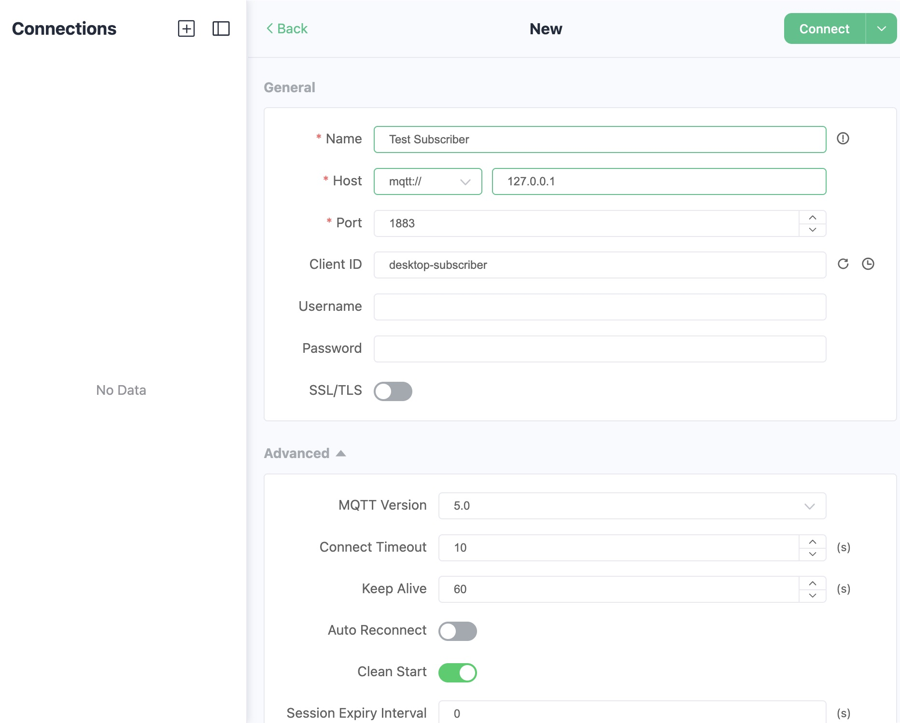
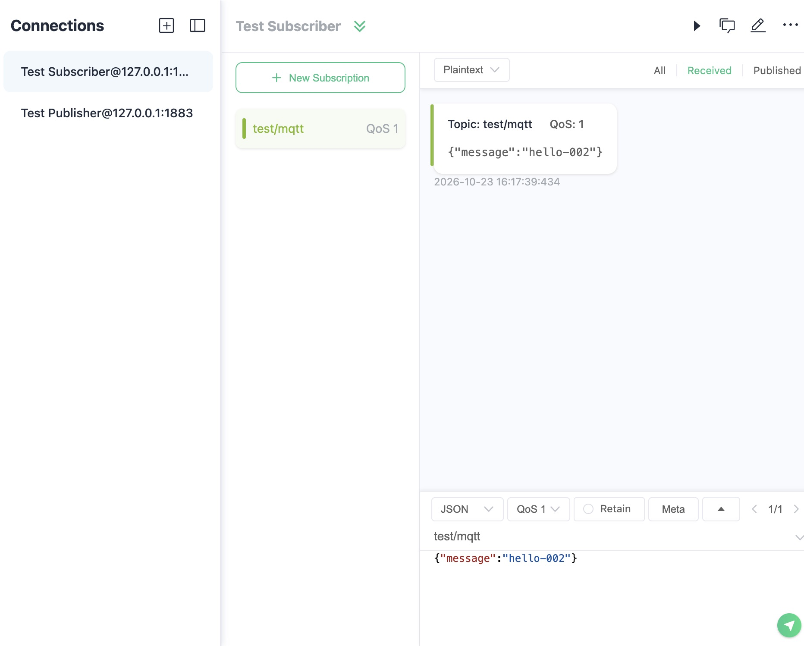

# Test MQTT Connections and Messaging

Use MQTTX CLI, MQTTX Desktop, or a browser client to verify MQTT connections and message delivery. Choose the tool that suits your environment. Connect a subscriber before publishing from a separate client, then check the exact payload at the receiver. These tests help distinguish connection or permission problems from an application's own message handling.

## Prerequisites

Have a running [Quick Start broker](../../get-started/quick-start.md), or a broker address, listener port, credentials, and topic permissions supplied by your operator. The commands below use MQTTX CLI 1.13.0, MQTT 5, and a local broker at `127.0.0.1:1883`. Run them on your computer; in a container, `127.0.0.1` would refer to that container.

Use different Client IDs for the publisher and subscriber. If other users share the broker, add a personal or random suffix to each example Client ID to avoid conflicts. For a secured deployment, add the appropriate credentials and TLS options rather than copying the local connection settings unchanged.

## Test with MQTTX CLI

Install [MQTTX CLI](https://mqttx.app/docs/cli/downloading-and-installation) before running these tests.

### Verify the Connection

1. Run this command on your computer to check the connection before exchanging messages:

   ```bash
   mqttx conn -h 127.0.0.1 -p 1883 -V 5.0 -i cli-connect
   ```

2. Wait until MQTTX reports **Connected**. This result does not verify topic permissions or message delivery. If the connection fails, use the [connection checks](#if-the-message-does-not-arrive).
3. [Optional] If you have EMQX Dashboard access, find Client ID `cli-connect` in **Monitoring** -> **Clients** to confirm that it reached the intended broker.

4. Press Ctrl+C to disconnect this client before continuing with a separate publisher and subscriber.

### Verify Message Delivery

1. In Terminal 1, subscribe and wait until MQTTX reports that the connection and subscription succeed:

   ```bash
   mqttx sub -h 127.0.0.1 -p 1883 -V 5.0 -i cli-subscriber \
     -t test/mqtt -q 1 -v
   ```

2. Keep Terminal 1 running. In Terminal 2, publish a unique payload:

   ```bash
   mqttx pub -h 127.0.0.1 -p 1883 -V 5.0 -i cli-publisher \
     -t test/mqtt -q 1 -m '{"message":"hello-001"}'
   ```

3. Confirm that Terminal 1 shows topic `test/mqtt` and payload `{"message":"hello-001"}`. A successful connection alone does not verify delivery. If no message arrives, use the [client testing checks](#if-the-message-does-not-arrive).
4. Press Ctrl+C in Terminal 1 to stop the subscriber after verification.

These commands do not request session retention or retained publishing, so they do not deliberately leave an offline session or retained value.

## Test with MQTTX Desktop

Install [MQTTX Desktop](https://mqttx.app/). The following steps use MQTTX Desktop v1.13.1 and the local Quick Start broker.

### Connect the Subscriber

1. Select **+** -> **New Connection**.
2. Configure the local test connection:

   | Setting | Value |
   | --- | --- |
   | Name | `Test Subscriber` |
   | Client ID | `desktop-subscriber` |
   | Transport | `mqtt://` |
   | Host | `127.0.0.1`, replacing the default `broker.emqx.io` |
   | Port | `1883` |
   | MQTT Version | `5.0` |
   | SSL/TLS | Off for this loopback test |
   | Auto Reconnect | Off |

   If you changed the MQTT host port, use that port instead. For a secured broker, use its required credentials and TLS settings.

   **Name** identifies the connection in MQTTX. **Client ID** identifies the client to the broker.

   

3. Connect the subscriber and confirm that the connection succeeds.
4. Select **New Subscription**, enter topic `test/mqtt` and QoS 1, then confirm. Wait for the subscription to succeed before publishing.

### Publish and Verify Delivery

1. Create and connect a second connection named `Test Publisher`, with Client ID `desktop-publisher` and the same broker settings.
2. Select the publisher and replace the compose area's topic with `test/mqtt` and payload with `{"message":"hello-002"}`. Set QoS 1, leave Retain off, and send the message.

   Check both values before sending. The compose area can retain a previous topic and payload when you switch connections.

3. Select the subscriber's **Received** tab. Confirm that it shows topic `test/mqtt` and payload `{"message":"hello-002"}`.
4. Disconnect both clients when finished.

   

For connection parameters beyond this local test, see [MQTT Connection Settings](../mqtt/basics.md#mqtt-connection-settings).

## Test with MQTTX Web

Install [MQTTX CLI](https://mqttx.app/docs/cli/downloading-and-installation) on your computer to publish the test message while MQTTX Web acts as the subscriber.

The [MQTTX Web client](https://mqttx.app/web) uses MQTT over WebSocket. The local Quick Start broker uses these ports:

- `1883`: MQTT over TCP for the CLI and Desktop examples.
- `8083`: Unencrypted MQTT over WebSocket, with path `/mqtt`, for browser clients.
- `18083`: The EMQX Dashboard management interface.

The Quick Start Docker command maps only ports `1883` and `18083` to your computer. Before testing with MQTTX Web, also map container port `8083` to a port on your computer, or use an already reachable secure WebSocket listener. See [Docker networking](../../get-started/deploy/install-docker.md) and [listener configuration](../../guides/configuration/listener.md).

If the web page is served over HTTPS, the browser can block an unencrypted `ws://` connection. Use an appropriately configured `wss://` listener with a certificate the browser trusts, or a locally served compatible client. Enabling TLS for TCP does not automatically configure a secure WebSocket listener.

1. Open MQTTX Web and configure a connection with Client ID `web-subscriber`, the broker host, WebSocket transport, listener port, and path. For a locally served client connecting to the unencrypted local listener, use host `127.0.0.1`, port `8083`, and path `/mqtt`. Use the mapped host port if it differs from `8083`.
2. Connect and confirm that the connection succeeds. Subscribe to `test/mqtt` at QoS 1 and wait for the subscription to succeed.
3. Keep the browser client connected. From a separate terminal on your computer, publish to the same local broker through its TCP listener:

   ```bash
   mqttx pub -h 127.0.0.1 -p 1883 -V 5.0 -i web-publisher \
     -t test/mqtt -q 1 -m '{"message":"hello-web-001"}'
   ```

   For another deployment, replace the host and TCP port and supply its required credentials and TLS options. The publisher uses the TCP port, not the browser client's WebSocket port.

4. In MQTTX Web, confirm that the received message has topic `test/mqtt` and payload `{"message":"hello-web-001"}`. A connected status alone does not verify message delivery.
5. Disconnect the browser client when finished.

## Test with the Dashboard WebSocket Client

Before testing with the local Quick Start broker, map WebSocket port `8083` to a host port as described in [Test with MQTTX Web](#test-with-mqttx-web). The Quick Start Docker command maps only ports `1883` and `18083`.

This tool connects from your browser. If the broker runs on a remote server, `localhost` in the tool refers to the browser's computer, not that remote server. The browser must be able to reach the configured listener; Dashboard access alone does not establish that connectivity.

1. Open the EMQX Dashboard and use its [WebSocket client](../../guides/dashboard/diagnose.md#websocket-client). Enter the broker's WebSocket connection settings and connect.
2. Subscribe to `test/mqtt` and wait for the subscription to succeed.
3. From another client connected to the same broker, publish payload `hello-003` to `test/mqtt`. Use a different Client ID for that client.
4. In the Dashboard WebSocket client, confirm that the received message has topic `test/mqtt` and payload `hello-003`.
5. Disconnect the Dashboard WebSocket client and the other test client when finished.

## If the Message Does Not Arrive

| Observation | Check Next |
| --- | --- |
| Connection fails | Host, listener status, port, transport, TLS trust, credentials, and MQTT version. |
| A client disconnects when the other connects | Duplicate Client IDs. Give them distinct IDs. |
| Connection succeeds but subscription fails | Subscribe authorization and the SUBACK reason code. |
| Subscription succeeds but publishing fails | Publish authorization, topic validity, packet size, and the PUBACK reason code. |
| Both succeed but there is no received message | Subscribe before publishing; compare exact topic case and spelling; inspect expiry and filtering. |
| Only the browser client fails | WebSocket port/path, `ws` versus `wss`, certificate trust, browser policy, and network reachability. |

A public test broker is suitable only for disposable, non-sensitive examples. Use your own broker to verify authentication, authorization, retention, and operational settings.

## Next Steps

Continue with [messaging features](../../get-started/messaging/introduction.md), or inspect [MQTT concepts](../../get-started/messaging/mqtt-concepts.md) to understand the result.
