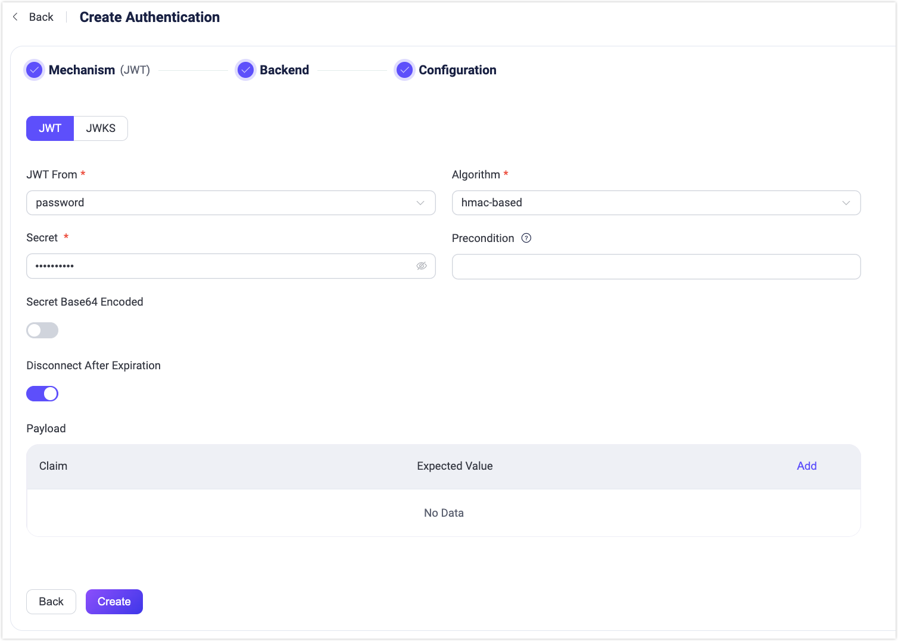
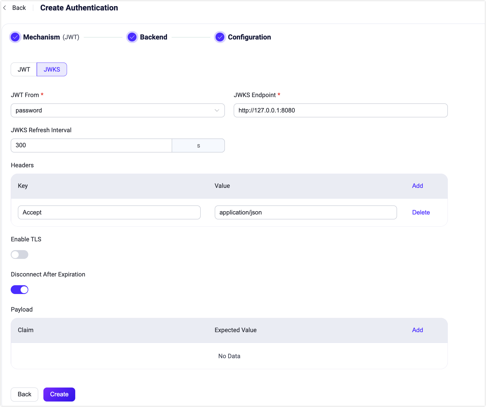

# JWT Authentication

[JSON Web Token (JWT)](https://jwt.io/) is a token-based authentication mechanism. It does not rely on the server to retain client authentication information or session information. EMQX supports using JWT for user authentication.

::: tip Prerequisite

Knowledge about [basic EMQX authentication concepts](./authn.md)

:::

## Authentication Principle

The client carries the JWT in the connection request, and EMQX uses the pre-configured secret or public key to verify the JWT signature. If the user configures a JWKS endpoint, the JWT authenticator will verify the JWT signature using the list of public keys queried from the JWKS endpoint.

If the signature verification is successful, the JWT authenticator proceeds to check the claims. The JWT authenticator actively checks the validity of the JWT based on these claims such as `iat` (Issued At), `nbf` (Not Before), and `exp` (Expiration Time). Additional custom claims can also be specified for verification. The client is granted access only if both the signature and claims verifications are successful.

Starting from EMQX version 5.7.0, JWT authentication includes an option to disconnect clients after their JWT expires. The configuration parameter `disconnect_after_expire` is set to `true` by default. To keep clients connected even after their JWT has expired, you can set this parameter to `false`.

## MQTT 5.0 Enhanced Authentication

The JWT authenticator also works as an MQTT 5.0 [enhanced authentication](https://docs.oasis-open.org/mqtt/mqtt/v5.0/os/mqtt-v5.0-os.html#_Toc3901256) method. This lets a connected client renew an expiring JWT without a reconnect.

- **Connect.** The client sets the `Authentication Method` property of the `CONNECT` packet to `JWT` and puts the token in the `Authentication Data` property. The `Username` and `Password` fields are not used for the token. EMQX validates the token in one round and answers with `CONNACK`. There is no `AUTH` challenge from the broker.
- **Re-authenticate.** The client sends an `AUTH` packet with reason code `0x19` (Re-authentication), `Authentication Method` set to `JWT` and a new token in `Authentication Data`. On success EMQX answers with `AUTH` reason code `0x00`, keeps the session, the subscriptions, the client ID and the username, and applies the new token:
  - The `acl` and `is_superuser` claims of the new token replace the ones of the previous token. When the new token has no `acl` claim, the previous ACL rules are removed.
  - The disconnect deadline follows the `exp` claim of the new token. When the new token has no `exp` claim, the client is no longer disconnected at the deadline of the previous token.
  - The `client_attrs` claim of the new token is ignored. Client attributes are set at connect and hold for the session.
  - A `clientid_override` claim that differs from the current client ID fails the re-authentication. The client is disconnected with reason code `0x87` (Not authorized).
  - The authorization cache of the client is cleared, so the new permissions apply to the next publish or subscribe.
- **Failure.** A re-authentication with an invalid or expired token disconnects the client with reason code `0x87` (Not authorized).

The authentication method is fixed when the client connects. A client that connected with the token in the `Password` or `Username` field cannot switch to `JWT` re-authentication later in the session. It must reconnect to renew the token. A client that connected with the `JWT` method must send a token in `Authentication Data` in every `AUTH` packet; the `on_missing_jwt` setting does not apply to this path.

No extra configuration is needed. A JWT authenticator in the chain handles both the `Password`/`Username` field and the `JWT` enhanced authentication method.

## Best Practice

The JWT authenticator essentially only checks the signature of the JWT, which means that the JWT authenticator does not guarantee the legitimacy of the client's identity.

The best practice is to deploy an independent authentication server. The client first accesses the authentication server, the authentication server verifies the identity of the client, and issues JWT for the legitimate client, and then the client uses the obtained JWT to connect to EMQX.

:::tip

Since the payload in the JWT is only Base64 encoded, anyone who gets the JWT can decode the payload to get the original information by Base64 decoding. Therefore, it is not recommended to store some sensitive data in the payload of JWT.

To reduce the possibility of JWT leakage and theft, it is recommended to set a reasonable validity period and also enable TLS to encrypt client connections.

:::

## Access Control List (Optional)

The Access Control List (ACL) is an optional extension of an authentication result to control the client's permissions after login. The JWT can include an `acl` field to specify the client's permissions.

See [Access Control List (ACL)](./acl.md) for more information.

## Client Attributes

Starting from EMQX v5.7.0, you can use the optional `client_attrs` field in the JWT Payload to set [client attributes](../../../develop/client-attributes/client-attributes.md). Please note that both the keys and values must be of string type.

Example:

```json
{
  "exp": 1654254601,
  "username": "emqx_u",
  "client_attrs": {
      "role": "admin",
      "sn": "10c61f1a1f47"
  }
}
```

## Configure JWT Authentication in Dashboard

1. Select **Access Control** -> **Authentication** from the left navigation menu.

2. On the **Authentication** page, click **Create** in the top right corner. Click to select **JWT** as the **Mechanism**, and click **Next**. Skip the Backend selection and go to the **Configuration** tab.

   

3. Configure the following options:

   - **JWT From**: Determines where the JWT is located in the client connection request. Available options are `password` and `username`, corresponding to the `Password` and `Username` fields in the MQTT `CONNECT` packet for MQTT clients.

   - **Algorithm**: Specify the encryption algorithm of JWT. Optional values ​​are `hmac-based` and `public-key`. Each selection dictates different configuration requirements.

     - `hmac-based`: Uses a symmetric key for both generating and verifying the JWT's signature. Supported algorithms include HS256, HS384, and HS512. Configuration must include:
       - `Secret`: The key used to verify the signature, identical to the one used for signature generation.
       - `Secret Base64 Encode`: Configures whether the `Secret` is Base64 encoded, which determines if EMQX needs to decode the secret during signature verification.

     - `public-key`: Uses a private key to generate the JWT's signature and a public key for verification. Supported algorithms are RS256, RS384, RS512, ES256, ES384, and ES512. Configuration must include:
        - `Public Key`: Specify the public key in PEM format used to verify the signature.

   - **Precondition**: A [Variform expression](../../configuration/configuration.md#variform-expressions) used to control whether this JWT authenticator should be applied to a client connection. The expression is evaluated against attributes from the client (such as `username`, `password`, `clientid`, and `listener`). The authenticator will only be invoked if the expression evaluates to the string "true". Otherwise, it will be skipped. For more information about the precondition, see [Authenticator Preconditions](./authn.md#authenticator-preconditions).

     Example: use `is_jwt(password)` when the same authentication chain serves both JWT clients and password-based clients.

     Starting from EMQX 6.2.3, `is_jwt(password)` returns `true` only when the password is structurally a JWT. Plain passwords, absent passwords, and malformed values return `false`, so EMQX skips the JWT authenticator and lets the next authenticator handle the client. A structurally valid JWT that fails signature or claim verification is still processed by the JWT authenticator and denied.
   - **Disconnect After Expiration**: Configures whether to disconnect clients after their JWT expires, enabled by default.
   - **Payload**: Specify additional claims checks that the user wants to perform. Users can define multiple key-value pairs with the **Claim** and **Expacted Value** fields, where the key is used to find the corresponding claim in the JWT, so it needs to have the same name as the JWT claim to be checked, and the value is used to compare with the actual value of the claim. Currently, the placeholders supported are `${clientid}` and `${username}`.

4. Click **Create** to complete the configuration.


EMQX also supports periodically obtaining the latest JWKS from the JWKS endpoint, which is essentially a set of public keys used to verify any JWT issued by the authorization server and signed using the RSA or ECDSA algorithm. If you want to use this feature, you need to switch to the **JWKS** configuration page.



You need to configure the following JWKS-specific configuration items:

- **JWKS Server**: Specify the server endpoint address for EMQX to query JWKS, the endpoint needs to support GET requests and return a JWKS that conforms to the specification.
- **JWKS Refresh Interval**: Specify the refresh interval of JWKS, that is, the interval for EMQX to query JWKS.
- **Headers**: Specify any additional HTTP headers that must be included in the requests to the JWKS server. Adding these HTTP headers ensures that the requests to the JWKS server are properly formatted according to your server's requirements. This configuration allows users to add key-value pairs, for example:
  - **Key**: `Accept`
  - **Value**: `application/json`

Click **Create** to complete the configuration.

<!-- ## Configure with Configuration Items

You can also configuration items for the configuration. For detailed steps, see [authn-jwt:*](../../configuration/configuration-manual.html#authn-jwt:hmac-based). -->
