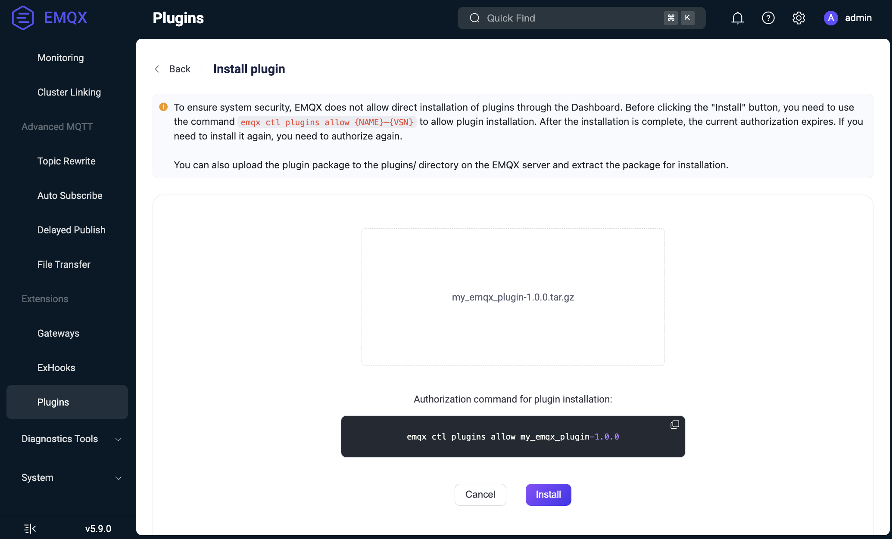

# Manage Plugins

This page explains how to deploy and manage EMQX plugins. You can manage a plugin across the cluster through the Dashboard, CLI, or REST API, or pin a pre-deployed plugin to an individual node.

EMQX supports the following plugin management modes:

- **Cluster-managed plugin**: EMQX distributes the plugin package and configuration to cluster nodes and records its enabled state in `plugins.states`.
- **Node-pinned plugin**: Starting from EMQX 6.1.6, a node can run a pre-deployed plugin independently of the cluster plugin configuration by listing its name and version in `node.pinned_plugins`.

## Plugin Lifecycle

A cluster-managed plugin goes through three main lifecycle states:

- **Installed**: The plugin's code and configuration are loaded, but the application is not yet started.
- **Started**: The plugin is running and actively interacting with EMQX.
- **Uninstalled**: The plugin is completely removed from the system.

### Installation Process

The installation process is as follows:

1. The plugin package (the tarball created by the `make rel` command) is uploaded via the Dashboard, API, or CLI. For detailed installation steps, see [Install and Manage Plugins](#install-and-manage-plugins).
2. The plugin package is transferred to each node of the EMQX cluster.
3. On each node:
   - The tarball is saved in the `plugins` subdirectory in the EMQX root directory (this may be overridden by the `plugins.install_dir` option): `$EMQX_ROOT/plugins/my_emqx_plugin-1.0.0.tar.gz`.
   - It is unpacked into the same directory: `$EMQX_ROOT/plugins/my_emqx_plugin-1.0.0/`.
   - The initial configuration (`config.hocon` from the main plugin's app) is copied into the `$EMQX_DATA_DIR/plugins/my_emqx_plugin/config.hocon` file.
   - The Avro schema is loaded (if present) for validation.
   - The plugin code is loaded into the node, but the application is not started.
   - The plugin is registered as `disabled` in the EMQX config (`plugins.states`).

::: tip

For cluster-managed plugins, only the plugin state (`true` or `false` for the `enable` flag) is stored in the EMQX config. Full plugin configurations reside in the `$EMQX_DATA_DIR/plugins/my_emqx_plugin/config.hocon` file on the nodes.

:::

### Configuration

After installation, plugin configuration can be updated through the Dashboard or API:

- The new configuration is validated against the Avro schema (if present).
- Updates are distributed to nodes that report the same version of the plugin.
- The plugin's `on_config_changed/2` callback function is called. If the plugin accepts the new configuration, it is persisted in the `$EMQX_DATA_DIR/plugins/my_emqx_plugin/config.hocon` file.

::: tip

`on_config_changed/2` callback function is called even if the application is not started.

:::

::: tip

The `on_config_changed/2` callback runs on each node that receives the configuration update. Avoid implementing configuration validation that depends on local system state (e.g., checking network availability), as this can lead to inconsistent results across nodes. Use `on_health_check/1` for runtime checks instead and report an unhealthy status if some resource is not available.

:::

### Config File Locations

There are two relevant config file locations:

- Bundled default file inside the installed plugin package:
  - Docker:
    `/opt/emqx/plugins/my_emqx_plugin-1.0.0/my_emqx_plugin-1.0.0/priv/config.hocon`
  - deb/rpm:
    `/usr/lib/emqx/plugins/my_emqx_plugin-1.0.0/my_emqx_plugin-1.0.0/priv/config.hocon`

- Persisted plugin config file managed by EMQX after config is saved via Dashboard or API:
  - Docker:
    `/opt/emqx/data/plugins/my_emqx_plugin/config.hocon`
  - deb/rpm:
    `/var/lib/emqx/plugins/my_emqx_plugin/config.hocon`

The `priv/config.hocon` file is the packaged default template. The
`data/plugins/.../config.hocon` file is the persisted plugin config location
used after EMQX saves plugin config changes.

### Starting

The plugin is started manually via the Dashboard, API, or CLI. Upon starting:

- The plugin's application is started.
- The plugin is registered as `enabled` in the EMQX config (`plugins.states`).

When the plugin is started and its information is requested, the `on_health_check/1` callback function is called to retrieve the plugin's status.

### Stopping

When the plugin is stopped:

- The plugin's applications are stopped.
- The plugin is registered as `disabled` in the EMQX config (`plugins.states`).

Although the plugin’s application is stopped, its code remains loaded on the node, as a stopped plugin can still be configured.

### Uninstallation Process

The uninstallation process is as follows:

1. The plugin is stopped (if it is running).
2. The plugin's code is unloaded from the node.
3. Its package files are removed from the nodes (the config file is preserved). 
4. The plugin is unregistered in the EMQX config (`plugins.states`).

You can uninstall a plugin package via the Dashboard or CLI. For details, see [Install and Manage Plugins](#install-and-manage-plugins).

### Cluster Join Behavior

When an EMQX node joins the cluster, it may not have the actual plugins installed and configured since the plugins and their configs reside in the local file systems of the nodes.

The new node does the following:

- When a node joins the cluster, it obtains the global EMQX config (as a part of the cluster join process).
- From the EMQX config, it knows plugin statuses (which plugins are installed and which are enabled).
- The new node requests the plugins and their actual configs from other nodes.
- The new node installs plugins and starts the enabled ones.

## Install and Manage Plugins

EMQX supports plugin package installation, uninstallation, and management via the Dashboard, CLI, and API.

### Install Packages via Dashboard

Suppose your plugin is already built and the tarball `my_emqx_plugin-1.0.0.tar.gz` is available. To install a compiled plugin package directly via the Dashboard, follow the steps below:

::: tip Important Security Update

For security reasons, EMQX now requires explicit authorization before plugin installation via the Dashboard.

- Installation permission must be granted before initiating the process.

- The allowed state is temporary and is automatically revoked after installation completes.

- If running in a clustered environment, permission must be granted on all nodes before installation.

  :::

1. Run the following command in the CLI to explicitly allow the plugin installation:

   ```bash
   emqx ctl plugins allow $NAME-$VSN
   ```

   - `{NAME}`: The name of your plugin (e.g., `my_emqx_plugin`).
   - `{VSN}`: The version of the plugin (e.g., `1.0.0`).

   Once this command is executed, you can proceed with the installation through the Dashboard.

2. Navigate to **Management** -> **Plugins** in the EMQX Dashboard. 

3. Click the **+ Install plugin** button to open the Install plugin page.

4. Select or drag the plugin package to upload it to the Dashboard.

   

5. Click the **Install** button to complete the installation. You will see the list of plugins with the new plugin installed.

   

Now you can start/stop the plugin and configure it.To uninstall a plugin package via Dashboard, click the **Uninstall** button under the **More** menu in the **Actions** column on the plugin list page.

To revoke permission for a previously allowed plugin, either:

1. Uninstall the plugin (if already installed).
2. Or explicitly disallow it using the following command:

```bash
emqx ctl plugins disallow $NAME-$VSN
```

### Install Packages via CLI

Suppose your plugin is already built and the tarball `my_emqx_plugin-1.0.0.tar.gz` is available. To install a compiled plugin package directly via the CLI, follow the steps below:

1. On an EMQX node, copy the tarball to the EMQX plugins directory:

   ```
   $ cp my_emqx_plugin-1.0.0.tar.gz $EMQX_HOME/plugins
   ```

2.  Install the plugin:

   ```
   $ emqx ctl plugins install my_emqx_plugin-1.0.0
   ```

   To install the plugin on all running nodes in a cluster, add the `--cluster` flag:

   ```
   $ emqx ctl plugins install my_emqx_plugin-1.0.0 --cluster
   ```

3. Check plugin list:

   ```
   $ emqx ctl plugins list
   ```

4. Start/stop the plugin:

   ```
   $ emqx ctl plugins start my_emqx_plugin-1.0.0
   $ emqx ctl plugins stop my_emqx_plugin-1.0.0
   ```

5. Uninstall the plugin:

   ```
   $ emqx ctl plugins uninstall my_emqx_plugin-1.0.0
   ```

### Install Packages via API

Suppose your plugin is already built and the tarball `my_emqx_plugin-1.0.0.tar.gz` is available. To install a plugin using the API, follow these steps:

1. Allow the installation. To enable the installation of the plugin, run the following command:

   ```
   emqx ctl plugins allow my_emqx_plugin-1.0.0
   ```

2. Install the plugin. Use `curl` to install the plugin by sending a POST request to the API:

   ```
   $ curl -u $KEY:$SECRET -X POST http://$EMQX_HOST:18083/api/v5/plugins/install -H "Content-Type: multipart/form-data" -F "plugin=@my_emqx_plugin-1.0.0.tar.gz"
   ```

3. Check the plugin list. To verify if the plugin has been installed successfully, run:

   ```
   $ curl -u $KEY:$SECRET http://$EMQX_HOST:18083/api/v5/plugins | jq
   ```

4. Start/stop the plugin. To start or stop the plugin, use the following commands:

   ```
   $ curl -s -u $KEY:$SECRET -X PUT "http://$EMQX_HOST:18083/api/v5/plugins/my_emqx_plugin-1.0.0/start"
   $ curl -s -u $KEY:$SECRET -X PUT "http://$EMQX_HOST:18083/api/v5/plugins/my_emqx_plugin-1.0.0/stop"
   ```

### Pre-Install Plugins Before EMQX Starts

If you want a plugin to be available immediately when EMQX starts, for example, when building a custom Docker image, you can pre-install the plugin by extracting the package and configuring EMQX in advance.

Choose one of the following modes:

- Pre-install a cluster-managed plugin if every node should follow `plugins.states` and participate in cluster-wide lifecycle operations.
- Pin the plugin to a node if the plugin is part of that node's deployment artifact and must run independently of the cluster plugin configuration.

#### Pre-Install a Cluster-Managed Plugin

The following steps use a Dockerfile as an example, but the same approach applies to any deployment method, including deb/rpm and bare-metal deployments:

1. Copy and extract the plugin tarball into the plugins directory:

   ```dockerfile
   COPY --chown=emqx:emqx my_emqx_plugin-1.0.0.tar.gz /opt/emqx/plugins/my_emqx_plugin-1.0.0.tar.gz

   RUN cd /opt/emqx/plugins && \
       mkdir -p my_emqx_plugin-1.0.0 && \
       tar zxf my_emqx_plugin-1.0.0.tar.gz -C my_emqx_plugin-1.0.0
   ```

2. Register the plugin in EMQX configuration so it is started automatically on boot. Append the following to the EMQX base config file:

   ```dockerfile
   RUN cat <<EOF >> /opt/emqx/etc/base.hocon
   plugins {
       states = [
           {
               name_vsn = "my_emqx_plugin-1.0.0"
               enable = true
           }
       ]
   }
   EOF
   ```

   Set `enable = true` to start the plugin automatically, or `enable = false` to install it without starting.

#### Run a Plugin Independently on a Node

Starting from EMQX 6.1.6, you can pin a pre-deployed plugin to an individual node. This mode is useful when a plugin is built into a container image or another node-specific deployment artifact.

1. Extract the plugin package into `<plugins.install_dir>`. Before EMQX starts, the extracted files must be located in `<plugins.install_dir>/<name-vsn>`, with `release.json` directly inside that directory. For example:

   ```dockerfile
   COPY --chown=emqx:emqx my_emqx_plugin-1.0.0.tar.gz /tmp/my_emqx_plugin-1.0.0.tar.gz

   RUN mkdir -p /opt/emqx/plugins && \
       tar zxf /tmp/my_emqx_plugin-1.0.0.tar.gz \
       -C /opt/emqx/plugins
   ```

2. Add the plugin name and version to the read-only `node.pinned_plugins` setting. For a container image, set the corresponding environment variable:

   ```dockerfile
   ENV EMQX_NODE__PINNED_PLUGINS="my_emqx_plugin-1.0.0"
   ```

   For other deployment methods, set the value in `emqx.conf`:

   ```hocon
   node.pinned_plugins = ["my_emqx_plugin-1.0.0"]
   ```

   You can list multiple plugins. Each entry must be a valid `<name-vsn>` identifier, and the list cannot contain two versions of the same plugin name. EMQX starts the plugins in the configured order before starting the plugins in `plugins.states`. To change the list, update the node configuration and restart the node. Cluster joins, API calls, and configuration imports cannot change this setting.

A node-pinned plugin has the following operational behavior:

- EMQX runs the plugin directly from the extracted directory. During a cluster join, EMQX neither distributes the plugin package nor synchronizes its stored configuration between nodes.
- The plugin is always enabled and does not require a `plugins.states` entry, an `emqx ctl plugins allow` grant, or an installation command. Entries in `plugins.states` with the same plugin name do not control it, regardless of the version specified in the entry.
- EMQX builds the initial configuration from the package's `priv/config.hocon` and, if present, deep-merges `etc/plugins/<name>.hocon` into it. After you save the configuration through the Dashboard or API, EMQX uses `data/plugins/<name>/config.hocon` as the complete configuration. Configuration changes apply only to nodes that report the same plugin version.
- Use `emqx ctl plugins start|stop|restart <name-vsn>` to manage the plugin on the node that pins it. A node-pinned plugin stopped through the CLI remains stopped until the node starts all plugins again, such as after a node restart or cluster join.
- The Dashboard and REST API can update the plugin configuration but cannot manage the lifecycle of a pinned instance. A lifecycle request returns HTTP `409` with the error code `PLUGIN_PINNED` in either of the following cases:
  - The node handling the request has a plugin with the same name configured in `node.pinned_plugins`.
  - Every node that reports the requested plugin version has that version configured as a node-pinned plugin.

  If another node runs the same plugin version as a cluster-managed plugin, cluster-wide operations initiated through that node affect only the cluster-managed instances.
- If the plugin directory is missing or the plugin fails to start, EMQX raises the `pinned_plugin_unavailable:<name-vsn>` alarm and continues starting the node. A later successful start clears the alarm.

## Upgrade Plugins

To upgrade a cluster-managed plugin:

- The old version must first be uninstalled.
- The new version is then installed.

The plugin configuration is preserved across installations.

Starting from EMQX 6.1.6, different nodes in a cluster can pin different versions of the same plugin. If a node lists a plugin version in `node.pinned_plugins`, EMQX runs only that pinned version and ignores `plugins.states` entries for every version of the same plugin. Plugin authors must ensure that these versions remain compatible with respect to shared database tables, cross-node RPC, and plugin configuration formats.

<!-- **Note**: (EMQX enterprise) Plugins need to be reinstalled after hot upgrades. -->
