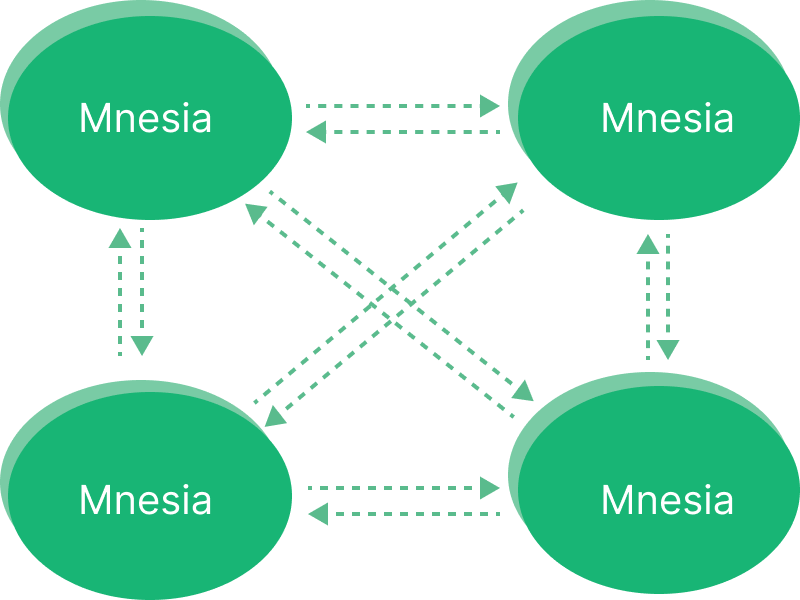
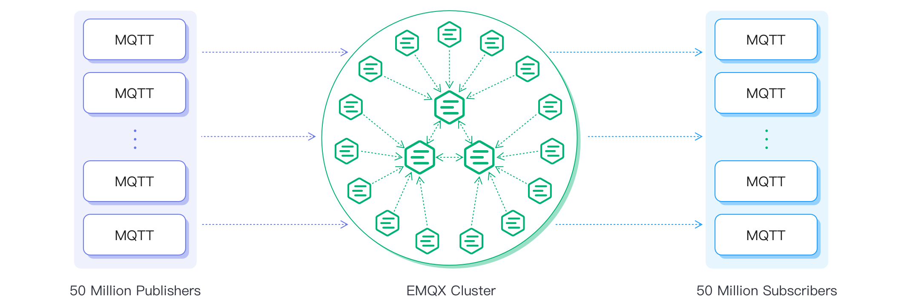
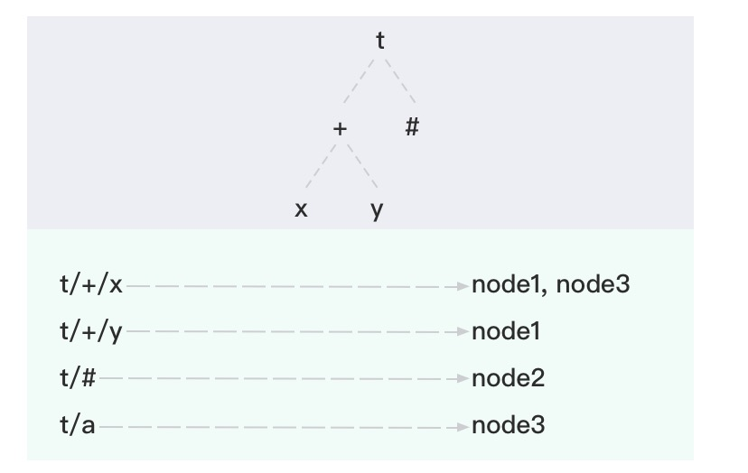

# EMQX クラスタリング

EMQX クラスタリングとは、複数の EMQX ノードが連携して統一されたシステムとして動作するデプロイメントを指します。これらのノードはクライアントセッション、トピックのサブスクリプション、およびルーティング情報を自動的に共有し、シームレスなメッセージ配信と水平スケーラビリティを実現します。

::: tip 注意

クラスタリング機能はトライアル期間中に利用可能です。トライアル終了後は商用ライセンスが必要であり、ライセンスがない場合は機能が無効になります。

:::

本章では、[クラスタリングの利点](#why-use-emqx-clustering)、新しい[Mria と RLOG](./mria-introduction.md)アーキテクチャ、[クラスタの手動および自動作成方法](../../guides/cluster/create-cluster.md)、[ロードバランシングの実装方法](../../guides/cluster/lb.md)、およびクラスタ内の[通信セキュリティの確保方法](../../guides/cluster/security.md)について紹介します。

このアーキテクチャは、MQTT を基盤とした大規模かつミッションクリティカルな IoT およびメッセージングプラットフォームに最適です。

## 章のプレビュー

本章では、EMQX クラスタリングの包括的な概要と実際のデプロイメントへの適用方法を解説します。以下の内容を学べます：

- [クラスタリングの利点](#why-use-emqx-clustering)
- [EMQX クラスタリングの動作原理](#how-clustering-in-emqx-works)
- [Mria と RLOG アーキテクチャ](./mria-introduction.md)
- [クラスタの手動および自動作成方法](../../guides/cluster/create-cluster.md)
- [ノード間通信のセキュリティ確保方法](../../guides/cluster/security.md)
- [ロードバランシングの実装方法](../../guides/cluster/lb.md)
- [クラスタ負荷のリバランスとノードの退避方法](../../guides/cluster/rebalancing.md)
- [システムチューニングおよびパフォーマンステストの実施方法](../../guides/performance/overview.md)

高可用性の MQTT プラットフォーム構築や本番規模への準備に役立つガイドです。

## なぜ EMQX クラスタリングを使うのか

EMQX クラスタリングは、信頼性、スケーラビリティ、パフォーマンスを要求される大規模かつミッションクリティカルなアプリケーション向けに設計されています。主な利点は以下の通りです：

- **スケーラビリティ**：ノードを追加することで容易にデプロイメントを拡張でき、増加する MQTT クライアントやメッセージをサービス停止なく処理可能です。
- **高可用性**：分散アーキテクチャにより単一障害点がなく、1つ以上のノードがオフラインになってもシステムは継続稼働します。
- **ロードバランシング**：MQTT トラフィックとクライアントセッションをノード間で分散し、ボトルネックを防ぎハードウェア利用率を最大化します。
- **集中管理**：すべてのノードを単一のダッシュボードまたは API エンドポイントから管理・監視でき、運用と保守を簡素化します。
- **データの一貫性とセキュリティ**：セッションおよびルーティング状態がノード間で自動的に複製され、一貫性を保ちつつクラスタ全体で安全な通信を維持します。

## EMQX クラスタリングの動作原理

EMQX クラスターは複数のノードで構成され、各ノードは EMQX のインスタンスを実行しています。これらのノードは連携してメッセージのルーティング、MQTT セッションの管理、高可用性とスケーラビリティを実現します。各ノードは他のノードと通信し、クライアントのサブスクリプションやルーティング情報を共有することで、どのノードにクライアントが接続していてもメッセージが該当するサブスクライバーに届くようにします。

この分散設計により、EMQX はミッションクリティカルなメッセージングシステムを最小限のダウンタイムで柔軟に拡張可能です。

### クラスタアーキテクチャの進化

#### EMQX 5.0 以前：Mnesia ベースのクラスタリング

初期の EMQX バージョンは Erlang/OTP の組み込みデータベース Mnesia とフルメッシュトポロジーを利用していました。各ノードは Erlang 分散プロトコル（デフォルトポート：4370）を使い、すべての他ノードと直接 TCP 接続を維持し、密結合のシステムを形成していました。



しかし、このモデルには以下の制約がありました：

- クラスタサイズの増加に伴う高い同期オーバーヘッド
- 5ノード以上のクラスタでの不安定性リスク
- スケーラビリティの限界（主に垂直スケールで対応）

> EMQX 4.3 はベンチマークテストで1000万同時接続を達成しましたが、これは高度なチューニングと高性能ハードウェアを必要としました。詳細は[パフォーマンスレポート](https://www.emqx.com/en/resources/emqx-v-4-3-0-ten-million-connections-performance-test-report)を参照してください。

#### EMQX 5.0 以降：Mria + RLOG

バージョン 5.0 からは、新しい[Mria クラスタアーキテクチャ](./mria-introduction.md)を導入し、より大規模かつ安定したクラスタをサポートしています。

主な変更点は以下の通りです：

- **Core ノードと Replicant ノードの役割分担**：Core ノードは書き込みと完全なデータ複製を担当し、Replicant ノードは読み取り専用でクライアントセッションを処理します。
- **Replication Log（RLOG）**：Core から Replicant への非同期かつ高スループットなデータ複製を可能にします。
- **スケーラビリティ**：クラスタあたり最大1億 MQTT 接続をサポートします。



::: tip 注意

厳密な上限はありませんが、EMQX オープンソース版ではクラスタサイズを3ノードに制限することを推奨します。Core タイプのノードのみで構成した小規模クラスタの方が一般的に安定性が高いです。

:::

このアーキテクチャを支えるために、EMQX は Erlang/OTP とルーティング・配信のための内部データ構造群を利用しています。以下のセクションでは、[Erlang/OTP の基盤](#erlang/otp-foundation)と[クラスタデータ構造](#cluster-data-structures)について説明し、これらがクラスタ内でどのように動作するかを解説します。

### Erlang/OTP の基盤

EMQX は分散型通信システム構築向けに設計されたランタイム兼フレームワークである[Erlang/OTP](https://www.erlang.org/)上に構築されています。Erlang では各ランタイムインスタンスを**ノード**と呼び、`<name>@<host>`形式の名前（例：`emqx1@192.168.0.10`）で識別します。

Erlang ノードは TCP 経由で接続し、軽量なメッセージパッシングで通信します。これが EMQX クラスタリングの基盤です。すべてのノードは同一の cookie を用いて認証を行い、接続が確立・認証されると自動的にクラスタに参加します。EMQX 5.x 以降では、ノードの役割（Core または Replicant）がデータ複製やルーティングへの参加方法を決定します。

### クラスタデータ構造

分散クラスタ内で効率的にメッセージをルーティングするため、EMQX はサブスクリプションテーブル、ルーティングテーブル、トピックツリーという3つの主要な内部データ構造を使用します。これらは連携して、クライアントが多数のノードに分散していてもメッセージが正しくサブスクライバーにマッチングされるようにします。

#### サブスクリプションテーブル（パーティション化）

各 EMQX ノードはローカルのサブスクリプションテーブルを保持し、そのノードに直接接続しているクライアントの MQTT トピックを管理します。データはパーティション化されており、各ノードは自身のクライアントのサブスクリプションのみを保存するため、オーバーヘッドが低減されスケーラビリティが向上します。

メッセージがノードにルーティングされると、そのノードはサブスクリプションテーブルを参照してローカルクライアントのうちどのクライアントにメッセージを配信すべきかを決定します。

例：

```
node1:
    topic1 -> client1, client2
    topic2 -> client3

node2:
    topic1 -> client4
```

この例では同じトピック（`topic1`）に複数ノードでサブスクライバーが存在し、各ノードは独自のローカルマッピングを管理しています。

#### ルーティングテーブル（Core から複製）

ルーティングテーブルは、どのノードがどのトピックにサブスクライブしているかを追跡します。EMQX 5.x ではこのテーブルは Core ノードのみが管理・複製し、Replicant ノードは RLOG 機構を通じて読み取り専用コピーを受け取ります。

クライアントが任意のノード（通常は Replicant）でトピックをサブスクライブすると、そのサブスクリプションイベントは Core ノードに転送され、クラスタ全体のルーティングテーブルが更新・複製されます。

例：

```
topic1 -> node1, node2
topic2 -> node3
topic3 -> node2, node4
```

#### トピックツリー（Core から複製）

トピックツリーは階層構造で、パブリッシュされたトピックとサブスクリプションパターン（[MQTT ワイルドカード](../../get-started/mqtt-basics.md#mqtt-topics-and-wildcards)の`+`や`#`を含む）をマッチングするために使用されます。これにより複雑なトピックフィルターを高速に解決できます。

ルーティングテーブル同様、トピックツリーも Core ノードで複製され、Replicant ノードと共有されます。新しいサブスクリプション（例：`client1`が`t/+/x`をサブスクライブ）を受け取ると、トピックツリーはすべてのノードで更新されます。更新は Core ノードが処理し複製されます。

トピックとサブスクリプションの例：

| クライアント | ノード | サブスクライブトピック |
| ------------ | ------ | ----------------------- |
| client1      | node1  | t/+/x, t/+/y            |
| client2      | node2  | t/#                     |
| client3      | node3  | t/+/x, t/a              |

これらのサブスクリプションが登録された後、EMQX は以下のトピックツリーとルーティングテーブルを構築します：



#### メッセージ配信フロー

MQTT クライアントがメッセージをパブリッシュすると、そのクライアントが接続しているノード（Core または Replicant）はトピックツリーを使ってメッセージのトピックをすべてのサブスクリプションパターンと照合します。次にルーティングテーブルを参照し、マッチするサブスクライバーが存在するノードを特定してメッセージを転送します（複数ノードに転送される場合もあります）。受信した各ノードはローカルのサブスクリプションテーブルを参照し、該当するサブスクライバーにメッセージを配信します。

例えば、**Client 1** がトピック `t/a` にメッセージをパブリッシュした場合のノード間のルーティングと配信は以下の通りです：

1. **Client 1** は **Node 1** に接続し、トピック `t/a` でメッセージをパブリッシュします。

2. **Node 1** はトピックツリーを参照し、`t/a` が既存のサブスクリプションパターン `t/a` と `t/#` にマッチすることを確認します。

3. **Node 1** はルーティングテーブルを参照し、以下を特定します：

   - **Node 2** は `t/#` にサブスクライブしているクライアントがいる
   - **Node 3** は `t/a` にサブスクライブしているクライアントがいる

   そのため、メッセージを **Node 2** と **Node 3** の両方に転送します。

4. **Node 2** はメッセージを受信し、ローカルのサブスクリプションテーブルを参照して `t/#` にサブスクライブしているクライアントにメッセージを配信します。

5. **Node 3** はメッセージを受信し、ローカルのサブスクリプションテーブルを参照して `t/a` にサブスクライブしているクライアントにメッセージを配信します。

6. メッセージ配信プロセスが完了します。

EMQX クラスタリングの動作をより深く理解するには、[EMQX クラスタリングの設計](../design/clustering.md)を参照してください。

## クラスタリング機能の概要

EMQX は、ネイティブの Erlang 分散システムを拡張する[Ekka](https://github.com/emqx/ekka)ライブラリを活用し、高度なクラスタリング機能を提供しています。この抽象化により、ノードの自動検出、動的クラスタ形成、ネットワークパーティションの処理、ノードのクリーンアップなどの主要機能が実現されています。

### ノード検出と自動クラスタリング

EMQX は複数のノード検出メカニズムをサポートし、多様なデプロイ環境でクラスタを自動形成できます：

| 戦略       | 説明                               |
| ---------- | ---------------------------------- |
| `manual`   | コマンドによる手動クラスタ作成       |
| `static`   | 静的ノードリストによる自動クラスタ形成 |
| `DNS`      | DNS の A レコードおよび SRV レコードによる自動クラスタ形成 |
| `etcd`     | etcd を利用した自動クラスタ形成       |
| `k8s`      | Kubernetes による自動クラスタ形成    |

詳細は[クラスタの作成と管理](../../guides/cluster/create-cluster.md)を参照してください。

### ネットワークパーティションの自動回復

ネットワークパーティションの自動回復は、EMQX がネットワーク分断から手動介入なしに自動復旧する機能であり、ダウンタイムが許されないミッションクリティカルな用途で有用です。

この機能は `cluster.autoheal` 設定で制御され、デフォルトで有効です。

```bash
cluster.autoheal = true
```

有効時、EMQX はクラスタ内ノード間の接続状態を継続的に監視します。ネットワークパーティションが検出されると、影響を受けたノードを分離し、残りのノードで稼働を継続します。パーティションが解消されると、分離されたノードを自動的にクラスタに再統合します。

パーティション検出と復旧時に生成されるログメッセージやアラームについては、[Mria ログとアラーム](../../guides/observability/mria-alarms.md)を参照してください。

### クラスタノードの自動クリーンアップ

クラスタノードの自動クリーンアップ機能は、切断されたノードを設定された時間経過後に自動的にクラスタから削除します。この機能によりクラスタの効率的な運用が維持され、時間経過によるパフォーマンス低下を防止します。

デフォルトで有効であり、`cluster.autoclean` 設定で制御されます（デフォルト値：`24h`）。

```bash
cluster.autoclean = 24h
```

### ノード間のセッション共有

EMQX はノード間のセッションパーシステンスをサポートし、クライアントが一時的に切断してもセッションとサブスクリプションを保持します。

この機能を有効にするには：

- **MQTT 3.x クライアント**：`clean_start = false` を設定
- **MQTT 5.0 クライアント**：`clean_start = false` および `session_expiry_interval > 0` を設定

これにより、クライアントが切断しても Client ID に紐づく以前のセッションデータが保持され、再接続時にセッションが再開され、切断期間中にキューイングされたメッセージが配信され、サブスクリプションも維持されます。

## ネットワーク要件

EMQX クラスタの最適なパフォーマンスを確保するため、ネットワークのレイテンシは10ミリ秒未満であることが望ましいです。レイテンシが100ミリ秒を超える場合、クラスタは利用できなくなります。

Core ノードは同一プライベートネットワーク内に配置する必要があります。Mria+RLOG モードでは、Replicant ノードも同一プライベートネットワーク内に配置することが推奨されます。

## 次のステップ：EMQX クラスタの作成

以下のセクションを続けて読み、EMQX クラスタの作成方法を学べます：

- [クラスタアーキテクチャ](./mria-introduction.md)
- [クラスタの作成](../../guides/cluster/create-cluster.md)
- [クラスタセキュリティ](../../guides/cluster/security.md)
