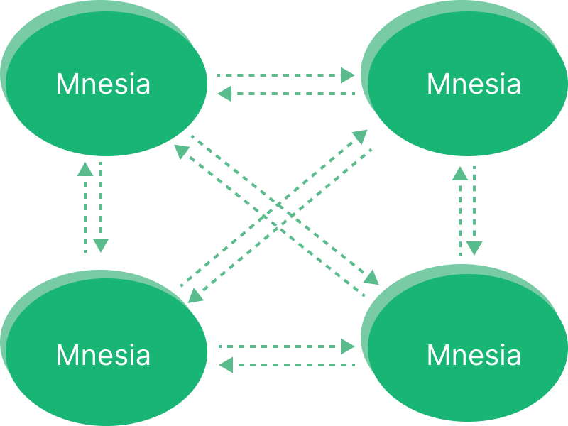
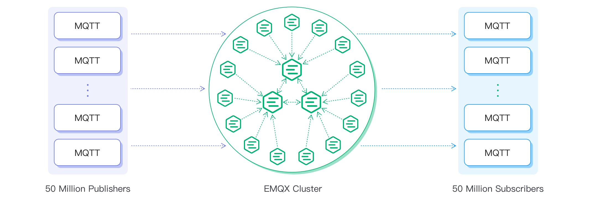
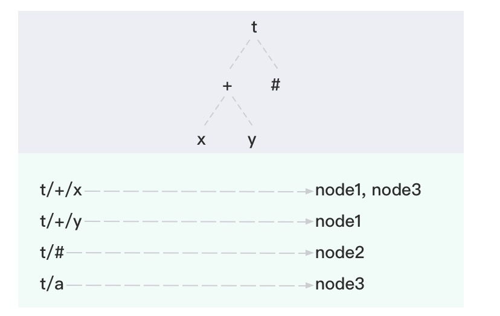

# EMQX クラスタリング

EMQX クラスタリングとは、複数の EMQX ノードを統合されたシステムとして連携させて展開することを指します。これらのノードはクライアントのセッション、トピックのサブスクリプション、およびルーティング情報を自動的に共有し、シームレスなメッセージ配信と水平スケーラビリティを実現します。

::: tip 注意

クラスタリング機能はトライアル期間中に利用可能です。トライアル終了後は商用ライセンスが必要であり、ライセンスがない場合は機能が無効になります。

:::

本章では、[クラスタリングの利点](#why-use-emqx-clustering)、新しい[Mria と RLOG](./mria-introduction.md)アーキテクチャ、[クラスタの手動・自動作成方法](../../guides/cluster/create-cluster.md)、[ロードバランシングの実装方法](../../guides/cluster/lb.md)、およびクラスタ内の[通信セキュリティの確保方法](../../guides/cluster/security.md)について紹介します。

このアーキテクチャは、MQTT を基盤とした大規模かつミッションクリティカルな IoT およびメッセージングプラットフォームに最適です。

## 章のプレビュー

本章では、EMQX クラスタリングの包括的な概要と実際のデプロイメントへの適用方法を解説します。以下の内容を学べます：

- [クラスタリングの利点](#why-use-emqx-clustering)
- [EMQX クラスタリングの動作原理](#how-clustering-in-emqx-works)
- [Mria と RLOG アーキテクチャ](./mria-introduction.md)
- [クラスタの手動・自動作成方法](../../guides/cluster/create-cluster.md)
- [ノード間通信のセキュリティ確保方法](../../guides/cluster/security.md)
- [ロードバランシングの実装方法](../../guides/cluster/lb.md)
- [クラスタ負荷のリバランスおよびノードの退避方法](../../guides/cluster/rebalancing.md)
- [システムチューニングとパフォーマンステストの実施方法](../../guides/performance/overview.md)

高可用性の MQTT プラットフォーム構築や本番規模への準備に役立つガイドです。

## なぜ EMQX クラスタリングを使うのか

EMQX クラスタリングは、信頼性、スケーラビリティ、およびパフォーマンスを求める大規模かつミッションクリティカルなアプリケーション向けに設計されています。主な利点は以下の通りです：

- **スケーラビリティ**：ノードを追加することで容易に展開を拡張でき、増加する MQTT クライアントやメッセージ数をサービス停止なく処理可能です。
- **高可用性**：分散アーキテクチャにより単一障害点がなく、1つ以上のノードがオフラインになってもシステムは継続稼働します。
- **ロードバランシング**：MQTT トラフィックやクライアントセッションをノード間で分散し、ボトルネックの防止とハードウェア利用率の最大化を図ります。
- **集中管理**：すべてのノードを単一のダッシュボードや API エンドポイントから管理・監視でき、運用・保守を簡素化します。
- **データ整合性とセキュリティ**：セッションやルーティング状態はノード間で自動的に複製され、一貫性を保ちつつクラスタ全体で安全な通信を維持します。

## EMQX クラスタリングの動作原理

EMQX クラスターは複数のノードで構成され、それぞれが EMQX インスタンスを実行しています。これらのノードは連携してメッセージのルーティング、MQTT セッションの管理、高可用性とスケーラビリティを実現します。各ノードは他のノードと通信し、クライアントのサブスクリプションやルーティング情報を共有することで、どのノードに接続されたクライアントにもメッセージが確実に届くようにします。

この分散設計により、EMQX は最小限のダウンタイムでミッションクリティカルなメッセージングシステムをサポートし、柔軟な拡張が可能です。

### クラスタアーキテクチャの進化

#### EMQX 5.0 以前：Mnesia ベースのクラスタリング

初期の EMQX は Erlang/OTP に組み込まれた Mnesia データベースとフルメッシュトポロジーを利用していました。各ノードは Erlang 分散プロトコル（デフォルトポート：4370）を使い、すべての他ノードと直接 TCP 接続を維持し、密結合のシステムを形成していました。



しかし、このモデルには以下の制約がありました：

- クラスタサイズの増加に伴う高い同期オーバーヘッド
- 5ノード以上のクラスタでの不安定化リスク
- 垂直スケーリングでしか対応できない限定的なスケーラビリティ

> EMQX 4.3 はベンチマークテストで 1,000万同時接続を達成しましたが、これは大幅なチューニングと高性能ハードウェアを必要としました。詳細は[パフォーマンスレポート](https://www.emqx.com/en/resources/emqx-v-4-3-0-ten-million-connections-performance-test-report)を参照してください。

#### EMQX 5.0 以降：Mria + RLOG

バージョン 5.0 からは新しい[Mria クラスタアーキテクチャ](./mria-introduction.md)が導入され、より大規模かつ安定したクラスタをサポートしています。

主な変更点は以下の通りです：

- **Core と Replicant の役割分担**：Core ノードは書き込みと完全なデータ複製を担当し、Replicant ノードは読み取り専用でクライアントセッションを処理します。
- **レプリケーションログ（RLOG）**：Core から Replicant への非同期かつ高スループットなデータ複製を可能にします。
- **スケーラビリティ**：1クラスタあたり最大 1億 MQTT 接続をサポートします。



::: tip 注意

明確な上限はありませんが、EMQX オープンソース版ではクラスタサイズを3ノードに制限することを推奨します。Core タイプのノードのみで構成した小規模クラスタの方が安定性が高い傾向にあります。

:::

このアーキテクチャを支えるため、EMQX は Erlang/OTP とルーティング・配信のための内部データ構造群を利用しています。[Erlang/OTP 基盤](#erlang/otp-foundation)および[クラスタデータ構造](#cluster-data-structures)の節で、ランタイム基盤とこれらの構造の動作を解説します。

### Erlang/OTP 基盤

EMQX は分散型通信システム構築のために設計されたランタイムおよびフレームワークである[Erlang/OTP](https://www.erlang.org/)上に構築されています。Erlang では各ランタイムインスタンスを**ノード**と呼び、`<name>@<host>`形式の名前で識別します。例：`emqx1@192.168.0.10`。

Erlang ノードは TCP 経由で接続し、軽量なメッセージパッシングで通信します。これが EMQX クラスタリングの基盤となります。各ノードは認証用に同じクッキーを使用する必要があります。接続と認証が完了すると、ノードは自動的に EMQX クラスタに参加できます。EMQX 5.x 以降では、ノードの役割（Core または Replicant）がデータ複製やルーティングへの参加方法を決定します。

### クラスタデータ構造

分散クラスタ内で効率的にメッセージをルーティングするため、EMQX はサブスクリプションテーブル、ルーティングテーブル、トピックツリーという3つの主要な内部データ構造を使用します。これらは連携して、クライアントが多数のノードに分散していてもメッセージを正確にサブスクライバーに届けます。

#### サブスクリプションテーブル（パーティション化）

各 EMQX ノードはローカルのサブスクリプションテーブルを保持し、そのノードに直接接続されたクライアントの MQTT トピックをマッピングします。データはパーティション化されており、各ノードは自ノードのクライアントのサブスクリプションのみを保持するため、オーバーヘッドが減りスケーラビリティが向上します。

メッセージがノードにルーティングされると、そのノードはサブスクリプションテーブルを参照してローカルクライアントへの配信先を決定します。

例：

```
node1:
    topic1 -> client1, client2
    topic2 -> client3

node2:
    topic1 -> client4
```

この例は同じトピック（`topic1`）に複数ノードでサブスクライバーが存在し、各ノードが独立してローカルマッピングを管理していることを示しています。

#### ルーティングテーブル（Core から複製）

ルーティングテーブルは、どのトピックがどのノードでサブスクライブされているかを追跡します。EMQX 5.x ではこのテーブルは Core ノードのみが管理・複製し、Replicant ノードは RLOG 機構を通じて読み取り専用コピーを受け取ります。

クライアントが任意のノード（通常は Replicant）でトピックをサブスクライブすると、そのイベントは Core ノードに転送され、クラスタ全体のルーティングテーブルが更新・複製されます。

例：

```
topic1 -> node1, node2
topic2 -> node3
topic3 -> node2, node4
```

#### トピックツリー（Core から複製）

トピックツリーは階層構造で、パブリッシュされたトピックとサブスクリプションパターン（[MQTT ワイルドカード](../../get-started/mqtt-basics.md#mqtt-topics-and-wildcards)の `+` と `#` を含む）を照合するために使用されます。これにより、複雑なトピックフィルターを高速に解決できます。

ルーティングテーブル同様、トピックツリーも Core ノードで複製され Replicant ノードと共有されます。新しいサブスクリプション（例：`client1` が `t/+/x` をサブスクライブ）を受けると、トピックツリーは全ノードで更新されます。更新は Core ノードで処理され複製されます。

トピックとサブスクリプションの例：

| クライアント | ノード  | サブスクライブトピック  |
| ------------ | ------- | ----------------------- |
| client1      | node1   | t/+/x, t/+/y            |
| client2      | node2   | t/#                     |
| client3      | node3   | t/+/x, t/a              |

これらのサブスクリプションを元に、EMQX は以下のトピックツリーとルーティングテーブルを構築します。



#### メッセージ配信フロー

MQTT クライアントがメッセージをパブリッシュすると、接続先ノード（Core または Replicant）はトピックツリーを使ってメッセージトピックとすべてのサブスクリプションパターンを照合します。次にルーティングテーブルを参照し、該当するサブスクライバーが存在するノードにメッセージを転送します（複数ノードに送信される場合もあります）。受信した各ノードはローカルのサブスクリプションテーブルを参照し、該当クライアントにメッセージを配信します。

例として、**Client 1** がトピック `t/a` にメッセージをパブリッシュした場合のノード間のルーティングと配信の流れは以下の通りです：

1. **Client 1** は **Node 1** に接続し、トピック `t/a` のメッセージをパブリッシュします。

2. **Node 1** はトピックツリーを確認し、`t/a` が既存のサブスクリプションパターン `t/a` と `t/#` にマッチすることを検出します。

3. **Node 1** はルーティングテーブルを参照し、以下を判定します：

   - **Node 2** は `t/#` をサブスクライブするクライアントがいる
   - **Node 3** は `t/a` をサブスクライブするクライアントがいる

   したがって、メッセージを **Node 2** と **Node 3** の両方に転送します。

4. **Node 2** はメッセージを受信し、ローカルのサブスクリプションテーブルを参照して `t/#` をサブスクライブするクライアントに配信します。

5. **Node 3** はメッセージを受信し、ローカルのサブスクリプションテーブルを参照して `t/a` をサブスクライブするクライアントに配信します。

6. メッセージ配信処理は完了します。

EMQX クラスタリングの動作をより深く理解するには、[EMQX クラスタリングの設計](../design/clustering.md)もご覧ください。

## クラスタリング機能の概要

EMQX はネイティブの Erlang 分散システムを拡張した [Ekka](https://github.com/emqx/ekka) ライブラリにより強化された高度なクラスタリング機能を提供します。この抽象化により、自動ノード検出、動的クラスタ形成、ネットワークパーティション処理、ノードのクリーンアップなどの主要機能が実現されています。

### ノード検出と自動クラスタリング

EMQX は複数のノード検出メカニズムをサポートし、多様な展開環境で自動的にクラスタを形成できます：

| 戦略       | 説明                                   |
| ---------- | -------------------------------------- |
| `manual`   | コマンドで手動クラスタ作成               |
| `static`   | 静的ノードリストによる自動クラスタリング |
| `DNS`      | DNS A および SRV レコードによる自動クラスタリング |
| `etcd`     | etcd による自動クラスタリング           |
| `k8s`      | Kubernetes による自動クラスタリング     |

詳細は[クラスタの作成と管理](../../guides/cluster/create-cluster.md)を参照してください。

### ネットワークパーティションの自動復旧

ネットワークパーティションの自動復旧は、EMQX がネットワーク分断から手動介入なしに自動回復する機能であり、ダウンタイムが許されないミッションクリティカルな用途で有用です。

この機能は `cluster.autoheal` 設定で制御され、デフォルトで有効です。

```bash
cluster.autoheal = true
```

有効時、EMQX はクラスタ内のノード間接続を継続的に監視します。ネットワークパーティションが検出されると、影響を受けたノードを分離し、残りのノードで稼働を継続します。パーティションが解消されると、分離されたノードを自動的にクラスタに再統合します。

パーティション検出および復旧時に生成されるログメッセージやアラームについては、[Mria ログとアラーム](../../guides/observability/mria-alarms.md)を参照してください。

### クラスタノードの自動クリーンアップ

クラスタノードの自動クリーンアップ機能は、切断されたノードを設定された時間経過後に自動的にクラスタから除去します。この機能によりクラスタの効率的な稼働が維持され、パフォーマンス劣化を防ぎます。

デフォルトで有効であり、`cluster.autoclean` 設定で制御されます（デフォルト値：`24h`）。

```bash
cluster.autoclean = 24h
```

### ノード間のセッション共有

EMQX はノード間のセッション永続化をサポートし、クライアントが一時的に切断されてもセッションとサブスクリプションを保持します。

この機能を有効にするには：

- **MQTT 3.x クライアント**：`clean_start = false` を設定
- **MQTT 5.0 クライアント**：`clean_start = false` および `session_expiry_interval > 0` を設定

これにより、クライアントが切断してもクライアントIDに紐づく以前のセッションデータを保持し、再接続時に前のセッションを再開、切断中にキューイングされたメッセージを配信し、サブスクリプションも維持します。

## ネットワーク要件

EMQX クラスタの最適なパフォーマンスを確保するため、ネットワークのレイテンシは 10 ミリ秒未満が望ましいです。レイテンシが 100 ミリ秒を超える場合、クラスタは利用できません。

Core ノードは同一のプライベートネットワーク内に配置する必要があります。Mria+RLOG モードでは、Replicant ノードも同じプライベートネットワーク内に配置することが推奨されます。

## 次のステップ：EMQX クラスタの作成

以下のセクションを続けて読み、EMQX クラスタの作成方法を学べます：

- [クラスタアーキテクチャ](./mria-introduction.md)
- [クラスタの作成](../../guides/cluster/create-cluster.md)
- [クラスタセキュリティ](../../guides/cluster/security.md)
