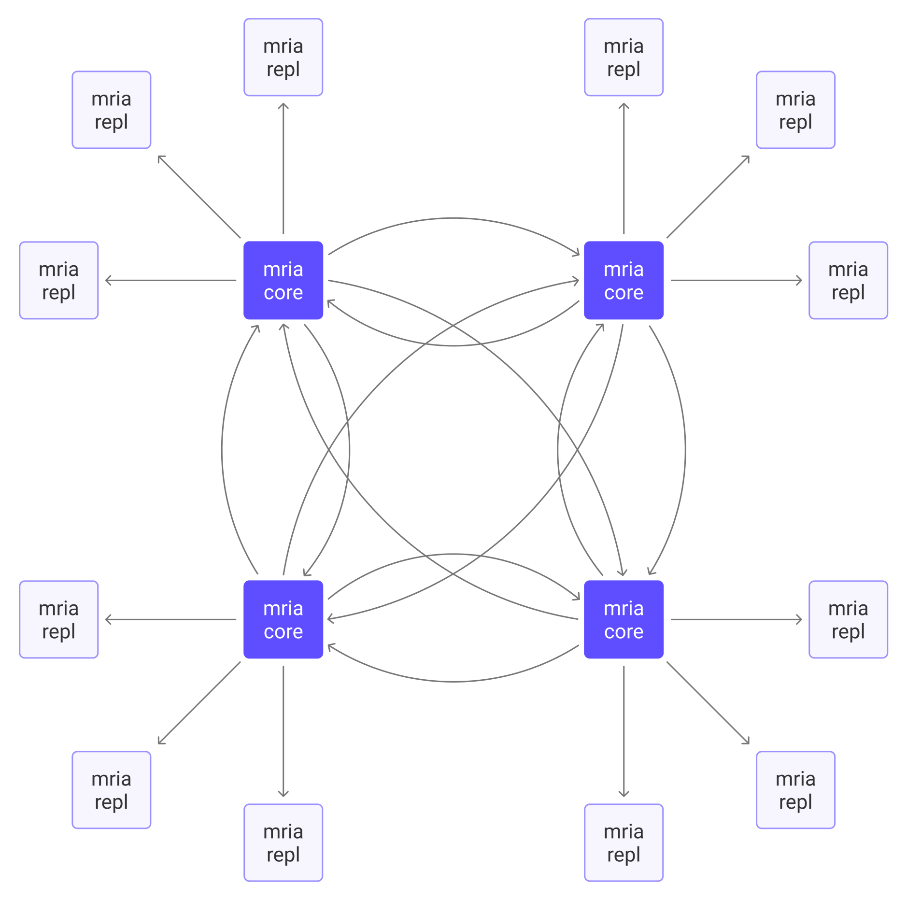

# クラスターアーキテクチャ

<!--ユーザーがすべてのノードをコアノードとして扱うクラスターの運用方法についてのセクションを追加する必要があります-->

EMQX 5.0 から、新しい [Mria](https://github.com/emqx/mria) クラスターアーキテクチャが導入され、データレプリケーション機構も再設計されました。これにより、EMQX の水平スケーラビリティが大幅に向上し、単一の EMQX 5.0 クラスターで最大1億の MQTT 接続をサポート可能となる重要な要素の一つとなっています。

本ページでは、新しいアーキテクチャにおける EMQX クラスターのデプロイメントモデルと、デプロイ時の重要な考慮点について紹介します。自動化されたクラスターのデプロイについては、[EMQX Kubernetes Operator](https://www.emqx.com/zh/emqx-kubernetes-operator) および [EMQX Core ノードと Replicant ノードの設定](https://docs.emqx.com/en/emqx-operator/latest/tasks/configure-emqx-core-replicant.html) のガイドを参照してください。

::: tip 前提知識

まずは [EMQX クラスタリング](./introduction.md) をお読みになることを推奨します。

:::

## Mria アーキテクチャ概要

Mria は Erlang のネイティブデータベースである Mnesia のオープンソース拡張であり、最終的整合性を実現するデータレプリケーションを可能にします。非同期のトランザクションログレプリケーションが有効になることで、ノード間接続のトポロジーは Mnesia の **フルメッシュ** モデルから Mria の **メッシュ＋スター** ハイブリッドトポロジーへと変化します。



### ノードの役割説明

クラスター内のノードは、コアノードとレプリカントノードの2つの役割に分類されます。

#### コアノード

コアノードはクラスターのフルメッシュデータレイヤーを形成します。各コアノードはデータの完全かつ最新のレプリカを保持し、フォールトトレランスを確保します。つまり、1つでもコアノードが稼働していればデータは失われません。コアノードは一般的に静的かつ永続的であり、頻繁な追加・削除・置換を伴うオートスケーリングには適していません。

#### レプリカントノード

レプリカントノードはコアノードに接続し、そこからのデータ更新を受動的にレプリケートします。書き込み操作は許可されず、書き込み要求はすべてコアノードに転送されて処理されます。ローカルに完全なデータコピーを持つため、レプリカントは高速な読み取りアクセスと低いルーティングレイテンシを提供します。

### Mria アーキテクチャの利点

Mria アーキテクチャはリーダーレスレプリケーションとマスター・スレーブレプリケーションの強みを組み合わせ、以下のような利点をもたらします。

- **水平スケーラビリティの向上**：EMQX 5.0 は最大23ノードの大規模クラスターをサポートします。
- **クラスターのオートスケーリングの簡素化**：レプリカントノードは動的に追加・削除が可能で、自動スケーリングを支援します。

EMQX 4.x では全ノードがフルコネクテッドトポロジーを使用していたため、ノード数増加に伴い同期オーバーヘッドが増大していましたが、EMQX 5.0 ではレプリカントノードを読み取り専用にすることでこの問題を回避しています。レプリカントが増えても書き込み効率に影響がなく、より大規模なクラスターの形成が可能です。

さらに、レプリカントノードは使い捨て可能でスケールイン・アウトが容易であり、データ冗長性に影響を与えません。これによりオートスケーリンググループに最適で、DevOps の運用性も向上します。

> **注意**：データセットが大きくなると、コアノードから新規レプリカントへの初期データ同期がリソース集約的になる場合があります。レプリカントノードのオートスケーリングポリシーは過度に攻撃的にならないよう注意してください。

## デプロイメントアーキテクチャ

デフォルトでは、すべてのノードがコアノードの役割を担い、クラスターは [EMQX 4.x](https://docs.emqx.com/en/enterprise/v4.4/getting-started/cluster.html#node-discovery-and-autocluster) と同様の動作をします。これは7ノード以下の小規模クラスターに推奨されます。コア＋レプリカントモードはクラスターが7ノードを超える場合にのみ推奨されます。

::: tip 注意

コア＋レプリカントのクラスターアーキテクチャは EMQX Enterprise のみで利用可能です。オープンソース版はコアノードのみのクラスターをサポートします。

:::

::: tip 推奨

クラスターには最低1つのコアノードが必要です。ベストプラクティスとしては、3つのコアノード＋N個のレプリカントノードから開始することを推奨します。

:::

ノードの役割割り当ては、実際のビジネス要件と想定されるクラスター規模に基づいて決定してください。

| シナリオ                     | 推奨デプロイメント                                             |
| ---------------------------- | -------------------------------------------------------------- |
| 小規模クラスター（7ノード以下） | コアノードのみで十分。すべてのノードが MQTT トラフィックを処理。 |
| 中規模クラスター             | コアノードが MQTT トラフィックを処理するかはワークロード次第。テストで最適解を見つける。 |
| 大規模クラスター（10ノード以上） | コアノードはデータベースレイヤーのみを担当。レプリカントノードがすべての MQTT トラフィックを処理し、安定性とスケーラビリティを最大化。 |

## コア＋レプリカントモードの有効化

コア＋レプリカントモードを有効にするには、一部のノードをレプリカントノードとして指定する必要があります。これは `node.role` パラメータを `replicant` に設定することで実現します。加えて、自動クラスター [ディスカバリーストラテジー](../../guides/cluster/create-cluster.md#node-discovery)（`cluster.discovery_strategy`）を有効にする必要があります。

::: tip

レプリカントノードは `manual` ディスカバリーストラテジーを使用してコアノードを検出することはできません。

:::

設定例：

```bash
node {
    ## ノードをレプリカントノードとして設定する場合：
    role = replicant
}
cluster {
    ## 静的ディスカバリーストラテジーを有効化：
    discovery_strategy = static
    static.seeds = [emqx@host1.local, emqx@host2.local]
}
```

## ネットワークおよびハードウェア要件

### ネットワーク

- コアノード間のネットワークレイテンシは10ms未満が望ましい。100msを超えるとクラスター障害の原因となる可能性があります。
- コアノードは同一プライベートネットワーク内に配置することを強く推奨します。
- レプリカントノードもコアノードと同じプライベートネットワーク内に配置することが望ましいですが、ネットワーク品質の要件はやや緩やかです。

### CPU とメモリ

コアノードはメモリを多く必要としますが、クライアント接続を処理していない場合は CPU 使用率は比較的低いです。レプリカントノードのハードウェア要件は EMQX 4.x と同様で、接続数やメッセージスループットに基づいてメモリ容量を見積もる必要があります。

## 監視とデバッグ

<!-- TODO 後続で数値型 Gauge または Counter を補足 -->

Mria のパフォーマンスは Prometheus メトリクスや Erlang コンソールで監視可能です。

### Prometheus 指標

Prometheus と連携してクラスターの動作を監視できます。Prometheus との連携方法は [ログと可観測性 - Prometheus 連携](../../guides/observability/prometheus.md) を参照してください。

#### コアノード

| 指標名                              | 説明                                                       |
| ---------------------------------- | ---------------------------------------------------------- |
| `emqx_mria_last_intercepted_trans` | ノード起動以降にシャードが受信したトランザクション数       |
| `emqx_mria_weight`                 | コアノードの瞬間的な負荷                                     |
| `emqx_mria_replicants`             | コアノードに接続しているレプリカントノード数（シャードごとに集計） |
| `emqx_mria_server_mql`             | レプリカントノードへ送信待ちのトランザクション数。少ないほど良い。<br />この値が増加傾向にある場合はコアノードの増設が必要。 |

#### レプリカントノード

| 指標名                        | 説明                                                       |
| ----------------------------- | ---------------------------------------------------------- |
| `emqx_mria_lag`               | レプリカントが上流のコアノードにどれだけ遅れているかを示す。少ないほど良い。 |
| `emqx_mria_bootstrap_time`    | レプリカントノードの起動時間。正常運用時は安定しているべき値。 |
| `emqx_mria_bootstrap_num_keys`| 起動時にコアノードからコピーしたデータベースレコード数。正常運用時は安定しているべき値。 |
| `emqx_mria_message_queue_len` | メッセージレプリケーション時のキュー長。0付近が望ましい。 |
| `emqx_mria_replayq_len`       | レプリカントノード内部のリプレイキュー長。少ないほど良い。 |

### コンソールコマンド

Erlang コンソール上で `emqx eval 'mria_rlog:status().'` コマンドを実行することで、クラスターの稼働状況を監視できます。

EMQX クラスターが正常に稼働している場合、現在のログレベル、処理済みメッセージ数、破棄されたメッセージ数などのステータス情報一覧が取得できます。

<!--ここにクエリ文と返却メッセージを記載し、Erlang コンソールのリファレンス https://www.erlang.org/doc/man/shell.html へのリンクを貼る予定です-->

関連情報：[Mria ログとアラーム](../../guides/observability/mria-alarms.md)
