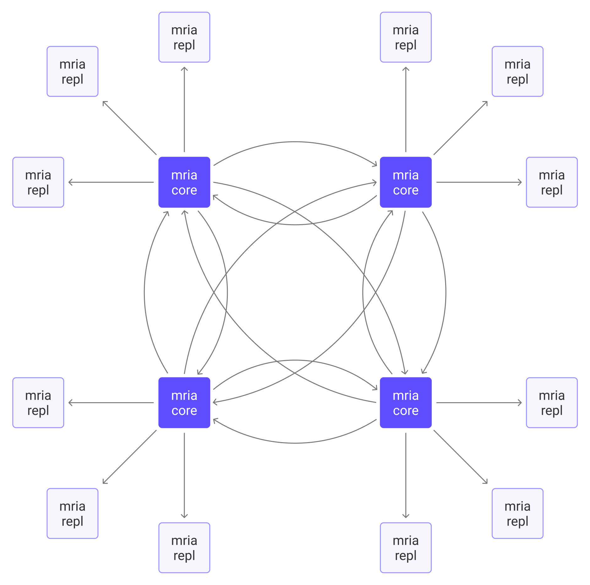

# クラスターアーキテクチャ

<!--ユーザーがすべてのノードをコアノードとしてクラスターを操作する方法についてのセクションを追加する必要があります-->

EMQX 5.0 から、新しい [Mria](https://github.com/emqx/mria) クラスターアーキテクチャと再設計されたデータレプリケーション機構が導入されました。これにより、EMQX の水平スケーラビリティが大幅に向上し、単一の EMQX 5.0 クラスターで最大1億の MQTT 接続をサポートできるようになりました。

本ページでは、新アーキテクチャにおける EMQX クラスターの展開モデルと、展開時の重要な考慮点を紹介します。自動化されたクラスター展開については、[EMQX Kubernetes Operator](https://www.emqx.com/zh/emqx-kubernetes-operator)および[EMQX コアノードとレプリカントノードの設定](https://docs.emqx.com/en/emqx-operator/latest/tasks/configure-emqx-core-replicant.html)のガイドを参照してください。

::: tip 前提知識

まずは[EMQX クラスタリング](./introduction.md)を読むことを推奨します。

:::

## Mria アーキテクチャ概要

Mria は Erlang のネイティブデータベースである Mnesia のオープンソース拡張であり、最終的整合性を持つデータレプリケーションを可能にします。非同期トランザクションログレプリケーションが有効になると、ノード間接続トポロジーは Mnesia の**フルメッシュ**モデルから Mria の**メッシュ＋スター**ハイブリッドトポロジーへと変わります。



### ノードの役割説明

クラスター内のノードは、コアノードとレプリカントノードの2つの役割に分類されます。

#### コアノード

コアノードはクラスターの完全なメッシュ型データレイヤーを形成します。各コアノードはデータの完全かつ最新のレプリカを保持し、フォールトトレランスを保証します。つまり、コアノードのいずれか1つでも稼働していればデータは失われません。コアノードは一般的に静的で永続的な存在であり、頻繁に追加・削除・置換されるオートスケーリングには推奨されません。

#### レプリカントノード

レプリカントノードはコアノードに接続し、データ更新を受動的にレプリケートします。書き込み操作は許可されず、すべての書き込みはコアノードに転送されて処理されます。ローカルに完全なデータコピーを持つため、レプリカントは高速な読み取りアクセスと低いルーティングレイテンシを提供します。

### Mria アーキテクチャの利点

Mria アーキテクチャはリーダーレスレプリケーションとマスター・スレーブレプリケーションの強みを組み合わせ、以下のような主要な利点を提供します。

- **水平スケーラビリティの向上**：EMQX 5.0 は最大23ノードの大規模クラスターをサポートします。
- **クラスターのオートスケーリングの簡素化**：レプリカントノードは動的に追加・削除でき、自動スケーリングを支援します。

EMQX 4.x ではすべてのノードがフルメッシュトポロジーを使用していたため、ノード数の増加に伴い同期オーバーヘッドが増大していましたが、EMQX 5.0 ではレプリカントノードを読み取り専用にすることでこの問題を回避しています。レプリカントが増加しても書き込み効率は低下せず、より大規模なクラスターの形成が可能です。

さらに、レプリカントノードは使い捨て可能で、データ冗長性に影響を与えずに容易にスケールイン・アウトできるよう設計されています。これによりオートスケーリンググループに最適であり、DevOps の実践を向上させます。

> **注意**：データセットが大きくなると、コアノードから新しいレプリカントへの初期データ同期がリソース集約的になる場合があります。レプリカントノードのオートスケーリングポリシーは過度に積極的にしないよう注意してください。

## 展開アーキテクチャ

デフォルトではすべてのノードがコアノードの役割を担い、クラスターは [EMQX 4.x](https://docs.emqx.com/en/enterprise/v4.4/getting-started/cluster.html#node-discovery-and-autocluster) と同様に動作します。これは7ノード以下の小規模クラスターに推奨されます。コア＋レプリカントモードはクラスターが7ノードを超える場合にのみ推奨されます。

::: tip 注意

コア＋レプリカントクラスターアーキテクチャは EMQX Enterprise のみで利用可能です。オープンソース版はコアノードのみのクラスターをサポートします。

:::

::: tip 推奨

クラスターには少なくとも1つのコアノードを含める必要があります。ベストプラクティスとして、3つのコアノード＋N個のレプリカントノードで開始することを推奨します。

:::

ノードの役割割り当ては、実際のビジネス要件および想定されるクラスター規模に基づいて行うべきです。

| シナリオ                   | 推奨展開                                                   |
| -------------------------- | ---------------------------------------------------------- |
| 小規模クラスター（7ノード以下） | コアノードのみで十分。すべてのノードが MQTT トラフィックを処理。 |
| 中規模クラスター           | コアノードが MQTT トラフィックを処理するかは負荷次第。最適な結果を得るためにテスト推奨。 |
| 大規模クラスター（10ノード以上） | コアノードはデータベースレイヤーのみを担当。レプリカントノードがすべての MQTT トラフィックを処理し、安定性とスケーラビリティを最大化。 |

## コア＋レプリカントモードの有効化

コア＋レプリカントモードを有効にするには、一部のノードをレプリカントノードとして指定する必要があります。これは `node.role` パラメータを `replicant` に設定することで実現します。加えて、自動クラスター[ディスカバリーストラテジー](../../guides/cluster/create-cluster.md#node-discovery)（`cluster.discovery_strategy`）を有効にする必要があります。

::: tip

レプリカントノードは `manual` ディスカバリーストラテジーを使用してコアノードを検出することはできません。

:::

設定例：

```bash
node {
    ## ノードをレプリカントノードとして設定する場合：
    role = replicant
}
cluster {
    ## 静的ディスカバリーストラテジーを有効化：
    discovery_strategy = static
    static.seeds = [emqx@host1.local, emqx@host2.local]
}
```

## ネットワークおよびハードウェア要件

### ネットワーク

- コアノード間のネットワークレイテンシは10ms未満が望ましい。100msを超えるとクラスター障害の原因となる可能性があります。
- コアノードは同一プライベートネットワーク内に展開することを強く推奨します。
- レプリカントノードもコアノードと同じプライベートネットワーク内に展開すべきですが、ネットワーク品質の要件は若干緩やかです。

### CPU とメモリ

コアノードはより多くのメモリを必要としますが、クライアント接続を処理していない場合は CPU 消費は比較的低いです。レプリカントノードは EMQX 4.x と同様のハードウェアサイズを想定し、メモリ要件は想定される接続数およびメッセージスループットに基づいて見積もるべきです。

## 監視とデバッグ

<!-- TODO 後続で数値型 Gauge または Counter を補足 -->

Mria のパフォーマンスは Prometheus メトリクスや Erlang コンソールを使って監視できます。

### Prometheus 指標

Prometheus と連携してクラスターの動作を監視できます。Prometheus との連携方法は[ログと可観測性 - Prometheus 連携](../../guides/observability/prometheus.md)を参照してください。

#### コアノード

| 指標名                           | 説明                                                         |
| -------------------------------- | ------------------------------------------------------------ |
| `emqx_mria_last_intercepted_trans` | ノード起動以降にシャードが受け取ったトランザクション数       |
| `emqx_mria_weight`               | コアノードの瞬間的な負荷                                       |
| `emqx_mria_replicants`           | コアノードに接続しているレプリカントノードの数（シャードごとに集計） |
| `emqx_mria_server_mql`           | レプリカントノードに送信待ちのトランザクション数。少ないほど良い。<br />この指標が増加傾向の場合は、コアノードの追加が必要。 |

#### レプリカントノード

| 指標名                         | 説明                                                         |
| ------------------------------ | ------------------------------------------------------------ |
| `emqx_mria_lag`                | レプリカントが上流のコアノードにどれだけ遅れているかを示す。少ないほど良い。 |
| `emqx_mria_bootstrap_time`     | レプリカントノードの起動時間。正常稼働時は安定していることが望ましい。 |
| `emqx_mria_bootstrap_num_keys` | 起動時にコアノードからコピーしたデータベースレコード数。正常稼働時は安定していることが望ましい。 |
| `emqx_mria_message_queue_len`  | メッセージレプリケーション時のキュー長。0付近が望ましい。       |
| `emqx_mria_replayq_len`        | レプリカントノード内部のリプレイキュー長。少ないほど良い。       |

### コンソールコマンド

Erlang コンソール上で `emqx eval 'mria_rlog:status().'` コマンドを使ってクラスターの稼働状況を監視できます。

EMQX クラスターが正常に稼働している場合、現在のログレベル、処理済みメッセージ数、破棄されたメッセージ数などのステータス情報一覧が取得できます。

<!--ここにクエリ文と返却メッセージを追加し、Erlang コンソールのリンク https://www.erlang.org/doc/man/shell.html も貼ることができます-->

関連情報：[Mria ログとアラーム](../../guides/observability/mria-alarms.md)
