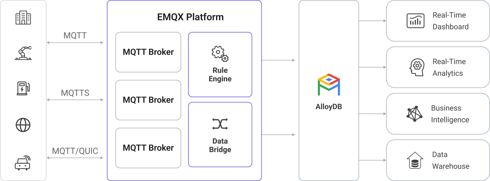

# AlloyDB に MQTT データを取り込む

[AlloyDB for PostgreSQL](https://cloud.google.com/products/alloydb?hl=en) は、Google Cloud が提供する完全マネージドの PostgreSQL 互換データベースサービスであり、要求の厳しいエンタープライズワークロード向けに設計されています。EMQX は AlloyDB とのシームレスな統合をサポートしており、IoT デバイスからの MQTT データをリアルタイムで取り込み、保存することが可能です。EMQX の効率的なメッセージルーティングと AlloyDB の高スループットなトランザクション処理能力および Hybrid Transactional/Analytical Processing（HTAP）エンジンによるリアルタイム分析を活用することで、デバイスの状態取得、イベントログ記録、インサイト分析のための強力なパイプラインを構築できます。

本ページでは、EMQX と AlloyDB 間のデータ統合について包括的に紹介し、データ統合の作成および検証方法を実践的に解説します。

## 動作概要

EMQX における AlloyDB データ統合は組み込み機能であり、MQTT ベースの IoT データストリームを AlloyDB の高性能な PostgreSQL 互換データベースに直接取り込みます。組み込みの[ルールエンジン](./rules.md)コンポーネントを利用することで、EMQX から AlloyDB へのデータ取り込みと分析が簡素化され、複雑なコーディングを不要にします。AlloyDB Sink を通じて、MQTT メッセージやクライアントイベントを AlloyDB に保存できます。また、イベントに応じて AlloyDB 内のデータを更新・削除する操作をトリガーでき、デバイスのオンライン状態や接続履歴などの情報を記録可能です。

以下の図は、EMQX と AlloyDB 間のデータ統合の典型的なアーキテクチャを示しています。




AlloyDB への MQTT データ取り込みは以下のように動作します：

1. **IoT デバイスが EMQX に接続**：IoT デバイスが MQTT プロトコルを通じて正常に接続されると、オンラインイベントがトリガーされます。イベントにはデバイス ID、送信元 IP アドレスなどの属性情報が含まれます。
2. **メッセージのパブリッシュと受信**：デバイスは特定のトピックにテレメトリや状態データをパブリッシュします。EMQX はこれらのメッセージを受信すると、ルールエンジン内でマッチング処理を開始します。
3. **ルールエンジンによるメッセージ処理**：EMQX のルールエンジンは、トピックやメッセージ内容に基づき定義されたルールにマッチさせてイベントやメッセージを処理します。処理内容には、データ変換（例：JSON から SQL 用フォーマットへの変換）、フィルタリング、コンテキスト情報によるデータ強化などが含まれ、データベース挿入前に適用されます。
4. **AlloyDB への書き込み**：マッチしたルールは AlloyDB に対する SQL 実行をトリガーします。SQL テンプレートを用いて、処理済みデータの各フィールドを AlloyDB のテーブルやカラムにマッピングします。AlloyDB は並列クエリ実行と組み込みのカラムナエンジンによる最適化ストレージをサポートしているため、高速なデータ挿入と即時の分析クエリが可能です。

イベントやメッセージデータが AlloyDB に書き込まれた後は、AlloyDB に接続してデータを読み込み、以下のような柔軟なアプリケーション開発が可能です：

- Grafana などの可視化ツールに接続し、データに基づくチャート作成やデータ変化の表示
- AlloyDB とデバイス管理システムや分析モデルを統合し、デバイスの健全性監視、異常検知、アラート発動
- AlloyDB の HTAP 機能を活用し、ライブの IoT データに対して集計、結合、時系列クエリなどの複雑な分析を実行しつつ、新しいデバイスのテレメトリ処理をリアルタイムで継続

## 特長と利点

AlloyDB とのデータ統合により、以下のような特長とメリットが得られます：

- **柔軟なイベント処理**：EMQX ルールエンジンを使うことで、デバイスのライフサイクルイベント（接続、切断、状態変化）を低レイテンシで AlloyDB に保存・処理可能です。AlloyDB の並列クエリ実行と独立スケーリングと組み合わせることで、リアルタイムにイベントデータを分析し、デバイス障害や異常、利用傾向を検出できます。
- **メッセージ変換**：EMQX ルールを通じてメッセージを多様に処理・変換できるため、AlloyDB への保存や活用がより便利になります。
- **SQL テンプレートによる柔軟なデータ操作**：EMQX の SQL テンプレートマッピングを使い、構造化された IoT データを AlloyDB のテーブルやカラムに挿入・更新できます。AlloyDB の PostgreSQL 互換性により標準 SQL、JSONB ストレージ、インデックスが利用可能で、AI によるインデックス最適化がワークロードの変化に対応します。
- **業務プロセス統合**：AlloyDB の PostgreSQL エコシステム互換性により、Google Cloud 上やオンプレミスの ERP、CRM、GIS、カスタム業務システムと直接統合可能です。EMQX と組み合わせることで、複雑なデータパイプラインなしにイベント駆動型の自動化や業務オーケストレーションを実現できます。
- **高度な地理空間機能**：PostGIS などの PostgreSQL 拡張を通じて、AlloyDB は地理空間データの保存、インデックス作成、クエリをサポートし、ジオフェンシング、ルート追跡、位置情報分析が可能です。EMQX の信頼性の高い MQTT 取り込みと組み合わせることで、車両追跡、資産監視などのリアルタイム IoT-GIS ソリューションを構築できます。
- **組み込みのメトリクスと監視**：EMQX は各 AlloyDB Sink のランタイムメトリクスを提供し、AlloyDB は Cloud Monitoring と統合してクエリ性能、ストレージ利用率、レプリカの健全性を監視可能で、エンドツーエンドの可観測性を確保します。

## はじめる前に

このセクションでは、AlloyDB 統合の作成を開始する前に必要な準備について説明します。AlloyDB インスタンスの作成やデータベースおよびデータテーブルの作成方法を含みます。

### 前提条件

- EMQX データ統合の[ルール](./rules.md)に関する知識
- [データ統合](./data-bridges.md)に関する知識

### AlloyDB でのデータベースとテーブルの作成

EMQX で AlloyDB コネクターを作成する前に、AlloyDB インスタンスが利用可能であり、IoT データを保存するためのデータベースとテーブルが作成されていることを確認してください。

以下の[公式 AlloyDB クイックスタートガイド](https://cloud.google.com/alloydb/docs/quickstart/create-and-connect)に従ってください：

1. AlloyDB インスタンスを作成します。

   - このセットアップ中に、以下のようにデータベースユーザーの認証情報を定義します：

     - **ユーザー名**：`emqx_user`（接続、挿入、更新、選択の権限を持つ必要があります）

     - **パスワード**：`your_password_here`

   - このユーザーはインスタンスプロビジョニング時に作成するか、後から SQL、Google Cloud コンソール、または `gcloud` CLI を使って作成可能です。

2. インスタンス内にデータベースを作成します。ここでは例としてデータベース名を `emqx_data` とします。

3. PostgreSQL 互換クライアント（例：`psql`）を使って、上記の認証情報でデータベースに接続します。

4. MQTT メッセージとクライアントイベントデータを保存するためのテーブルを `emqx_data` データベース内に2つ作成します。

   - 以下の SQL 文で、クライアント ID、トピック、QoS、ペイロード、到着時間などのメタデータを含む MQTT メッセージ保存用の `t_mqtt_msg` テーブルを作成します：

     ```sql
     CREATE TABLE t_mqtt_msg (
       id SERIAL primary key,
       msgid character varying(64),
       sender character varying(64),
       topic character varying(255),
       qos integer,
       retain integer,
       payload text,
       arrived timestamp without time zone
     );
     ```

   - 以下の SQL 文で、クライアントのオンライン／オフラインイベントとタイムスタンプを保存する `emqx_client_events` テーブルを作成します：

     ```sql
     CREATE TABLE emqx_client_events (
       id SERIAL primary key,
       clientid VARCHAR(255),
       event VARCHAR(255),
       created_at TIMESTAMP DEFAULT CURRENT_TIMESTAMP
     );
     ```

## AlloyDB コネクターの作成

AlloyDB Sink を追加する前に、EMQX で AlloyDB コネクターを作成します。コネクターは EMQX が Google Cloud の AlloyDB インスタンスに接続する方法を定義します。

1. EMQX ダッシュボードの **Integration** -> **Connector** に移動します。

2. ページ右上の **Create** をクリックします。

3. **Create Connector** ページで **AlloyDB** を選択し、**Next** をクリックします。

4. コネクター名を入力します。名前は英数字で始まり、英数字、ハイフン、アンダースコアを含めることができます。例：`my_alloydb`

5. 接続情報を入力します：

   - **Server Host**：Google Cloud 上の AlloyDB インスタンスのホスト名または IP アドレス
   - **Database Name**：EMQX がデータを書き込む AlloyDB のターゲットデータベース名。例：`emqx_data`
   - **Username**：認証および識別に使用する AlloyDB のデータベースユーザー名。例：`emqx_user`
   - **Password**：`emqx_user` のパスワード
   - **Enable TLS**：暗号化接続を確立する場合はトグルをオンにします。TLS 接続の詳細は [TLS for External Resource Access](../../guides/network/overview.md#tls-for-external-resource-access) を参照してください。

6. 詳細設定（任意）：接続プールサイズ、アイドルタイムアウト、リクエストタイムアウトなどの追加接続プロパティを設定可能です。

7. **Test Connectivity** をクリックして、EMQX が指定した設定で AlloyDB インスタンスに正常に接続できるか確認します。

8. **Create** をクリックしてコネクターを保存します。

9. 作成後、以下のいずれかを選択できます：

   - **Back to Connector List** をクリックして全コネクターを表示
   - **Create Rule** をクリックして、このコネクターを使って AlloyDB にデータを転送するルールを直ちに作成

   詳細な例は以下を参照してください：

   - [メッセージ保存用 AlloyDB Sink を使ったルールの作成](#create-a-rule-with-alloydb-sink-for-message-storage)
   - [イベント記録用 AlloyDB Sink を使ったルールの作成](#create-a-rule-with-alloydb-sink-for-events-recording)

## メッセージ保存用 AlloyDB Sink を使ったルールの作成

このセクションでは、ソース MQTT トピック `t/#` からのメッセージを処理し、処理済みデータを設定済み Sink を通じて AlloyDB の `t_mqtt_msg` テーブルに保存するルールをダッシュボードで作成する方法を示します。

1. ダッシュボードの **Integration** -> **Rules** ページに移動します。

2. ページ右上の **Create** をクリックします。

3. ルール ID に `my_rule` を入力し、SQL エディターにルールを記述します。ここではトピック `t/#` の MQTT メッセージを AlloyDB に保存するため、ルールの SELECT 部分で SQL テンプレートで使うすべての変数を含むフィールドを選択してください。例として以下のルール SQL を使用します：

   ```sql
   SELECT
   *
   FROM
   "t/#"
   ```

   ::: tip

   初心者の方は **SQL Examples** をクリックし、**Enable Test** を有効にして SQL ルールの学習とテストが可能です。

   :::

4. + **Add Action** ボタンをクリックして、ルールによってトリガーされるアクションを定義します。このアクションにより、EMQX はルールで処理したデータを AlloyDB に送信します。

5. **Type of Action** のドロップダウンから AlloyDB を選択し、**Action** ドロップダウンはデフォルトの `Create Action` のままにするか、既存の AlloyDB アクションを選択します。本例では新規 Sink を作成してルールに追加します。

6. Sink の名前と説明をフォームに入力します。

7. **Connector** のドロップダウンから、先に作成した `my_alloydb` を選択します。ドロップダウン横のボタンから新規コネクター作成も可能です。設定パラメータの詳細は [AlloyDB コネクターの作成](#create-an-alloydb-connector) を参照してください。

8. **SQL Template** を設定します。以下の SQL 文を使ってデータを挿入します。

   注意：これは[プリプロセス済み SQL](./data-bridges.md#prepared-statement)であるため、フィールドは引用符で囲まず、文末にセミコロンを付けないでください。

   ```sql
   INSERT INTO t_mqtt_msg(msgid, sender, topic, qos, payload, arrived) VALUES(
     ${id},
     ${clientid},
     ${topic},
     ${qos},
     ${payload},
     TO_TIMESTAMP((${timestamp} :: bigint)/1000)
   )
   ```

9. **フォールバックアクション（任意）**：メッセージ配信失敗時の信頼性向上のため、1つ以上のフォールバックアクションを定義できます。詳細は [Fallback Actions](./data-bridges.md#fallback-actions) を参照してください。

10. **詳細設定（任意）**：詳細は [Sink の機能](./data-bridges.md#features-of-sink) を参照してください。

11. **Create** をクリックする前に、**Test Connectivity** をクリックして Sink が AlloyDB インスタンスに接続できるかテスト可能です。

12. **Create** ボタンをクリックして Sink 設定を完了します。新しい Sink が **Action Outputs** に追加されます。

13. **Create Rule** ページで設定内容を確認し、**Save** ボタンをクリックしてルールを生成します。

ルール作成が完了すると、**Integration** -> **Rules** ページで新規ルールを確認でき、**Action (Sink)** タブで新規 AlloyDB Sink も確認できます。

また、**Integration** -> **Flow Designer** でトポロジーを確認でき、トピック `t/#` のメッセージがルール `my_rule` によって解析され AlloyDB に書き込まれている様子を可視化できます。

## イベント記録用 AlloyDB Sink を使ったルールの作成

このセクションでは、クライアントのオンライン／オフライン状態を記録し、イベントデータを設定済み Sink を通じて AlloyDB の `emqx_client_events` テーブルに保存するルールの作成方法を示します。

手順は[メッセージ保存用 AlloyDB Sink を使ったルールの作成](#create-a-rule-with-alloydb-sink-for-message-storage)とほぼ同様ですが、SQL テンプレートと SQL ルールが異なります。

オンライン／オフライン状態記録用の SQL ルールは以下の通りです。

```sql
SELECT
  *
FROM
  "$events/client_connected", "$events/client_disconnected"
```

イベント記録用の SQL テンプレートは以下の通りです。

注意：これは[プリプロセス済み SQL](./data-bridges.md#prepared-statement)であるため、フィールドは引用符で囲まず、文末にセミコロンを付けないでください。

```sql
INSERT INTO emqx_client_events(clientid, event, created_at) VALUES (
  ${clientid},
  ${event},
  TO_TIMESTAMP((${timestamp} :: bigint)/1000)
)
```

## ルールのテスト

MQTTX を使ってトピック `t/1` にメッセージを送信し、オンライン／オフラインイベントをトリガーします。

```bash
mqttx pub -i emqx_c -t t/1 -m '{ "msg": "hello AlloyDB" }'
```

2つの Sink の稼働状況を確認します。メッセージ保存用 Sink では新規の受信メッセージと送信メッセージがそれぞれ1件ずつあるはずです。イベント記録用 Sink では2件のイベントレコードが存在します。

`t_mqtt_msg` データテーブルにデータが書き込まれているか確認します。

```bash
emqx_data=# select * from t_mqtt_msg;
 id |              msgid               | sender | topic | qos | retain |            payload
        |       arrived
----+----------------------------------+--------+-------+-----+--------+-------------------------------+---------------------
  1 | 0005F298A0F0AEE2F443000012DC0002 | emqx_c | t/1   |   0 |        | { "msg": "hello AlloyDB" } | 2023-01-19 07:10:32
(1 row)

```

`emqx_client_events` テーブルにデータが書き込まれているか確認します。

```bash
emqx_data=# select * from emqx_client_events;
 id | clientid |        event        |     created_at
----+----------+---------------------+---------------------
  3 | emqx_c   | client.connected    | 2023-01-19 07:10:32
  4 | emqx_c   | client.disconnected | 2023-01-19 07:10:32
(2 rows)

```
