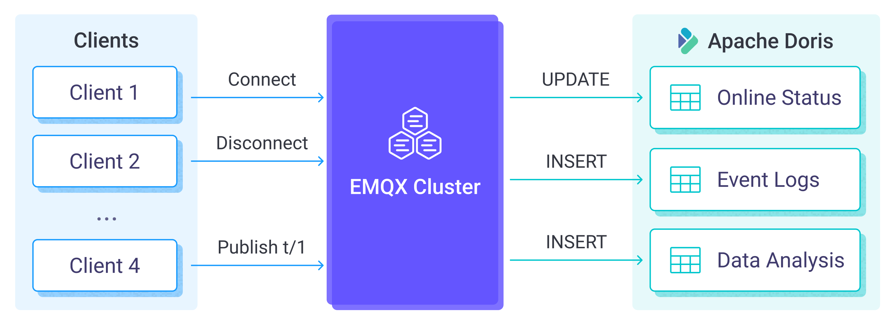

# Apache Doris に MQTT データを取り込む

[Apache Doris](https://doris.apache.org/) は、高い同時接続性、高性能、使いやすさで知られる最新のMassively Parallel Processing（MPP）分析データベースシステムです。リアルタイム分析やデータウェアハウジングのシナリオに特に適しています。EMQX 5.10.0 では、MQTT データを Apache Doris と統合でき、効率的なストレージ、リアルタイム分析、強力なデータ可視化を実現します。

本ガイドでは、EMQX と Apache Doris 間のデータ統合の設定および検証方法について実践的な手順を提供します。

::: tip 注意

EMQX における Apache Doris データ統合は、Apache Doris バージョン 2.1.7 以降をサポートしています。

:::

## 動作の仕組み

Apache Doris データ統合は EMQX の標準機能であり、簡単な設定で複雑なビジネス開発を可能にします。典型的な IoT アプリケーションでは、EMQX が IoT プラットフォームとしてデバイス接続とメッセージ転送を担当し、Apache Doris がデータストレージプラットフォームとしてデバイスの状態やメタデータ、メッセージデータの保存と分析を担当します。



EMQX はルールエンジンと Sink を通じてデバイスのイベントやデータを Apache Doris に転送します。アプリケーションは Apache Doris 内のデータを読み取り、デバイスの状態を把握したり、デバイスのオンライン・オフライン履歴を取得したり、デバイスデータを分析したりできます。具体的なワークフローは以下の通りです。

- **IoT デバイスが EMQX に接続**：IoT デバイスが MQTT プロトコルを介して正常に接続されると、オンラインイベントがトリガーされます。イベントにはデバイスID、送信元IPアドレスなどの情報が含まれます。
- **メッセージのパブリッシュと受信**：デバイスは特定のトピックにテレメトリや状態データをパブリッシュします。EMQX はこれらのメッセージを受信すると、ルールエンジン内でマッチング処理を開始します。
- **ルールエンジンによるメッセージ処理**：組み込みのルールエンジンにより、特定のソースからのメッセージやイベントをトピックマッチングに基づいて処理します。ルールエンジンは対応するルールをマッチさせ、データ形式の変換、特定情報のフィルタリング、メッセージへのコンテキスト情報の付加などを行います。
- **Apache Doris への書き込み**：ルールによりメッセージを Apache Doris に書き込む処理がトリガーされます。SQL テンプレートを利用して、ルール処理結果からデータを抽出し、SQL を構築して Apache Doris に送信し、メッセージの特定フィールドを対応するデータベースのテーブルやカラムに書き込んだり更新したりします。

イベントおよびメッセージデータが Apache Doris に書き込まれた後は、Apache Doris に接続してデータを読み取り、以下のような柔軟なアプリケーション開発が可能です。

- Grafana などの可視化ツールに接続し、データに基づくグラフを生成してデータ変化を表示する。
- デバイス管理システムに接続し、デバイス一覧や状態を確認、異常なデバイス挙動を検知して潜在的な問題をタイムリーに解消する。

## 特長とメリット

Apache Doris とのデータ統合により、以下の特長と利点をビジネスにもたらします。

- **柔軟なイベント処理**：EMQX ルールエンジンを通じて、Apache Doris はデバイスのライフサイクルイベントを処理でき、IoT アプリケーション実装に必要な各種管理・監視タスクの開発を大幅に容易にします。イベントデータを分析することで、デバイスの故障や異常挙動、トレンド変化を迅速に検知し、適切な対応を取れます。
- **メッセージ変換**：メッセージは EMQX ルールを通じて広範な処理・変換が可能で、Apache Doris への書き込みや利用がより便利になります。
- **リアルタイムデータ取り込み**：Apache Doris は HTTP や JDBC インターフェースによるリアルタイムデータ取り込みをサポートします。EMQX と統合することで、MQTT データを低レイテンシで Doris テーブルに直接書き込め、即時クエリや分析が求められるシナリオに最適です。
- **ストリーミング同期**：Apache Doris は Flink、Kafka、トランザクションデータベースなどのリアルタイムデータストリーム取り込みもサポートします。これにより、EMQX からの MQTT データと他のストリーミングデータを統合した統一パイプラインを構築し、包括的なリアルタイム分析が可能です。
- **標準 SQL とエコシステム互換性**：Doris は MySQL 構文に完全対応し、標準 SQL をサポートするため、新たな言語を学ばずに強力な分析クエリを実行できます。BI ツールやクライアントアプリケーションとの連携も容易で、ダッシュボード、レポート、自動化ワークフローに活用できます。
- **ランタイムメトリクス**：各 Sink のランタイムメトリクス（総メッセージ数、成功／失敗数、現在のレートなど）の閲覧をサポートします。

柔軟なイベント処理、広範なメッセージ変換、柔軟なデータ操作、リアルタイム監視・分析機能を活用し、効率的で信頼性が高くスケーラブルな IoT アプリケーションを構築し、ビジネスの意思決定や最適化に役立てられます。

## はじめる前に

本節では、EMQX ダッシュボードで Apache Doris データ統合を作成する前に必要な準備、具体的には Apache Doris サーバーのインストールとデータテーブルの作成について説明します。

### 前提条件

- EMQX データ統合の [ルール](./rules.md) に関する知識
- [データ統合](./data-bridges.md) に関する知識

### Apache Doris サーバーのインストール

[公式ガイド](https://doris.apache.org/docs/dev/getting-started/quick-start/#quick-deployment-with-docker) に従い、Docker Compose を使ってローカルで Doris を起動してください。

### データテーブルの作成

MySQL クライアントを使って Doris Frontend に接続し、コマンドを発行します。詳細は [公式ドキュメント](https://doris.apache.org/docs/dev/getting-started/quick-start/#run-your-first-query) を参照してください。

例：

```sh
mysql -uroot -P9030 -h127.0.0.1
```

Apache Doris に以下のデータベースと2つのテーブルを作成してください。

- `emqx_messages` テーブル：クライアントID、トピック、ペイロード、作成日時を保存するためのデータテーブル。
- `emqx_client_events` テーブル：クライアントID、イベントタイプ、作成日時を保存するためのデータテーブル。

```sql
create database mqtt;
use mqtt;

create table if not exists
  emqx_messages(
    clientid varchar,
    topic string,
    payload string,
    created_at datetime
  )
  properties (replication_num = 1);

create table if not exists
  emqx_client_events(
    clientid varchar,
    event varchar,
    created_at datetime)
  properties (replication_num = 1);
```

## コネクターの作成

本節では、Sink を Apache Doris サーバーに接続するためのコネクター作成方法を示します。

以下の手順は、EMQX と Apache Doris をローカルマシンで実行していることを前提としています。リモートで実行している場合は設定を適宜調整してください。

1. EMQX ダッシュボードに入り、**Integration** -> **Connectors** をクリックします。
2. 画面右上の **Create** をクリックします。
3. **Create Connector** ページで **Doris** を選択し、**Next** をクリックします。
4. **Configuration** ステップで以下の情報を設定します。
   - **Connector name**：コネクター名を入力します。英数字の組み合わせで、例：`my_doris`。
   - **Server Host**：`127.0.0.1:9030` または Apache Doris サーバーがリモートの場合は実際のホスト名を入力します。
   - **Database Name**：`mqtt` を入力します。
   - **Username**：`root` を入力します。
   - **Password**：`public` を入力します。
5. 詳細設定（任意）：[Advanced Configurations](#advanced-configurations) を参照してください。
6. **Create** をクリックする前に、**Test Connectivity** をクリックしてコネクターが Apache Doris サーバーに接続できるかテストできます。
7. ページ下部の **Create** ボタンをクリックしてコネクター作成を完了します。ポップアップダイアログで **Back to Connector List** または **Create Rule** をクリックして、Apache Doris へのデータ転送やクライアントイベント記録を指定するルールを作成できます。詳細は [Create a Rule with Apache Doris Sink for Message Storage](#create-a-rule-with-apache-doris-sink-for-message-storage) および [Create a Rule with Apache Doris Sink for Events Recording](#create-a-rule-with-apache-doris-sink-for-events-recording) を参照してください。

## Apache Doris Sink を使ったメッセージ保存用ルールの作成

本節では、MQTT トピック `t/#` からのメッセージを処理し、処理済みデータを設定済み Sink 経由で Apache Doris の `emqx_messages` テーブルに保存するルールの作成方法を示します。

EMQX と Apache Doris をローカルマシンで実行していることを前提としています。リモートの場合は設定を調整してください。

1. EMQX ダッシュボードで **Integration** -> **Rules** をクリックします。

2. 画面右上の **Create** をクリックします。

3. ルールIDに `my_rule` を入力し、**SQL Editor** に以下のステートメントを設定します。これはトピック `t/#` 以下の MQTT メッセージを Apache Doris に保存することを意味します。

   注意：独自の SQL 構文を指定する場合は、Sink が必要とするすべてのフィールドを `SELECT` 部分に含めてください。

   ```sql
   SELECT
     *
   FROM
     "t/#"
   ```

   ::: tip

   初心者の方は **SQL Examples** と **Enable Test** をクリックして SQL ルールを学習・テストできます。

   :::

4. + **Add Action** ボタンをクリックし、ルールによってトリガーされるアクションを定義します。このアクションにより、EMQX はルールで処理したデータを Apache Doris に送信します。

5. **Type of Action** ドロップダウンから `Apache Doris` を選択します。**Action** はデフォルトの `Create Action` のままにします。既に作成済みの Sink があれば選択可能ですが、本デモでは新規 Sink を作成します。

6. Sink 名を入力します。英数字の組み合わせにしてください。

7. **Connector** ドロップダウンから先ほど作成した `my_mysql` を選択します。新規コネクターはドロップダウン横のボタンから作成可能です。設定パラメータは [Create a Connector](#create-a-connector) を参照してください。

8. 利用する機能に基づき **SQL Template** を設定します。

   注意：これは事前処理済みの SQL なので、フィールドは引用符で囲まず、文末にセミコロンを付けないでください。

   ```sql
   INSERT INTO emqx_messages(clientid, topic, payload, created_at) VALUES(
     ${clientid},
     ${topic},
     ${payload},
     FROM_UNIXTIME(${timestamp}/1000)
   )
   ```

   SQL テンプレート内でプレースホルダー変数が未定義の場合、**SQL template** 上部の **Undefined Vars as Null** スイッチでルールエンジンの動作を切り替えられます。

   - **Disabled**（デフォルト）：ルールエンジンは文字列 `undefined` をデータベースに挿入します。
   - **Enabled**：変数が未定義の場合、`NULL` を挿入します。

     ::: tip

     可能な限りこのオプションは有効にしてください。無効化は後方互換性確保のためのみ推奨されます。

     :::

9. **フォールバックアクション（任意）**：メッセージ配信失敗時の信頼性向上のため、1つ以上のフォールバックアクションを定義できます。詳細は [Fallback Actions](./data-bridges.md#fallback-actions) を参照してください。

10. 詳細設定（任意）：[Advanced Configurations](#advanced-configurations) を参照してください。

11. **Create** ボタンをクリックして Sink 設定を完了します。新しい Sink が **Action Outputs** に追加されます。

12. **Create Rule** ページに戻り、設定内容を確認して **Create** ボタンをクリックし、ルールを生成します。

これでルールが正常に作成されました。**Integration** -> **Rules** ページで新規ルールを確認できます。**Actions(Sink)** タブをクリックすると、新しい Apache Doris Sink が表示されます。

また、**Integration** -> **Flow Designer** をクリックするとトポロジーが表示され、トピック `t/#` 以下のメッセージが Apache Doris に送信・保存されていることが確認できます。

## Apache Doris Sink を使ったイベント記録用ルールの作成

本節では、クライアントのオンライン／オフライン状態を記録し、イベントデータを設定済み Sink 経由で Apache Doris の `emqx_client_events` テーブルに保存するルールの作成方法を示します。

ルール作成手順は [メッセージ保存用ルールの作成](#apache-doris-sink-を使ったメッセージ保存用ルールの作成) とほぼ同様ですが、SQL ルール構文と SQL テンプレートが異なります。

オンライン／オフライン状態記録用の SQL エディターには以下のステートメントを入力してください。

```sql
SELECT
  *
FROM
  "$events/client/connected", "$events/client/disconnected"
```

クライアントイベントデータをデータテーブルに挿入するための SQL テンプレートは以下の通りです。

```sql
INSERT INTO emqx_client_events(clientid, event, created_at) VALUES (
  ${clientid},
  ${event},
  FROM_UNIXTIME(${timestamp}/1000)
)
```

## ルールのテスト

MQTTX を使ってトピック `t/1` にメッセージを送信し、オンライン／オフラインイベントをトリガーします。

```bash
mqttx pub -i emqx_c -t t/1 -m '{ "msg": "hello Apache Doris" }'
```

2つの Sink の稼働状況を確認してください。新規の受信メッセージと送信メッセージが1件ずつ、イベントレコードが2件あるはずです。

`emqx_messages` データテーブルにデータが書き込まれているか確認します。

```bash
mysql> select * from emqx_messages;
+----------+-------+--------------------------+---------------------+
| clientid | topic | payload                  | created_at          |
+----------+-------+--------------------------+---------------------+
| emqx_c   | t/1   | { "msg": "hello Apache Doris" } | 2022-12-09 08:44:07 |
+----------+-------+--------------------------+---------------------+
1 row in set (0.01 sec)
```

`emqx_client_events` テーブルにデータが書き込まれているか確認します。

```bash
mysql> select * from emqx_client_events;
+----------+---------------------+---------------------+
| clientid | event               | created_at          |
+----------+---------------------+---------------------+
| emqx_c   | client.connected    | 2022-12-09 08:44:07 |
| emqx_c   | client.disconnected | 2022-12-09 08:44:07 |
+----------+---------------------+---------------------+
2 rows in set (0.00 sec)
```

## 詳細設定

本節では、Apache Doris コネクターおよび Sink の詳細設定オプションについて説明します。ダッシュボードでコネクターや Sink を設定する際、**Advanced Settings** にて以下のパラメータをニーズに合わせて調整できます。

| **項目**                  | **説明**                                                                                             | **推奨値**           |
| ------------------------- | -------------------------------------------------------------------------------------------------- | --------------------- |
| **Connection Pool Size**  | Apache Doris サービスとの接続プール内で同時に維持可能な接続数を指定します。この設定は EMQX と Apache Doris 間のアクティブ接続数を制御し、アプリケーションのスケーラビリティやパフォーマンス管理に役立ちます。<br/>**注意**：適切な接続プールサイズはシステムリソース、ネットワークレイテンシ、ワークロードに依存します。大きすぎるとリソース枯渇、小さすぎるとスループット低下の原因となります。 | `8`                   |
| **Start Timeout**         | コネクターが自動起動したリソースが正常状態になるまで待機する最大時間（秒）を指定します。この設定により、Apache Doris のデータベースインスタンスなど接続先リソースが完全に稼働し、データ処理可能になるまで処理を進めないようにします。 | `5` 秒                |
| **Buffer Pool Size**      | EMQX と Apache Doris 間の egress タイプ Sink でデータフロー管理に割り当てるバッファワーカープロセス数を指定します。これらのワーカーはデータ送信前の一時保管と処理を担当します。ingress（受信）専用の Sink では無効なので「0」に設定可能です。 | `16`                  |
| **Request TTL**           | リクエストがバッファに入ってから有効とみなされる最大時間（秒）を指定します。このタイマーはリクエストがバッファに入った時点で開始し、TTL 超過または Apache Doris からの応答・アックが得られない場合、リクエストは期限切れとみなされます。 | `45` 秒               |
| **Health Check Interval** | コネクターが Apache Doris への接続状態を自動的にヘルスチェックする間隔（秒）を指定します。 | `15` 秒               |
| **Max Buffer Queue Size** | コネクター内の各バッファワーカーがバッファリング可能な最大バイト数を指定します。バッファワーカーは Apache Doris へのデータ送信前に一時的にデータを保管し、効率的なデータフローを実現します。システム性能やデータ転送要件に応じて調整してください。 | `256` MB              |
| **Max Batch Size**        | EMQX から Apache Doris へ一度に転送するデータバッチの最大サイズを指定します。サイズ調整によりデータ転送の効率やパフォーマンスを最適化できます。<br />「1」に設定すると、データレコードはバッチ化されず個別に送信されます。 | `1`                   |
| **Query Mode**            | メッセージ送信要件に応じて `asynchronous`（非同期）または `synchronous`（同期）クエリモードを選択可能です。非同期モードでは Apache Doris への書き込みが MQTT メッセージパブリッシュ処理をブロックしませんが、クライアントが Apache Doris への書き込み完了前にメッセージを受信する可能性があります。 | `Async`               |
| **Inflight Window**       | 「インフライトクエリ」とは、開始されたがまだ応答やアックを受け取っていないクエリを指します。この設定はコネクターが Apache Doris と通信する際に同時に存在可能なインフライトクエリの最大数を制御します。<br/>**Query Mode** が `async`（非同期）の場合、このパラメータは特に重要です。同一 MQTT クライアントからのメッセージを厳密に順序処理したい場合は、この値を 1 に設定してください。 | `100`                 |
