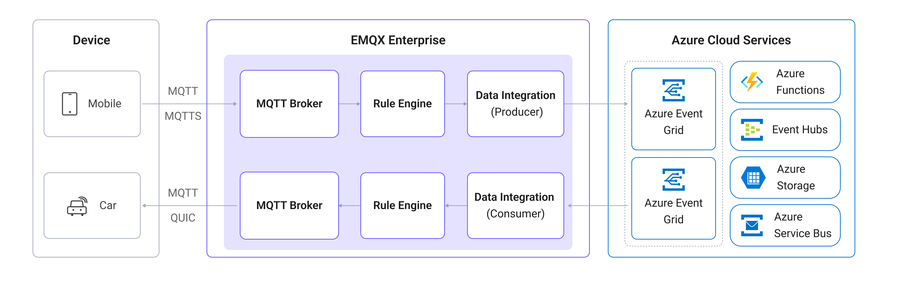

# Azure Event Grid MQTTとのブリッジ

[Azure Event Grid](https://azure.microsoft.com/en-us/products/event-grid) は、Azure上のフルマネージドなイベントルーティングサービスです。そのMQTTブローカー機能により、IoTデバイスとクラウドアプリケーション間で標準ベースの双方向MQTT通信を大規模に実現できます。EMQXはAzure Event Grid向けの組み込みコネクターを提供しており、EMQXとAzure Event Grid間でMQTTデータをブリッジし、Azureのクラウドサービスエコシステムとシームレスに統合できます。

本ページでは、EMQXとAzure Event Grid MQTTの連携について詳細な概要と、SinkおよびSourceの作成と検証手順を実践的に解説します。

## 動作概要

Azure Event Gridのデータ統合は、EMQXのデバイス接続性とメッセージ送信機能をAzure Event GridのクラウドネイティブMQTTブローカーと組み合わせた即時利用可能な機能です。EMQXはMQTTクライアントとしてAzure Event Grid MQTTブローカーに接続し、双方向のメッセージ送受信を実現します。

- **送信メッセージ（Sink）**: EMQXはローカルMQTTトピックからAzure Event Gridの指定トピックへメッセージをパブリッシュします。
- **受信メッセージ（Source）**: EMQXはAzure Event Gridのトピックをサブスクライブし、受信したメッセージをローカルEMQXトピックに転送します。

以下の図は連携の典型的なアーキテクチャを示しています。



## 特長とメリット

Azure Event Gridとのデータ統合は以下の特長とメリットを提供します。

- **標準ベースのMQTTブリッジ**: Azure Event GridはMQTT 3.1.1およびMQTT 5.0をサポートし、EMQXは標準MQTTプロトコルでブリッジ可能なため、MQTT対応の任意のクライアントやサービスと相互運用できます。
- **双方向データフロー**: EMQXからAzure Event Gridへのメッセージパブリッシュ（Sink）と、Azure Event GridトピックのサブスクライブおよびEMQXへの転送（Source）の両方をサポートし、柔軟なIoTデータルーティングを実現します。
- **安全な接続**: Azure Event GridはTLSを必須とします。コネクターはデフォルトでTLSを有効にし、クライアント証明書認証もサポートしており、本番環境での推奨認証方式です。
- **柔軟なトピックマッピング**: EMQXのルールエンジンを通じてメッセージのフィルタリング、変換、動的トピックマッピングによる特定のAzure Event Gridトピックスペースへのルーティングが可能です。
- **豊富なAzureエコシステム連携**: データがAzure Event Gridに到達すると、Azure Functions、Azure Event Hubs、Azure Storageなど他のAzureサービスへルーティングしてさらなる処理や分析が可能です。

## はじめる前に

### 前提条件

- EMQXのデータ統合に関する[ルール](./rules.md)の知識
- [データ統合](./data-bridges.md)の知識

### Azure Event Gridのセットアップ

EMQXでデータ統合を作成する前に、MQTTブローカーサポートを有効にしたAzure Event Gridネームスペースをセットアップしてください。以下のMicrosoft公式ドキュメントにステップバイステップの手順があります。

- [Quickstart: Publish and subscribe to MQTT messages using Azure Event Grid namespace](https://learn.microsoft.com/en-us/azure/event-grid/mqtt-publish-and-subscribe-portal)
- [Azure Event Grid MQTT broker overview](https://learn.microsoft.com/en-us/azure/event-grid/mqtt-overview)
- [How to authenticate MQTT clients using a certificate chain](https://learn.microsoft.com/en-us/azure/event-grid/mqtt-certificate-chain-client-authentication)

セットアップ完了後、EMQXでコネクター作成時に必要となる以下の接続情報を控えてください。

- **ホスト名**: Event GridネームスペースのMQTTブローカーホスト名。形式は `<namespace>.ts.<region>.eventgrid.azure.net`。ポートは`8883`です。
- **クライアント証明書と秘密鍵**: Azure Event Gridはクライアント証明書認証を要求します。Azure Event Gridネームスペースから証明書と秘密鍵をエクスポートし、コネクターのTLS設定時に使用します。
- **トピックスペース**: Azure Event Gridで設定したトピックスペースおよび権限バインディング。

::: tip

対応する認証方式やTLS要件については、[Azure Event Gridドキュメント](https://learn.microsoft.com/en-us/azure/event-grid/mqtt-client-authentication)を参照してください。

:::

## コネクターの作成

EMQXとAzure Event Gridを接続するコネクターの作成方法を説明します。

1. EMQXダッシュボードで **Integration** -> **Connectors** をクリックします。

2. 画面右上の **Create** をクリックします。

3. **Create Connector** ページで **Azure Event Grid** を選択し、**Next** をクリックします。

4. コネクター名を入力します。大文字・小文字の英数字の組み合わせで、例として `my_azure_event_grid` などを指定します。

5. 接続情報を設定します。

   - **Server Host**: Event GridネームスペースのMQTTブローカーエンドポイントを入力します。例: `myns.northeurope-1.ts.eventgrid.azure.net:8883`。デフォルトポートは`8883`です。
   - **ClientID Prefix**: （任意）EMQXが生成するクライアントIDのプレフィックスを指定します。EMQXは`[prefix]:{connector name}{random string}:{pool index}`形式で一意のクライアントIDを自動生成します。詳細は[Connection Pool and Client ID Generation Rules](./data-bridge-mqtt.md#connection-pool-and-client-id-generation-rules)を参照してください。
   - **Username** と **Password**: 空欄のままにします。Azure Event Grid MQTTはユーザー名/パスワード認証を使用しません。
   - **Keepalive**: キープアライブ間隔（秒）を指定します。デフォルトは`160`秒です。
   - **MQTT Version**: MQTTプロトコルバージョンを選択します。Azure Event GridはMQTT 3.1.1（`v4`）とMQTT 5.0（`v5`）の両方をサポートします。
   - **Static ClientId Entries**: （任意）特定のEMQXノード向けに静的クライアントIDを設定します。Azure Event Gridで事前登録済みクライアントIDが必要な場合に有効です。詳細は[Configure Static Client IDs](./data-bridge-mqtt.md#configure-static-client-ids)を参照してください。

     ::: tip

     静的クライアントIDが定義されている場合、明示的に割り当てられたEMQXノードのみがMQTT接続を開始します。

     :::

   - **Clean Start**: デフォルトで有効。接続ごとに新しいセッションを開始します。
   - **Enable TLS**: 有効にします。Azure Event GridはTLSを必須とします。クライアント証明書認証を使用する場合は、ここで証明書と秘密鍵を設定してください。TLS設定の詳細は[TLS for External Resource Access](../../guides/network/overview.md#enable-tls-encryption-for-accessing-external-resources)を参照してください。

6. **詳細設定（任意）**: 詳細は[Connector Advanced Settings](#connector-advanced-settings)を参照してください。

7. **Create**をクリックする前に、**Test Connectivity**をクリックしてEMQXがAzure Event Gridに接続できるか検証できます。

8. **Create**をクリックしてコネクター作成を完了します。作成成功のダイアログが表示され、ルールを今すぐ作成するか尋ねられます。**Create Rule**をクリックするとコネクターが事前選択された状態でルール作成画面に進みます。**Back To Connector List**をクリックすると後でルールを作成できます。

## Azure Event Grid Sinkを使ったルールの作成

ローカルEMQXトピック `t/#` からAzure Event GridへMQTTメッセージを転送するルールの作成手順を説明します。

1. 前項で**Create Rule**をクリックした場合、**Add Action**パネルが自動で開き、**Type of Action**が`Azure Event Grid`、コネクターが事前選択されています。手順5へ進んでください。

   それ以外の場合は、EMQXダッシュボードで **Integration** -> **Rules** をクリックし、右上の **Create** をクリック、続いて **+ Add Action** をクリックします。

2. 左側の**SQL Editor**でルールIDを入力し、トピック `t/#` のメッセージにマッチする以下のSQLを入力します。

   ※独自のSQL構文を指定する場合は、Sinkで必要なすべてのフィールドが`SELECT`句に含まれていることを確認してください。

   ```sql
   SELECT
     *
   FROM
     "t/#"
   ```

   ::: tip

   初心者の方は**SQL Examples**をクリックし、**Enable Test**を有効にしてSQLルールを学習・テストできます。

   :::

3. 右側の**Add Action**パネルで、**Type of Action**ドロップダウンから`Azure Event Grid`を選択し、**Action**はデフォルトの`Create Action`のままにします。

4. **Connectors**ドロップダウンから先ほど作成した`my_azure_event_grid`コネクターを選択します。新規作成はドロップダウン横のボタンから可能です。設定パラメーターは[Create a Connector](#create-a-connector)を参照してください。

5. Sinkの名前と任意の説明を入力します。

6. Azure Event GridへメッセージをパブリッシュするSinkパラメーターを設定します。

   - **Topic**: Azure Event Gridでパブリッシュするトピック。`${var}`プレースホルダーをサポートします。例: `devices/${clientid}/messages` はクライアントIDに基づき動的にトピックを設定します。
   - **QoS**: パブリッシュメッセージのQoSレベル。`0`、`1`、`2`のいずれか、または`${qos}`のようなプレースホルダーで元メッセージのQoSに従うことが可能です。
   - **Retain**: `true`、`false`、または`${flags.retain}`のようなプレースホルダーを選択してリテインフラグを設定します。
   - **Payload**: メッセージペイロードのテンプレート。空欄の場合はルール出力全体を転送し、`${payload}`などを指定するとペイロードのみを転送します。

7. **フォールバックアクション（任意）**: メッセージ配信失敗時の信頼性向上のため、1つ以上のフォールバックアクションを定義できます。詳細は[Fallback Actions](./data-bridges.md#fallback-actions)を参照してください。

8. **詳細設定（任意）**: 詳細は[Sink Advanced Settings](#sink-advanced-settings)を参照してください。

9. **Create**をクリックする前に、**Test Connectivity**をクリックしてSinkがAzure Event Gridに接続可能かテストできます。

10. **Create**をクリックしてSink設定を完了します。新しいSinkが**Action Outputs**に追加されます。

11. **Create Rule**ページに戻り、設定内容を確認して**Save**をクリックしルールを生成します。

これでルールの作成が完了しました。**Integration** -> **Rules**ページで新規ルールを確認できます。**Actions(Sink)**タブをクリックすると新しいAzure Event Grid Sinkが表示されます。

また、**Integration** -> **Flow Designer**をクリックするとトポロジーを確認でき、トピック `t/#` のメッセージがルール`my_rule`で処理された後にAzure Event Gridへ転送されていることを検証できます。

## Azure Event Grid Sourceを使ったルールの作成

Azure Event Gridからのメッセージをサブスクライブし、ローカルEMQXトピックに転送するルールの作成手順を説明します。

### Azure Event Grid Sourceの作成とルールへの追加

1. EMQXダッシュボードで **Integration** -> **Rules** をクリックし、右上の **Create** をクリックします。

2. ルールIDに `my_rule_source` を入力します。

3. ルールのトリガーソースを設定します。画面右側の**Data Inputs**タブでデフォルトの**Message**入力を削除し、**Add Input**をクリックしてAzure Event Grid Sourceを作成します。

4. **Add Input**ダイアログで、**Input Type**ドロップダウンから`Azure Event Grid`を選択し、**Source**はデフォルトの`Create Source`のままにします。

5. Sourceの名前と説明を入力します。

6. **Connectors**ドロップダウンから`my_azure_event_grid`コネクターを選択します。

7. Azure Event Gridのサブスクライブ用Sourceパラメーターを設定します。

   - **Topic**: Azure Event Gridでサブスクライブするトピック。`+`および`#`ワイルドカードをサポートします。

     ::: tip

     EMQXがクラスター運用中、またはコネクターが接続プール設定の場合は、重複メッセージを避けるために共有サブスクリプションを利用してください。例: `$share/group/devices/#`

     :::

   - **QoS**: サブスクライブのQoS。`0`または`1`を選択します。

8. **Create**をクリックしてSource作成を完了します。ルールのSQLは自動的に以下のように更新されます。

   ```sql
   SELECT
     *
   FROM
     "$bridges/azure_event_grid:<source_name>"
   ```

### Republishアクションの作成

Azure Event Gridからサブスクライブしたメッセージは自動的にローカルEMQXトピックに転送されません。Republishアクションを作成してルーティングします。

1. ルール作成画面右側の**Action Outputs**タブに切り替え、**Add Action**をクリックします。

2. **Type of Action**ドロップダウンから`Republish`を選択します。

3. Republishパラメーターを設定します。

   - **Topic**: 転送先のローカルトピック。例: `azure/${topic}` は元トピックに`azure/`プレフィックスを付与します。
   - **QoS**: `${qos}`を選択して元メッセージのQoSに従うか、固定値を設定します。
   - **Retain**: `false`を選択するかプレースホルダーを使用します。
   - **Payload**: `${payload}`を指定してペイロードのみ転送するか、空欄でルール出力全体を転送します。

4. **Add**をクリックしてアクションを追加し、**Save**をクリックしてルールを生成します。

## ルールのテスト

### Sinkのテスト

[MQTTX](https://mqttx.app/)を使ってEMQXのトピック `t/1` にメッセージをパブリッシュします。

```bash
mqttx pub -i emqx_c -t t/1 -m '{ "msg": "Hello Azure Event Grid" }'
```

Azure Event Grid Sinkの稼働統計を確認し、新規マッチ数1件、新規送信メッセージ1件があることを確認してください。AzureポータルやAzure Event Grid MQTTクライアントでメッセージ受信を検証できます。

### Sourceのテスト

1. ローカルEMQXトピック `azure/#` をサブスクライブします。

   ```bash
   mqttx sub -t azure/# -q 1 -v
   ```

2. Azure Event Gridの認証情報で設定したMQTTクライアントを使い、Azure Event Gridにメッセージをパブリッシュします。

   ```bash
   mqttx pub -t devices/device1/messages -m "hello from azure" \
     -h myns.northeurope-1.ts.eventgrid.azure.net -p 8883 \
     --tls --cert /path/to/client.crt --key /path/to/client.key
   ```

3. EMQXのトピック `azure/devices/device1/messages` にメッセージが転送されていることを確認します。

   ```bash
   topic: azure/devices/device1/messages
   payload: hello from azure
   ```

## 詳細設定

本節ではAzure Event GridコネクターおよびSinkの詳細設定オプションを説明します。ダッシュボードで設定する際は**Advanced Settings**を展開し、要件に応じて以下のパラメーターを調整してください。

### コネクター詳細設定

| フィールド名               | 説明                                                                                  | デフォルト値       |
|----------------------------|---------------------------------------------------------------------------------------|--------------------|
| Message Retry Interval      | メッセージ配信失敗時の再試行間隔時間                                                 | `15`秒             |
| Bridge Mode                | 有効にすると、リモートブローカーに接続がブリッジであることを通知するMQTTブリッジモードを使用 | 無効               |
| Max Inflight               | 1接続あたり同時に未アックのメッセージ最大数                                           | `32`               |
| Connection Pool Size       | Azure Event Gridへの同時MQTT接続数。増やすとスループット向上                           | `8`                |
| Connect Timeout            | Azure Event GridへのTCP接続確立の最大待機時間                                         | `10`秒             |
| Start Timeout              | 自動起動リソースが正常化するまでの最大待機時間                                         | `5`秒              |
| Health Check Interval      | コネクターの自動ヘルスチェック実行間隔                                               | `15`秒             |
| Health Check Timeout       | 各ヘルスチェック完了までの最大許容時間                                               | `60`秒             |

### Sink詳細設定

| フィールド名                 | 説明                                                                                          | デフォルト値       |
|------------------------------|-----------------------------------------------------------------------------------------------|--------------------|
| Buffer Pool Size             | EMQXとAzure Event Grid間のデータフローを処理するバッファワーカー数。負荷が高い場合は増加推奨 | `16`               |
| Request TTL                 | バッファ内でリクエストが有効な最大時間。超過したリクエストは破棄される                         | `45`秒             |
| Health Check Interval       | Sinkの自動ヘルスチェック実行間隔                                                             | `15`秒             |
| Health Check Interval Jitter | 複数ノードが同時にチェックしないようにヘルスチェック間隔にランダム遅延を加える。複数ActionやSourceが同一コネクターを共有する場合に有効 | `0`ミリ秒          |
| Health Check Timeout        | 各Sinkヘルスチェック完了までの最大許容時間                                                   | `60`秒             |
| Max Buffer Queue Size       | 各バッファワーカーが保持可能な最大バイト数。バースト負荷が多い場合は増加推奨                 | `256`MB            |
| Query Mode                 | `async`はAzure Event Gridの書き込み確認を待たずにパブリッシュを継続。`sync`は確認後に進行。Asyncはスループットが高いが順序が乱れる可能性あり | `Async`            |
| Inflight Window            | 同時に未アックのリクエスト最大数。**Query Mode**が`async`の場合はクライアントごとのメッセージ順序保証のため`1`推奨 | `100`              |

### Source詳細設定

| フィールド名                 | 説明                                                                                          | デフォルト値       |
|------------------------------|-----------------------------------------------------------------------------------------------|--------------------|
| Health Check Interval       | Sourceの自動ヘルスチェック実行間隔                                                           | `15`秒             |
| Health Check Interval Jitter | 複数ノードが同時にチェックしないようにヘルスチェック間隔にランダム遅延を加える。複数ActionやSourceが同一コネクターを共有する場合に有効 | `0`ミリ秒          |
| Health Check Timeout        | 各Sourceヘルスチェック完了までの最大許容時間                                                 | `60`秒             |
