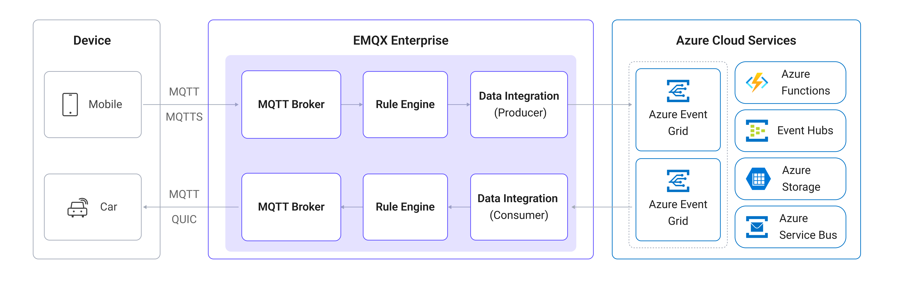

# Azure Event Grid MQTTとのブリッジ

[Azure Event Grid](https://azure.microsoft.com/en-us/products/event-grid) は、Azure上のフルマネージドイベントルーティングサービスです。そのMQTTブローカー機能により、IoTデバイスとクラウドアプリケーション間で標準ベースの双方向MQTT通信を大規模に実現します。EMQXはAzure Event Grid向けの組み込みコネクターを提供しており、EMQXとAzure Event Grid間でMQTTデータをブリッジし、Azureのクラウドサービスエコシステムとシームレスに統合できます。

本ページでは、EMQXとAzure Event Grid MQTTの統合について詳細に解説し、SinkおよびSourceの作成と検証方法を実践的に説明します。

## 動作概要

Azure Event Gridのデータ統合は、EMQXのデバイス接続性とメッセージ送信機能をAzure Event GridのクラウドネイティブMQTTブローカーと組み合わせた、EMQXの標準機能です。EMQXはMQTTクライアントとしてAzure Event Grid MQTTブローカーに接続し、双方向のメッセージ送受信を実現します。

- **送信メッセージ（Sink）**：EMQXはローカルMQTTトピックからAzure Event Gridの指定トピックへメッセージをパブリッシュします。
- **受信メッセージ（Source）**：EMQXはAzure Event Gridのトピックをサブスクライブし、受信したメッセージをローカルのEMQXトピックへ転送します。

以下の図は統合の典型的なアーキテクチャを示しています。



## 特長と利点

Azure Event Gridとのデータ統合は以下の特長と利点を提供します。

- **標準ベースのMQTTブリッジ**：Azure Event GridはMQTT 3.1.1およびMQTT 5.0をサポートし、EMQXは標準MQTTプロトコルでブリッジ可能なため、MQTT対応の任意のクライアントやサービスと相互運用できます。
- **双方向データフロー**：EMQXからAzure Event Gridへのメッセージパブリッシュ（Sink）と、Azure Event GridのトピックサブスクライブおよびEMQXへのメッセージ転送（Source）をサポートし、柔軟なIoTデータルーティングを実現します。
- **安全な接続**：Azure Event GridはTLSを必須とし、コネクターはデフォルトでTLSを有効化しています。クライアント証明書認証もサポートし、本番環境で推奨される認証方式です。
- **柔軟なトピックマッピング**：EMQXのルールエンジンを通じて、メッセージのフィルタリング、変換、動的トピックマッピングによる特定のAzure Event Gridトピックスペースへのルーティングが可能です。
- **豊富なAzureエコシステム統合**：データがAzure Event Gridに到達すると、Azure FunctionsやAzure Event Hubs、Azure Storageなど他のAzureサービスへルーティングされ、さらなる処理や分析が可能です。

## はじめる前に

### 前提条件

- EMQXのデータ統合[ルール](./rules.md)の知識
- [データ統合](./data-bridges.md)の知識

### Azure Event Gridのセットアップ

EMQXでデータ統合を作成する前に、MQTTブローカーサポートを有効にしたAzure Event Gridネームスペースをセットアップする必要があります。以下のMicrosoftドキュメントに手順が示されています。

- [クイックスタート：Azure Event Gridネームスペースを使ったMQTTメッセージのパブリッシュとサブスクライブ](https://learn.microsoft.com/en-us/azure/event-grid/mqtt-publish-and-subscribe-portal)
- [Azure Event Grid MQTTブローカーの概要](https://learn.microsoft.com/en-us/azure/event-grid/mqtt-overview)
- [証明書チェーンを使ったMQTTクライアント認証方法](https://learn.microsoft.com/en-us/azure/event-grid/mqtt-certificate-chain-client-authentication)

セットアップ完了後、EMQXでコネクター作成時に必要となる以下の接続情報を控えておいてください。

- **ホスト名**：Event GridネームスペースのMQTTブローカーのホスト名。形式は `<namespace>.ts.<region>.eventgrid.azure.net`。ポートは `8883`。
- **クライアント証明書と秘密鍵**：Azure Event Gridはクライアント証明書認証を要求します。Azure Event Gridネームスペースから証明書と秘密鍵をエクスポートし、コネクターのTLS設定時に使用します。
- **トピックスペース**：Azure Event Gridで設定したトピックスペースと権限バインディング。

::: tip

サポートされている認証方式やTLS要件については、[Azure Event Gridドキュメント](https://learn.microsoft.com/en-us/azure/event-grid/mqtt-client-authentication)を参照してください。

:::

## コネクターの作成

EMQXとAzure Event Gridを接続するコネクターの作成手順を示します。

1. EMQXダッシュボードで **Integration** -> **Connectors** をクリックします。

2. 画面右上の **Create** をクリックします。

3. **Create Connector** ページで **Azure Event Grid** を選択し、**Next** をクリックします。

4. コネクター名を入力します。大文字・小文字の英数字の組み合わせで、例：`my_azure_event_grid`。

5. 接続情報を設定します。

   - **Server Host**：Event GridネームスペースのMQTTブローカーエンドポイントを入力します。例：`myns.northeurope-1.ts.eventgrid.azure.net:8883`。デフォルトポートは `8883`。
   - **ClientID Prefix**：（任意）EMQXが生成するクライアントIDのプレフィックスを指定します。EMQXは `[prefix]:{connector name}{random string}:{pool index}` の形式で一意のクライアントIDを自動生成します。詳細は[接続プールとクライアントID生成ルール](./data-bridge-mqtt.md#connection-pool-and-client-id-generation-rules)を参照してください。
   - **Username** と **Password**：空欄のままにします。Azure Event Grid MQTTはユーザー名/パスワード認証を使用しません。
   - **Keepalive**：キープアライブ間隔（秒）を指定します。デフォルトは `160` 秒です。
   - **MQTT Version**：MQTTプロトコルバージョンを選択します。Azure Event GridはMQTT 3.1.1 (`v4`) とMQTT 5.0 (`v5`) の両方をサポートします。
   - **Static ClientId Entries**：（任意）特定のEMQXノードに静的クライアントIDを設定します。Azure Event Gridが事前登録済みクライアントIDを要求する場合に有効です。詳細は[静的クライアントIDの設定](./data-bridge-mqtt.md#configure-static-client-ids)を参照してください。

     ::: tip

     静的クライアントIDが定義されている場合、明示的に割り当てられたEMQXノードのみがMQTT接続を開始します。

     :::

   - **Clean Start**：デフォルトで有効。接続ごとに新しいセッションを開始します。
   - **Enable TLS**：有効にします。Azure Event GridはTLSを必須とします。クライアント証明書認証を使用する場合は、ここで証明書と秘密鍵を設定します。TLSの詳細設定は[外部リソースアクセスのTLS設定](../../guides/network/overview.md#enable-tls-encryption-for-accessing-external-resources)を参照してください。

6. **詳細設定（任意）**：詳細は[コネクターの詳細設定](#connector-advanced-settings)を参照してください。

7. **Create**をクリックする前に、**Test Connectivity** をクリックしてEMQXがAzure Event Gridに接続できるか確認できます。

8. **Create** をクリックしてコネクターの作成を完了します。作成成功ダイアログが表示され、ルールを今すぐ作成するか尋ねられます。**Create Rule** をクリックするとコネクターが事前選択された状態でルール作成画面に進みます。**Back To Connector List** をクリックすると後でルールを作成できます。

## Azure Event Grid Sinkを使ったルールの作成

ローカルのEMQXトピック `t/#` からAzure Event GridへMQTTメッセージを転送するルールの作成手順を示します。

1. 前のステップで **Create Rule** をクリックした場合、**Add Action** パネルが自動的に開き、**Type of Action** が `Azure Event Grid`、コネクターが事前選択されています。ステップ5へ進んでください。

   そうでない場合は、EMQXダッシュボードで **Integration** -> **Rules** を開き、右上の **Create** をクリックし、**+ Add Action** をクリックします。

2. 左側の **SQL Editor** にルールIDと以下のSQLを入力し、トピック `t/#` のメッセージをマッチさせます。

   注意：独自のSQL構文を指定する場合は、Sinkで必要な全フィールドが `SELECT` 部分に含まれていることを確認してください。

   ```sql
   SELECT
     *
   FROM
     "t/#"
   ```

   ::: tip

   初心者の方は **SQL Examples** と **Enable Test** をクリックしてSQLルールを学習・テストできます。

   :::

3. 右側の **Add Action** パネルで、**Type of Action** ドロップダウンから `Azure Event Grid` を選択します。**Action** はデフォルトの `Create Action` のままにします。

4. **Connectors** ドロップダウンから先ほど作成した `my_azure_event_grid` コネクターを選択します。新規コネクターはドロップダウン横のボタンから作成可能です。設定パラメータは[コネクターの作成](#コネクターの作成)を参照してください。

5. Sinkの名前と任意の説明を入力します。

6. Azure Event GridへメッセージをパブリッシュするSinkパラメータを設定します。

   - **Topic**：Azure Event Gridでパブリッシュするトピック。`${var}` プレースホルダーをサポートします。例：`devices/${clientid}/messages` はクライアントIDに基づき動的にトピックを設定します。
   - **QoS**：パブリッシュメッセージのQoSレベル。`0`、`1`、`2` または `${qos}` のように元メッセージのQoSを引き継ぐプレースホルダーを選択可能です。
   - **Retain**：`true`、`false` または `${flags.retain}` のようなプレースホルダーを選択してリテインフラグを設定します。
   - **Payload**：メッセージペイロードのテンプレート。空欄の場合はルール出力全体を転送します。`${payload}` のように指定するとペイロードのみ転送します。

7. **フォールバックアクション（任意）**：メッセージ配信失敗時の信頼性向上のため、1つ以上のフォールバックアクションを定義できます。詳細は[フォールバックアクション](./data-bridges.md#fallback-actions)を参照してください。

8. **詳細設定（任意）**：詳細は[Sinkの詳細設定](#sink-advanced-settings)を参照してください。

9. **Create** をクリックする前に、**Test Connectivity** をクリックしてSinkがAzure Event Gridに接続できるかテストできます。

10. **Create** をクリックしてSinkの設定を完了します。新しいSinkが **Action Outputs** に追加されます。

11. **Create Rule** ページに戻り、設定内容を確認して **Save** をクリックしルールを生成します。

これでルールの作成が完了しました。**Integration** -> **Rules** ページで新規作成したルールを確認できます。**Actions(Sink)** タブをクリックすると新しいAzure Event Grid Sinkが表示されます。

また、**Integration** -> **Flow Designer** を開くとトポロジーを確認でき、トピック `t/#` のメッセージがルール `my_rule` によって処理されAzure Event Gridに転送されていることを検証できます。

## Azure Event Grid Sourceを使ったルールの作成

Azure Event Gridからのメッセージをサブスクライブし、ローカルのEMQXトピックへ転送するルールの作成手順を示します。

### Azure Event Grid Sourceの作成とルールへの追加

1. EMQXダッシュボードで **Integration** -> **Rules** を開き、右上の **Create** をクリックします。

2. ルールIDに `my_rule_source` を入力します。

3. ルールのトリガーソースを設定します。画面右側の **Data Inputs** タブで、デフォルトの **Message** 入力を削除し、**Add Input** をクリックしてAzure Event Grid Sourceを作成します。

4. **Add Input** ダイアログで、**Input Type** ドロップダウンから `Azure Event Grid` を選択します。**Source** はデフォルトの `Create Source` のままにします。

5. Sourceの名前と説明を入力します。

6. ドロップダウンから `my_azure_event_grid` コネクターを選択します。

7. Azure Event Gridのサブスクライブ設定を行います。

   - **Topic**：Azure Event Gridでサブスクライブするトピック。`+` と `#` のワイルドカードをサポートします。

     ::: tip

     EMQXがクラスター運用中、またはコネクターが接続プール設定されている場合は、重複メッセージを避けるため共有サブスクリプションを使用してください。例：`$share/group/devices/#`

     :::

   - **QoS**：サブスクライブのQoS。`0` または `1` を選択します。

8. **Create** をクリックしてSourceの作成を完了します。ルールのSQLは自動的に以下のように更新されます。

   ```sql
   SELECT
     *
   FROM
     "$bridges/azure_event_grid:<source_name>"
   ```

### Republishアクションの作成

Azure Event Gridからサブスクライブしたメッセージは自動的にローカルEMQXトピックに転送されません。Republishアクションを作成してメッセージをルーティングします。

1. ルール作成画面右側の **Action Outputs** タブに切り替え、**Add Action** をクリックします。

2. **Type of Action** ドロップダウンから `Republish` を選択します。

3. Republishパラメータを設定します。

   - **Topic**：転送先のローカルトピック。例：`azure/${topic}` は元トピックに `azure/` プレフィックスを付加します。
   - **QoS**：`${qos}` を選択して元メッセージのQoSを引き継ぐか、固定値を設定します。
   - **Retain**：`false` またはプレースホルダーを選択します。
   - **Payload**：`${payload}` を入力してペイロードのみ転送、または空欄にしてルール出力全体を転送します。

4. **Add** をクリックしてアクションを追加し、**Save** をクリックしてルールを生成します。

## ルールのテスト

### Sinkのテスト

[MQTTX](https://mqttx.app/) を使ってEMQXのトピック `t/1` にメッセージをパブリッシュします。

```bash
mqttx pub -i emqx_c -t t/1 -m '{ "msg": "Hello Azure Event Grid" }'
```

Azure Event Grid Sinkの稼働統計を確認し、新しいマッチ数と送信数が1であることを確認してください。AzureポータルやAzure Event Grid MQTTクライアントでメッセージ受信を検証できます。

### Sourceのテスト

1. ローカルEMQXトピック `azure/#` をサブスクライブします。

   ```bash
   mqttx sub -t azure/# -q 1 -v
   ```

2. Azure Event Gridの認証情報で設定したMQTTクライアントを使い、Azure Event Gridにメッセージをパブリッシュします。

   ```bash
   mqttx pub -t devices/device1/messages -m "hello from azure" \
     -h myns.northeurope-1.ts.eventgrid.azure.net -p 8883 \
     --tls --cert /path/to/client.crt --key /path/to/client.key
   ```

3. EMQXの `azure/devices/device1/messages` トピックにメッセージが転送されていることを確認します。

   ```bash
   topic: azure/devices/device1/messages
   payload: hello from azure
   ```

## 詳細設定

Azure Event GridコネクターおよびSinkの詳細設定オプションについて説明します。ダッシュボードで設定する際は、**Advanced Settings** を展開して必要に応じて以下のパラメータを調整してください。

### コネクターの詳細設定

| フィールド名 | 説明 | デフォルト値 |
| --- | --- | --- |
| Message Retry Interval | メッセージ配信失敗時の再試行間隔 | `15` 秒 |
| Bridge Mode | 有効にすると、コネクターはMQTTブリッジモードを使用し、リモートブローカーに接続がブリッジであることを通知する | 無効 |
| Max Inflight | 1接続あたり同時に未アックのメッセージ最大数 | `32` |
| Connection Pool Size | Azure Event Gridへの同時MQTT接続数。増やすとスループット向上 | `8` |
| Connect Timeout | Azure Event GridへのTCP接続確立の最大待機時間 | `10` 秒 |
| Start Timeout | 自動起動リソースが正常になるまでの最大待機時間 | `5` 秒 |
| Health Check Interval | 接続の自動ヘルスチェック実行間隔 | `15` 秒 |
| Health Check Timeout | 各ヘルスチェックの最大許容時間 | `60` 秒 |

### Sinkの詳細設定

| フィールド名 | 説明 | デフォルト値 |
| --- | --- | --- |
| Buffer Pool Size | EMQXとAzure Event Grid間のデータフローを処理するバッファワーカープロセス数。負荷が高い場合は増やすとスループット向上 | `16` |
| Request TTL | バッファ内でリクエストが有効な最大時間。超過したリクエストは破棄される | `45` 秒 |
| Health Check Interval | Sinkの自動ヘルスチェック実行間隔 | `15` 秒 |
| Health Check Interval Jitter | 複数ノードが同時にチェックしないようにランダム遅延を追加。複数のActionやSourceが同一コネクターを共有する場合に有効 | `0` ミリ秒 |
| Health Check Timeout | 各Sinkヘルスチェックの最大許容時間 | `60` 秒 |
| Max Buffer Queue Size | 各バッファワーカーが保持可能な最大バイト数。バーストが多い場合は増やす | `256` MB |
| Query Mode | `async` はAzure Event Gridの書き込み確認を待たずにパブリッシュを継続。`sync` は確認を待つ。asyncはスループットが高いが順序が乱れる可能性あり | `Async` |
| Inflight Window | 同時に未アックのリクエスト最大数。**Query Mode** が `async` の場合はクライアントごとのメッセージ順序保証のため `1` に設定推奨 | `100` |

### Sourceの詳細設定

| フィールド名 | 説明 | デフォルト値 |
| --- | --- | --- |
| Health Check Interval | Sourceの自動ヘルスチェック実行間隔 | `15` 秒 |
| Health Check Interval Jitter | 複数ノードが同時にチェックしないようにランダム遅延を追加。複数のActionやSourceが同一コネクターを共有する場合に有効 | `0` ミリ秒 |
| Health Check Timeout | 各Sourceヘルスチェックの最大許容時間 | `60` 秒 |
