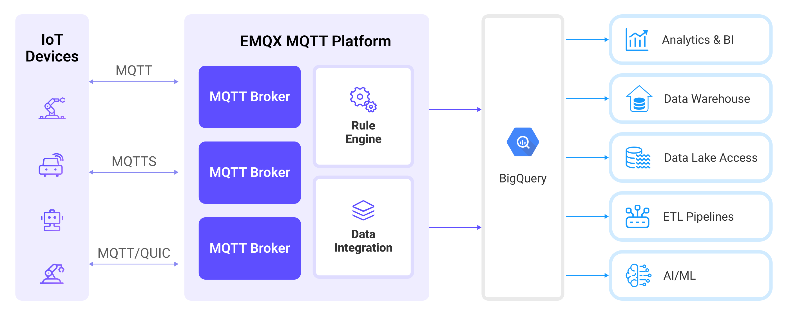
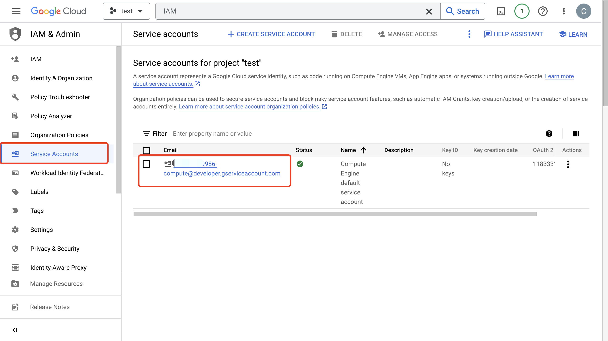

# BigQueryへのMQTTデータ取り込み

[BigQuery](https://cloud.google.com/bigquery?hl=en)は、大量のリレーショナル構造化データ向けのエンタープライズデータウェアハウスです。大規模かつアドホックなSQLベースの分析およびレポーティングに最適化されており、組織の洞察を得るのに最適です。EMQXは、MQTTデータのリアルタイム抽出、処理、分析のためにBigQueryとのシームレスな統合をサポートしています。

本ページでは、EMQXとBigQuery間のデータ統合について包括的に紹介し、データ統合の作成および検証に関する実践的な手順を提供します。

## 動作の仕組み

BigQueryデータ統合は、EMQXの標準機能として提供されており、ユーザーがMQTTデータストリームをGoogle Cloudとシームレスに統合し、IoTアプリケーション開発のための豊富なサービスと機能を活用できるよう設計されています。



EMQXはルールエンジンとSinkを介してMQTTデータをBigQueryに転送します。全体のプロセスは以下の通りです：

1. **IoTデバイスがメッセージをパブリッシュ**：デバイスは特定のトピックを通じてテレメトリや状態データをパブリッシュし、ルールエンジンをトリガーします。
2. **ルールエンジンがメッセージを処理**：組み込みのルールエンジンを用いて、特定のソースからのMQTTメッセージをトピックマッチングに基づいて処理します。ルールエンジンは対応するルールをマッチングし、データ形式の変換、特定情報のフィルタリング、コンテキスト情報の付加などの処理を行います。
3. **BigQueryへのブリッジング**：ルールがメッセージをBigQueryに転送するアクションをトリガーします。データプロパティ、オーダーキー、MQTTトピックとBigQueryトピックのマッピングを簡単に設定可能です。これにより、より豊富なコンテキスト情報と順序保証が提供され、柔軟なIoTデータ処理が可能になります。

## 特長と利点

EMQXとBigQueryの統合は、MQTTデータの堅牢でスケーラブルかつリアルタイムなデータパイプラインを提供します。以下の特長と利点により、IoT分析およびデータ駆動型の意思決定を簡素化します：

- **リアルタイムデータ取り込み**：EMQXからBigQueryへMQTTメッセージを低レイテンシでシームレスにストリーム送信。即時処理と分析が必要な時間敏感なアプリケーションに対応。
- **柔軟なデータマッピング**：MQTTトピックおよびメッセージペイロードをBigQueryのテーブルやフィールドにカスタマイズしてマッピング可能。
- **スケーラブルかつサーバレスな分析**：BigQueryの完全マネージドでサーバレスなアーキテクチャを活用し、大規模なIoTデータを分析。
- **Google Cloudエコシステムとの簡単な統合**：Data Studio、Looker、AI PlatformなどのGoogle Cloudサービスとネイティブに連携し、可視化や機械学習を実現。データ収集から洞察生成までのエンドツーエンドパイプライン構築を簡素化。

## はじめる前に

BigQueryデータ統合の作成を開始する前に必要な準備について説明します。

### 前提条件

- EMQXのデータ統合[ルール](./rules.md)に関する知識
- [データ統合](./data-bridges.md)に関する知識

### GCPでのサービスアカウントキーの作成

**Service Account JSON**認証を使用する場合は、Google Cloudでサービスアカウントを作成し、JSON形式のキーを生成してください。

1. GCPアカウントで[サービスアカウント](https://developers.google.com/identity/protocols/oauth2/service-account#creatinganaccount)を作成します。サービスアカウントには、使用するデータセットおよびテーブルへのアクセス権限が必要です。例えば、「BigQuery Data Editor」ロールを付与して対象データセットやテーブルの読み書きを許可するか、少なくともデータの読み書きアクセス権を持たせます。

2. 作成したサービスアカウントのメールアドレスをクリックします。

3. **Key**タブをクリックし、**Add key**のドロップダウンから**Create new key**を選択して、サービスアカウントキーをJSON形式で作成しダウンロードします。

   ::: tip

   ダウンロードしたサービスアカウントキーは、後でEMQXがBigQuery認証に使用するため、安全に保管してください。

   :::

   

### GCPでのWorkload Identity Federationの設定

Workload Identity Federation（WIF）を使用すると、EMQXは長期間有効なサービスアカウントキーを使わずにGCPリソースにアクセス可能です。EMQXは外部IDプロバイダー（例：Microsoft Azure）からのトークンをGCPのSecurity Token Service経由で一時的なGCPトークンに交換し、そのトークンでGCPサービスアカウントをなりすまします。トークンの更新は自動で行われます。

WIFを使用するには、コネクター作成前にGCPプロジェクトで以下を完了してください。

1. Google Cloudコンソールで**IAM & Admin** -> **Workload Identity Federation**に移動し、ワークロードアイデンティティプールを作成し、**Pool ID**と**Project Number**を控えます。

2. プールにプロバイダーを追加し、**Provider ID**を控えます。OIDCベースの認証の場合、外部IDプロバイダーからOAuth 2.0クライアント認証情報（クライアントID、クライアントシークレット、トークンエンドポイントURI）を取得します。

3. ワークロードアイデンティティプールに、BigQueryデータセットおよびテーブルにアクセス可能なGCPサービスアカウントをなりすます権限を付与します。コネクター設定時にサービスアカウントのメールアドレスが必要です。

   ::: tip

   詳細は[Workload Identity Federationの設定](https://cloud.google.com/iam/docs/workload-identity-federation-with-other-providers)を参照してください。

   :::

**例：Microsoft Azure（Entra ID）**

[Microsoft Entra ID](https://portal.azure.com/)でAPIを公開するアプリケーションを登録し、クライアントシークレットを作成します。コネクター設定時には以下の値を使用します：

| コネクター項目 | 値 |
|---|---|
| **Endpoint URI** | `https://login.microsoftonline.com/<tenant-id>/oauth2/v2.0/token` |
| **OAuth Client ID** | `api://<application-id>`形式のアプリケーション（クライアント）ID |
| **OAuth Client Secret** | アプリケーション用に生成したクライアントシークレット |
| **OAuth Request Scope** | `api://<application-id>/.default` |

::: tip 注意

`scope`はアプリケーションのaudience（aud）と完全に一致させる必要があります。そうしないとGCP STSとのトークン交換が失敗します。詳細はMicrosoftの[OAuth 2.0クライアント認証フロー](https://learn.microsoft.com/en-us/entra/identity-platform/v2-oauth2-client-creds-grant-flow)を参照してください。

サービスアカウントにWIFプールへのアクセス権を付与する際は、Subject値に**Object ID**（アプリケーションIDではなく）を使用してください。Object IDはAzureポータルのアプリケーションの概要ページの**Enterprise applications**に表示されます。

:::

### Attached Service Accountの前提条件

**Attached Service Account**認証を使用する場合、EMQXはGCP Compute Engineインスタンス上で実行され、サービスアカウントがアタッチされている必要があります。インスタンスのOAuthアクセススコープがBigQueryへのアクセスを許可していることを確認してください。Googleは`cloud-platform`スコープ（`https://www.googleapis.com/auth/cloud-platform`）の使用を推奨し、サービスアカウントの権限はIAMロールで制限してください。サービスアカウントは対象のBigQueryデータセットおよびテーブルにアクセスできる権限を持つ必要があります。詳細はGoogle Cloudの[サービスアカウント](https://cloud.google.com/compute/docs/access/service-accounts)を参照してください。

対象のBigQueryデータセットおよびテーブルは、Compute Engineインスタンスに関連付けられたGCPプロジェクト内に存在する必要があります。EMQXクラスターの場合、すべてのノードがこれらの要件を満たし、そのプロジェクトのCompute Engineインスタンス上で実行されている必要があります。

コネクター起動時にEMQXは自動的にインスタンスメタデータエンドポイントからGCPプロジェクトIDとアクセストークンを取得します。サービスアカウントキーのアップロードは不要です。

### GCPでのデータセットおよびテーブルの作成と管理

EMQXでBigQueryデータ統合を設定する前に、GCPで必要なデータセットとテーブルを作成してください。

1. Google Cloudコンソールで**BigQuery** -> **Studio**ページに移動します。詳細は[データのロードとクエリ](https://cloud.google.com/bigquery/docs/quickstarts/load-data-console)クイックスタートガイドを参照してください。

   ::: tip

   使用するサービスアカウントは、対象テーブルに対して書き込み権限を持っている必要があります。

   :::

2. **Explorer**ペインでケバブアイコン（⋮）をクリックし、**Create dataset**を選択します。データセット名を定義し、**Create dataset**をクリックします。

3. データセット作成後、**Explorer**ペインでデータセットをクリックし、**(+) Create table**をクリックします。

   - ソースを「Empty Table」に設定します。

   - テーブル名を入力します。

   - テーブルスキーマを定義します。例として、**Edit as text**トグルをクリックし、以下のスキーマ定義をテキストフィールドに貼り付けます。

     ```
     clientid:string,payload:bytes,topic:string,publish_received_at:timestamp
     ```

   - **Create table**をクリックして設定を完了します。

4. EMQXがデータを書き込めるように権限を設定します：

   - データセットを選択し、**Share**をクリックします。  
   - サービスアカウントのメールアドレスをプリンシパルとして追加します。
   - 適切なロールを割り当てます。例：
     - データセットに対して「BigQuery Data Viewer」（読み取りアクセス）
     - テーブルに対して「Editor」（読み書きアクセス）

5. テーブル作成後、クエリを実行して確認できます：

   - テーブルをクリックし、**Query**をクリックします。

   - 以下のような簡単なSQLを実行してテーブルにアクセスできることを確認します：

     ```sql
     SELECT * FROM `my_project.my_dataset.my_tab` LIMIT 1000
     ```

## BigQueryコネクターの作成

BigQuery Producer Sinkアクションを追加する前に、EMQXとBigQuery間の接続を確立するためのBigQueryコネクターを作成します。

1. EMQXダッシュボードで**Integration** -> **Connector**をクリックします。

2. ページ右上の**Create**をクリックし、コネクター選択ページで**BigQuery**を選択して**Next**をクリックします。

3. 名前と説明を入力します（例：`my_bigquery`）。この名前はBigQuery Sinkとコネクターを紐付けるために使用され、クラスター内で一意である必要があります。

4. **Authentication**リストから以下の認証方法のいずれかを選択し、対応するフィールドを設定します：

   - **Service Account JSON**：[GCPでのサービスアカウントキーの作成](#gcpでのサービスアカウントキーの作成)でエクスポートしたJSON形式のサービスアカウント認証情報をアップロードします。

   - **Workload Identity Federation (WIF)**：以下のフィールドを入力します。この方法はサービスアカウントJSONファイルを使用しません。[GCPでのWorkload Identity Federationの設定](#gcpでのworkload-identity-federationの設定)を参照してください。

     - **GCP Project ID**：コネクターがアクセスするリソースのプロジェクトID。

     - **GCP Project Number**：コネクターがアクセスするリソースのプロジェクト番号。

     - **Service Account Email**：なりすますサービスアカウントのメールアドレス。

     - **Workload Identity Pool ID**：WIFトークン交換に使用するワークロードアイデンティティプールのID。

     - **Workload Identity Provider ID**：WIFトークン交換に使用するワークロードアイデンティティプロバイダーのID。

     - **Initial Token Configuration**では認証タイプを選択し、対応するフィールドを入力します。現在は**OIDC with Client Credentials Grant Type**のみサポート：

       - **Endpoint URI**：OIDCプロバイダーのOAuthトークンエンドポイントURI。

       - **OAuth Client ID**：OAuthサーバーからトークンを取得するためのクライアントID。

       - **OAuth Client Secret**：OAuthサーバーからトークンを取得するためのクライアントシークレット。

       - **OAuth Request Scope**：OAuthアクセストークン取得時に必要な場合の`scope`。

       - **Enable TLS**：EMQX 6.3.3以降で利用可能。OIDCトークンエンドポイントへの初期トークンリクエストに対するTLS設定。TLSおよびサーバー証明書検証はデフォルトで有効。プライベートCA署名証明書を使用する場合は対応するCA証明書を設定してください。詳細は[外部リソースアクセスのTLS](../../guides/network/overview.md#tls-for-external-resource-access)を参照。

   - **Attached Service Account**：追加のフィールドは不要です。EMQXはインスタンスメタデータエンドポイントからGCPプロジェクトIDとアクセストークンを自動取得します。[Attached Service Accountの前提条件](#attached-service-accountの前提条件)を参照してください。

5. **Create**をクリックする前に、**Test Connectivity**をクリックしてコネクターがBigQueryサーバーに接続できるかテストできます。

6. ページ下部の**Create**ボタンをクリックしてコネクターの作成を完了します。ポップアップダイアログで**Back to Connector List**をクリックするか、**Create Rule**をクリックしてBigQueryに転送するデータを指定するSink付きのルール作成に進めます。詳細は[BigQuery Sink付きルールの作成](#bigquery-sink付きルールの作成)を参照してください。

## BigQuery Sink付きルールの作成

このセクションでは、BigQueryに保存するデータを指定するルールの作成方法を説明します。

1. EMQXダッシュボードで**Integration** -> **Rules**をクリックします。

2. ページ右上の**Create**をクリックします。

3. ルールIDに`my_rule`と入力します。

4. **SQL Editor**でルールを設定します。例えば、トピック`t/bq`のMQTTメッセージをBigQueryに保存したい場合、以下のSQL文を使用します。

   注意：独自のSQL文を指定する場合、Sinkのペイロードテンプレートで必要なすべてのフィールドを`SELECT`部分に含めるようにしてください。

   ```sql
   SELECT
     clientid,
     topic,
     base64_encode(payload) AS payload,
     timestamp/1000 AS publish_received_at
   FROM
     "t/bq"
   ```

   ::: tip 注意

   BigQueryテーブルのカラムに存在しないフィールドは選択しないでください。BigQueryが未知のフィールドとして認識しません。

   :::

   ::: tip

   初心者の方は**SQL Examples**をクリックし、**Enable Test**でSQLルールを学習・テストできます。

   :::

5. **Add Action**ボタンをクリックして、ルールによってトリガーされるアクションを定義します。**Type of Action**ドロップダウンから`BigQuery`を選択し、EMQXがルールで処理したデータをBigQueryに送信するようにします。

6. **Action**ドロップダウンは`Create Action`のままにするか、既存のBigQuery Sinkを選択できます。本例では新しいSinkを作成してルールに追加します。

7. **Name**フィールドにSinkの名前を入力します。名前は英数字の組み合わせで指定してください。

8. **Connector**ドロップダウンから先ほど作成した`my_bigquery`を選択します。新しいコネクターを作成する場合は、ドロップダウン横のボタンをクリックしてください。設定パラメーターの詳細は[コネクターの作成](#bigqueryコネクターの作成)を参照してください。

9. 以下のBigQueryリソースパラメーターを設定します：

   - **Project ID**（任意）：対象のデータセットとテーブルが含まれるGCPプロジェクトのIDを入力します。指定すると、選択したコネクターの認証設定から取得したプロジェクトIDを上書きし、このSinkにのみ適用されます。空欄の場合は認証設定から取得したプロジェクトIDが使用されます。

   - **Dataset**および**Table**：[GCPでのデータセットおよびテーブルの作成と管理](#gcpでのデータセットおよびテーブルの作成と管理)で作成したデータセット名とテーブル名をそれぞれ入力します。

12. **フォールバックアクション（任意）**：メッセージ配信失敗時の信頼性向上のため、1つ以上のフォールバックアクションを定義できます。これらはプライマリSinkがメッセージ処理に失敗した場合にトリガーされます。詳細は[フォールバックアクション](./data-bridges.md#fallback-actions)を参照してください。

13. **詳細設定（任意）**：必要に応じて詳細設定オプションを構成します。詳細は[詳細設定](#詳細設定)を参照してください。

14. **Create**をクリックする前に、**Test Connectivity**をクリックしてコネクターがBigQueryサーバーに接続できるかテストできます。

15. **Create**ボタンをクリックしてSinkの設定を完了すると、新しいSinkが**Action Outputs**タブに表示されます。

16. **Create Rule**ページに戻り、**Create**をクリックしてルールを作成します。

これでルールの作成が完了しました。**Integration** -> **Rules**ページで新規作成したルールを確認できます。**Actions(Sink)**タブをクリックすると、新しいBigQuery Sinkが表示されます。

また、**Integration** -> **Flow Designer**をクリックするとトポロジーが表示され、トピック`t/bq`のメッセージがルール`my_rule`で解析されBigQueryに送信・保存されていることが確認できます。

## ルールのテスト

1. MQTTXを使用してトピック`t/bq`にメッセージを送信します。

   ```bash
   mqttx pub -i emqx_c -t t/bq -m '{ "msg": "hello BigQuery" }'
   ```

2. Sinkの稼働状況を確認し、新しい受信メッセージと送信メッセージがそれぞれ1件ずつあることを確認します。

3. GCPの**BigQuery** -> **Studio**に移動し、テーブルをクリックして**Query**をクリックします。クエリを実行するとメッセージが確認できます。

## 詳細設定

このセクションでは、BigQuery Producer Sinkの詳細な設定オプションについて説明します。ダッシュボードのSink設定時に**Advanced Settings**を展開し、用途に応じて以下のパラメーターを調整できます。

| フィールド名                       | 説明                                                  | デフォルト値   |
| -------------------------------- | ----------------------------------------------------- | --------------- |
| **Buffer Pool Size**             | EMQXとBigQuery間のデータフローを管理するバッファワーカープロセスの数を指定します。これらのワーカーはデータを一時的に保持・処理し、ターゲットサービスへの送信を最適化しスムーズなデータ伝送を保証します。 | `16`            |
| **Request TTL**                  | リクエストTTL（Time To Live）は、リクエストがバッファに入ってから有効とみなされる最大秒数を指定します。TTLを超えてバッファに滞留するか、送信後にBigQueryからの応答やアックがタイムリーに得られない場合、リクエストは期限切れとみなされます。 | `45`秒          |
| **Health Check Interval**        | SinkがBigQueryとの接続状態を自動的にヘルスチェックする間隔（秒）を指定します。 | `15`秒          |
| **Health Check Interval Jitter** | 複数ノードが同時にヘルスチェックを開始するのを防ぐため、ヘルスチェック間隔に加える一様ランダム遅延です。複数のアクションやソースが同じコネクターを共有する場合、ジッターを有効にするとヘルスチェックの開始タイミングが分散されます。 | `0`ミリ秒       |
| **Health Check Timeout**         | コネクターがBigQueryとの接続状態をヘルスチェックする際のタイムアウト時間（秒）を指定します。 | `60`秒          |
| **Max Buffer Queue Size**        | BigQuery Sinkの各バッファワーカーがバッファリング可能な最大バイト数を指定します。バッファワーカーはデータを一時的に保持し、BigQueryへの送信を効率化します。システム性能やデータ伝送要件に応じて調整してください。 | `256`           |
| **Query Mode**                   | メッセージ送信を最適化するために、`synchronous`または`asynchronous`のリクエストモードを選択できます。非同期モードでは、BigQueryへの書き込みがMQTTメッセージのパブリッシュ処理をブロックしません。ただし、クライアントがBigQuery到達前にメッセージを受け取る可能性があります。 | `Async`         |
| **Batch Size**                   | EMQXからBigQueryへ一度に送信するデータバッチの最大サイズを指定します。サイズを調整することでデータ転送の効率や性能を最適化できます。`Batch Size`を`1`に設定すると、データレコードはバッチ化せず個別に送信されます。 | `1000`          |
| **Inflight Window**              | 「インフライトキューリクエスト」とは、送信済みでまだ応答やアックを受け取っていないリクエストを指します。この設定は、SinkがBigQueryと通信中に同時に存在可能なインフライトリクエストの最大数を制御します。**Request Mode**が`asynchronous`の場合に特に重要です。同一MQTTクライアントからのメッセージを厳密に順次処理する必要がある場合、この値を`1`に設定してください。 | `100`           |
