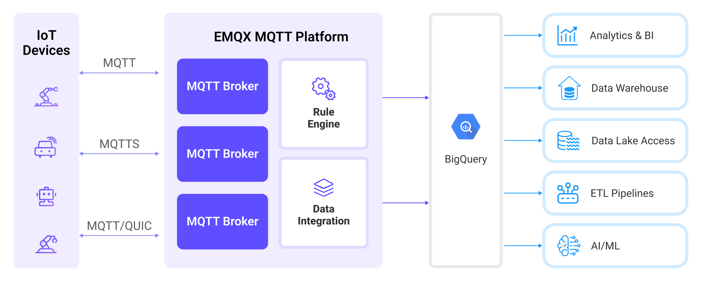
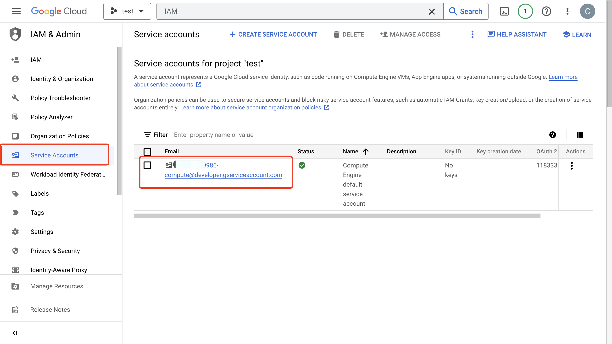

# BigQueryへのMQTTデータ取り込み

[BigQuery](https://cloud.google.com/bigquery?hl=en) は、大量のリレーショナル構造化データを扱うエンタープライズ向けデータウェアハウスです。大規模なアドホックSQLベースの分析やレポーティングに最適化されており、組織の洞察を得るのに適しています。EMQXは、MQTTデータのリアルタイム抽出、処理、分析のためにBigQueryとのシームレスな統合をサポートしています。

本ページでは、EMQXとBigQuery間のデータ統合について包括的に紹介し、データ統合の作成および検証に関する実践的な手順を提供します。

## 動作概要

BigQueryデータ統合は、EMQXの標準機能として提供されており、ユーザーがMQTTデータストリームをGoogle Cloudとシームレスに統合し、IoTアプリケーション開発のための豊富なサービスと機能を活用できるよう設計されています。



EMQXはルールエンジンとSinkを介してMQTTデータをBigQueryに転送します。全体の流れは以下の通りです：

1. **IoTデバイスがメッセージをパブリッシュ**：デバイスは特定のトピックを通じてテレメトリやステータスデータをパブリッシュし、ルールエンジンをトリガーします。
2. **ルールエンジンがメッセージを処理**：組み込みのルールエンジンは、特定のソースからのMQTTメッセージをトピックマッチングに基づいて処理します。ルールエンジンは対応するルールをマッチングし、データ形式の変換、特定情報のフィルタリング、コンテキスト情報の付加などの処理を行います。
3. **BigQueryへのブリッジング**：ルールはメッセージをBigQueryに転送するアクションをトリガーし、データプロパティ、オーダーキー、MQTTトピックからBigQueryトピックへのマッピングを簡単に設定できます。これにより、データ統合における豊富なコンテキスト情報と順序保証が提供され、柔軟なIoTデータ処理が可能になります。

## 特長と利点

EMQXとBigQueryの統合は、MQTTデータのための堅牢でスケーラブルかつリアルタイムなデータパイプラインを提供します。以下の特長と利点により、IoT分析とデータ駆動型の意思決定を簡素化します：

- **リアルタイムデータ取り込み**：EMQXからBigQueryへ低レイテンシでMQTTメッセージをシームレスにストリーミングします。即時処理と分析を必要とする時間敏感なアプリケーションに対応します。
- **柔軟なデータマッピング**：MQTTトピックとメッセージペイロードをBigQueryのテーブルやフィールドにカスタマイズしてマッピング可能です。
- **スケーラブルでサーバレスな分析**：BigQueryのフルマネージドかつサーバレスなアーキテクチャを活用し、大規模なIoTデータ分析を実現します。
- **Google Cloudエコシステムとの簡単な統合**：Data Studio、Looker、AI PlatformなどのGoogle Cloudサービスとネイティブに連携し、可視化や機械学習を容易にします。データ収集から洞察生成までのエンドツーエンドパイプライン構築を簡素化します。

## はじめる前に

このセクションでは、BigQueryデータ統合の作成を開始する前に必要な準備について説明します。

### 前提条件

- EMQXのデータ統合[ルール](./rules.md)に関する知識
- [データ統合](./data-bridges.md)に関する知識

### GCPでのサービスアカウントキーの作成

EMQXがBigQueryに接続できるように、Google Cloudでサービスアカウントを作成し、JSON形式のキーを生成する必要があります。

1. GCPアカウントで[サービスアカウント](https://developers.google.com/identity/protocols/oauth2/service-account#creatinganaccount)を作成します。サービスアカウントには、使用するデータセットやテーブルへのアクセス権限が必要です。例えば、「BigQuery Data Editor」ロールを付与して対象のデータセットやテーブルの読み書きを許可するか、少なくともデータへの読み書きアクセスを持つようにしてください。

2. 作成したサービスアカウントのメールアドレスをクリックします。

3. **Key** タブをクリックし、**Add key** のドロップダウンリストから **Create new key** を選択して、サービスアカウントキーをJSON形式で作成しダウンロードします。

   ::: tip

   ダウンロードしたサービスアカウントキーは、後でEMQXのBigQuery認証に使用するため、安全に保管してください。

   :::

   

### GCPでのWorkload Identity Federationの設定

Workload Identity Federation（WIF）を利用すると、長期間有効なサービスアカウントキーを使わずにEMQXがGCPリソースへアクセスできます。EMQXは外部IDプロバイダー（例：Microsoft Azure）からのトークンをGCPのSecurity Token Service経由で一時的なGCPトークンに交換し、そのトークンを用いてGCPサービスアカウントを代行します。トークンの更新は自動で行われます。

WIFを利用するには、コネクター作成前にGCPプロジェクトで以下を完了してください。

1. Google Cloudコンソールの **IAM & Admin** -> **Workload Identity Federation** でワークロードアイデンティティプールを作成し、**Pool ID** と **Project Number** を控えます。

2. プールにプロバイダーを追加し、**Provider ID** を控えます。OIDC認証の場合、外部IDプロバイダーからOAuth 2.0クライアント認証情報（クライアントID、クライアントシークレット、トークンエンドポイントURI）を取得します。

3. ワークロードアイデンティティプールに、BigQueryのデータセットやテーブルにアクセスできるGCPサービスアカウントの代行権限を付与します。コネクター設定時にサービスアカウントのメールアドレスが必要です。

   ::: tip

   詳細な手順は[Workload Identity Federationの設定](https://cloud.google.com/iam/docs/workload-identity-federation-with-other-providers)を参照してください。

   :::

**例：Microsoft Azure（Entra ID）**

[Microsoft Entra ID](https://portal.azure.com/)でAPIを公開するアプリケーションを登録し、クライアントシークレットを作成します。コネクター設定時には以下の値を使用します：

| コネクター項目 | 値 |
|---|---|
| **Endpoint URI** | `https://login.microsoftonline.com/<tenant-id>/oauth2/v2.0/token` |
| **OAuth Client ID** | アプリケーション（クライアント）ID、形式は `api://<application-id>` |
| **OAuth Client Secret** | アプリケーション用に生成したクライアントシークレット |
| **OAuth Request Scope** | `api://<application-id>/.default` |

::: tip 注意

`scope` はアプリケーションのaudience（aud）と完全に一致させる必要があります。そうしないとGCP STSとのトークン交換が失敗します。詳細はMicrosoftの[OAuth 2.0クライアントクレデンシャルフロー](https://learn.microsoft.com/en-us/entra/identity-platform/v2-oauth2-client-creds-grant-flow)を参照してください。

サービスアカウントにWIFプールへのアクセス権を付与する際は、Subject値に**アプリケーションIDではなくオブジェクトID**を使用してください。オブジェクトIDはAzureポータルのアプリケーションの概要ページの**Enterprise applications**で確認できます。

:::

### GCPでのデータセットとテーブルの作成および管理

EMQXでBigQueryデータ統合を設定する前に、GCPで必要なデータセットとテーブルを作成しておく必要があります。

1. Google Cloudコンソールで **BigQuery** -> **Studio** ページに移動します。詳細は[データのロードとクエリ](https://cloud.google.com/bigquery/docs/quickstarts/load-data-console)のクイックスタートガイドを参照してください。

   ::: tip

   使用するサービスアカウントには、対象テーブルへの書き込み権限が必要です。

   :::

2. **Explorer** ペインでケバブメニュー（⋮）をクリックし、**Create dataset** を選択します。データセット名を定義し、**Create dataset** をクリックします。

3. データセット作成後、**Explorer** ペインでデータセットを選択し、**(+) Create table** をクリックします。

   - ソースは「Empty Table」を選択します。

   - テーブル名を入力します。

   - テーブルスキーマを定義します。例として、**Edit as text** トグルをクリックし、以下のスキーマ定義をテキストフィールドに貼り付けます。

     ```
     clientid:string,payload:bytes,topic:string,publish_received_at:timestamp
     ```

   - **Create table** をクリックして設定を完了します。

4. EMQXが書き込み可能なように権限を設定します：

   - データセットを選択し、**Share** をクリックします。  
   - サービスアカウントのメールアドレスをプリンシパルとして追加します。
   - 以下のような適切なロールを割り当てます：
     - データセットに対して「BigQuery Data Viewer」（読み取りアクセス）
     - テーブルに対して「Editor」（読み書きアクセス）

5. テーブル作成後、クエリを実行して確認できます：

   - テーブルをクリックし、**Query** をクリックします。

   - 以下のような簡単なSQLを実行してテーブルにアクセスできることを確認します：

     ```sql
     SELECT * FROM `my_project.my_dataset.my_tab` LIMIT 1000
     ```

## BigQueryコネクターの作成

BigQuery Producer Sinkアクションを追加する前に、EMQXとBigQuery間の接続を確立するためにBigQueryコネクターを作成する必要があります。

1. EMQXダッシュボードで **Integration** -> **Connector** に移動します。
2. 画面右上の **Create** をクリックし、コネクター選択ページで **BigQuery** を選択して **Next** をクリックします。
3. 名前と説明を入力します（例：`my_bigquery`）。この名前はBigQuery Sinkとコネクターを紐付けるために使用され、クラスター内で一意である必要があります。
4. **Authentication** ドロップダウンから以下の認証方法のいずれかを選択し、対応する項目を入力します：
   - **Service Account JSON**：前述の[サービスアカウントキーの作成](#gcpでのサービスアカウントキーの作成)でエクスポートしたJSON形式のサービスアカウント認証情報をアップロードします。
   - **Workload Identity Federation (WIF)**：以下の項目を入力します。この方法はサービスアカウントJSONファイルを使用しません。詳細は[Workload Identity Federationの設定](#gcpでのworkload-identity-federationの設定)を参照してください。
     - **GCP Project ID**：コネクターがアクセスするリソースのプロジェクトID
     - **GCP Project Number**：コネクターがアクセスするリソースのプロジェクト番号
     - **Service Account Email**：代行するサービスアカウントのメールアドレス
     - **Workload Identity Pool ID**：WIFトークン交換に使用するワークロードアイデンティティプールのID
     - **Workload Identity Provider ID**：WIFトークン交換に使用するワークロードアイデンティティプロバイダーのID
     - **Initial Token Configuration** で認証情報タイプを選択し、対応する項目を入力します。現在サポートされているのは **OIDC with Client Credentials Grant Type** のみです：
       - **Endpoint URI**：OIDCプロバイダーのOAuthトークンエンドポイントURI
       - **OAuth Client ID**：OAuthサーバーからトークンを取得するためのクライアントID
       - **OAuth Client Secret**：OAuthサーバーからトークンを取得するためのクライアントシークレット
       - **OAuth Request Scope**：OAuthアクセストークン取得時に指定するスコープ（プロバイダーによって必要な場合）
5. **Create** をクリックする前に、**Test Connectivity** をクリックしてコネクターがBigQueryサーバーに接続可能かテストできます。
6. 画面下部の **Create** ボタンをクリックしてコネクターの作成を完了します。ポップアップダイアログで **Back to Connector List** をクリックするか、**Create Rule** をクリックしてSink付きのルール作成に進むことができます。詳細は[BigQuery Sink付きルールの作成](#create-a-rule-with-bigquery-sink)を参照してください。

## BigQuery Sink付きルールの作成

このセクションでは、BigQueryに保存するデータを指定するルールの作成方法を示します。

1. EMQXダッシュボードで **Integration** -> **Rules** に移動します。

2. 画面右上の **Create** をクリックします。

3. ルールIDに `my_rule` と入力します。

4. **SQL Editor** でルールを設定します。例えば、トピック `t/bq` のMQTTメッセージをBigQueryに保存したい場合、以下のSQL文を使用できます。

   注意：独自のSQL文を指定する場合は、Sinkのペイロードテンプレートで必要なすべてのフィールドが `SELECT` 部分に含まれていることを確認してください。

   ```sql
   SELECT
     clientid,
     topic,
     base64_encode(payload) AS payload,
     timestamp/1000 AS publish_received_at
   FROM
     "t/bq"
   ```

   ::: tip 注意

   BigQueryテーブルのカラムに存在しないフィールドは選択しないでください。BigQueryが不明なフィールドとして認識できません。

   :::

   ::: tip

   初心者の方は **SQL Examples** と **Enable Test** をクリックしてSQLルールの学習とテストができます。

   :::

5. **Add Action** ボタンをクリックして、ルールによってトリガーされるアクションを定義します。**Type of Action** ドロップダウンから `BigQuery` を選択すると、EMQXはルールで処理されたデータをBigQueryに送信します。

6. **Action** ドロップダウンは `Create Action` のままにするか、既存のBigQuery Sinkを選択できます。この例では新しいSinkを作成してルールに追加します。

7. **Name** フィールドにSinkの名前を入力します。名前は英数字の組み合わせで指定してください。

8. **Connector** ドロップダウンから先ほど作成した `my_bigquery` を選択します。新しいコネクターを作成する場合は、ドロップダウン横のボタンをクリックします。設定パラメータの詳細は[コネクターの作成](#bigqueryコネクターの作成)を参照してください。

9. **Dataset** と **Table** に、[GCPでのデータセットとテーブルの作成および管理](#gcpでのデータセットとテーブルの作成および管理)で作成したデータセット名とテーブル名をそれぞれ入力します。

12. **フォールバックアクション（オプション）**：メッセージ配信失敗時の信頼性向上のため、1つ以上のフォールバックアクションを定義できます。プライマリSinkがメッセージ処理に失敗した場合にこれらのアクションがトリガーされます。詳細は[フォールバックアクション](./data-bridges.md#fallback-actions)を参照してください。

13. **詳細設定（オプション）**：必要に応じて詳細設定オプションを構成します。詳細は[詳細設定](#advanced-settings)を参照してください。

14. **Create** をクリックする前に、**Test Connectivity** をクリックしてコネクターがBigQueryサーバーに接続可能かテストできます。

15. **Create** ボタンをクリックしてSinkの設定を完了すると、新しいSinkが **Action Outputs** タブに表示されます。

16. **Create Rule** ページに戻り、**Create** をクリックしてルールを作成します。

これでルールの作成が完了しました。**Integration** -> **Rules** ページで新規作成したルールを確認できます。**Actions(Sink)** タブをクリックすると、新しいBigQuery Sinkが表示されます。

また、**Integration** -> **Flow Designer** をクリックするとトポロジーが表示され、トピック `t/bq` のメッセージがルール `my_rule` によって解析され、BigQueryに送信・保存されていることが確認できます。

## ルールのテスト

1. MQTTXを使用してトピック `t/bq` にメッセージを送信します。

   ```bash
   mqttx pub -i emqx_c -t t/bq -m '{ "msg": "hello BigQuery" }'
   ```

2. Sinkの稼働状況を確認し、新しい受信メッセージと送信メッセージが1件ずつあることを確認します。

3. GCPの **BigQuery** -> **Studio** に移動し、テーブルをクリックして **Query** をクリックします。クエリを実行するとメッセージが確認できます。

## 詳細設定

このセクションでは、BigQuery Producer Sinkの詳細な設定オプションについて説明します。ダッシュボードでSinkを設定する際に、**Advanced Settings** を展開し、以下のパラメータをニーズに応じて調整できます。

| 項目名                           | 説明                                                                                           | デフォルト値       |
| -------------------------------- | ---------------------------------------------------------------------------------------------- | ------------------ |
| **Buffer Pool Size**             | EMQXとBigQuery間のデータフローを管理するバッファワーカープロセスの数を指定します。これらのワーカーはデータを一時的に保持・処理し、ターゲットサービスへの送信を最適化し、スムーズなデータ伝送を保証します。 | `16`               |
| **Request TTL**                  | リクエストがバッファに入ってから有効とみなされる最大時間（秒）を指定します。このタイマーはリクエストがバッファに入った時点で開始されます。TTLを超えてバッファに留まるか、BigQueryからの応答やアックがタイムリーに得られない場合、リクエストは期限切れと見なされます。 | `45` 秒            |
| **Health Check Interval**        | SinkがBigQueryとの接続の自動ヘルスチェックを行う間隔（秒）を指定します。                                         | `15` 秒            |
| **Health Check Interval Jitter** | 基本のヘルスチェック間隔に加える一様ランダム遅延で、複数ノードが同時にヘルスチェックを開始する可能性を減らします。複数のアクションやソースが同じコネクターを共有する場合、ジッターを有効にするとヘルスチェックの開始時刻がずれます。 | `0` ミリ秒         |
| **Health Check Timeout**         | コネクターがBigQueryとの接続の自動ヘルスチェックを行う際のタイムアウト時間を指定します。                                   | `60` 秒            |
| **Max Buffer Queue Size**        | BigQuery Sinkの各バッファワーカープロセスがバッファリング可能な最大バイト数を指定します。バッファワーカーはデータを一時的に保持し、BigQueryへの送信を効率化します。システム性能やデータ伝送要件に応じて調整してください。 | `256`              |
| **Query Mode**                   | メッセージ送信を最適化するために、`synchronous`（同期）または`asynchronous`（非同期）のリクエストモードを選択できます。非同期モードでは、BigQueryへの書き込みがMQTTメッセージのパブリッシュ処理をブロックしませんが、クライアントがBigQuery到達前にメッセージを受信する可能性があります。 | `Async`            |
| **Batch Size**                   | EMQXからBigQueryへ一度に送信するデータバッチの最大サイズを指定します。サイズを調整することでデータ転送の効率とパフォーマンスを最適化できます。`Batch Size` を `1` に設定すると、データレコードはバッチ化されず個別に送信されます。 | `1000`             |
| **Inflight Window**              | 「インフライトキューレクエスト」とは、開始されたがまだ応答やアックを受け取っていないリクエストを指します。この設定はBigQueryとの通信時に同時に存在可能なインフライトキューレクエストの最大数を制御します。**Request Mode** が `asynchronous` の場合に特に重要です。同一MQTTクライアントからのメッセージを厳密に順序処理する必要がある場合、この値を `1` に設定してください。 | `100`              |
