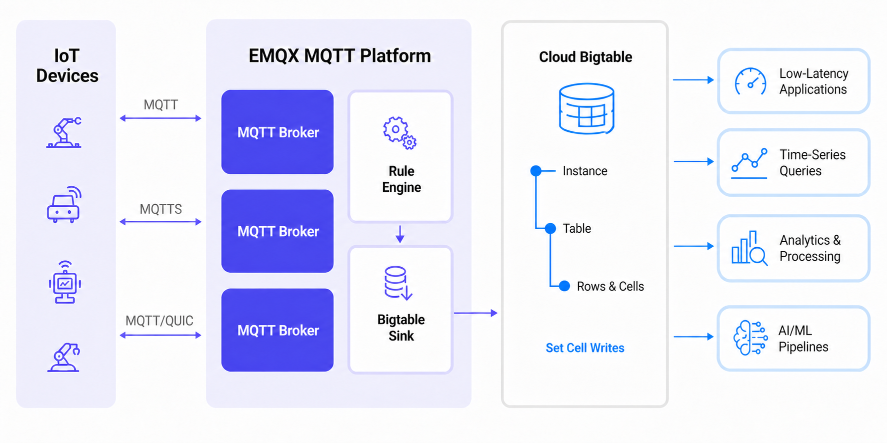

# Bigtable に MQTT データを取り込む

[Cloud Bigtable](https://cloud.google.com/bigtable) は、Google Cloud 上のフルマネージドのワイドカラム型 NoSQL データベースサービスです。時系列データ、テレメトリストレージ、イベント記録、高スループットの IoT データ取り込みなど、大規模かつ低レイテンシのワークロード向けに設計されています。

EMQX はルールエンジンと Bigtable Sink を通じて Bigtable との連携をサポートしています。MQTT メッセージをルール SQL で処理し、選択したフィールドを Bigtable の行キーやセルのミューテーションにマッピングし、処理済みデータをリアルタイムで Bigtable テーブルに書き込みます。

本ページでは、Bigtable データ統合の仕組みを紹介し、EMQX ダッシュボードでの連携作成およびテストのワークフローを説明します。

## 動作概要

Bigtable データ統合は EMQX の標準機能です。MQTT データを Google Cloud にストリーミングし、デバイスのテレメトリやイベントデータを Bigtable に保存して、後のクエリ、分析、下流処理に活用できます。



EMQX はルールエンジンと Sink を介して MQTT データを Bigtable に転送します。処理の流れは以下の通りです。

1. **IoT デバイスがメッセージをパブリッシュ**：デバイスはテレメトリ、状態、イベントデータを MQTT トピックにパブリッシュします。
2. **ルールエンジンがメッセージを処理**：ルールエンジンはトピックで MQTT メッセージをマッチングし、SQL で Bigtable に必要なフィールドを抽出・変換します。
3. **Bigtable への書き込み**：Bigtable Sink は各ルールの出力レコードを行ミューテーションとして Bigtable テーブルに書き込みます。設定された行キーや `set_cell` ミューテーションのフィールドを使用します。下流のアプリケーションやサービスは保存済みデータを低レイテンシアプリケーション、時系列クエリ、分析処理、AI/ML パイプラインに活用できます。

## 特長とメリット

EMQX と Bigtable の連携により、以下のメリットがあります。

- **高スループットの IoT データ取り込み**：大規模なテレメトリやイベントワークロード向けに MQTT メッセージを Bigtable に書き込み可能。
- **柔軟なフィールドマッピング**：ルール SQL で Bigtable の行キー、カラムファミリー、カラム修飾子、タイムスタンプ、セル値として使用するフィールドを明示的に選択・エイリアス可能。
- **バッチおよび非同期書き込み**：バッチモードや非同期リクエストモードを活用し、書き込みスループットを向上させつつ MQTT メッセージのパブリッシュへの影響を軽減。
- **Google Cloud との統合**：Bigtable に MQTT データを保存し、他の Google Cloud サービスと連携して分析、処理、アプリ開発に活用可能。

## はじめる前に

Bigtable データ統合を作成する前に必要な準備を説明します。

### 前提条件

- EMQX データ統合の[ルール](./rules.md)に関する知識
- [データ統合](./data-bridges.md)に関する知識
- Bigtable が有効な Google Cloud プロジェクト
- Bigtable インスタンス、テーブル、および少なくとも1つのカラムファミリー
- 使用予定の認証方式に応じた認証情報：
  - **サービスアカウント JSON**：サービスアカウントキーの JSON ファイル
  - **Workload Identity Federation (WIF)**：ワークロードアイデンティティプール、プロバイダー、プロジェクトID、プロジェクト番号、サービスアカウントメール、外部 ID プロバイダーの OAuth 2.0 クライアント認証情報
  - **アタッチドサービスアカウント**：GCP Compute Engine 上で動作する EMQX デプロイメントで、[アタッチドサービスアカウントの前提条件](#attached-service-account-prerequisites)を満たすもの

### GCP でサービスアカウントキーを作成する

**サービスアカウント JSON** 認証を使う場合、Google Cloud でサービスアカウントを作成し、JSON 形式のキーを生成します。

1. GCP アカウントで[サービスアカウント](https://developers.google.com/identity/protocols/oauth2/service-account#creatinganaccount)を作成します。
2. サービスアカウントに Bigtable インスタンスとテーブルへの書き込み権限を付与します。例えば、対象テーブルへのデータ読み書きを許可する Bigtable ロールを割り当てます。
3. 作成したサービスアカウントのメールアドレスをクリックします。
4. **Keys** タブをクリックし、**Add key** のドロップダウンから **Create new key** を選択して JSON 形式のキーをダウンロードします。

   ::: tip

   サービスアカウントキーは安全に保管してください。後で Bigtable コネクター作成時に使用します。

   :::

### GCP で Workload Identity Federation を設定する

Workload Identity Federation (WIF) を使うと、長期間有効なサービスアカウントキーなしで EMQX が GCP リソースにアクセスできます。EMQX は Microsoft Azure などの外部 ID プロバイダーからトークンを受け取り、GCP Security Token Service を通じて一時的な GCP トークンと交換し、GCP サービスアカウントを代行します。トークンの更新は自動で行われます。

WIF を利用するには、コネクター作成前に GCP プロジェクトで以下を完了してください。

1. Google Cloud コンソールで **IAM & Admin** -> **Workload Identity Federation** に移動し、ワークロードアイデンティティプールを作成し、**Pool ID** と **Project Number** を控えます。
2. プールにプロバイダーを追加し、**Provider ID** を控えます。OIDC 認証の場合は、外部 ID プロバイダーから OAuth 2.0 クライアント認証情報（クライアントID、クライアントシークレット、トークンエンドポイント URI、リクエストスコープ）を取得します。
3. ワークロードアイデンティティプールに、Bigtable インスタンスとテーブルにアクセス可能な GCP サービスアカウントを代行する権限を付与します。サービスアカウントメールを控えます。
4. Bigtable リソースを含むプロジェクトの **GCP プロジェクトID** を控えます。

::: tip

詳細は[Workload Identity Federation の設定](https://cloud.google.com/iam/docs/workload-identity-federation-with-other-providers)を参照してください。

:::

例：Microsoft Azure (Entra ID)

[Microsoft Entra ID](https://portal.azure.com/)で API を公開するアプリケーションを登録し、クライアントシークレットを作成します。コネクター設定時に以下の値を使用します。

| コネクター項目 | 値 |
| --- | --- |
| **OAuth Token Endpoint URI** | `https://login.microsoftonline.com/<tenant-id>/oauth2/v2.0/token` |
| **OAuth Client ID** | `api://<application-id>` 形式のアプリケーション（クライアント）ID |
| **OAuth Client Secret** | アプリケーション用に生成したクライアントシークレット |
| **OAuth Request Scope** | `api://<application-id>/.default` |

::: note

**OAuth Request Scope** はアプリケーションのオーディエンス（`aud`）と完全に一致させる必要があります。そうしないと GCP STS とのトークン交換が失敗します。WIF プールにサービスアカウントアクセスを付与する際は、アプリケーションIDではなく **Object ID** をサブジェクト識別子として使用してください。Object ID は Azure ポータルのアプリケーション概要ページの **Enterprise applications** で確認できます。

:::

### アタッチドサービスアカウントの前提条件

**アタッチドサービスアカウント** 認証を使う場合、EMQX は GCP Compute Engine インスタンス上で動作し、サービスアカウントがアタッチされている必要があります。インスタンスの OAuth アクセススコープは Bigtable へのアクセスを許可している必要があります。Google は `cloud-platform` スコープ (`https://www.googleapis.com/auth/cloud-platform`) の使用と IAM ロールによるサービスアカウント権限の制限を推奨しています。サービスアカウントは対象の Bigtable インスタンスとテーブルへのアクセス権限を持つ必要があります。詳細は Google Cloud ドキュメントの[サービスアカウント](https://cloud.google.com/compute/docs/access/service-accounts)を参照してください。

対象の Bigtable インスタンスとテーブルは Compute Engine インスタンスに関連付けられた GCP プロジェクト内に存在する必要があります。EMQX クラスターの場合、すべてのノードがこれらの要件を満たし、同じプロジェクトの Compute Engine インスタンス上で動作している必要があります。

コネクター起動時、EMQX はインスタンスメタデータエンドポイントから GCP プロジェクトIDとアクセストークンを自動取得します。サービスアカウントキーのアップロードは不要です。

### GCP で Bigtable リソースを作成・管理する

EMQX で Bigtable データ統合を設定する前に、Google Cloud で対象の Bigtable リソースを作成します。

1. Google Cloud コンソールで **Bigtable** ページに移動します。
2. Bigtable インスタンスを作成または選択します。インスタンス作成時の **Instance name** は Google Cloud コンソール上の表示名としてのみ使われます。`EMQX MQTT Messages` のような読みやすい名前を入力可能です。**Instance ID** は EMQX で使用する値で、`emqxinst` のようなシンプルな一意識別子にします。
3. テーブルを作成します。テーブルID（例：`mqtt_messages`）を控えます。
4. テーブルに少なくとも1つのカラムファミリーを作成します（例：`cf`）。

   ::: tip

   EMQX は Google Cloud コンソールのインスタンス表示名や `projects/<project-id>/instances/<instance-id>` のような完全修飾リソース名ではなく、**Instance ID** と **Table ID** を使用します。

   :::

## Bigtable コネクターを作成する

Bigtable Sink アクションを追加する前に、EMQX と Bigtable 間の接続を確立するための Bigtable コネクターを作成します。

1. EMQX ダッシュボードで **Integration** -> **Connectors** に移動します。
2. 右上の **Create** をクリックし、**Bigtable** を選択して **Next** をクリックします。
3. コネクター名と説明を入力します（例：`my_bigtable`）。この名前は Bigtable Sink とコネクターを紐づけるために使用され、クラスター内で一意である必要があります。
4. 認証オプションを設定します：
   - **Authentication**：EMQX が GCP に認証する方法を選択します。
     - **Service Account JSON**：[GCP でサービスアカウントキーを作成する](#gcp-でサービスアカウントキーを作成する)でエクスポートした JSON ファイルを **GCP Service Account Credentials** にアップロードします。**Select file** をクリックして JSON ファイルを選択可能です。
     - **Workload Identity Federation (WIF)**：以下の項目を入力します。この方法はサービスアカウント JSON ファイルを必要としません。前提条件は[WIF の設定](#gcp-で-workload-identity-federation-を設定する)を参照してください。
       - **GCP Project ID**：コネクターがアクセスするリソースの GCP プロジェクトID
       - **GCP Project Number**：コネクターがアクセスするリソースの GCP プロジェクト番号
       - **Service Account Email**：代行するサービスアカウントのメールアドレス
       - **Workload Identity Pool ID**：WIF トークン交換に使用するワークロードアイデンティティプールID
       - **Workload Identity Provider ID**：WIF トークン交換に使用するワークロードアイデンティティプロバイダーID
       - **Credential Type**：外部 ID プロバイダーが使用する認証情報タイプ。現在は OIDC クライアント認証情報のみサポート。選択後、以下を入力：
         - **OAuth Client ID**：OAuth サーバーからトークンを要求するためのクライアントID
         - **OAuth Client Secret**：OAuth サーバーからトークンを要求するためのクライアントシークレット
         - **OAuth Token Endpoint URI**：OIDC プロバイダーの OAuth トークンエンドポイント URI
         - **OAuth Request Scope**：OAuth サーバーからアクセストークンを要求する際の `scope`。プロバイダーが要求する場合に入力。
         - **OAuth Request Audience**：OAuth サーバーからアクセストークンを要求する際の `audience`。プロバイダーが要求する場合に入力。
         - **Enable TLS**：EMQX 6.3.3 以降で利用可能。OIDC トークンエンドポイントへの初回トークンリクエストに TLS オプションを設定。TLS とサーバー証明書検証はデフォルトで有効。プライベート CA 発行証明書の場合は対応する CA 証明書を設定可能。詳細は[外部リソースアクセスの TLS](../../guides/network/overview.md#tls-for-external-resource-access)を参照。
     - **Attached Service Account**：追加の入力は不要です。EMQX はインスタンスメタデータエンドポイントから GCP プロジェクトIDとアクセストークンを自動取得します。前提条件は[アタッチドサービスアカウントの前提条件](#attached-service-account-prerequisites)を参照してください。
   - **Enable TLS**：デプロイ環境で TLS が必要な場合に有効化します。
   - **Advanced Settings**：詳細な接続オプションを設定する場合に展開します。
5. **Create** をクリックする前に、**Test Connectivity** をクリックして EMQX が Bigtable に接続できるか検証可能です。
6. **Create** をクリックしてコネクター設定を完了します。作成成功ダイアログが表示され、ルールを作成するか尋ねられます。**Create Rule** をクリックするとコネクターが事前選択された状態でルール作成画面に進みます。**Back To Connector List** をクリックすると戻って後でルールを作成できます。

## Bigtable Sink を使ったルールの作成

MQTT メッセージを Bigtable に書き込むルールの作成方法を説明します。

1. 前ステップで **Create Rule** をクリックした場合、**Add Action** パネルが自動で開き、**Type of Action** が `Bigtable`、コネクターが事前選択されています。まずアクションを設定するため、ステップ5に進みます。アクション作成後にルールページに戻り、ルールIDと SQL を設定してください。そうでない場合はダッシュボードの **Integration** -> **Rules** ページで右上の **Create** をクリックします。
2. ルールIDに `my_rule` を入力します。
3. **SQL Editor** にルール SQL を入力します。Bigtable Sink は Sink で設定したフィールド名を使ってルール出力から値を参照するため、SQL で Bigtable ミューテーションに必要なすべてのフィールドを明示的に選択し、エイリアスを付ける必要があります。

   例：

   ```sql
   SELECT
     clientid AS rk,
     'cf' AS fn,
     '' AS cq,
     payload AS v,
     publish_received_at * 1000 AS tm
   FROM
     "t/bigtable"
   ```

   この例では：

   - `rk` が Bigtable の行キーとして使われます。
   - `fn` がカラムファミリー名として使われます。
   - `cq` がカラム修飾子として使われます。
   - `tm` がマイクロ秒単位のタイムスタンプとして使われます。
   - `v` がセルの値として使われます。

   ::: tip

   Bigtable Sink のフィールドはルール出力のフィールド名を指すキー名であり、テンプレート式ではありません。ルール SQL で必須キーが選択されていない場合、Sink はそのメッセージの Bigtable ミューテーションを構築できません。

   :::

4. **Add Action** をクリックし、**Add Action** パネルで **Type of Action** ドロップダウンから `Bigtable` を選択します。
5. **Action** は `Create Action` のままにするか、既存の Bigtable Sink を選択します。コネクター成功ダイアログからルール作成した場合は、**Type of Action** がすでに `Bigtable`、コネクターが事前選択されています。
6. **Name** に Sink 名を入力します。**Description** に説明を入力することも可能です。
7. **Connectors** で、[Bigtable コネクターの作成](#bigtable-コネクターを作成する)で作成したコネクターを選択します。未選択の場合は、プラスアイコンをクリックしてこのパネルから新規作成も可能です。
8. Bigtable アクションパラメーターを設定します：

   | 項目 | 説明 | 例 |
   | --- | --- | --- |
   | **Instance ID** | Bigtable インスタンス識別子。完全修飾名ではなくシンプルな ID を使用。 | `emqxinst` |
   | **Table ID** | Bigtable テーブル識別子。完全修飾名ではなくシンプルな ID を使用。 | `mqtt_messages` |
   | **Row Key** | メッセージの行キーを含むキー名。 | `rk` |
   | **Mutations** | 受信メッセージに適用するセルミューテーションのリスト。**Add** をクリックしてミューテーションを追加。 | - |
   | **Mutation Type** | ミューテーション操作タイプ。現行統合は Set Cell ミューテーションをサポート。 | `Set Cell` |
   | **Column Family** | ミューテーションのカラムファミリーを含むキー名。 | `fn` |
   | **Column Qualifier** | ミューテーションのカラム修飾子を含むキー名。 | `cq` |
   | **Timestamp (microseconds)** | ミューテーションのタイムスタンプ（マイクロ秒単位）を含むキー名。 | `tm` |
   | **Value** | ミューテーションの値を含むキー名。 | `v` |

9. メッセージ配信失敗時の信頼性向上のために **Fallback Actions** を設定することも可能です。詳細は [Fallback Actions](./data-bridges.md#fallback-actions) を参照してください。
10. 必要に応じて **Advanced Settings** を設定します。詳細は [Advanced Settings](#advanced-settings) を参照してください。
11. **Create** をクリックする前に、**Test Connectivity** をクリックして Sink が Bigtable に接続できるか検証可能です。
12. **Create** をクリックして Sink 設定を完了します。
13. **Create Rule** ページに戻り、**Create** をクリックしてルールを作成します。

## ルールのテスト

1. MQTTX を使ってトピック `t/bigtable` にメッセージをパブリッシュします。

   ```bash
   mqttx pub -i emqx_c -t t/bigtable -m '{ "msg": "hello Bigtable" }'
   ```

2. ルールと Sink のメトリクスを確認します。マッチ数と成功数が増加しているはずです。
3. Google Cloud で対象の Bigtable テーブルをクエリし、以下の内容で行が書き込まれていることを確認します：
   - 行キー：MQTT クライアントID（例：`emqx_c`）
   - カラムファミリー：`cf`
   - カラム修飾子：空文字列
   - セル値：MQTT ペイロード

## 詳細設定

Bigtable コネクターと Sink の一般的な詳細設定を説明します。

### コネクター詳細設定

| 項目 | 説明 | デフォルト値 |
| --- | --- | --- |
| **Connection Pool Size** | Bigtable 用接続プールの接続数。 | `8` |
| **Connect Timeout** | Bigtable への接続確立タイムアウト。 | `5s` |
| **Start Timeout** | コネクター起動タイムアウト。 | `5s` |
| **Health Check Interval** | Bigtable 接続のヘルスチェック間隔。 | `15s` |
| **Health Check Timeout** | コネクターのヘルスチェックタイムアウト。 | `60s` |

### Sink 詳細設定

| 項目 | 説明 | デフォルト値 |
| --- | --- | --- |
| **Buffer Pool Size** | Bigtable へのデータ処理・送信に使うバッファワーカープロセス数。 | `16` |
| **Dispatch Strategy** | バッファワーカーへのリクエスト振り分け戦略。デフォルトは MQTT クライアントID ごとに振り分け。 | `Per Client ID` |
| **Request TTL** | バッファに入ってから有効な最大時間。期限切れの場合は送信またはアック前に失効とみなす。 | `45s` |
| **Health Check Interval** | Bigtable 接続のヘルスチェック間隔。 | `15s` |
| **Health Check Interval Jitter** | ヘルスチェック間隔に加えるランダムジッター。 | `0ms` |
| **Health Check Timeout** | コネクターのヘルスチェックタイムアウト。 | `60s` |
| **Max Buffer Queue Size** | 各バッファワーカーの最大バッファキューサイズ。 | `256MB` |
| **Batch Size** | 1回のバッチで書き込む最大レコード数。`1` に設定するとバッチ処理を無効化。 | `1000` |
| **Query Mode** | リクエストモード。非同期モードでは Bigtable への書き込みが MQTT メッセージのパブリッシュをブロックしない。 | `Async` |
| **Inflight Window** | 非同期モードでの最大同時処理リクエスト数。同一 MQTT クライアントからのメッセージの厳密な順序を保証する場合は `1` に設定。 | `100` |

高スループット環境では、**Connection Pool Size**、**Buffer Pool Size**、**Dispatch Strategy**、**Batch Size**、**Inflight Window** を想定するクラスターのワークロードに合わせて調整してください。例えば、クラスター全体で 2 分間に約 11,000,000 メッセージ、5,000～10,000 MQTT 接続がある場合は、本番利用前に代表的なベンチマークで設定を検証してください。
