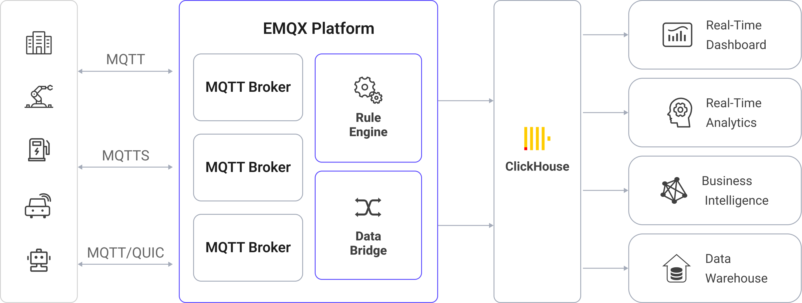

# ClickHouseへのMQTTデータ取り込み

[ClickHouse](https://clickhouse.com/)は、高性能なカラム指向のSQLデータベース管理システム（DBMS）であり、オンライン分析処理（OLAP）に優れています。大量のデータを低レイテンシで処理・分析することに長けており、優れたクエリ性能、柔軟なデータモデル、スケーラブルな分散アーキテクチャを備えているため、さまざまなデータ分析シナリオに適しています。EMQXはClickHouseとの統合をサポートしており、MQTTのメッセージやイベントデータをClickHouseに取り込んで、さらなる分析や処理を行うことが可能です。

## 動作概要

ClickHouseデータ統合は、EMQXに標準搭載された機能であり、MQTTのリアルタイムデータキャプチャおよび送信機能とClickHouseの強力なデータ処理機能を組み合わせることを目的としています。組み込みの[ルールエンジン](https://docs.emqx.com/en/enterprise/v5.1/data-integration/rules.html)コンポーネントにより、EMQXからClickHouseへのデータ取り込みを簡素化し、複雑なコーディングを不要にします。

以下の図は、EMQXとClickHouse間のデータ統合の典型的なアーキテクチャを示しています。



MQTTデータをClickHouseに取り込む流れは以下の通りです：

1. **メッセージのパブリッシュと受信**：産業用IoTデバイスはMQTTプロトコルを通じてEMQXに正常に接続し、機械、センサー、製造ラインの稼働状態、計測値、トリガーイベントに基づくリアルタイムMQTTデータをEMQXにパブリッシュします。EMQXがこれらのメッセージを受信すると、ルールエンジン内でマッチング処理を開始します。  
2. **メッセージデータの処理**：メッセージが到着すると、ルールエンジンを通過し、EMQXで定義されたルールによって処理されます。ルールは事前定義された条件に基づき、ClickHouseにルーティングすべきメッセージを判別します。ペイロードの変換が指定されている場合は、データ形式の変換、特定情報のフィルタリング、追加コンテキストによるペイロードの強化などの変換処理が適用されます。
3. **ClickHouseへのデータ取り込み**：ルールエンジンがClickHouseへの保存対象メッセージを特定すると、メッセージをClickHouseに転送するアクションがトリガーされます。処理済みデータはClickHouseデータベースのコレクションにシームレスに書き込まれます。
4. **データの保存と活用**：データがClickHouseに保存された後、企業はそのクエリ機能を活用してさまざまな用途に利用できます。たとえば、物流やサプライチェーン管理の分野では、GPSトラッカー、温度センサー、在庫管理システムなどのIoTデバイスからのデータをリアルタイムで監視・分析し、追跡、ルート最適化、需要予測、効率的な在庫管理に役立てることが可能です。

## 特長とメリット

ClickHouseとのデータ統合は、効率的なデータ送信、保存、活用を実現するために以下のような特長とメリットを提供します：

- **リアルタイムデータストリーミング**：EMQXはリアルタイムデータストリームの処理に最適化されており、ソースシステムからClickHouseへの効率的かつ信頼性の高いデータ送信を保証します。即時の洞察やアクションを必要とするユースケースに最適です。
- **高性能かつスケーラブル**：EMQXの分散アーキテクチャとClickHouseのカラムナーストレージ形式により、データ量の増加に応じてシームレスにスケール可能です。大規模データセットでも一貫した性能と応答性を維持します。
- **柔軟なデータ変換**：EMQXは強力なSQLベースのルールエンジンを提供し、ClickHouseに保存する前にデータの前処理が可能です。フィルタリング、ルーティング、集約、強化など多様なデータ変換をサポートし、ニーズに応じたデータ整形を実現します。
- **簡単なデプロイと管理**：EMQXはデータソースの設定、データ前処理ルール、ClickHouse保存設定をユーザーフレンドリーなインターフェースで提供し、データ統合プロセスのセットアップと運用管理を簡素化します。
- **高度な分析機能**：ClickHouseの強力なSQLクエリ言語と複雑な分析関数のサポートにより、IoTデータから価値ある洞察を得られ、予測分析や異常検知などが可能です。

## はじめる前に

このセクションでは、EMQXダッシュボードでClickHouseデータ統合を作成する前に必要な準備について説明します。

### 前提条件

- EMQXデータ統合の[ルール](./rules.md)に関する知識
- [データ統合](./data-bridges.md)に関する知識
- UNIXターミナルおよびコマンドの基本知識

### ClickHouseサーバーの起動

ここでは、[Docker](https://www.docker.com/)を使用してClickHouseサーバーを起動する方法を紹介します。

1. `init.sql`というファイルを作成し、以下の初期化SQL文を記述します。このファイルはコンテナ起動時にデータベースを初期化するために使用します。

   ```bash
   cat >init.sql <<SQL_INIT
   CREATE DATABASE IF NOT EXISTS mqtt_data;
   CREATE TABLE IF NOT EXISTS mqtt_data.messages (
      data String,
      arrived TIMESTAMP
   ) ENGINE = MergeTree()
   ORDER BY arrived;
   SQL_INIT
   ```

2. 以下のコマンドでClickHouseサーバーを起動します。このコマンドはデータベース名、ポート番号、ユーザー名、パスワードを指定し、カレントディレクトリの`init.sql`ファイルをDockerの初期化ディレクトリにマウントします。

   ```bash
   docker run \
   --rm \
   -e CLICKHOUSE_DB=mqtt_data \
   -e CLICKHOUSE_USER=emqx \
   -e CLICKHOUSE_DEFAULT_ACCESS_MANAGEMENT=1 \
   -e CLICKHOUSE_PASSWORD=public \
   -p 18123:8123 \
   -p 19000:9000 \
   --ulimit nofile=262144:262144 \
   -v $pwd/init.sql:/docker-entrypoint-initdb.d/init.sql \
   clickhouse/clickhouse-server
   ```

DockerでのClickHouseの実行に関する詳細は[dockerhub](https://hub.docker.com/r/clickhouse/clickhouse-server)をご参照ください。

## コネクターの作成

このセクションでは、SinkをClickHouseサーバーに接続するためのコネクターの作成方法を説明します。

以下の手順は、EMQXとClickHouseの両方をローカルマシンで実行していることを前提としています。リモートで実行している場合は設定を適宜調整してください。

1. EMQXダッシュボードにアクセスし、**Integration** -> **Connectors**をクリックします。
2. 画面右上の**Create**をクリックします。
3. **Create Connector**ページで**ClickHouse**を選択し、**Next**をクリックします。
4. **Configuration**ステップで以下の情報を設定します：
   - **Connector name**：コネクター名を入力します。英数字の大文字・小文字の組み合わせで、例：`my_clickhouse`
   - **Server URL**：`http://127.0.0.1:18123`
   - **Database Name**：`mqtt_data`
   - **Username**：`emqx`
   - **Password**：`public`
   - **Enable TLS**：EMQX 6.3.3以降で利用可能です。ClickHouseサーバーがHTTPSを使用している場合は有効にしてください。EMQXはデフォルトでサーバー証明書を検証します。プライベートCA署名の場合は対応するCA証明書を設定してください。詳細は[外部リソースアクセスのTLS](../../guides/network/overview.md#tls-for-external-resource-access)を参照してください。
5. 高度な設定（任意）：[高度な設定](#advanced-configurations)を参照してください。
6. **Create**をクリックする前に、**Test Connectivity**をクリックしてコネクターがClickHouseサーバーに接続可能かテストできます。
7. 画面下部の**Create**ボタンをクリックしてコネクターの作成を完了します。ポップアップダイアログで**Back to Connector List**をクリックするか、**Create Rule**をクリックしてルールとSinkの作成を続行できます。詳細は[ClickHouse Sink付きルールの作成](#create-a-rule-with-clickhouse-sink)を参照してください。

## ClickHouse Sink付きルールの作成

このセクションでは、DashboardでMQTTのソーストピック`t/#`からのメッセージを処理し、処理結果を設定済みのSink経由でClickHouseに転送するルールの作成方法を説明します。

1. EMQXダッシュボードで左メニューから**Integration** -> **Rules**をクリックします。
2. 画面右上の**Create**をクリックします。
3. ルールIDを入力します。例：`my_rule`
4. SQLエディターに以下のステートメントを入力します。これはトピックパターン`t/#`にマッチするMQTTメッセージを転送します。

   ```sql
   SELECT 
     payload as data,
     now_timestamp() as timestamp
   FROM
     "t/#"
   ```

   注：初心者の方は**SQL Examples**をクリックし、**Enable Test**を有効にしてSQLルールの学習およびテストが可能です。

5. + **Add Action**ボタンをクリックして、ルールによりトリガーされるアクションを定義します。このアクションにより、EMQXはルールで処理したデータをClickHouseに送信します。
6. **Type of Action**ドロップダウンから`ClickHouse`を選択します。**Action**はデフォルトの`Create Action`のままにします。既存のClickHouse Sinkがあれば選択可能ですが、この例では新規作成します。
7. Sinkの名前を入力します。英数字の大文字・小文字の組み合わせで入力してください。
8. **Connector**ドロップダウンから先ほど作成した`my_clickhouse`を選択します。新規作成する場合はドロップダウン横のボタンから作成可能です。設定パラメータは[コネクターの作成](#create-a-connector)を参照してください。
9. **Batch Value Separator**設定は互換性のため残されていますが、EMQX 6.3.1以降は無視されます。バッチモードが有効な場合、EMQXはSQLフォーマットから区切り文字を自動的に判別します。
10. **SQL Template**に以下のコマンドを入力します：

    ::: warning 重要なお知らせ

    EMQX 6.3.1以降、Sink作成時にSQLテンプレートを解析し、SQLコンテキストに基づいてプレースホルダーをエスケープし、サポートされない構文を拒否します。テンプレートは単一のClickHouse `INSERT`文で、`VALUES`、`FORMAT Values`、または`FORMAT JSONCompactEachRow`を使用する必要があります。プレースホルダーは値の位置および文字列リテラル内でのみサポートされます。SQLコメント、追加文、識別子内のプレースホルダーはサポートされません。

    この検証により、以前のバージョンで許容されていたテンプレートが拒否される場合があります。アップグレード前に互換性のないテンプレートを修正してください。

    :::

    ```sql
    INSERT INTO messages(data, arrived) VALUES ('${data}', ${timestamp})
    ```

    ここで`${data}`と`${timestamp}`はメッセージ内容とタイムスタンプを表し、後述のルール設定で指定されます。EMQXは転送前にこれらを対応する内容に置き換えます。

    SQLテンプレート内でプレースホルダー変数が未定義の場合、**SQL Template**上部の**Undefined Vars as Null**スイッチでルールエンジンの動作を切り替えられます：

    - **無効**（デフォルト）：ルールエンジンは文字列`undefined`をデータベースに挿入します。
    - **有効**：未定義変数の場合、`NULL`を挿入します。

      ::: tip

      可能な限りこのオプションは有効にしてください。無効化は後方互換性確保のためのみ推奨されます。

      :::

11. **フォールバックアクション（任意）**：メッセージ配信失敗時の信頼性向上のため、1つ以上のフォールバックアクションを定義できます。これらはプライマリSinkがメッセージ処理に失敗した際にトリガーされます。詳細は[フォールバックアクション](./data-bridges.md#fallback-actions)を参照してください。
12. **高度な設定（任意）**：[高度な設定](#advanced-configurations)を参照してください。
13. **Create**をクリックする前に、**Test Connectivity**ボタンでClickHouseサーバーへの接続確認が可能です。
14. **Create**ボタンをクリックしてSink設定を完了します。**Create Rule**ページに戻ると、新しいSinkが**Action Outputs**タブに表示されます。
15. **Create Rule**ページで設定内容を確認し、**Create**をクリックしてルールを作成します。作成したルールはルール一覧に表示され、**status**は`connected`となります。

これでルールの作成が完了し、**Rule**ページに新しいルールが表示されます。**Actions(Sink)**タブをクリックすると、新しいClickHouse Sinkが確認できます。

また、**Integration** -> **Flow Designer**をクリックするとトポロジーが表示され、トピック`t/#`のメッセージがルール`my_rule`で解析され、ClickHouseに送信・保存されている様子が確認できます。

## ルールのテスト

EMQXダッシュボード内蔵のWebSocketクライアントを使って、ルールが期待通りに動作するかテストできます。

ダッシュボード左メニューの**Diagnose** -> **WebSocket Client**をクリックしてWebSocketクライアントを開き、以下の手順でセットアップし、トピック`t/test`にメッセージを送信します：

1. 現在のEMQXインスタンスの接続情報を入力します。ローカルでEMQXを実行している場合は、デフォルト値のままで問題ありません（認証設定を変更している場合はユーザー名・パスワードを入力してください）。
2. **Connect**をクリックしてEMQXインスタンスに接続します。
3. ページ下部のパブリッシュエリアで以下を入力します：
   - **Topic**：`t/test`
   - **Payload**：`Hello World Clickhouse from EMQX`
   - **QoS**：2
4. **Publish**をクリックしてメッセージを送信します。ClickHouseサーバーの`mqtt_data`データベース内の`messages`テーブルにエントリが挿入されているはずです。ターミナルから以下のコマンドで確認できます：

   ```bash
   curl -u emqx:public -X POST -d "SELECT * FROM mqtt_data.messages" http://localhost:18123
   ```

5. 正常に動作していれば、以下のような出力が得られます（タイムスタンプは異なります）：

   ```
   Hello World Clickhouse from EMQX        2024-01-17 09:40:06
   ```

## 高度な設定

このセクションでは、EMQX ClickHouseコネクターの高度な設定オプションについて詳述します。ダッシュボードでコネクターを設定する際、**Advanced Settings**に移動して以下のパラメータをニーズに合わせて調整できます。

| **項目**                  | **説明**                                                                                         | **推奨値**           |
| ------------------------- | ------------------------------------------------------------------------------------------------ | -------------------- |
| **Connection Pool Size**  | ClickHouseサービスとの接続プールで維持可能な同時接続数を指定します。このオプションはEMQXとClickHouse間のアクティブ接続数を制御し、アプリケーションのスケーラビリティと性能管理に役立ちます。<br/>**注意**：適切な接続プールサイズはシステムリソース、ネットワークレイテンシ、アプリケーションのワークロードによって異なります。大きすぎるとリソース枯渇、小さすぎるとスループット低下の原因となります。 | `8`                  |
| **Clickhouse Timeout**    | ClickHouseサーバーへの接続確立時にコネクターが待機する最大時間（秒）を指定します。<br/>**注意**：システム性能とリソース利用のバランスを取るため、ネットワーク環境に応じて最適なタイムアウト値をテストすることが推奨されます。 | `15`                 |
| **Start Timeout**         | 自動起動されたリソースが正常な状態になるまで、コネクターがリソース作成要求に応答せず待機する最大時間（秒）を指定します。これにより、ClickHouseのデータベースインスタンスなどの接続先リソースが完全に稼働し、データ処理可能になるまで操作を進めないようにします。 | `5`                  |
| **Buffer Pool Size**      | EMQXとClickHouse間のエグレス型Sinkでデータフローを管理するバッファワーカープロセスの数を指定します。これらのワーカーは、ターゲットサービスに送信する前のデータを一時的に保存・処理します。エグレス（送信）シナリオのパフォーマンス最適化に関連し、イングレス（受信）専用のブリッジでは`0`に設定可能です。 | `16`                 |
| **Request TTL**           | バッファに入ったリクエストが有効とみなされる最大期間（秒）を指定します。TTLはリクエストがバッファに入った時点からカウントされ、TTLを超過するか、ClickHouseからの応答やアックがタイムリーに得られない場合、リクエストは期限切れと見なされます。 | `45`                 |
| **Health Check Interval** | コネクターがClickHouseへの接続のヘルスチェックを自動的に実行する間隔（秒）を指定します。 | `15`                 |
| **Max Buffer Queue Size** | ClickHouseコネクターの各バッファワーカーがバッファリング可能な最大バイト数を指定します。バッファワーカーはデータを一時保存し、効率的なデータフローを実現します。システム性能やデータ転送要件に応じて調整してください。 | `256`                |
| **Max Batch Size**        | EMQXからClickHouseへ一度に転送可能なデータバッチの最大サイズを指定します。サイズを調整することでデータ転送の効率と性能を最適化できます。<br />`1`に設定すると、データレコードはバッチ化せず個別に送信されます。 | `1`                  |
| **Query Mode**            | メッセージ送信要件に応じて`asynchronous`または`synchronous`のクエリモードを選択できます。非同期モードではClickHouseへの書き込みがMQTTメッセージのパブリッシュ処理をブロックしませんが、クライアントがClickHouseへの到着前にメッセージを受信する可能性があります。 | `Async`              |
| **Inflight Window**       | 「インフライトクエリ」とは、開始されたがまだ応答やアックを受け取っていないクエリのことです。この設定は、コネクターがClickHouseと通信する際に同時に存在可能なインフライトクエリの最大数を制御します。<br/>**Query Mode**が`async`の場合、このパラメータは特に重要です。同一MQTTクライアントからのメッセージを厳密な順序で処理したい場合は、この値を1に設定してください。 | `100`                |

## さらに詳しく

以下のリンクから詳細情報をご覧いただけます：

**ブログ**：

- [EMQX + ClickHouseによるIoTデータ収集と分析の実現](https://www.emqx.com/en/blog/emqx-and-clickhouse-for-iot-data-access-and-analysis)
- [MQTTからClickHouse統合：リアルタイムIoTデータ分析の推進](https://www.emqx.com/en/blog/mqtt-to-clickhouse-integration)
