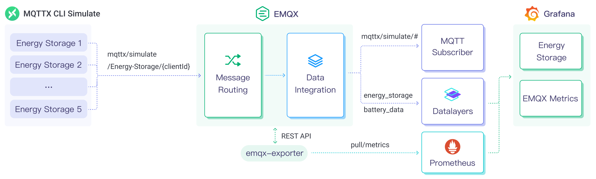

# MQTTデータをDatalayersに取り込む

Datalayersは、産業用IoT、IoV、エネルギーなどの分野向けに設計されたマルチモーダルかつハイパーコンバージドなデータベースです。高いデータスループットと安定したパフォーマンスを備えており、IoTアプリケーションに最適です。EMQXは現在、Sinkを介してメッセージやデータをDatalayersに保存することをサポートしており、データ分析や可視化を容易にしています。

本ページでは、EMQXとDatalayersのデータ統合について詳しく解説し、ルールとSinkの作成方法を実践的に案内します。

## 動作概要

Datalayersデータ統合はEMQXの標準機能であり、デバイスからのMQTTメッセージをシームレスにDatalayersへ転送し、保存・分析を可能にします。ルールとSinkを設定することで、処理済みのMQTTデータを柔軟にDatalayersへルーティングできます。

以下の図は、エネルギー貯蔵シナリオにおけるEMQXとDatalayersの統合アーキテクチャの一例を示しています：



このアーキテクチャでは、EMQXがデバイスの接続管理、メッセージ送受信、ルールベースの処理を担当し、Datalayersがデータの保存、分析、可視化を担います。両者が連携することで、エネルギー消費のリアルタイムデータを効率的に収集・分析するスケーラブルなIoTプラットフォームを構築できます。

EMQX 6.0.0以降、DatalayersはApache Arrowをベースにした高性能バイナリ通信プロトコルであるArrow Flight SQLをサポートしています。従来のInfluxDB Line Protocolと比較して、Arrow Flight SQLはより効率的なデータ転送と構造化データ書き込みの強力なサポートを提供します。

::: warning 注意

Arrow FlightドライバーはRustで実装され、Erlang VMにNative Implemented Function（NIF）を介して統合されています。本機能は現在実験的であり、テスト環境での利用を推奨します。

:::

具体的なワークフローは以下の通りです：

1. **メッセージのパブリッシュと受信**：デバイスはMQTT経由でEMQXに接続し、電力、電流、電圧などのエネルギー関連メトリクスを定期的にパブリッシュします。EMQXはこれらのメッセージを受信し、ルールエンジンに渡します。

2. **ルールエンジンによるメッセージ処理**：EMQXの組み込みルールエンジンはトピックパターンに基づいてメッセージをマッチングし、ペイロードの変換、フィールドのフィルタリング、コンテキスト情報の付加などの処理を行います。

3. **Datalayersへの書き込み**：ルールがトリガーされると、処理済みデータをDatalayersに書き込むSinkアクションが実行されます。SinkはフィールドをDatalayersのテーブルやカラムにマッピングするカスタマイズ可能なSQLテンプレートをサポートしています。

   EMQXは以下の2つの書き込み方式をサポートしています：

   - InfluxDB Line Protocol
   - Arrow Flight SQLドライバー

   Sinkの設定は選択した方式によって異なります。

エネルギー貯蔵データがDatalayersに書き込まれた後は、対応ツールを使って柔軟にデータ分析が可能です。例えば：

- Grafanaなどの可視化ツールに接続し、チャートを作成してエネルギー貯蔵データを表示する。
- 業務システムに接続して、エネルギー貯蔵デバイスの状態監視やアラートを行う。

## 特長とメリット

Datalayersデータ統合は以下の特長と利点を提供します：

- **効率的なデータ処理**：EMQXは多数のIoTデバイス接続とメッセージスループットを処理可能であり、Datalayersはデータ書き込み、保存、クエリに優れ、IoTシナリオのデータ処理要件をシステム負荷を抑えて満たします。
- **メッセージ変換**：メッセージはEMQXルール内で大規模な処理・変換を経てからDatalayersに書き込まれます。
- **スケーラビリティ**：EMQXとDatalayersは共にクラスタリング機能を備え、ビジネスの成長に応じて柔軟に水平スケール可能です。
- **豊富なクエリ機能**：Datalayersはタイムスタンプデータの効率的なクエリ・分析のために最適化された関数、演算子、インデックス技術を提供し、IoT時系列データから価値ある洞察を抽出します。
- **効率的なストレージ**：Datalayersは高圧縮エンコーディング方式を採用し、ストレージコストを大幅に削減します。また、不要なデータがストレージを占有しないよう、データ保持期間のカスタマイズも可能です。

## はじめる前に

このセクションでは、EMQXでDatalayers Sinkを作成する前に必要な準備として、Datalayersのインストール、データベース作成、テーブル構造定義について説明します。

### 前提条件

- [ルール](./rules.md)の理解
- [データ統合](./data-bridges.md)の理解
- 使用予定のドライバータイプに応じて、[InfluxDB Line Protocol](https://docs.influxdata.com/influxdb/v1.8/write_protocols/line_protocol_reference/)または[Arrow Flight SQL](https://arrow.apache.org/docs/format/FlightSql.html#arrow-flight-sql)の理解

### Datalayersのインストールとセットアップ

1. Dockerを使用してDatalayersをインストール・起動します。詳細は[Install Datalayers](https://docs.datalayers.cn/datalayers/latest/getting-started/docker.html)を参照してください。

   ```bash
   # Datalayersコンテナを起動
   docker run -d --name datalayers -p 8360:8360 -p 8361:8361 datalayers/datalayers:latest
   ```

   - ポート`8360`はArrow Flight SQLのデフォルトgRPCポートです。
   - ポート`8361`はHTTPポートで、主にLine Protocol書き込みや管理APIに使用されます。

2. Datalayersサービス起動後、デフォルトのユーザー名・パスワード`admin`/`public`でDatalayers CLIにログインし、データベースを作成します。

   - Datalayersコンテナにアクセス：

     ```bash
     docker exec -it datalayers bash
     ```

   - Datalayers CLIを起動：

     ```bash
     dlsql -u admin -p public
     ```

   - データベース作成（例：`mqtt`）：

     ```sql
     create database mqtt
     ```

4. Arrow Flight SQLドライバーを使用する場合は、対象テーブルを事前に作成する必要があります。

   ::: tip 注意

   InfluxDB Line Protocolを使用する場合はテーブルの事前作成は不要です。Datalayersは受信したLine Protocolデータの`measurement`やフィールド定義に基づき自動でテーブルを作成します。

   :::

   例として、`t_mqtt_msg`というテーブルを以下のSQLで作成します：

   ```sql
   CREATE TABLE IF NOT EXISTS `t_mqtt_msg` (
       time TIMESTAMP(3) NOT NULL,
       msgid STRING NOT NULL,
       sender STRING NOT NULL,
       topic STRING NOT NULL,
       qos INT8 NOT NULL,
       payload STRING,
       arrived TIMESTAMP(3) NOT NULL,
       timestamp key(time)
   ) PARTITION BY HASH (msgid, sender) PARTITIONS 1
   ENGINE = TimeSeries WITH (ttl = '14d');
   ```

## Datalayersコネクターの作成

このセクションでは、EMQXでSinkをDatalayersサーバーに接続するためのコネクター作成方法を説明します。

以下の手順はEMQXとDatalayersがローカルで稼働していることを前提としています。別環境やリモートに展開している場合は接続設定を適宜更新してください。

1. EMQXダッシュボードで、**Integration** -> **Connectors**をクリックします。

2. ページ右上の**Create**をクリックします。

3. **Create Connector**ページで**Datalayers**を選択し、**Next**をクリックします。

5. **Configuration**ページでコネクターの詳細を入力します：

   - **Connector Name**：英数字で始める必要があります。英数字、ハイフン、アンダースコアのみ使用可能です。例：`my_datalayers`
   - **Description**（任意）：後で識別しやすいよう説明を追加できます。

   Datalayersサーバー接続設定：

   - **Driver Type**：

     - `InfluxDB Line Protocol`：InfluxDB互換のLine Protocolでデータを取り込みます。テーブル作成は自動です。

     - `Arrow Flight`：SQLテンプレートを用いた高性能な構造化データ書き込みを可能にします。スキーマ管理が厳密で高い書き込みスループットが必要な場合に適しています。

       ::: warning 注意

       Arrow FlightドライバーはRustで実装され、Erlang VMにNIFを介して統合されています。本機能は実験的であり、テスト環境での評価を推奨します。

       :::

   - **Server Host**：

     - デフォルト：`127.0.0.1:8361`
     - `Arrow Flight`ドライバー使用時はgRPC通信のためポート`8360`を使用します。

   - **Database Name**：Datalayersの対象データベース名（例：`mqtt`）

   - **Username / Password**：Datalayersアクセス用の認証情報（例：`admin` / `public`）

   - **Enable TLS**（任意）：暗号化接続を有効化できます。有効時は証明書パスや検証オプションを設定可能です。詳細は[外部リソースアクセスのTLS有効化](../../guides/network/overview.md#tls-for-external-resource-access)を参照してください。

     ::: tip 注意

     Arrow Flight SQLプロトコル使用時は、証明書検証をスキップできません（`verify_none`はライブラリ制約により非対応）。gRPCサーバーの証明書はサーバーホストと一致する有効なCommon Name（CN）を持つ必要があります。

     :::

5. `Arrow Flight`を選択した場合、**Enable Prepared Statements**オプションが表示されます。これはSinkがSQLテンプレートを使用してデータ挿入を行うかを制御し、デフォルトで有効です。

6. **Create**をクリックする前に、**Test Connectivity**でDatalayersサーバーへの接続確認が可能です。

7. ページ下部の**Create**をクリックしてコネクター作成を完了します。ポップアップで**Back to Connector List**または**Create Rule**を選択できます。ルールとSinkの作成手順は[Create a Datalayers Rule](#create-a-datalayers-rule)を参照してください。

## Datalayersルールの作成

このセクションでは、EMQXでソーストピック`t/#`からのMQTTメッセージを処理し、処理結果を設定済みのSinkを使ってDatalayersに送信するルールの作成方法を説明します。

### SQLを定義してルールを作成する

1. EMQXダッシュボードで、左メニューの**Data Integration** -> **Rules**に移動します。

2. **Rules**ページで右上の**Create**ボタンをクリックします。

3. ルール作成フォームでルールIDを入力します（例：`my_rule`）。

4. **SQL Editor**にルールロジックを定義します。トピック`t/#`にパブリッシュされたMQTTメッセージをDatalayersに保存するには、以下のSQLを使用できます：

   ::: tip 注意

   カスタムSQLルールを書く場合、Sinkテンプレート内で参照する全ての変数（例：`${clientid}`, `${payload.temp}`）がルールの`SELECT`句に含まれていることを確認してください。

   :::

   ```
   SELECT
     *
   FROM
     "t/#"
   ```

   ::: tip

   EMQXのSQLに不慣れな場合は、**SQL Examples**や**Enable Debug**をクリックしてサンプルクエリを確認・テストできます。

   :::

5. 処理結果をDatalayersに書き込むため、ルールにDatalayers Sinkを追加します。

   - **InfluxDB Line Protocol**を使う場合は：[Add an InfluxDB Line Protocol Sink](#add-an-influxdb-line-protocol-sink)を参照してください。
   - **Arrow Flight SQLドライバー**を使う場合は：[Add an Arrow Flight SQL Sink](#add-an-arrow-flight-sql-sink)を参照してください。

6. **Create Rule**ページで設定を確認し、**Save**をクリックしてルールを作成します。

作成したルールは**Rules**一覧に表示されます。ルールの**Actions (Sink)**タブをクリックすると、このルールに紐づくDatalayers Sinkを確認できます。

また、**Integrations** -> **Flow Designer**でトポロジーグラフを表示可能です。ここではトピック`t/#`のメッセージが`my_rule`ルールで処理され、Datalayersに書き込まれる様子が可視化されます。

### InfluxDB Line Protocol Sinkの追加

このセクションでは、InfluxDB Line Protocolを使って処理済みデータをDatalayersに書き込むSinkをルールに追加する方法を説明します。

1. ルールエディター右側の**Add Action**ボタンをクリックし、ルール条件にマッチした際にトリガーされるアクションを定義します。このアクションは処理済みメッセージをDatalayersに転送します。

2. **Type of Action**ドロップダウンで`Datalayers`を選択し、**Action**はデフォルトの`Create Action`のままにします。既存のDatalayers Sinkを選択することも可能ですが、本例では新規作成を想定しています。

3. Sinkの名前を入力します（例：`dl_sink_influx`）。名前は英数字の組み合わせとしてください。

4. **Connector**ドロップダウンで、`InfluxDB Line Protocol`ドライバーで設定済みのコネクターを選択します。コネクターがない場合は隣のボタンから作成できます。詳細は[Create a Datalayers Connector](#create-a-datalayers-connector)を参照してください。

5. **Time Precision**はデフォルトでミリ秒に設定します。

6. Datalayersへのデータ解析・書き込み用に**Data Format**と内容を定義します。`JSON`または`Line Protocol`を選択可能です：

   - **JSON**：

     **Measurement**、**Fields**、**Timestamp**、**Tags**を指定します。キーと値は定数またはプレースホルダー（例：`${payload.temp}`）をサポートします。書式ルールは[InfluxDB Line Protocol](https://docs.datalayers.cn/datalayers/latest/development-guide/writing-with-influxdb-line-protocol.html)を参照してください。

     **Fields**はCSVファイルを使った一括設定も可能です。[Use CSV to Batch Configure Fields](#use-csv-to-batch-configure-fields)を参照してください。

   - **Line Protocol**：

     テーブル、フィールド、タイムスタンプ、タグを含む単一のLine Protocol文字列を定義できます。キーと値は定数またはプレースホルダーをサポートします。構文は[InfluxDB Line Protocol](https://docs.datalayers.cn/datalayers/latest/development-guide/writing-with-influxdb-line-protocol.html)を参照してください。

     ::: tip

     Datalayersに書き込むデータはInfluxDB v1のLine Protocolと完全互換のため、[InfluxDB Line Protocol](https://docs.influxdata.com/influxdb/v1.8/write_protocols/line_protocol_reference/)を参照して設定できます。

     例えば、符号付き整数値を入力する場合は、プレースホルダーの後に`i`を付けます（例：`${payload.int}i`）。詳細は[InfluxDB 1.8の整数値書き込み](https://docs.influxdata.com/influxdb/v1.8/write_protocols/line_protocol_reference/#write-the-field-value-1-as-an-integer-to-influxdb)を参照してください。

     :::

     Line Protocolの例：

     ```sql
     devices,clientid=${clientid} temp=${payload.temp},hum=${payload.hum},precip=${payload.precip}i ${timestamp}
     ```

7. **Fallback Actions**（任意）：メッセージ配信失敗時の信頼性向上のため、1つ以上のフォールバックアクションを定義できます。詳細は[Fallback Actions](./data-bridges.md#fallback-actions)を参照してください。

8. **Advanced Settings**を展開し、必要に応じて高度な設定を行います。詳細は[Advanced Settings](#advanced-settings)を参照してください。

9. **Create**をクリックする前に、**Test Connectivity**でSinkがDatalayersサーバーに接続できるか確認可能です。

10. **Create**をクリックしてSink作成を完了します。**Create Rule**ページに戻ると、**Action Outputs**タブに新しいSinkが表示されます。

#### CSVを使ったフィールド一括設定

::: tip

この機能は**InfluxDB Line Protocol**でデータフォーマットが`JSON`のSinkのみ利用可能です。フィールド設定を一括でインポートできます。

:::

Datalayersのデータエントリは数百のフィールドを含むことが多く、データフォーマット設定が煩雑になるため、EMQXは一括フィールド設定機能を提供しています。

JSONフォーマット設定時にCSVファイルからフィールドのキー・値ペアを一括インポートできます。

1. **Fields**テーブルの**Batch Settings**ボタンをクリックし、**Import Batch Settings**ポップアップを開きます。

2. 指示に従いテンプレートファイルをダウンロードし、フィールドのキー・値ペアを記入します。デフォルトのテンプレート内容は以下の通りです：

   | Field  | Value              | 備考（任意）                                               |
   | ------ | ------------------ | ---------------------------------------------------------- |
   | temp   | ${payload.temp}    |                                                            |
   | hum    | ${payload.hum}     |                                                            |
   | precip | ${payload.precip}i | フィールド値の後に`i`を付けるとDatalayersは整数型として保存 |

   - **Field**：フィールドキー。定数または`${var}`形式のプレースホルダーをサポート。
   - **Value**：フィールド値。定数またはプレースホルダーをサポート。Line Protocolに従い型指定子を付加可能。
   - **備考**：CSV内のコメント用で、EMQXにはインポートされません。

   CSVファイルは最大2048行までです。

3. 記入済みテンプレートを保存し、**Import Batch Settings**ポップアップにアップロードして**Import**をクリックします。

4. インポート後、**Fields**設定テーブルでキー・値ペアをさらに調整できます。

### Arrow Flight SQL Sinkの追加

このセクションでは、**Arrow Flight SQL**ドライバーを使ってSQL挿入文によりDatalayersにデータを書き込むSinkをルールに追加する方法を説明します。

::: warning 注意

Arrow Flight SQLドライバーは現在実験的です。運用環境での使用は慎重に行ってください。

:::

1. ルールエディター右側の**Add Action**ボタンをクリックし、ルールにマッチした際にトリガーされるアクションを定義します。このアクションは処理済みデータをDatalayersに転送します。

2. **Type of Action**ドロップダウンで`Datalayers`を選択し、**Action**はデフォルトの`Create Action`のままにします。既存のDatalayers Sinkを選択することも可能ですが、本例では新規作成を想定しています。

3. Sinkの名前を入力します（例：`dl_sink_arrow`）。英数字の組み合わせを推奨します。

4. **Connector**ドロップダウンで、`Arrow Flight`ドライバーで設定済みのコネクターを選択します。コネクターがない場合は隣のボタンから作成可能です。詳細は[Create a Datalayers Connector](#create-a-datalayers-connector)を参照してください。

5. データを対象テーブルに挿入する方法を定義する**SQL**テンプレートを設定します。

   ::: tip

   これは[Preprocessing SQL](./data-bridges.md#prepared-statement)テンプレートです。フィールド名を引用符で囲まず、SQL文の末尾にセミコロン`;`を含めないでください。
   `${}`プレースホルダーはルールSQLで選択したフィールドと一致させる必要があります。

   :::

   ::: tip

   コネクター設定のデータベース以外にデータを挿入する場合は、SQLテンプレート内で対象データベース名を明示的に指定してください。
   ただし、コネクターは対象データベースの存在をチェックします。

   :::

   例：

   ```sql
   insert into t_mqtt_msg(time, msgid, sender, topic, qos, payload, arrived) values (${timestamp}, ${id}, ${clientid}, ${topic}, ${qos}, ${payload}, ${timestamp})
   ```

6. **Fallback Actions**（任意）：信頼性向上のため、Sinkがメッセージ処理に失敗した場合にトリガーされるフォールバックアクションを1つ以上設定できます。詳細は[Fallback Actions](./data-bridges.md#fallback-actions)を参照してください。

7. **Advanced Settings**を展開し、必要に応じて追加設定を行います。詳細は[Advanced Settings](#advanced-settings)を参照してください。

8. **Create**をクリックする前に、**Test Connection**ボタンでSinkがDatalayersサーバーに接続できるか検証可能です。

9. **Create**をクリックしてSink作成を完了します。**Create Rule**ページに戻ると、**Action Outputs**タブに新しいSinkが表示されます。

## ルールとSinkのテスト

ルールとSinkの設定後、テスト用MQTTメッセージをパブリッシュしてDatalayersへの書き込みが成功しているか確認できます。

1. [MQTTX](https://mqttx.app/)を使い、トピック`t/1`にメッセージを送信します。これによりセッションイベント（クライアントのオンライン/オフラインなど）もトリガーされる場合があります：

   ```bash
   mqttx pub -i emqx_c -t t/1 -m '{ "temp": "23.5", "hum": "62", "precip": 2 }'
   ```

   このメッセージはルールエンジンをトリガーし、設定済みのDatalayers Sinkに転送されます。ルールにクライアント接続・切断などのセッションイベントが含まれている場合も同様にトリガーされます。

2. Sinkの実行統計を確認します。EMQXダッシュボードの**Rules**ページで対象ルールを探し、**Actions (Sink)**タブに切り替えます。対象Sinkの**Matched**および**Success**カウントが1増加していることを確認してください。

3. CLIでDatalayers内のデータを確認します。

   Datalayersコンテナにアクセスし、CLIツールを起動します：

   ```bash
   docker exec -it datalayers bash
   dlsql -u admin -p public
   ```

   使用した書き込み方式に応じてSQLクエリを実行します：

   - InfluxDB Line Protocolの場合、テーブル名はSink設定の`measurement`（例：`devices`）がデフォルトです：

     ```sql
     use mqtt
     select * from devices
     ```

   - Arrow Flight SQLの場合、事前に作成した対象テーブル（例：`t_mqtt_msg`）をクエリします：

     ```sql
     use mqtt
     select * from t_mqtt_msg
     ```

## 高度な設定

このセクションでは、DatalayersコネクターおよびSinkの高度な設定オプションについて説明します。ダッシュボードでコネクターやSinkを設定する際、**Advanced Settings**を展開して以下のパラメーターを必要に応じて調整できます。

| フィールド名               | 説明                                                                                                                         | デフォルト値 |
| -------------------------- | ---------------------------------------------------------------------------------------------------------------------------- | ------------ |
| Buffer Pool Size           | バッファワーカーのプロセス数を指定します。これらのプロセスはEMQXとDatalayers Sink間のデータフローを管理し、データ送信前の一時保存・処理を担当します。特にデータ送信（egress）シナリオでのパフォーマンス最適化とスムーズなデータ伝送に重要です。受信（ingress）専用のブリッジでは`0`に設定可能です。 | `4`          |
| Request TTL                | バッファに入ったリクエストが有効とみなされる最大時間（秒）を指定します。リクエストがこのTTLを超えてバッファ内にあるか、送信後にDatalayersからの応答やアックを受け取れない場合、リクエストは期限切れとみなされます。 | `45`         |
| Health Check Interval      | SinkがDatalayersとの接続状態を自動的にヘルスチェックする間隔（秒）を指定します。                                         | `15`         |
| Max Buffer Queue Size      | 各バッファワーカープロセスがDatalayers Sink内でバッファリング可能な最大バイト数を指定します。バッファワーカーはデータ送信前に一時保存し、データストリームを効率的に処理します。システム性能やデータ送信要件に応じて調整してください。 | `1`          |
| Batch Size                 | EMQXからDatalayersへ一度に転送するデータバッチの最大サイズを指定します。このサイズを調整することで、データ転送の効率とパフォーマンスを最適化できます。<br />`1`に設定すると、データレコードはバッチ化せず個別に送信されます。 | `100``       |
| Query Mode                 | `synchronous`または`asynchronous`のリクエストモードを選択し、メッセージ送信を要件に応じて最適化します。非同期モードではDatalayersへの書き込みがMQTTメッセージパブリッシュをブロックしませんが、クライアントがDatalayers到達前にメッセージを受信する可能性があります。 | `Asynch`     |
| Inflight Window            | 送信済みだが応答やアックをまだ受け取っていないリクエスト数の最大値を制御します。<br/>`Request Mode`が`asynchronous`の場合に重要です。同一MQTTクライアントからのメッセージを厳密に順次処理する必要がある場合、この値を`1`に設定してください。 | `100`        |
