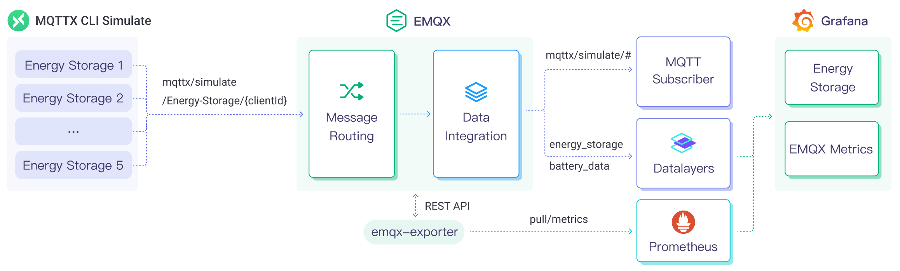

# MQTTデータをDatalayersに取り込む

Datalayersは、産業用IoT、IoV、エネルギーなどの分野向けに設計されたマルチモーダルかつハイパーコンバージドなデータベースです。高いデータスループットと安定したパフォーマンスを備えており、IoTアプリケーションに最適です。EMQXは現在、Sinkを介してメッセージやデータをDatalayersに保存することをサポートしており、データ分析や可視化を容易にします。

本ページでは、EMQXとDatalayersのデータ統合について詳細に解説し、ルールとSinkの作成方法を実践的に案内します。

## 動作概要

Datalayersデータ統合はEMQXの標準機能であり、デバイスからのMQTTメッセージをシームレスにDatalayersへ転送し、保存および分析を可能にします。ルールとSinkを設定することで、処理済みのMQTTデータを柔軟にDatalayersへルーティングできます。

以下の図は、エネルギー貯蔵シナリオにおけるEMQXとDatalayersの統合アーキテクチャの典型例を示しています。



このアーキテクチャでは、EMQXがデバイスの接続管理、メッセージの送受信、ルールベースの処理を担当し、Datalayersがデータの保存、分析、可視化を担います。両者が連携することで、エネルギー消費に関するリアルタイムデータを効率的に収集・分析するスケーラブルなIoTプラットフォームを構築できます。

EMQX 6.0.0以降、DatalayersはApache Arrowをベースとした高性能バイナリ通信プロトコルであるArrow Flight SQLをサポートしています。従来のInfluxDB Line Protocolと比較して、Arrow Flight SQLはより効率的なデータ転送と構造化データの書き込みを強力にサポートします。

::: warning 注意

Arrow FlightドライバーはRustで実装され、Erlang VMにNative Implemented Function（NIF）を通じて統合されています。本機能は現在実験的であり、テスト環境での利用を推奨します。

:::

具体的なワークフローは以下の通りです。

1. **メッセージのパブリッシュと受信**  
   デバイスはMQTTを介してEMQXに接続し、電力、電流、電圧などのエネルギー関連メトリクスを定期的にパブリッシュします。EMQXはこれらのメッセージを受信し、ルールエンジンに渡します。

2. **ルールエンジンによるメッセージ処理**  
   EMQXの組み込みルールエンジンはトピックパターンに基づいてメッセージをマッチングし、ペイロードの変換、フィールドのフィルタリング、コンテキスト情報の付加などの処理を行います。

3. **Datalayersへの書き込み**  
   ルールがトリガーされると、処理済みデータをDatalayersに書き込むSinkアクションが実行されます。SinkはフィールドをDatalayersのテーブルやカラムにマッピングするカスタマイズ可能なSQLテンプレートをサポートします。

   EMQXは以下の2つの書き込み方法をサポートしています。

   - InfluxDB Line Protocol
   - Arrow Flight SQLドライバー

   Sinkの設定は選択した方法により異なります。

エネルギー貯蔵データがDatalayersに書き込まれた後は、対応するツールを用いて柔軟にデータ分析が可能です。例えば：

- Grafanaなどの可視化ツールに接続し、チャートを生成してエネルギー貯蔵データを表示する。
- 業務システムに接続し、エネルギー貯蔵デバイスの状態監視やアラートを実施する。

## 特長とメリット

Datalayersデータ統合は以下の特長と利点を提供します。

- **効率的なデータ処理**  
  EMQXは多数のIoTデバイス接続とメッセージスループットを処理可能であり、Datalayersはデータの書き込み、保存、クエリに優れています。これにより、IoTシナリオのデータ処理要件をシステムに過負荷をかけずに満たせます。

- **メッセージ変換**  
  EMQXのルール内でメッセージを高度に処理・変換してからDatalayersに書き込むことが可能です。

- **スケーラビリティ**  
  EMQXとDatalayersは共にクラスター機能を備えており、ビジネスの成長に応じて柔軟に水平スケールできます。

- **豊富なクエリ機能**  
  Datalayersはタイムスタンプデータの効率的なクエリと分析のために最適化された関数、演算子、インデックス技術を提供し、IoT時系列データから価値ある洞察を抽出します。

- **効率的なストレージ**  
  Datalayersは高圧縮エンコーディング方式を用いてストレージコストを大幅に削減します。また、カスタマイズ可能なデータ保持期間により不要なデータのストレージ占有を防止します。

## はじめる前に

本節では、EMQXでDatalayers Sinkを作成する前に必要な準備として、Datalayersのインストール、データベース作成、テーブル構造の定義について説明します。

### 前提条件

- [ルール](./rules.md)の理解
- [データ統合](./data-bridges.md)の理解
- 書き込みに使用するドライバーに応じて、[InfluxDB Line Protocol](https://docs.influxdata.com/influxdb/v1.8/write_protocols/line_protocol_reference/)または[Arrow Flight SQL](https://arrow.apache.org/docs/format/FlightSql.html#arrow-flight-sql)の理解

### Datalayersのインストールとセットアップ

1. Dockerを使用してDatalayersをインストールし起動します。詳細は[Install Datalayers](https://docs.datalayers.cn/datalayers/latest/getting-started/docker.html)を参照してください。

   ```bash
   # Datalayersコンテナを起動
   docker run -d --name datalayers -p 8360:8360 -p 8361:8361 datalayers/datalayers:latest
   ```

   - ポート`8360`はArrow Flight SQLのデフォルトgRPCポートです。
   - ポート`8361`はHTTPポートで、主にLine Protocol書き込みや管理APIに使用されます。

2. Datalayersサービス起動後、デフォルトのユーザー名とパスワード`admin`/`public`でDatalayers CLIにログインします。以下の手順でDatalayers CLIからデータベースを作成できます。

   - Datalayersコンテナにアクセス：

     ```bash
     docker exec -it datalayers bash
     ```

   - Datalayers CLIを起動：

     ```bash
     dlsql -u admin -p public
     ```

   - データベースを作成（例：`mqtt`）：

     ```sql
     create database mqtt
     ```

4. Arrow Flight SQLドライバーを使用する場合は、対象テーブルを事前に作成する必要があります。

   ::: tip 注意

   InfluxDB Line Protocolを使用する場合はテーブルの事前作成は不要です。Datalayersは受信したLine Protocolデータの`measurement`やフィールド定義に基づき自動でテーブルを作成します。

   :::

   例として、以下のSQLで`t_mqtt_msg`テーブルを作成します。

   ```sql
   CREATE TABLE IF NOT EXISTS `t_mqtt_msg` (
       time TIMESTAMP(3) NOT NULL,
       msgid STRING NOT NULL,
       sender STRING NOT NULL,
       topic STRING NOT NULL,
       qos INT8 NOT NULL,
       payload STRING,
       arrived TIMESTAMP(3) NOT NULL,
       timestamp key(time)
   ) PARTITION BY HASH (msgid, sender) PARTITIONS 1
   ENGINE = TimeSeries WITH (ttl = '14d');
   ```

## Datalayersコネクターの作成

本節では、EMQXでSinkをDatalayersサーバーに接続するためのコネクター作成手順を示します。

以下の手順はEMQXとDatalayersがローカルで稼働していることを前提としています。別環境やリモート環境にデプロイしている場合は接続設定を適宜更新してください。

1. EMQXダッシュボードで、**Integration** -> **Connectors**をクリックします。

2. 画面右上の**Create**をクリックします。

3. **Create Connector**ページで**Datalayers**を選択し、**Next**をクリックします。

5. **Configuration**ページでコネクターの詳細を入力します。

   - **Connector Name**：英数字で始まり、英数字、ハイフン、アンダースコアのみ使用可能です。例：`my_datalayers`
   - **Description**（任意）：コネクター識別用の説明を入力可能です。

   Datalayersサーバー接続設定：

   - **Driver Type**：

     - `InfluxDB Line Protocol`：InfluxDB互換のLine Protocolを用いたデータ取り込み。テーブルは自動作成されます。

     - `Arrow Flight`：SQLテンプレートを用いた高性能な構造化データ書き込みを有効化。スキーマ管理や高い書き込みスループットが必要な場合に適しています。

       ::: warning 注意

       Arrow FlightドライバーはRustで実装され、Erlang VMにNIFを通じて統合されています。現在実験的機能のため、テスト環境での評価を推奨します。

       :::

   - **Server Host**：

     - デフォルト：`127.0.0.1:8361`
     - `Arrow Flight`ドライバー使用時はgRPC通信のためポート`8360`を使用します。

   - **Database Name**：Datalayersの対象データベース名（例：`mqtt`）

   - **Username / Password**：Datalayersアクセス用認証情報（例：`admin` / `public`）

   - **Enable TLS**（任意）：暗号化接続を有効化できます。有効時は証明書パスや検証設定を行えます。詳細は[外部リソースアクセスのTLS有効化](../../guides/network/overview.md#tls-for-external-resource-access)を参照してください。

     ::: tip 注意

     Arrow Flight SQLプロトコル使用時は証明書検証をスキップできません（`verify_none`非対応）。gRPCサーバー証明書のCommon Name（CN）がサーバーホストと一致している必要があります。

     :::

5. ドライバーに`Arrow Flight`を選択すると、**Enable Prepared Statements**オプションが表示されます。これはSinkがSQLテンプレートを用いてデータ挿入を行うかどうかを制御し、デフォルトで有効です。

6. **Create**をクリックする前に、**Test Connectivity**でDatalayersサーバーへの接続確認が可能です。

7. 画面下部の**Create**をクリックしてコネクター作成を完了します。ポップアップで**Back to Connector List**または**Create Rule**を選択可能です。ルールとSinkの作成手順は[Create a Datalayers Rule](#create-a-datalayers-rule)を参照してください。

## Datalayersルールの作成

本節では、EMQXでソーストピック`t/#`からMQTTメッセージを処理し、処理結果を設定済みのDatalayers Sinkへ送信するルール作成方法を示します。

### SQLを定義したルールの作成

1. EMQXダッシュボードの左メニューから**Data Integration** -> **Rules**に移動します。

2. **Rules**ページ右上の**Create**ボタンをクリックします。

3. ルール作成フォームでルールIDを入力します（例：`my_rule`）。

4. **SQL Editor**にルールロジックを定義します。トピック`t/#`にパブリッシュされたMQTTメッセージをDatalayersに保存するには、以下のSQLを使用できます。

   ::: tip 注意

   カスタムSQLルールを記述する場合、Sinkテンプレート内で参照するすべての変数（例：`${clientid}`, `${payload.temp}`）がルールの`SELECT`句に含まれていることを確認してください。

   :::

   ```
   SELECT
     *
   FROM
     "t/#"
   ```

   ::: tip

   EMQXのSQLに不慣れな場合は、**SQL Examples**や**Enable Debug**をクリックしてサンプルクエリの確認や出力テストが可能です。

   :::

5. 処理結果をDatalayersに書き込むため、ルールにDatalayers Sinkを追加します。

   - **InfluxDB Line Protocol**を使用する場合は、[Add an InfluxDB Line Protocol Sink](#add-an-influxdb-line-protocol-sink)を参照してください。
   - **Arrow Flight SQLドライバー**を使用する場合は、[Add an Arrow Flight SQL Sink](#add-an-arrow-flight-sql-sink)を参照してください。

6. **Create Rule**ページで設定内容を確認し、**Save**をクリックしてルールを作成します。

作成したルールは**Rules**一覧に表示されます。ルール詳細の**Actions (Sink)**タブで、このルールに紐づくDatalayers Sinkを確認できます。

また、**Integrations** -> **Flow Designer**でトポロジーグラフを表示可能です。トピック`t/#`のメッセージが`my_rule`ルールで処理され、Datalayersに書き込まれる様子が可視化されます。

### InfluxDB Line Protocol Sinkの追加

本節では、InfluxDB Line Protocolを用いて処理済みデータをDatalayersに書き込むSinkをルールに追加する方法を示します。

1. ルールエディター右側の**Add Action**ボタンをクリックし、ルール条件が満たされた際にトリガーされるアクションを定義します。このアクションは処理済みメッセージをDatalayersに転送します。

2. **Type of Action**ドロップダウンで`Datalayers`を選択し、**Action**はデフォルトの`Create Action`のままにします。既存のDatalayers Sinkを選択することも可能ですが、本例では新規作成を想定しています。

3. Sinkの名前を入力します（例：`dl_sink_influx`）。名前は英数字の組み合わせで指定してください。

4. **Connector**ドロップダウンで、`InfluxDB Line Protocol`ドライバーで設定済みのコネクターを選択します。利用可能なコネクターがない場合は隣のボタンから作成してください。詳細は[Create a Datalayers Connector](#create-a-datalayers-connector)を参照してください。

5. **Time Precision**はデフォルトでミリ秒に設定します。

6. Datalayersにデータを書き込むための**Data Format**と内容を定義します。`JSON`または`Line Protocol`から選択可能です。

   - **JSON**：

     **Measurement**、**Fields**、**Timestamp**、**Tags**を指定する必要があります。キーと値は定数またはプレースホルダー（例：`${payload.temp}`）をサポートします。書式ルールは[InfluxDB Line Protocol](https://docs.datalayers.cn/datalayers/latest/development-guide/writing-with-influxdb-line-protocol.html)を参照してください。

     **Fields**はCSVファイルを用いた一括設定もサポートします。[Use CSV to Batch Configure Fields](#use-csv-to-batch-configure-fields)を参照してください。

   - **Line Protocol**：

     テーブル、フィールド、タイムスタンプ、タグを含む単一のLine Protocol文字列を定義できます。キーと値は定数またはプレースホルダーをサポートします。構文は[InfluxDB Line Protocol](https://docs.datalayers.cn/datalayers/latest/development-guide/writing-with-influxdb-line-protocol.html)を参照してください。

     ::: tip

     Datalayersに書き込むデータはInfluxDB v1のLine Protocolと完全互換のため、[InfluxDB Line Protocol](https://docs.influxdata.com/influxdb/v1.8/write_protocols/line_protocol_reference/)も参照可能です。

     例えば、符号付き整数値を入力する場合は、プレースホルダーの後に`i`を付けます（例：`${payload.int}i`）。詳細は[InfluxDB 1.8で整数値を書き込む](https://docs.influxdata.com/influxdb/v1.8/write_protocols/line_protocol_reference/#write-the-field-value-1-as-an-integer-to-influxdb)を参照してください。

     :::

     Line Protocolの例：

     ```sql
     devices,clientid=${clientid} temp=${payload.temp},hum=${payload.hum},precip=${payload.precip}i ${timestamp}
     ```

7. **Fallback Actions**（任意）：メッセージ配信失敗時の信頼性向上のため、1つ以上のフォールバックアクションを定義可能です。詳細は[Fallback Actions](./data-bridges.md#fallback-actions)を参照してください。

8. **Advanced Settings**を展開し、必要に応じて詳細設定を行います（任意）。詳細は[Advanced Settings](#advanced-settings)を参照してください。

9. **Create**をクリックする前に、**Test Connectivity**でSinkがDatalayersサーバーに接続できるか確認可能です。

10. **Create**をクリックしてSink作成を完了します。**Create Rule**ページに戻ると、**Action Outputs**タブに新規Sinkが表示されます。

#### CSVを使ったフィールドの一括設定

::: tip

この機能は**InfluxDB Line Protocol**ドライバーかつデータフォーマットが`JSON`のSinkでのみ利用可能です。フィールド設定を一括でインポートできます。

:::

Datalayersのデータエントリーは数百のフィールドを含むことが多く、データフォーマット設定が複雑になる場合があります。これを解決するため、EMQXはフィールドの一括設定機能を提供しています。

JSONフォーマット設定時に、CSVファイルからフィールドのキー・バリューを一括インポートできます。

1. **Fields**テーブルの**Batch Settings**ボタンをクリックし、**Import Batch Settings**ポップアップを開きます。

2. 指示に従い一括設定テンプレートファイルをダウンロードし、フィールドのキー・バリューを入力します。テンプレートのデフォルト内容は以下の通りです。

   | Field  | Value              | 備考（任意）                                               |
   | ------ | ------------------ | ---------------------------------------------------------- |
   | temp   | ${payload.temp}    |                                                            |
   | hum    | ${payload.hum}     |                                                            |
   | precip | ${payload.precip}i | フィールド値の後に`i`を付けるとDatalayersは整数型として保存 |

   - **Field**：フィールドキー。定数または`${var}`形式のプレースホルダーをサポート。
   - **Value**：フィールド値。定数またはプレースホルダーをサポートし、Line Protocolに準じた型指定子を付加可能。
   - **備考**：CSV内のコメント用で、EMQXにはインポートされません。

   一括設定CSVファイルは最大2048行までです。

3. 入力済みテンプレートファイルを保存し、**Import Batch Settings**ポップアップにアップロード後、**Import**をクリックして一括設定を完了します。

4. インポート後、**Fields**設定テーブルでキー・バリューをさらに調整可能です。

### Arrow Flight SQL Sinkの追加

本節では、**Arrow Flight SQL**ドライバーを用いてSQL挿入文でデータをDatalayersに書き込むSinkをルールに追加する方法を示します。

::: warning 注意

Arrow Flight SQLドライバーは現在実験的です。プロダクション環境での利用は慎重に行ってください。

:::

1. ルールエディター右側の**Add Action**ボタンをクリックし、ルールマッチ時にトリガーされるアクションを定義します。このアクションは処理済みデータをDatalayersに転送します。

2. **Type of Action**ドロップダウンで`Datalayers`を選択し、**Action**はデフォルトの`Create Action`のままにします。既存のDatalayers Sinkを選択することも可能ですが、本例では新規作成を想定しています。

3. Sinkの名前を入力します（例：`dl_sink_arrow`）。英数字の組み合わせを推奨します。

4. **Connector**ドロップダウンで、`Arrow Flight`ドライバーで設定済みのコネクターを選択します。存在しない場合は隣のボタンから作成してください。詳細は[Create a Datalayers Connector](#create-a-datalayers-connector)を参照してください。

5. データ挿入方法を定義する**SQL**テンプレートを設定します。

   ::: tip

   これは[Preprocessing SQL](./data-bridges.md#prepared-statement)テンプレートです。フィールド名をクォートで囲まず、SQL文末にセミコロン`;`を含めないでください。  
   `${}`プレースホルダーはルールSQLで選択したフィールドと一致させる必要があります。

   :::

   ::: tip

   コネクターで設定したデータベース以外にデータを挿入する場合は、SQLテンプレート内で対象データベース名を明示的に指定してください。  
   なお、コネクターは対象データベースの存在をチェックします。

   :::

   例：

   ```sql
   insert into t_mqtt_msg(time, msgid, sender, topic, qos, payload, arrived) values (${timestamp}, ${id}, ${clientid}, ${topic}, ${qos}, ${payload}, ${timestamp})
   ```

6. **Fallback Actions**（任意）：信頼性向上のため、Sinkがメッセージ処理に失敗した場合にトリガーされるフォールバックアクションを1つ以上設定可能です。詳細は[Fallback Actions](./data-bridges.md#fallback-actions)を参照してください。

7. **Advanced Settings**を展開し、必要に応じて詳細設定を行います。詳細は[Advanced Settings](#advanced-settings)を参照してください。

8. **Create**をクリックする前に、**Test Connection**ボタンでSinkがDatalayersサーバーに接続できるか検証可能です。

9. **Create**をクリックしてSink作成を完了します。**Create Rule**ページに戻ると、**Action Outputs**タブに新規Sinkが表示されます。

## ルールとSinkのテスト

ルールとSinkの設定後、テストMQTTメッセージをパブリッシュしてデータがDatalayersに正常に書き込まれるか確認できます。

1. [MQTTX](https://mqttx.app/)を使用し、トピック`t/1`にメッセージを送信します。これによりセッションイベント（クライアントのオンライン/オフラインなど）がトリガーされる場合もあります。

   ```bash
   mqttx pub -i emqx_c -t t/1 -m '{ "temp": "23.5", "hum": "62", "precip": 2 }'
   ```

   このメッセージはルールエンジンをトリガーし、設定済みのDatalayers Sinkに転送されます。ルールにクライアントの接続・切断などのセッションイベントが含まれている場合も、この操作でトリガーされる可能性があります。

2. Sinkの実行統計を確認します。EMQXダッシュボードの**Rules**ページで対象ルールを見つけ、**Actions (Sink)**タブに切り替えます。対象Sinkの**Matched**および**Success**カウントが1増加していることを確認してください。

3. CLIからDatalayersのデータを検証します。

   Datalayersコンテナにアクセスし、CLIツールを起動します。

   ```bash
   docker exec -it datalayers bash
   dlsql -u admin -p public
   ```

   書き込み方法に応じてSQLクエリを実行します。

   - InfluxDB Line Protocol使用時は、Sink設定の`measurement`で指定したテーブル名（例：`devices`）がデフォルトです。

     ```sql
     use mqtt
     select * from devices
     ```

   - Arrow Flight SQL使用時は、事前作成した対象テーブル（例：`t_mqtt_msg`）をクエリします。

     ```sql
     use mqtt
     select * from t_mqtt_msg
     ```

## 詳細設定

本節では、DatalayersコネクターおよびSinkの詳細設定オプションについて説明します。ダッシュボードでコネクターやSinkを設定する際、**Advanced Settings**を展開して以下のパラメーターを業務要件に応じて調整可能です。

| フィールド名              | 説明                                                                                                                         | デフォルト値 |
| ------------------------- | ---------------------------------------------------------------------------------------------------------------------------- | ------------ |
| Buffer Pool Size          | バッファワーカープロセスの数を指定します。これらのプロセスはEMQXとDatalayersのエグレス型Sink間のデータフローを管理し、送信前のデータの一時保存と処理を担当します。エグレスシナリオでのパフォーマンス最適化とスムーズなデータ送信に重要です。イングレスのみを扱うブリッジでは`0`に設定可能です。 | `4`          |
| Request TTL               | リクエストTTL（Time to Live）は、リクエストがバッファに入ってから有効とみなされる最大時間（秒）を指定します。TTLを超えてバッファ内に滞留するか、送信後にDatalayersから応答やアックがタイムリーに得られない場合、リクエストは期限切れとみなされます。 | `45`         |
| Health Check Interval     | SinkがDatalayersとの接続状態を自動的に監視する間隔（秒）を指定します。                                                       | `15`         |
| Max Buffer Queue Size     | Datalayers Sinkの各バッファワーカープロセスがバッファリング可能な最大バイト数を指定します。バッファワーカーはデータを一時保存し、効率的なデータストリーム処理を実現します。システム性能やデータ送信要件に応じて調整してください。 | `1`          |
| Batch Size                | EMQXからDatalayersへ一度に転送するデータの最大バッチサイズを指定します。サイズ調整により転送効率とパフォーマンスを最適化できます。<br />`1`に設定すると、データはバッチ化されず個別に送信されます。 | `100``       |
| Query Mode                | `synchronous`または`asynchronous`のリクエストモードを選択し、メッセージ送信を要件に応じて最適化します。非同期モードではDatalayersへの書き込みがMQTTメッセージのパブリッシュ処理をブロックしませんが、クライアントがメッセージをDatalayers到着前に受信する可能性があります。 | `Asynch`     |
| Inflight Window           | インフライトキューリクエストは、送信済みだがまだ応答やアックを受け取っていないリクエストを指します。SinkとDatalayers間の通信で同時に存在可能な最大インフライトキューリクエスト数を制御します。<br/>`Request Mode`が`asynchronous`の場合、このパラメーターは特に重要です。同一MQTTクライアントからのメッセージを厳密に順序処理する必要がある場合は`1`に設定してください。 | `100`       |
