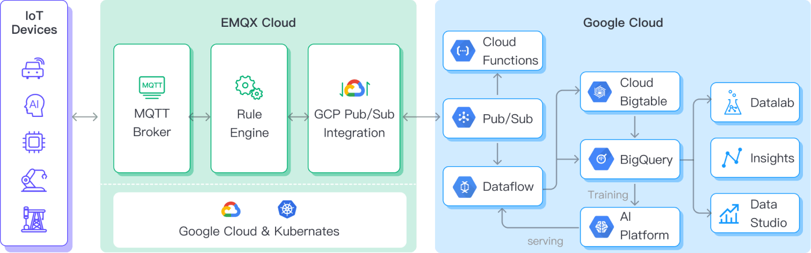
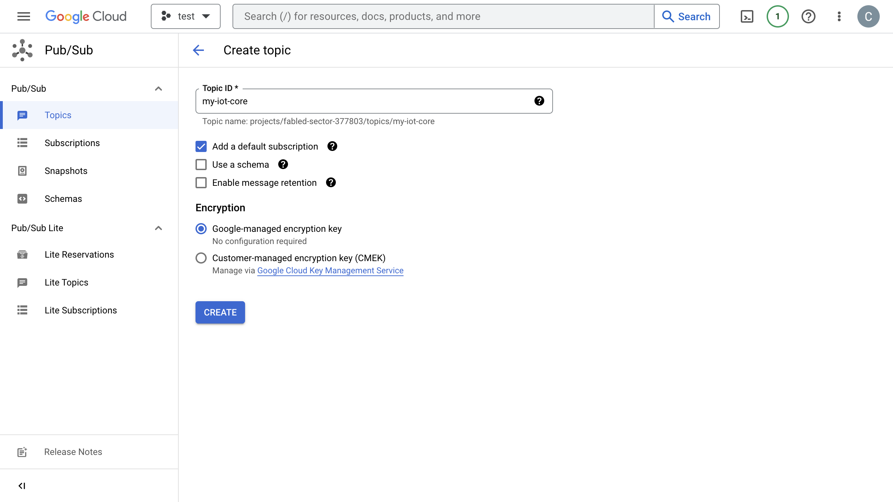
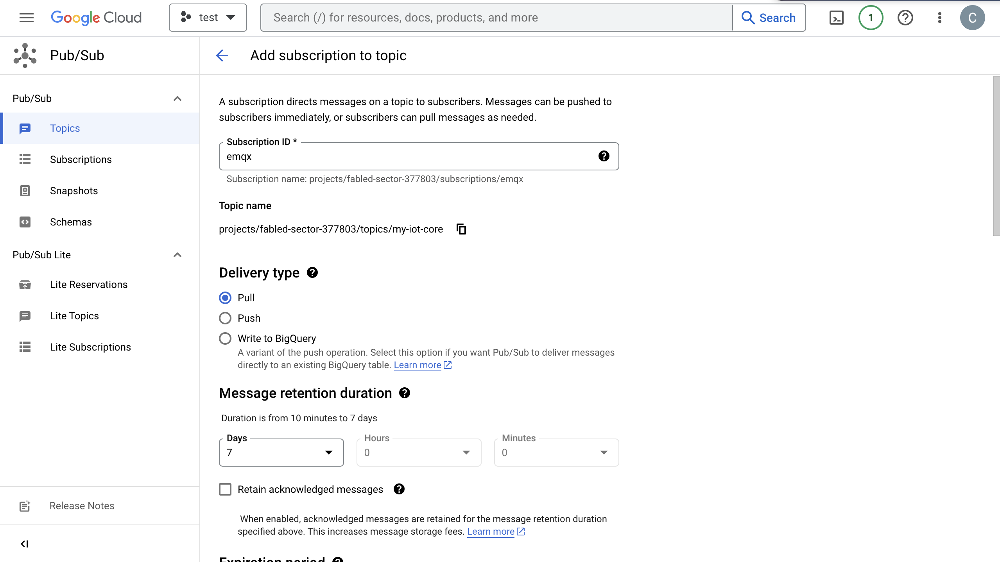
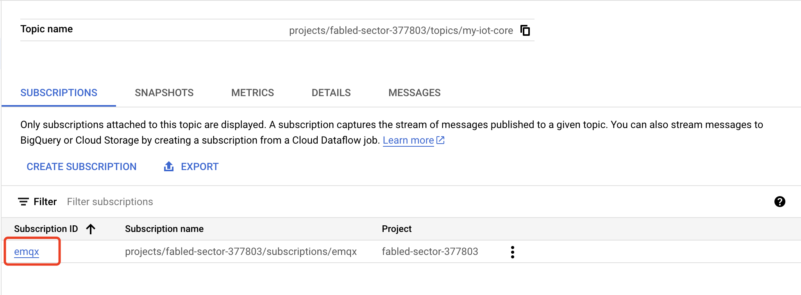
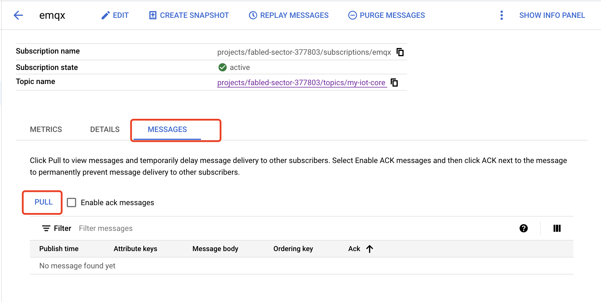

# GCP Pub/Sub への MQTT データ取り込み

[Google Cloud Pub/Sub](https://cloud.google.com/pubsub?hl=en-us) は、非常に高い信頼性とスケーラビリティを実現する非同期メッセージングサービスです。EMQX は、MQTT データのリアルタイム抽出、処理、分析のために Google Cloud Pub/Sub とのシームレスな統合をサポートしています。Cloud Functions、App Engine、Cloud Run、Kubernetes Engine、Compute Engine などのさまざまな Google Cloud サービスへデータをプッシュできます。また、Google Cloud から MQTT へのデータ配信も可能で、ユーザーが GCP 上で迅速に IoT アプリケーションを構築するのに役立ちます。

本ページでは、EMQX と GCP Pub/Sub 間のデータ統合について、作成および検証の実践的な手順を交えて包括的に紹介します。

## 動作概要

GCP Pub/Sub データ統合は、EMQX の標準機能であり、MQTT データストリームを Google Cloud とシームレスに統合し、IoT アプリケーション開発のための豊富なサービスと機能を活用できるように設計されています。



EMQX はルールエンジンと Sink を介して MQTT データを GCP Pub/Sub に転送します。GCP Pub/Sub のプロデューサー役割の例で、全体の流れは以下の通りです。

1. **IoT デバイスがメッセージをパブリッシュ**: デバイスは特定のトピックを通じてテレメトリやステータスデータをパブリッシュし、ルールエンジンをトリガーします。
2. **ルールエンジンがメッセージを処理**: 組み込みのルールエンジンは、特定のソースからの MQTT メッセージをトピックマッチングに基づき処理します。ルールエンジンは対応するルールをマッチングし、データ形式変換、特定情報のフィルタリング、メッセージへのコンテキスト情報付加などを行います。
3. **GCP Pub/Sub へのブリッジング**: ルールはメッセージを GCP Pub/Sub に転送するアクションをトリガーし、データプロパティ、オーダーキー、MQTT トピックと GCP Pub/Sub トピックのマッピングを簡単に設定できます。これにより、より豊富なコンテキスト情報と順序保証を持つデータ統合が可能となり、柔軟な IoT データ処理を実現します。

MQTT メッセージデータが GCP Pub/Sub に書き込まれた後は、以下のような柔軟なアプリケーション開発が可能です。

- リアルタイムデータ処理と分析：Dataflow、BigQuery、Pub/Sub のストリーミング機能など、強力な Google Cloud のデータ処理・分析ツールを活用し、メッセージデータのリアルタイム処理と分析を行い、価値ある洞察や意思決定支援を得られます。
- イベント駆動型機能：Cloud Functions や Cloud Run などの Google Cloud のイベント処理をトリガーし、動的かつ柔軟な機能トリガーと処理を実現します。
- データ保存と共有：Cloud Storage や Firestore などの Google Cloud ストレージサービスにメッセージデータを送信し、大量データの安全な保存と管理を行います。これにより他の Google Cloud サービスと連携してデータの共有や分析が可能となり、多様なビジネスニーズに対応します。

## 特長とメリット

GCP Pub/Sub とのデータ統合は以下の特長とメリットを提供します。

- **堅牢なメッセージングサービス**：EMQX と GCP Pub/Sub は共に高可用性とスケーラビリティを備え、大規模なメッセージストリームの確実な受信、配信、処理を保証します。IoT データのシーケンス管理、メッセージ品質保証、パーシステンスをサポートし、信頼性の高いメッセージ伝送と処理を実現します。
- **柔軟なルールエンジン**：組み込みのルールエンジンにより、特定のソースメッセージやイベントをトピックマッチングに基づいて処理可能です。データ形式変換、特定情報のフィルタリング、コンテキスト情報の付加などが行え、GCP Pub/Sub と組み合わせてさらなる処理や分析が可能です。
- **豊富なコンテキスト情報**：GCP Pub/Sub データ統合を通じて、クライアント属性を Pub/Sub 属性やソートキーにマッピングするなど、メッセージにより豊富なコンテキスト情報を付加できます。これにより、後続のアプリケーション開発やデータ処理でより精緻な分析と処理が可能となります。

まとめると、EMQX と GCP Pub/Sub の統合により、高信頼性かつスケーラブルなメッセージ配信と、データ分析・統合のための豊富なツールとサービスを活用できます。これにより、堅牢な IoT アプリケーション構築とイベント駆動型の柔軟なビジネスロジック実装が可能となります。

## はじめる前に

このセクションでは、GCP Pub/Sub データ統合を作成する前に完了すべき準備について説明します。

### 前提条件

- EMQX データ統合の[ルール](./rules.md)に関する知識
- [データ統合](./data-bridges.md)に関する知識

### GCP でサービスアカウントキーを作成する

GCP Pub/Sub サービスを利用するには、サービスアカウントとサービスアカウントキーを作成する必要があります。

1. GCP アカウントで[サービスアカウント](https://developers.google.com/identity/protocols/oauth2/service-account#creatinganaccount)を作成します。サービスアカウントには、対象トピックへのメッセージの検査/読み取りおよびパブリッシュ権限（例：Pub/Sub Editor ロール）が必要です。

2. 作成したサービスアカウントのメールアドレスをクリックし、**Key** タブを開きます。**Add key** のドロップダウンリストから **Create new key** を選択し、サービスアカウントキーを JSON 形式で作成しダウンロードします。

   ::: tip

   サービスアカウントキーは後で使用するため安全に保管してください。

   :::

   

### GCP で Workload Identity Federation を設定する

Workload Identity Federation（WIF）は、EMQX が長期間有効なサービスアカウントキーを使わずに GCP リソースにアクセスできるようにします。EMQX は外部 ID プロバイダー（例：Microsoft Azure）からトークンを取得し、GCP の Security Token Service を介して一時的な GCP トークンと交換し、そのトークンでサービスアカウントをなりすまします。トークンの更新は自動で行われます。

WIF を利用するには、コネクター作成前に GCP プロジェクトで以下を完了してください。

1. Google Cloud コンソールで **IAM & Admin** -> **Workload Identity Federation** に移動し、ワークロードアイデンティティプールを作成し、**Pool ID** と **Project Number** を控えます。

2. プールにプロバイダーを追加し、**Provider ID** を控えます。OIDC ベースの認証の場合は、外部 ID プロバイダーから OAuth 2.0 クライアント資格情報（クライアント ID、クライアントシークレット、トークンエンドポイント URI）を取得します。

3. Pub/Sub トピックにアクセスできる GCP サービスアカウントをなりすます権限をワークロードアイデンティティプールに付与します。コネクター設定時にサービスアカウントのメールアドレスが必要です。

   ::: tip

   詳細は[Workload Identity Federation の設定](https://cloud.google.com/iam/docs/workload-identity-federation-with-other-providers)を参照してください。

   :::

**例：Microsoft Azure (Entra ID)**

[Microsoft Entra ID](https://portal.azure.com/)で API を公開するアプリケーションを登録し、クライアントシークレットを作成します。コネクター設定時に以下の値を使用します。

| コネクター項目 | 値 |
|---|---|
| **Endpoint URI** | `https://login.microsoftonline.com/<tenant-id>/oauth2/v2.0/token` |
| **OAuth Client ID** | アプリケーション（クライアント）ID、形式は `api://<application-id>` |
| **OAuth Client Secret** | アプリケーション用に生成したクライアントシークレット |
| **OAuth Request Scope** | `api://<application-id>/.default` |

::: tip 注意

`scope` はアプリケーションの audience (`aud`) と完全に一致する必要があります。そうでないと GCP STS とのトークン交換に失敗します。詳細は Microsoft ドキュメントの[OAuth 2.0 クライアント資格情報フロー](https://learn.microsoft.com/en-us/entra/identity-platform/v2-oauth2-client-creds-grant-flow)を参照してください。

WIF プールにサービスアカウントのアクセス権を付与する際は、Subject 値にアプリケーション ID ではなく **Object ID** を使用してください。Object ID は Azure ポータルのアプリケーションの概要ページの **Enterprise applications** で確認できます。

:::

### GCP でトピックの作成と管理

EMQX で GCP Pub/Sub データ統合を設定する前に、トピックを作成し、GCP での基本的な管理操作に慣れておく必要があります。

1. Google Cloud コンソールで **Pub/Sub** -> **Topics** ページに移動します。詳細は[トピックの作成と管理](https://cloud.google.com/pubsub/docs/create-topic)を参照してください。

   ::: tip

   サービスアカウントには該当トピックへのパブリッシュ権限が必要です。

   :::

2. **Topic ID** フィールドにトピックの ID を入力し、**Create topic** をクリックします。

   

3. **Subscriptions** ページに移動し、リストの **Topic ID** をクリックします。トピックに対してサブスクリプションを作成します。

   - **Delivery type** で **Pull** を選択します。
   - **Message retention duration** で `7` 日を選択します。

   詳細は[GCP Pub/Sub サブスクリプション](https://cloud.google.com/pubsub/docs/subscriber)を参照してください。

   

4. **Subscription ID** -> **Messages** -> **Pull** をクリックすると、トピックに送信されたメッセージを確認できます。

   

   

## GCP Pub/Sub プロデューサーコネクターの作成

GCP Pub/Sub プロデューサー Sink アクションを追加する前に、EMQX と GCP Pub/Sub 間の接続を確立するための GCP Pub/Sub プロデューサーコネクターを作成する必要があります。

1. EMQX ダッシュボードで **Integration** -> **Connector** をクリックします。
2. 画面右上の **Create** をクリックし、コネクター選択ページで **Google PubSub Producer** を選択して **Next** をクリックします。
3. 名前と説明を入力します（例：`my-pubsubproducer`）。名前は GCP Pub/Sub プロデューサー Sink とコネクターを関連付けるために使用され、クラスター内で一意である必要があります。
4. **Authentication** ドロップダウンから以下の認証方法のいずれかを選択し、対応する項目を入力します。
   - **Service Account JSON**：前述の[サービスアカウントキー作成](#gcp-でサービスアカウントキーを作成する)でエクスポートした JSON 形式のサービスアカウント認証情報をアップロードします。
   - **Workload Identity Federation (WIF)**：以下の項目を入力します。詳細は[Workload Identity Federation の設定](#gcp-で-workload-identity-federation-を設定する)を参照してください。
     - **GCP Project ID**：コネクターがアクセスするリソースのプロジェクト ID。
     - **GCP Project Number**：コネクターがアクセスするリソースのプロジェクト番号。
     - **Service Account Email**：なりすますサービスアカウントのメールアドレス。
     - **Workload Identity Pool ID**：WIF トークン交換に使用するワークロードアイデンティティプールの ID。
     - **Workload Identity Provider ID**：WIF トークン交換に使用するワークロードアイデンティティプロバイダーの ID。
     - **Initial Token Configuration** で認証タイプを選択し、対応するフィールドを入力します。現在サポートされているのは **OIDC with Client Credentials Grant Type** のみです。
       - **Endpoint URI**：OIDC プロバイダーの OAuth トークンエンドポイント URI。
       - **OAuth Client ID**：OAuth サーバーからトークンを要求するためのクライアント ID。
       - **OAuth Client Secret**：OAuth サーバーからトークンを要求するためのクライアントシークレット。
       - **OAuth Request Scope**：OAuth アクセストークン要求時に指定する `scope`（プロバイダーによって必要な場合）。
5. **Create** をクリックする前に、**Test Connectivity** をクリックしてコネクターが GCP Pub/Sub サーバーに接続できるかテストできます。
6. 画面下部の **Create** ボタンをクリックしてコネクター作成を完了します。ポップアップで **Back to Connector List** をクリックするか、**Create Rule** をクリックして Sink を指定したルール作成に進めます。詳細は[Create a Rule with GCP Pub/Sub Producer Sink](#create-a-rule-with-gcp-pub-sub-producer-sink)を参照してください。

## GCP Pub/Sub プロデューサー Sink を使ったルールの作成

このセクションでは、GCP Pub/Sub に保存するデータを指定するルールの作成方法を示します。

1. EMQX ダッシュボードで **Integration** -> **Rules** をクリックします。

2. 画面右上の **Create** をクリックします。

3. ルール ID に `my_rule` を入力します。

4. **SQL Editor** でルールを設定します。例えば、トピック `/devices/+/events` の MQTT メッセージを GCP Pub/Sub に保存する場合、以下の SQL を使用します。

   注意：独自の SQL を指定する場合は、Sink のペイロードテンプレートで必要なすべてのフィールドが `SELECT` 部分に含まれていることを確認してください。

   ```sql
   SELECT
     *
   FROM
     "/devices/+/events"
   ```

   注意：初心者の方は **SQL Examples** と **Enable Test** をクリックして SQL ルールの学習とテストができます。

5. **+ Add Action** ボタンをクリックして、ルールでトリガーされるアクションを定義します。**Type of Action** ドロップダウンから `Google PubSub Producer` を選択し、EMQX がルールで処理したデータを GCP Pub/Sub に送信するようにします。

6. **Action** ドロップダウンは `Create Action` のままにするか、既存の GCP Pub/Sub プロデューサー Sink を選択できます。この例では新しい Sink を作成してルールに追加します。

7. **Name** フィールドに Sink の名前を入力します。名前は英数字の組み合わせにしてください。

8. **Connector** ドロップダウンから先ほど作成した `my_pubsubprodcer` を選択します。隣のボタンから新規コネクター作成も可能です。設定パラメーターの詳細は[Create a Connector](#create-a-connector)を参照してください。

9. **GCP PubSub Topic** に以下のいずれかを入力します。

   - 例：`my-iot-core` のように、[GCP でトピックを作成・管理](#gcp-でトピックの作成と管理)で作成したトピック名。EMQX は設定したサービスアカウントに紐づくプロジェクト内でトピックを解決します。
   - `projects/<project-id>/topics/<topic-name>` の形式で完全修飾トピックパス。異なる GCP プロジェクトのトピックにメッセージをパブリッシュする場合はこちらを使用し、該当トピックに対してサービスアカウントに必要な Pub/Sub 権限を付与してください。

10. **Payload Template** にテンプレートを定義するか空欄のままにします。

    - 空欄の場合、クライアント ID、トピック、ペイロードなど MQTT メッセージの可視フィールドを JSON 形式でエンコードします。
    - 定義済みテンプレートを使う場合、`${variable_name}` 形式のプレースホルダーが MQTT コンテキストの対応値に置き換わります。例：`${topic}` は MQTT メッセージのトピック `my/topic` に置換されます。

11. **Attributes Template** と **Ordering Key Template** で送信メッセージの属性やオーダーキーのフォーマットテンプレートを定義します（任意）。

    - **Attributes** はキー・値ともに `${variable_name}` 形式のプレースホルダーが使え、MQTT コンテキストから値を抽出します。キーのテンプレートが空文字になる場合、そのキーは GCP Pub/Sub メッセージに含まれません。
    - **Ordering Key** も `${variable_name}` プレースホルダーが使え、空文字の場合は GCP Pub/Sub メッセージの `orderingKey` フィールドは設定されません。

12. **Fallback Actions（任意）**：メッセージ配信失敗時の信頼性向上のため、1つ以上のフォールバックアクションを定義できます。詳細は[Fallback Actions](./data-bridges.md#fallback-actions)を参照してください。

13. **Advanced Settings** を展開して必要に応じてオプション設定を行います。詳細は[Advanced Settings](#advanced-settings)を参照してください。

14. **Create** をクリックする前に、**Test Connectivity** でコネクターが GCP Pub/Sub サーバーに接続できるかテストできます。

15. **Create** ボタンをクリックして Sink 設定を完了すると、新しい Sink が **Action Outputs** タブに表示されます。

16. ルール作成画面に戻り、**Create** をクリックしてルールを作成します。

これでルールが正常に作成されました。**Integration** -> **Rules** ページで新規作成ルールを確認できます。**Actions(Sink)** タブで新しい Google PubSub Producer Sink を確認できます。

また、**Integration** -> **Flow Designer** をクリックしてトポロジーを表示すると、トピック `/devices/+/events` のメッセージがルール `my_rule` で解析され、GCP Pub/Sub に送信・保存されていることが視覚的に確認できます。

## プロデューサールールのテスト

1. MQTTX を使い、トピック `/devices/+/events` にメッセージを送信します。

   ```bash
   mqttx pub -i emqx_c -t /devices/+/events -m '{ "msg": "hello GCP PubSub" }'
   ```

2. Sink の稼働状況を確認し、新規の受信メッセージと送信メッセージがそれぞれ1件ずつあることを確認します。

3. GCP の **Pub/Sub** -> **Subscriptions** に移動し、**MESSAGES** タブをクリックするとメッセージが確認できます。

## GCP Pub/Sub コンシューマーコネクターの作成

GCP Pub/Sub コンシューマー Source を追加する前に、EMQX と GCP Pub/Sub 間の接続を確立するための GCP Pub/Sub コンシューマーコネクターを作成する必要があります。

1. EMQX ダッシュボードで **Integration** -> **Connector** をクリックします。
2. 画面右上の **Create** をクリックし、コネクター選択ページで **Google PubSub Consumer** を選択して **Next** をクリックします。
3. 名前と説明を入力します（例：`my-pubsubconsumer`）。名前は GCP Pub/Sub コンシューマー Sink とコネクターを関連付けるために使用され、クラスター内で一意である必要があります。
4. **Authentication** ドロップダウンから以下の認証方法のいずれかを選択し、対応する項目を入力します。
   - **Service Account JSON**：前述の[サービスアカウントキー作成](#gcp-でサービスアカウントキーを作成する)でエクスポートした JSON 形式のサービスアカウント認証情報をアップロードします。
   - **Workload Identity Federation (WIF)**：以下の項目を入力します。詳細は[Workload Identity Federation の設定](#gcp-で-workload-identity-federation-を設定する)を参照してください。
     - **GCP Project ID**：コネクターがアクセスするリソースのプロジェクト ID。
     - **GCP Project Number**：コネクターがアクセスするリソースのプロジェクト番号。
     - **Service Account Email**：なりすますサービスアカウントのメールアドレス。
     - **Workload Identity Pool ID**：WIF トークン交換に使用するワークロードアイデンティティプールの ID。
     - **Workload Identity Provider ID**：WIF トークン交換に使用するワークロードアイデンティティプロバイダーの ID。
     - **Initial Token Configuration** で認証タイプを選択し、対応するフィールドを入力します。現在サポートされているのは **OIDC with Client Credentials Grant Type** のみです。
       - **Endpoint URI**：OIDC プロバイダーの OAuth トークンエンドポイント URI。
       - **OAuth Client ID**：OAuth サーバーからトークンを要求するためのクライアント ID。
       - **OAuth Client Secret**：OAuth サーバーからトークンを要求するためのクライアントシークレット。
       - **OAuth Request Scope**：OAuth アクセストークン要求時に指定する `scope`（プロバイダーによって必要な場合）。
5. **Create** をクリックする前に、**Test Connectivity** をクリックしてコネクターが GCP Pub/Sub サーバーに接続できるかテストできます。
6. 画面下部の **Create** ボタンをクリックしてコネクター作成を完了します。ポップアップで **Back to Connector List** をクリックするか、**Create Rule** をクリックして GCP Pub/Sub コンシューマー Source を使ったルール作成に進めます。詳細は[Create a Rule with GCP Pub/Sub Consumer Source](#create-a-rule-with-gcp-pub-sub-cconsumer-source)を参照してください。

## GCP Pub/Sub コンシューマー Source を使ったルールの作成

このセクションでは、GCP Pub/Sub からメッセージを消費し、EMQX に転送するルールの作成方法を示します。Google PubSub Consumer Source を作成・設定し、ルールのデータ入力として追加します。また、Republish アクションをルールに追加し、GCP Pub/Sub からのメッセージを EMQX に転送します。

1. EMQX ダッシュボードで **Integration** -> **Rules** をクリックします。

2. 画面右上の **Create** をクリックします。

3. ルール ID に `my_rule_source` を入力します。

4. 右側の **Data Inputs** タブで、デフォルトの Input `Messages` を削除し、**Add Input** をクリックします。

5. **Input Type** ドロップダウンから `Google PubSub Consumer` を選択します。

6. **Source** ドロップダウンはデフォルトの `Create Source` のままにします。この例では新しい Source を作成しルールに追加します。

7. Source の **Name** と（任意で）**Description** を入力します。名前は英数字の組み合わせにしてください（例：`my-gcppubsub-source`）。

8. **Connector** ドロップダウンから先ほど作成した `my_pubsubconsumer` を選択します。隣のボタンから新規コネクター作成も可能です。設定パラメーターの詳細は[Create a Connector](#create-a-connector)を参照してください。

9. GCP Pub/Sub からメッセージを消費するための以下の情報を設定します。

   - **GCP PubSub Topic**：トピック名（例：`my-iot-core`）または完全修飾トピックパス（`projects/<project-id>/topics/<topic-name>`）を入力します。トピック名は設定したサービスアカウントに紐づくプロジェクト内で解決されます。異なる GCP プロジェクトのトピックから消費する場合は完全修飾パスを入力し、サービスアカウントに該当トピックの Pub/Sub 権限を付与してください。コンシューマーサブスクリプションはサービスアカウントのプロジェクトに作成され、トピック参照のみ別プロジェクトを指します。
   - **Maximum Messages to Pull**：1 回のプルリクエストで GCP Pub/Sub から取得する最大メッセージ数を指定します。実際の取得数は指定値より少ない場合があります。

10. **Advanced Settings** を展開して必要に応じてオプション設定を行います。詳細は[Advanced Settings](#advanced-settings)を参照してください。

11. **Create** をクリックする前に、**Test Connectivity** で GCP Pub/Sub サーバーへの接続が成功するかテストできます。

12. **Create** をクリックして Source 作成を完了します。Source はルールの **Data Inputs** タブに追加され、**SQL Editor** のルールは以下のようになります。

    ```sql
    SELECT
      *
    FROM
      "$bridges/gcppubsub:my-gcppubsub-source"
    ```

    注意：初心者の方は **SQL Examples** と **Enable Test** をクリックして SQL ルールの学習とテストができます。

    `my-gcppubsub-source` からは、以下の GCP Pub/Sub から MQTT トピックへのマッピングテーブルに示すメッセージフィールドにアクセスできます。ルール SQL を調整してデータ処理が可能です。この例ではデフォルトの SQL を使用します。

    | フィールド名          | 説明                                                        |
    | --------------------- | ----------------------------------------------------------- |
    | `attributes`          | （任意）文字列のキー・バリューのペアを含むオブジェクト（存在する場合） |
    | `message_id`          | GCP Pub/Sub が割り当てたメッセージ ID                       |
    | `ordering_key`        | （任意）メッセージの順序付けキー（存在する場合）            |
    | `publishing_time`     | GCP Pub/Sub によるメッセージのタイムスタンプ                 |
    | `topic`               | 発信元の GCP Pub/Sub トピック                               |
    | `value`               | （任意）メッセージのペイロード（存在する場合）               |

    **注意**：GCP Pub/Sub から MQTT へのマッピングは、それぞれ一意の GCP Pub/Sub トピック名を含む必要があります。つまり、同じトピックが複数のマッピングに存在してはいけません。

これで GCP Pub/Sub コンシューマー Source が正常に作成されましたが、メッセージはまだ EMQX に直接パブリッシュされません。次に、[Add Republish Action to the Rule](#add-republish-action-to-the-rule) の手順に従い、Republish アクションを作成してルールに追加してください。

### ルールへの Republish アクション追加

このセクションでは、GCP Pub/Sub コンシューマー Source から消費したメッセージを転送し、EMQX のトピック `t/1` にパブリッシュするための Republish アクションをルールに追加する方法を示します。

1. 画面右側の **Action Output** タブを選択し、**Add Action** ボタンをクリックして、**Type of Action** ドロップダウンから `Republish` アクションを選択します。

2. メッセージ再パブリッシュの設定を入力します。

   - **Topic**：MQTT にパブリッシュするトピック。ここでは `t/1` を入力します。

   - **QoS**：`0`、`1`、`2`、`${qos}` のいずれかを選択、または他のフィールドから QoS を設定するためのプレースホルダーを入力します。`${qos}` を選択すると元のメッセージの QoS に従います。

   - **Retain**：`true` または `false` を選択します。メッセージをリテインメッセージとしてパブリッシュするかどうかを決定します。プレースホルダーも使用可能です。この例では `false` を選択します。

   - **Payload**：転送するメッセージペイロードのテンプレートを設定します。空欄の場合はルールの出力結果をそのまま転送します。`${.value}` と入力すると、GCP Pub/Sub メッセージのペイロード部分のみを転送します。

     MQTT ペイロードテンプレートのデフォルト値は `${.}` で、利用可能なすべてのデータを JSON オブジェクトとしてエンコードします。例えば、すべてのオプションフィールドを含む GCP Pub/Sub メッセージの場合、以下のようになります。

     ```json
     {
       "attributes": {"attribute_key": "attribute_value"},
       "message_id": "1679665968238",
       "ordering_key": "my-ordering-key",
       "topic": "my-pubsub-topic",
       "publishing_time": "2023-08-18T14:15:18.470Z",
       "value": "my payload"
     }
     ```

     GCP Pub/Sub メッセージのサブフィールドはドット表記でアクセス可能です。例：`${.value}` はメッセージの値に、`${.attributes.h1}` は属性キー `h1` の値に解決されます。存在しない値は空文字列に置換されます。

   - **MQTT 5.0 Message Properties**：デフォルトで無効です。詳細は[Add Republish Action](./rule-get-started.md#add-republish-action)を参照してください。

3. **Create** をクリックしてアクション作成を完了します。作成成功後、ルール作成画面に戻り、Republish アクションが **Action Outputs** タブに追加されます。

4. ルール作成画面で **Create** をクリックしてルール全体の作成を完了します。

これでルールが正常に作成されました。**Rules** ページで新規作成ルールを確認できます。**Sources** タブで新規作成した GCP Pub/Sub コンシューマー Source を確認できます。

また、**Integration** -> **Flow Designer** をクリックしてトポロジーを表示すると、GCP Pub/Sub コンシューマー Source からのメッセージが Republish を経由してトピック `t/1` にパブリッシュされる様子が直感的に確認できます。

## GCP Pub/Sub コンシューマールールのテスト

以下の手順で、GCP Pub/Sub コンシューマー Source が GCP Pub/Sub からメッセージを消費し、EMQX の MQTT トピック `t/1` に再パブリッシュすることを検証します。

1. MQTTX CLI を使い、EMQX の MQTT トピック `t/1` をサブスクライブします。

   ```bash
   mqttx sub -t t/1 -v
   ```

2. Google Cloud コンソールで **Pub/Sub** -> **Topics** に移動し、`my-iot-core` トピックをクリックして以下のメッセージをパブリッシュします。

   ```json
   {"msg":"hello GCP PubSub"}
   ```

3. MQTTX がトピック `t/1` で以下のメッセージを受信することを確認します。

   ```text
   topic: t/1
   payload: {"msg":"hello GCP PubSub"}
   ```

## 詳細設定

このセクションでは、GCP Pub/Sub コネクター、プロデューサー Sink、およびコンシューマー Source の詳細設定について説明します。

### コネクターの詳細設定

GCP Pub/Sub のプロデューサーおよびコンシューマーコネクターは同じ詳細設定を使用します。

| 項目名 | 説明 | デフォルト値 |
| --- | --- | --- |
| **HTTP Pipelining** | レスポンスを待たずに送信できる HTTP リクエストの最大数。`1` に設定すると、次のリクエスト送信前にレスポンスを待ちます。 | `100` |
| **Connection Pool Size** | コネクションプールで維持する接続数。 | `8` |
| **Connect Timeout** | HTTP 接続確立の最大待機時間。 | `15` 秒 |
| **Max Inactive** | アクティビティがない最大時間。EMQX 6.0.4 以降、レスポンス待ちの状態で 60 秒間リクエスト送信がなければ再接続します。60 秒より長い値を設定すると優先されます。レスポンスが 60 秒以上かかる可能性がある場合は、最長応答時間以上に設定してください。 | `10` 秒 |
| **Max Retries** | リクエスト送信エラー発生時の最大リトライ回数。 | `2` |
| **Start Timeout** | コネクター作成後に正常状態になるまでの最大待機時間。 | `5` 秒 |
| **Health Check Interval** | コネクターのヘルスチェック間隔。 | `15` 秒 |
| **Health Check Timeout** | ヘルスチェック結果が返るまでの最大時間。タイムアウトするとコネクターは切断と見なされます。 | `60` 秒 |

### プロデューサー Sink とコンシューマー Source で共通の詳細設定

プロデューサー Sink とコンシューマー Source は以下の詳細設定を共有します。**Health Check Interval** のデフォルト値は異なります。

| 項目名 | 説明 | プロデューサー Sink デフォルト | コンシューマー Source デフォルト |
| --- | --- | --- | --- |
| **Request TTL** | リクエストがバッファに入ってからレスポンスやアックを受け取るまでの最大時間。この間にレスポンスがなければリクエストは期限切れとなります。 | `45` 秒 | `45` 秒 |
| **Health Check Interval** | Sink または Source のヘルスチェック間隔。 | `15` 秒 | `30` 秒 |
| **Health Check Interval Jitter** | ヘルスチェック間隔に加える一様ランダム遅延。複数の Action や Source が同時にヘルスチェックを開始しないようにします。 | `0` ミリ秒 | `0` ミリ秒 |
| **Health Check Timeout** | ヘルスチェック結果が返るまでの最大時間。タイムアウトすると Sink または Source は切断と見なされます。 | `60` 秒 | `60` 秒 |

### プロデューサー Sink 固有の詳細設定

GCP Pub/Sub プロデューサー Sink は以下の追加詳細設定を提供します。

| 項目名 | 説明 | デフォルト値 |
| --- | --- | --- |
| **Buffer Pool Size** | GCP Pub/Sub 送信前にデータを保持・処理するバッファワーカープロセス数。 | `16` |
| **Dispatch Strategy** | 明示的なピックキーなしのリクエストをバッファワーカーに割り当てる戦略。`Per Client ID` は同一クライアントのリクエストを同一ワーカーに割り当て、`Random` はワーカー間で分散します。 | `Per Client ID` |
| **Max Buffer Queue Size** | 各バッファワーカーが保持可能な最大データ量。 | `256` MB |
| **Batch Size** | 1 バッチあたりの最大リクエスト数。`1` に設定するとバッチ処理を無効化します。 | `1` |
| **Query Mode** | リクエストを同期または非同期で送信するかを制御します。`Async` モードでは EMQX は GCP Pub/Sub のレスポンスを待たずにメッセージ処理を継続します。 | `Async` |
| **Inflight Window** | **Query Mode** が `Async` の場合、レスポンス待ちのリクエスト最大数。MQTT クライアントからのメッセージを厳密な順序で処理する必要がある場合は `1` に設定します。 | `100` |

### コンシューマー Source 固有の詳細設定

GCP Pub/Sub コンシューマー Source は以下の追加詳細設定を提供します。

| 項目名 | 説明 | デフォルト値 |
| --- | --- | --- |
| **Ack Deadline** | Source が配信済みメッセージをアックするまでの GCP Pub/Sub の待機時間の目安。期限切れ後はメッセージが再配信される可能性があります。サポート範囲は `10` ～ `600` 秒です。 | `60` 秒 |
