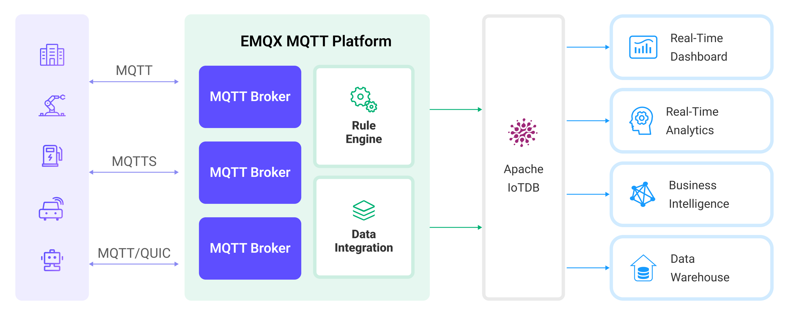

# Apache IoTDB への MQTT データ取り込み

[Apache IoTDB](https://iotdb.apache.org/) は、さまざまな IoT デバイスやシステムから生成される大量の時系列データを効率的に処理するために設計された高性能かつスケーラブルな時系列データベースです。

EMQX は Apache IoTDB とのシームレスなデータ統合を提供し、EMQX がリアルタイムで受信した MQTT メッセージを [REST API V2](https://iotdb.apache.org/UserGuide/latest/API/RestServiceV2.html) を通じて IoTDB に転送できます。この統合は一方向のデータフローをサポートし、MQTT データを IoTDB に書き込むことで効率的な時系列ストレージと分析を実現します。

本ページでは、EMQX と Apache IoTDB の統合方法を紹介し、統合の作成および検証の手順をステップバイステップで説明します。

## 動作概要

Apache IoTDB データ統合は EMQX の組み込み機能であり、MQTT ベースの時系列データを追加のコーディングなしに Apache IoTDB に取り込むことが可能です。EMQX の組み込みの [ルールエンジン](./rules.md) を活用することで、データのフィルタリング、変換、転送を簡素化し、IoTDB での効率的な保存とクエリを実現します。

以下の図は、EMQX と IoTDB 間の典型的なデータ統合アーキテクチャを示しています。<!-- この画像は IoTDB 専用に修正が必要です -->



データ統合のワークフローは以下の通りです：

1. **メッセージのパブリッシュと受信**：デバイスが MQTT を介して EMQX に接続し、テレメトリーデータ、ステータス更新、イベント情報を含むメッセージをパブリッシュします。ルールエンジンが受信メッセージを評価します。
2. **ルールベースの処理**：定義されたルールにマッチするメッセージが選択され、必要に応じてフィールドのフィルタリング、データ形式の変換、ペイロードの付加などの変換が適用されます。
3. **データのバッファリング**：信頼性向上のため、IoTDB が一時的に利用できない場合、EMQX はメッセージをメモリ内にバッファリングします。必要に応じてメモリ圧迫を避けるためにディスクにオフロードすることも可能です。統合や EMQX ノードの再起動時にはバッファデータは保持されません。
4. **IoTDB へのデータ取り込み**：マッチしたルールに対して、EMQX は IoTDB Sink をトリガーし、処理済みデータを IoTDB に時系列データとして書き込みます。
5. **データの保存と活用**：IoTDB に保存されたデータは、デバイス監視、資産追跡、予知保全、運用最適化などの下流アプリケーションでクエリや分析に利用できます。

## 特長とメリット

IoTDB とのデータ統合は、効果的なデータ処理と保存を実現するために以下の特長とメリットを提供します：

- **ノーコードの IoT データパイプライン**

  組み込みのルールと Sink を使い、カスタムコードや外部サービスなしで EMQX と Apache IoTDB 間の完全な MQTT から時系列データへのパイプラインを構築できます。

- **MQTT から IoTDB モデルへの柔軟なマッピング**

  Tree モデルと Table モデルの両方をサポートし、デバイスモデリングやクエリ要件に応じた構造で MQTT データを IoTDB に書き込めます。

- **取り込みと保存の分離**

  EMQX はバースト的かつ高頻度な MQTT トラフィックを吸収し、IoTDB は耐久性のある時系列保存に専念することで、システムの安定性とレジリエンスを向上させます。

- **本番対応のスケーラビリティ**

  デバイス数やデータ量に応じて水平スケール可能で、大規模な IoT、IIoT、エネルギー分野に適しています。

- **分析対応の時系列データ**

  IoTDB に書き込まれたデータは直接クエリ、集計、分析でき、ビッグデータエンジンと連携した高度な分析や長期インサイトにも対応します。

## はじめる前に

このセクションでは、EMQX ダッシュボードで Apache IoTDB データ統合を作成する前に必要な準備を説明します。

### 前提条件

- EMQX データ統合の [ルール](./rules.md) に関する知識
- [データ統合](./data-bridges.md) に関する知識

### Apache IoTDB サーバーの起動

ここでは [Docker](https://www.docker.com/) を使って Apache IoTDB サーバーを起動する方法を紹介します。IoTDB の設定で `enable_rest_service=true` が有効になっていることを確認してください。

以下のコマンドを実行して、REST インターフェースが有効な Apache IoTDB サーバーを起動します：

```bash
docker run -d --name iotdb-service \
              --hostname iotdb-service \
              -p 6667:6667 \
              -p 18080:18080 \
              -e enable_rest_service=true \
              -e cn_internal_address=iotdb-service \
              -e cn_target_config_node_list=iotdb-service:10710 \
              -e cn_internal_port=10710 \
              -e cn_consensus_port=10720 \
              -e dn_rpc_address=iotdb-service \
              -e dn_internal_address=iotdb-service \
              -e dn_target_config_node_list=iotdb-service:10710 \
              -e dn_mpp_data_exchange_port=10740 \
              -e dn_schema_region_consensus_port=10750 \
              -e dn_data_region_consensus_port=10760 \
              -e dn_rpc_port=6667 \
              apache/iotdb:2.0.5-standalone
```

詳細は [Docker Hub の IoTDB イメージ](https://hub.docker.com/r/apache/iotdb) を参照してください。

### データベースの作成

IoTDB は Tree モデルと Table モデルの2つのデータモデルをサポートしています。データベース作成前に、Connector と Sink で使用する **SQL Dialect**（Tree か Table）を確認し、それに応じたデータベースを作成してください。

- **Tree モデル**の場合はデータベースのみ作成すればよいです。
- **Table モデル**の場合は、データベースを作成した後にテーブルを作成する必要があります。

詳細な手順は IoTDB ユーザーガイドを参照してください：

- [Tree モデル用のデータベース作成](https://iotdb.apache.org/UserGuide/latest/Basic-Concept/Operate-Metadata_apache.html#_1-1-create-database)
- [Table モデル用のデータベース作成](https://iotdb.apache.org/UserGuide/latest-Table/Basic-Concept/Database-Management_apache.html#_1-1-create-a-database)
- [Table モデル用のテーブル作成](https://iotdb.apache.org/UserGuide/latest-Table/Basic-Concept/Table-Management_apache.html#_1-1-create-a-table)

## IoTDB コネクターの作成

Apache IoTDB データ統合を作成するには、Apache IoTDB Sink と Apache IoTDB サーバーを接続するためのコネクターを作成する必要があります。

EMQX は REST API または Thrift プロトコルを通じて IoTDB と通信をサポートしています。

1. EMQX ダッシュボードで **Integrations** -> **Connectors** に移動します。

2. 右上の **Create** をクリックします。

3. **Create Connector** ページで **Apache IoTDB** を選択します。

4. コネクターを設定します：

   - **Connector Name**：コネクターの一意な名前を入力します。大文字・小文字・数字の組み合わせが使用可能です。例：`my_iotdb`
   - **Description**：（任意）コネクターの簡単な説明
   - **Driver**：IoTDB への接続に使用するプロトコルを選択します。
     - `REST API`：IoTDB REST サービスのエンドポイント（例：`http://localhost:18080`）を **IoTDB REST Service Base URL** に入力します。
     - `Thrift Protocol`：IoTDB Thrift サーバーのアドレスを **Server Host** に入力します。

   - **SQL Dialect**：EMQX がデバイスデータを IoTDB に書き込む際のデータモデルを選択します。
     - `Tree Model`：階層的な時系列パスとしてデータを書き込み、パスベースのデバイス・計測管理に適しています。
     - `Table Model`：リレーショナルテーブルにデータを書き込み、デバイスタイプやカテゴリ別の管理に適しています。
   - **Database Name**：`Table Model` 選択時に接続するデータベース名を指定します。
   - **Username** と **Password**：EMQX が Apache IoTDB サーバーに認証するための資格情報を入力します。
   - **IoTDB Version**：Apache IoTDB のバージョンを選択します。
   - **Enable TLS**：Apache IoTDB サーバーへの暗号化接続を有効にします。詳細は [外部リソースアクセスの TLS](../../guides/network/overview.md#tls-for-external-resource-access) を参照してください。
   - オプションの調整は [高度な設定](#advanced-configurations) の **Advanced Settings** を参照してください。

5. （任意）**Test Connectivity** をクリックして、コネクターが Apache IoTDB サーバーに正常に接続できるか確認します。

6. **Create** をクリックしてコネクターの作成を完了します。

   表示されるダイアログで、**Back to Connector List** または **Create Rule** を選択してルールと Apache IoTDB Sink の設定を続けられます。詳細は [ルールと Apache IoTDB Sink の作成](#create-a-rule-and-apache-iotdb-sink) を参照してください。

## Apache IoTDB Sink を使ったルールの作成

このセクションでは、EMQX でソース MQTT トピック `root/#` からのメッセージを処理し、処理結果を設定済みの Apache IoTDB Sink 経由で Apache IoTDB に時系列データとして保存するルールの作成方法を示します。

### SQL を定義したルールの作成

1. EMQX ダッシュボードで **Integration** -> **Rules** に移動します。

2. ページ右上の **Create** をクリックします。

3. ルール ID を入力します（例：`my_rule`）。

4. **SQL editor** に以下のステートメントを入力し、トピックパターン `root/#` にマッチする MQTT メッセージを転送します：

   ```sql
   SELECT
     *
   FROM
     "root/#"
   ```

   ::: tip

   初心者の方は、**SQL Examples** をクリックし、**Enable Test** を有効にして SQL ルールの学習とテストが可能です。

   :::

5. 処理結果を IoTDB に書き込むため、ルールに Apache IoTDB Sink を追加します。詳細は [Apache IoTDB Sink の追加](#add-an-apache-iotdb-sink) を参照してください。

6. **Create Rule** ページで設定を確認し、**Save** をクリックしてルールを作成します。

ルール作成後、**Rules** リストに表示されます。**Actions (Sink)** タブをクリックすると、このルールに関連付けられた IoTDB Sink を確認できます。

また、**Integrations** -> **Flow Designer** でトポロジーグラフを表示すると、トピック `root/#` からのメッセージが `my_rule` ルールで処理され IoTDB に書き込まれる様子が確認できます。

### Apache IoTDB Sink の追加

1. ルールの右側にある **Add Action** ボタンをクリックし、ルールにマッチした際にトリガーされるアクションを定義します。このアクションは処理済みデータを IoTDB に転送します。

2. **Type of Action** ドロップダウンで `Apache IoTDB` を選択します。**Action** はデフォルトの `Create Action` のままにします。既存の IoTDB Sink を選択することも可能ですが、ここでは新規作成を前提とします。

3. Sink の名前と説明を入力します。

4. **Connector** ドロップダウンで先ほど作成したコネクター `my_iotdb` を選択します。利用可能なコネクターがない場合は隣のボタンから作成できます。詳細は [IoTDB コネクターの作成](#create-an-iotdb-connector) を参照してください。

5. Sink の設定を行います：

      * **SQL Dialect**：Apache IoTDB Sink がデータを書き込む際のモードを選択します。Connector で選択した SQL Dialect と一致させる必要があります。

        * `Tree Model`：IoTDB の時系列パスとしてデータを書き込みます。各 Sink レコードはデバイスパスに挿入され、計測はそのデバイス下の個別時系列として書き込まれます。このモデル選択時は **Device ID** フィールドを指定可能です。
        * `Table Model`：IoTDB のリレーショナルテーブルにデータを書き込みます。各 Sink レコードは指定したテーブルの行として挿入され、フィールドはテーブルのカラムにマッピングされます。このモデル選択時は **Table** フィールドの指定が必須です。
        
      * **Device ID**（任意）：IoTDB インスタンスに時系列データを転送・挿入する際のデバイス名として使用する特定のデバイス ID を入力します。

        :::tip

        空欄の場合でも、パブリッシュされたメッセージ内やルール内でデバイス ID を指定可能です。例えば、JSON エンコードされたメッセージに `device_id` フィールドがあれば、その値が出力デバイス ID となります。ルールエンジンでこの情報を抽出するには、以下のような SQL を使用できます：

        ```sql
        SELECT
         payload,
         `my_device` as payload.device_id
        ```

        ただし、このフィールドに固定で設定されたデバイス ID が優先されます。

        :::

      - **Table**：データを書き込む IoTDB テーブル名を指定します。

      - **Align Timeseries**：デフォルトは無効です。有効にすると、グループ化されたアラインド時系列のタイムスタンプ列が IoTDB に一度だけ保存され、各時系列で重複しなくなります。詳細は [Aligned timeseries](https://iotdb.apache.org/UserGuide/V1.1.x/Data-Concept/Data-Model-and-Terminology.html#aligned-timeseries) を参照してください。

      - **Write Data** の設定で、MQTT メッセージから IoTDB データを生成する方法を指定します。

        **Write Data** セクションでは、必要な数だけ項目を含むテンプレートを定義でき、各行に必要なコンテキスト情報を記述します。このテンプレートに基づいて MQTT メッセージから IoTDB データが生成されます。データ書き込みテンプレートは CSV ファイルによる一括設定もサポートしています。詳細は [一括設定](#batch-setting) を参照してください。

        例として以下のテンプレートを考えます：

        ::: tip 注意
        
        **Column Category** は SQL Dialect で `Table Model` を選択した場合のみ表示されます。
        
        :::

        | Column Category | Timestamp | Measurement | Data Type | Value    |
        | --------------- | --------- | ----------- | --------- | -------- |
        | field           |           | index       | INT32     | ${index} |
        |                 |           | temperature | FLOAT     | ${temp}  |

        `Timestamp` と `Value` はプレースホルダー構文をサポートし、変数で埋められます。`Timestamp` を省略すると、現在のシステム時刻（ミリ秒単位）で自動的に埋められます。

        例えば、以下のような MQTT メッセージが想定されます：

          ```json
        {
          "index": "42",
          "temp": "32.67"
          }
          ```

6. **フォールバックアクション**：（任意）メッセージ配信失敗時の信頼性向上のため、1つ以上のフォールバックアクションを定義できます。これらはプライマリ Sink がメッセージ処理に失敗した場合にトリガーされます。詳細は [フォールバックアクション](./data-bridges.md#fallback-actions) を参照してください。

7. **高度な設定**：（任意）[高度な設定](#advanced-configurations) を参照してください。

8. （任意）**Test Connectivity** をクリックして Sink が Apache IoTDB サーバーに接続できるかテストします。

### 一括設定

Apache IoTDB では、ダッシュボード上で数百件のデータを同時に書き込む設定は困難な場合があります。この問題を解決するため、EMQX はデータ書き込みの一括設定機能を提供しています。

**Write Data** の設定時に、一括設定機能を使って CSV ファイルから挿入操作のフィールドをインポートできます。

1. **Write Data** テーブルの **Batch Setting** ボタンをクリックし、**Import Batch Setting** ポップアップを開きます。

2. 指示に従い一括設定テンプレートファイルをダウンロードし、テンプレートにデータ書き込み設定を記入します。デフォルトのテンプレート内容は以下の通りです：

   ::: tip 注意

   以下は `Table Model` 用のデフォルトテンプレートです。`Tree Model` では **Column Category** 列はありません。

   :::

   | Column Category | Timestamp | Measurement | Data Type | Value             | 備考（任意）                                               |
   | --------------- | --------- | ----------- | --------- | ----------------- | ---------------------------------------------------------- |
   | tag             | now       | clientid    | text      | ${clientid}       |                                                            |
   | field           | now       | temp        | float     | ${payload.temp}   | フィールド、値、データ型は必須。データ型は boolean, int32, int64, float, double, text が利用可能 |
   | attribute       | now       | hum         | text      | ${payload.hum}    |                                                            |
   | attribute       | now       | status      | text      | ${payload.status} |                                                            |

   - **Column Category**：カラムのデータモデル。`tag`、`field`、`attribute` のいずれか。`tag` は文字列である必要があり、`field` または `attribute` が推奨されます。
   - **Timestamp**：`${var}` 形式のプレースホルダーをサポートし、タイムスタンプ形式が必要です。以下の特殊文字でシステム時刻を挿入可能です：
     - now：現在のミリ秒タイムスタンプ
     - now_ms：現在のミリ秒タイムスタンプ
     - now_us：現在のマイクロ秒タイムスタンプ
     - now_ns：現在のナノ秒タイムスタンプ
   - **Measurement**：フィールド名
   - **Data Type**：データ型。boolean, int32, int64, float, double, text が利用可能
   - **Value**：書き込むデータ値。定数または `${var}` 形式のプレースホルダーをサポートし、データ型と一致する必要があります。
   - **備考**：CSV ファイル内のメモ用で、EMQX にはインポートされません。

   ファイルサイズは 1MB 以下、データ行数は 2000 行以下の CSV ファイルのみサポートされます。

3. 記入済みテンプレートファイルを保存し、**Import Batch Setting** ポップアップにアップロードして **Import** をクリックし、一括設定を完了します。

4. インポート後、**Write Data** テーブルでさらにデータを調整できます。

## ルールのテスト

EMQX ダッシュボード内蔵の WebSocket クライアントを使って、Apache IoTDB Sink とルールの動作をテストできます。

1. ダッシュボード左メニューの **Diagnose** -> **WebSocket Client** をクリックします。

2. 現在の EMQX インスタンスへの接続情報を入力します。

   - ローカルで EMQX を実行している場合はデフォルト値を使用可能です。
   - 認証設定などを変更している場合は、ユーザー名やパスワードを入力してください。

3. **Connect** をクリックしてクライアントを EMQX インスタンスに接続します。

4. ページ下部のパブリッシュエリアで、メッセージにデバイス ID を指定し、以下を入力します：

   - **Topic**：`root/sg27`

     :::tip

     トピックが `root` で始まらない場合、自動的に `root` がプレフィックスされます。例えば、`test/sg27` にパブリッシュすると、デバイス名は `root.test.sg27` になります。ルールとトピックの設定が正しく、該当トピックのメッセージが Sink に転送されることを確認してください。

     :::

   - **Payload**：

     ```json
      {
       "value": "37.6",
       "device_id": "root.sg27"
      }
     ```
     
      ::: tip
     
      `Write Data` テンプレートは以下の通りです：
     
     ```
      now, "temp", float, "${payload.value}"
     ```
     
      :::

   - **QoS**：`2`

7. **Publish** をクリックしてメッセージを送信します。

   Sink とルールが正常に作成されていれば、メッセージは指定した Apache IoTDB の時系列テーブルにパブリッシュされているはずです。

8. IoTDB のコマンドラインインターフェースでメッセージを確認します。上記のように Docker で起動している場合は、以下のコマンドでサーバーに接続できます：

   ```shell
       $ docker exec -ti iotdb-service /iotdb/sbin/start-cli.sh -h iotdb-service
   ```

9. コンソールで以下を入力します：

   ```sql
   IoTDB> select * from root.sg27
   ```

   以下のようにデータが表示されるはずです：

   ```
   +------------------------+--------------+
   |                    Time|root.sg27.temp|
   +------------------------+--------------+
   |2023-05-05T14:26:44.743Z|          37.6|
   +------------------------+--------------+
   ```

## 高度な設定

このセクションでは、Connector のパフォーマンス最適化や特定のシナリオに応じたカスタマイズに役立つ高度な設定オプションを説明します。Connector 作成時に **Advanced Settings** を展開し、ビジネス要件に応じて以下の設定を行えます。

| 項目名                   | 説明                                                         | 推奨値             |
| ------------------------ | ------------------------------------------------------------ | ------------------ |
| HTTP Pipelining          | サーバーに対して連続して個別の応答を待たずに送信可能な HTTP リクエスト数を指定します。<br />正の整数値で、`1` の場合はリクエストごとに応答を待つ従来のモデルです。値を大きくすると複数リクエストをバッチ送信でき、ネットワークリソースを効率的に利用し、往復遅延を削減します。 | `100`              |
| Pool Type                | EMQX と Apache IoTDB 間のコネクション管理・分配のアルゴリズムを定義します。<br />`random` は利用可能なコネクションプールからランダムに選択し、シンプルでバランスの取れた分配を提供します。<br />`hash` はハッシュアルゴリズムでリクエストを一貫して特定のコネクションにマッピングし、クライアント ID やトピック名に基づくロードバランシングなど決定的な分配が必要な場合に使います。<br />**注意**：適切なプールタイプはユースケースや分配特性に依存します。 | `random`           |
| Connection Pool Size     | Apache IoTDB サービスとの接続プールで維持する同時接続数を指定します。<br />システムのスケーラビリティやパフォーマンス管理に役立ちます。<br />**注意**：システムリソースやネットワークレイテンシ、ワークロードに応じて適切な値を設定してください。大きすぎるとリソース枯渇、小さすぎるとスループット制限となります。 | `8`                |
| Connect Timeout          | EMQX が Apache IoTDB HTTP サーバーへの接続確立を試みる最大待機時間（秒）を指定します。<br />**注意**：システムパフォーマンスとリソース利用のバランスを取るため、ネットワーク環境に応じて最適な値をテストしてください。 | `15`               |
| HTTP Request Max Retries | EMQX と Apache IoTDB 間の通信で HTTP リクエストが失敗した場合の最大再試行回数を指定します。 | `2`                |
| Start Timeout            | 自動起動したリソースが正常状態になるまで待機する最大時間（秒）を指定します。リソース作成要求に応答する前に、接続先リソース（例：Apache IoTDB インスタンス）が完全に稼働していることを確認するための設定です。 | `5`                |
| Buffer Pool Size         | EMQX と Apache IoTDB 間のイーグレス型ブリッジでデータフロー管理に割り当てるバッファワーカープロセス数を指定します。これらのワーカーはデータ送信前に一時的にデータを保持・処理します。イングレスのみのブリッジでは無効で、`0` に設定可能です。 | `18`               |
| Request TTL              | バッファに入ったリクエストが有効とみなされる最大期間（秒）を指定します。リクエストがこの TTL を超えてバッファに残るか、送信後に Apache IoTDB からの応答やアックがタイムリーに得られない場合、リクエストは期限切れとみなされます。 | `45`               |
| Health Check Interval    | Apache IoTDB との接続状態を自動的にチェックする間隔（秒）を指定します。 | `15`               |
| Max Buffer Queue Size    | Apache IoTDB データ統合で各バッファワーカーがバッファリング可能な最大バイト数を指定します。バッファワーカーはデータ送信前の一時保管に使われ、システム性能やデータ転送要件に応じて調整可能です。 | `265`              |
| Query Mode               | メッセージ送信の最適化のため、`asynchronous`（非同期）または `synchronous`（同期）モードを選択できます。非同期モードでは IoTDB への書き込みが MQTT メッセージのパブリッシュ処理をブロックしませんが、クライアントが IoTDB への到達前にメッセージを受信する可能性があります。 | `Async`            |
| Inflight Window          | 「インフライトクエリ」とは、開始されたがまだ応答やアックを受け取っていないクエリのことです。Connector が Apache IoTDB と通信する際に同時に存在可能なインフライトクエリの最大数を制御します。<br />`query_mode` が `async` の場合、このパラメータは特に重要です。同一 MQTT クライアントからのメッセージを厳密に順序処理したい場合は、この値を 1 に設定してください。 | `100`              |

## さらに詳しく

EMQX は Apache IoTDB とのデータ統合に関する多くの学習リソースを提供しています。以下のリンクもぜひご覧ください：

**ブログ：**

[IoT 向け時系列データベース (TSDB)：欠けていたピース](https://www.emqx.com/en/blog/time-series-database-for-iot-the-missing-piece)
