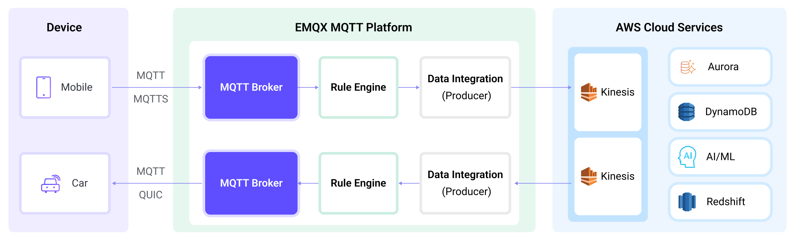

# Amazon Kinesis への MQTT データストリーム

[AWS Kinesis](https://aws.amazon.com/cn/kinesis/) は、AWS 上で提供されるフルマネージドのリアルタイムストリーミングデータ処理サービスであり、ストリーミングデータの収集、処理、分析を容易にします。あらゆる規模のストリーミングデータをリアルタイムかつ経済的かつ効率的に処理でき、高い柔軟性を持ち、数十万のソースからの大量のストリーミングデータを低レイテンシで処理可能です。

EMQX は [Amazon Kinesis Data Streams](https://aws.amazon.com/kinesis/data-streams/) とシームレスに連携でき、大量の IoT デバイスを接続してリアルタイムのメッセージ収集と送信を実現します。このデータ統合により、Amazon Kinesis Data Streams と接続してリアルタイムのデータ分析や複雑なストリーム処理が可能です。

本ページでは、EMQX と Amazon Kinesis 間のデータ統合について包括的に紹介し、データ統合の作成および検証手順を実践的に解説します。

## 動作概要

Amazon Kinesis とのデータ統合は EMQX の標準機能であり、MQTT データストリームを Amazon Kinesis とシームレスに統合し、IoT アプリケーション開発における豊富なサービスと機能を活用できるよう設計されています。



EMQX はルールエンジンと Sink を介して MQTT データを Amazon Kinesis に転送します。全体の流れは以下の通りです。

1. **IoT デバイスがメッセージをパブリッシュ**：デバイスは特定のトピックを通じてテレメトリや状態データをパブリッシュし、ルールエンジンをトリガーします。
2. **ルールエンジンがメッセージを処理**：組み込みのルールエンジンが特定のソースからの MQTT メッセージをトピックマッチングに基づいて処理します。ルールエンジンは対応するルールをマッチングし、データ形式の変換、特定情報のフィルタリング、メッセージのコンテキスト情報による拡充などを行います。
3. **Amazon Kinesis へのブリッジング**：ルールによってトリガーされたアクションでメッセージを Amazon Kinesis に転送します。パーティションキー、書き込み先のデータストリーム、メッセージフォーマットをカスタマイズ可能で、柔軟なデータ統合を実現します。

MQTT メッセージデータが Amazon Kinesis に書き込まれた後は、以下のような柔軟なアプリケーション開発が可能です。

- リアルタイムデータ処理と分析：強力な Amazon Kinesis のデータ処理・分析ツールとストリーミング機能を活用し、メッセージデータのリアルタイム処理・分析を行い、有益なインサイトや意思決定支援を得られます。
- イベント駆動機能：Amazon のイベント処理をトリガーし、動的かつ柔軟な関数の起動・処理を実現します。
- データの保存と共有：メッセージデータを Amazon Kinesis のストレージサービスに送信し、大量データを安全に保存・管理します。これにより他の Amazon サービスと連携してデータ共有や分析が可能となり、多様なビジネスニーズに対応します。

## 特長とメリット

EMQX と AWS Kinesis Data Streams のデータ統合は、以下の機能と利点をビジネスにもたらします。

- **信頼性の高いデータ送信と順序保証**：EMQX と AWS Kinesis Data Streams は共に信頼性の高いデータ送信機構を備えています。EMQX は MQTT プロトコルを通じてメッセージの確実な送信を保証し、AWS Kinesis Data Streams はパーティションとシーケンス番号でメッセージの順序を保証します。これにより、デバイスから送信されたメッセージが正確に目的地に届き、正しい順序で処理されます。
- **リアルタイムデータ処理**：デバイスからの高頻度データは EMQX のルール SQL によるリアルタイム前処理を経て、MQTT メッセージのフィルタリング、抽出、拡充、変換が容易に行えます。AWS Kinesis Data Streams へ送信後は、AWS Lambda や AWS 管理の Apache Flink と組み合わせてさらなるリアルタイム分析が可能です。
- **弾力的なスケーラビリティ対応**：EMQX は数百万の IoT デバイス接続を容易に実現し、弾力的なスケーラビリティを提供します。一方、AWS Kinesis Data Streams はオンデマンドの自動リソース割り当てと拡張を行います。両者を組み合わせたアプリケーションは接続数やデータ量に応じてスケールし、ビジネスの成長に継続的に対応します。
- **パーシステンスなデータ保存**：AWS Kinesis Data Streams はパーシステンスなデータ保存機能を備え、毎秒数百万件のデバイスデータストリームを確実に保存します。必要に応じて過去データの取得やオフライン分析・処理が可能です。

AWS Kinesis Data Streams を活用したストリーミングデータパイプラインの構築は、EMQX と AWS プラットフォームの統合の難易度を大幅に低減し、ユーザーにより豊かで柔軟なデータ処理ソリューションを提供します。これにより EMQX ユーザーは AWS 上で機能的に充実し高性能なデータ駆動型アプリケーションを構築できます。

## はじめる前に

Amazon Kinesis データ統合を作成する前に、前提条件を確認し、AWS または LocalStack 上で Kinesis データストリームを準備し、コネクターの認証方式を選択してください。

### 前提条件

- EMQX データ統合の [ルール](./rules.md) に関する知識
- [データ統合](./data-bridges.md) に関する知識

### Kinesis データストリームの準備

以下のいずれかの方法で Kinesis データストリームを準備してください。

#### Amazon Kinesis Data Streams でストリームを作成

AWS マネジメントコンソールを使ったストリーム作成手順は以下の通りです（詳細は [こちらのチュートリアル](https://docs.aws.amazon.com/streams/latest/dev/how-do-i-create-a-stream.html) を参照）。

1. AWS マネジメントコンソールにサインインし、[Kinesis コンソール](https://console.aws.amazon.com/kinesis) を開きます。

2. ナビゲーションバーのリージョン選択を展開し、リージョンを選択します。

3. **Create data stream** を選択します。

4. **Create Kinesis stream** ページでデータストリーム名を入力し、**On-demand** キャパシティモードを選択します。

#### Amazon Kinesis Data Streams をローカルでエミュレート

開発やテストを容易にするため、[LocalStack](https://localstack.cloud/) を使って Amazon Kinesis Data Streams をローカルでエミュレートできます。LocalStack により、AWS アプリケーションをリモートクラウドに接続せずにローカルマシン上で完全に実行可能です。

1. Docker イメージを使ってインストール・起動します。

   ```bash
   # LocalStack の Docker イメージをローカルで起動
   docker run --name localstack -p '4566:4566' -e 'KINESIS_LATENCY=0' -d localstack/localstack:2.1
   
   # コンテナにアクセス
   docker exec -it localstack bash
   ```

2. シャード数 1 のストリーム `my_stream` を作成します。

   ```bash
   awslocal kinesis create-stream --stream-name "my_stream" --shard-count 1
   ```

### 認証方式の選択 <Badge type="tip" text="6.3.3+" />

Amazon Kinesis コネクターは以下の認証方式をサポートしています。EMQX のデプロイ環境に応じて選択してください。

- **アクセスキーを手動設定**：対象の Kinesis リソースにアクセス可能な AWS Access Key ID と AWS Secret Access Key を指定します。アクセスキーの作成・管理については [IAM ユーザーのアクセスキー管理](https://docs.aws.amazon.com/IAM/latest/UserGuide/id_credentials_access-keys.html) を参照してください。LocalStack を使用する場合は、AWS アクセスキーの代わりに各フィールドに任意の空でない値を入力してください。この方式はローカル環境、非 AWS 環境、ECS タスクロールや EC2 インスタンスロールを使用しないデプロイに適しています。
- **一時認証情報を自動取得**：EMQX が Amazon ECS タスクまたは Amazon EC2 インスタンス上で動作している場合、対象 Kinesis リソースへのアクセス権限を持つ ECS タスクロールまたは EC2 インスタンスロールを設定します。コネクターの **AWS Access Key ID** と **AWS Secret Access Key** は空欄にします。EMQX は ECS タスクロールまたは EC2 インスタンスメタデータサービス v2（IMDSv2）を通じて一時認証情報を取得し、有効期限前に更新します。

::: warning 重要

**AWS Access Key ID** と **AWS Secret Access Key** は両方とも指定するか、両方とも空欄にしてください。片方だけを指定するとコネクター設定が無効になります。

:::

## コネクターの作成

ここでは、Sink を Amazon Kinesis Data Streams サービスに接続するコネクターの作成方法を示します。

1. EMQX ダッシュボードに入り、**Integration** -> **Connectors** をクリックします。
2. ページ右上の **Create** をクリックします。
3. **Create Connector** ページで **Amazon Kinesis** を選択し、**Next** をクリックします。
4. **Configuration** ステップで以下を設定します。
   - コネクター名を入力します。大文字・小文字の英数字の組み合わせで、例：`my_kinesis`
   - **Amazon Kinesis Endpoint**：Kinesis サービスの [エンドポイント](https://docs.aws.amazon.com/general/latest/gr/ak.html) を入力します。LocalStack を利用する場合は `http://localhost:4566` を入力してください。
   - **AWS Access Key ID** と **AWS Secret Access Key**：静的認証情報を使う場合はアクセスキー ID とシークレットアクセスキーを入力します。LocalStack 利用時は任意の空でない値を入力してください。ECS タスクロールや EC2 インスタンスロールを使う場合は両方空欄にします。詳細は [認証方式の選択](#認証方式の選択) を参照してください。
5. **Create** をクリックする前に、**Test Connectivity** をクリックしてコネクターが Amazon Kinesis Data Streams に接続できるかテストできます。
6. ページ下部の **Create** ボタンをクリックしてコネクター作成を完了します。ポップアップで **Back to Connector List** または **Create Rule** を選択できます。ルールと Sink を作成し、Amazon Kinesis に転送するデータを指定するには、[Amazon Kinesis Sink を使ったルール作成](#create-a-rule-with-amazon-kinesis-sink) を参照してください。

## Amazon Kinesis Sink を使ったルール作成

ここでは、ソース MQTT トピック `t/#` からのメッセージを処理し、処理結果を Amazon データストリーム `my_stream` にストリームするルールの作成方法を示します。

1. EMQX ダッシュボードで **Integration** -> **Rules** をクリックします。

2. ページ右上の **Create** をクリックします。

3. ルール ID に `my_rule` と入力します。

4. **SQL Editor** でルールを設定します。トピック `t/#` の MQTT メッセージを Amazon Kinesis Data Streams に保存したい場合、以下の SQL 文を使えます。

   注意：独自の SQL 文を指定する場合は、Sink のペイロードテンプレートで必要なすべてのフィールドが `SELECT` 部分に含まれていることを確認してください。

   ```sql
   SELECT
     *
   FROM
     "t/#"
   ```

   ::: tip

   初心者の方は **SQL Examples** と **Enable Test** をクリックして SQL ルールを学習・テストしてください。

   :::

5. + **Add Action** ボタンをクリックし、ルールでトリガーされるアクションを定義します。このアクションで EMQX はルールで処理したデータを Kinesis に送信します。

6. **Type of Action** ドロップダウンリストから `Amazon Kinesis` を選択します。**Action** ドロップダウンはデフォルトの `Create Action` のままにします。既存の Sink を選択することもできますが、ここでは新規 Sink を作成します。

7. Sink の名前と説明を入力します。名前は大文字・小文字の英数字の組み合わせにしてください。

8. **Connector** ドロップダウンから先に作成した `my_kinesis` を選択します。新しいコネクターを作成するにはドロップダウン横のボタンをクリックします。設定パラメータは [コネクターの作成](#コネクターの作成) を参照してください。

9. 以下の情報を入力します。

   - **Amazon Kinesis Stream**：[Amazon Kinesis Data Streams でストリームを作成](#amazon-kinesis-data-streams-でストリームを作成) で作成したストリーム名を入力します。
   - **Partition Key**：このストリームに送信されるレコードに関連付けるパーティションキーを入力します。`${variable_name}` の形式のプレースホルダーも使用可能です（次のステップで例を示します）。

10. **Payload Template** フィールドは空欄のままにするかテンプレートを定義します。

    - 空欄の場合、クライアント ID、トピック、ペイロードなど MQTT メッセージの可視入力をすべて JSON 形式でエンコードします。
    - 定義したテンプレートを使う場合、`${variable_name}` 形式のプレースホルダーは MQTT コンテキストの対応する値で置換されます。例：`${topic}` は MQTT メッセージのトピックが `my/topic` なら `my/topic` に置き換わります。

11. **フォールバックアクション（任意）**：メッセージ配信失敗時の信頼性向上のため、1つ以上のフォールバックアクションを定義できます。プライマリ Sink がメッセージ処理に失敗した場合にこれらがトリガーされます。詳細は [フォールバックアクション](./data-bridges.md#fallback-actions) を参照してください。

12. **詳細設定（任意）**：必要に応じて詳細設定オプションを構成します。詳細は [詳細設定](#advanced-settings) を参照してください。

13. **Create** をクリックする前に、**Test Connectivity** をクリックして Sink が Amazon Kinesis Data Streams に接続できるかテストできます。

14. **Create** ボタンをクリックして Sink 設定を完了します。新しい Sink が **Action Outputs** に追加されます。

15. **Create Rule** ページに戻り、設定内容を確認して **Create** ボタンをクリックしルールを生成します。

これで Amazon Kinesis Sink を介してデータを転送するルールが正常に作成されました。**Integration** -> **Rules** ページで新規ルールを確認できます。**Actions(Sink)** タブをクリックすると新しい Amazon Kinesis Sink を確認できます。

また、**Integration** -> **Flow Designer** をクリックするとトポロジーが表示され、トピック `t/#` のメッセージがルール `my_rule` によって解析され、Amazon Kinesis Data Streams に送信・保存されている様子が確認できます。

## ルールのテスト

1. MQTTX を使ってトピック `t/my_topic` にメッセージを送信します。

   ```bash
   mqttx pub -i emqx_c -t t/my_topic -m '{ "msg": "hello Amazon Kinesis" }'
   ```

2. Sink の稼働状況を確認し、新規の受信メッセージと送信メッセージがそれぞれ 1 件ずつあることを確認します。

3. [Amazon Kinesis Data Viewer](https://docs.aws.amazon.com/streams/latest/dev/data-viewer.html) にアクセスし、レコード取得時にメッセージが表示されることを確認します。

### LocalStack を使った確認

LocalStack を利用している場合は、以下の手順で受信データを確認できます。

1. EMQX にメッセージ送信する前に、以下のコマンドで *ShardIterator* を取得します。

   ```bash
   awslocal kinesis get-shard-iterator --stream-name my_stream --shard-id shardId-000000000000 --shard-iterator-type LATEST
   {
   "ShardIterator": "AAAAAAAAAAG3YjBK9sp0uSIFGTPIYBI17bJ1RsqX4uJmRllBAZmFRnjq1kPLrgcyn7RVigmH+WsGciWpImxjXYLJhmqI2QO/DrlLfp6d1IyJFixg1s+MhtKoM6IOH0Tb2CPW9NwPYoT809x03n1zL8HbkXg7hpZjWXPmsEvkXjn4UCBf5dBerq7NLKS3RtAmOiXVN6skPpk="
   }
   ```

2. MQTTX を使ってトピック `t/my_topic` にメッセージを送信します。

   ```bash
   mqttx pub -i emqx_c -t t/my_topic -m '{ "msg": "hello Amazon Kinesis" }'
   ```

3. レコードを読み取り、受信データをデコードします。

   ```bash
   awslocal kinesis get-records --shard-iterator="AAAAAAAAAAG3YjBK9sp0uSIFGTPIYBI17bJ1RsqX4uJmRllBAZmFRnjq1kPLrgcyn7RVigmH+WsGciWpImxjXYLJhmqI2QO/DrlLfp6d1IyJFixg1s+MhtKoM6IOH0Tb2CPW9NwPYoT809x03n1zL8HbkXg7hpZjWXPmsEvkXjn4UCBf5dBerq7NLKS3RtAmOiXVN6skPpk="
   {
       "Records": [
           {
               "SequenceNumber": "49642650476690467334495639799144299020426020544120356866",
               "ApproximateArrivalTimestamp": 1689389148.261,
               "Data": "eyAibXNnIjogImhlbGxvIEFtYXpvbiBLaW5lc2lzIiB9",
               "PartitionKey": "key",
               "EncryptionType": "NONE"
           }
       ],
       "NextShardIterator": "AAAAAAAAAAFj5M3+6XUECflJAlkoSNHV/LBciTYY9If2z1iP+egC/PtdVI2t1HCf3L0S6efAxb01UtvI+3ZSh6BO02+L0BxP5ssB6ONBPfFgqvUIjbfu0GOmzUaPiHTqS8nNjoBtqk0fkYFDOiATdCCnMSqZDVqvARng5oiObgigmxq8InciH+xry2vce1dF9+RRFkKLBc0=",
       "MillisBehindLatest": 0
   }
   
   echo 'eyAibXNnIjogImhlbGxvIEFtYXpvbiBLaW5lc2lzIiB9' | base64 -d
   { "msg": "hello Amazon Kinesis" }
   ```

## 詳細設定

このセクションでは、Amazon Kinesis Sink の詳細設定オプションについて説明します。ダッシュボードの Sink 設定画面で **Advanced Settings** を展開し、ニーズに応じて以下のパラメータを調整できます。

| 項目名                           | 説明                                                                                                                     | デフォルト値      |
| -------------------------------- | ------------------------------------------------------------------------------------------------------------------------ | ----------------- |
| **Buffer Pool Size**             | EMQX と Kinesis 間のデータフローを管理するバッファワーカーの数を指定します。これらのワーカーはデータを一時的に保存・処理し、ターゲットサービスへの送信を最適化しスムーズなデータ転送を保証します。 | `16`              |
| **Request TTL**                  | 「Request TTL」（Time To Live）は、リクエストがバッファに入ってから有効とみなされる最大時間（秒）を指定します。このタイマーはリクエストがバッファに入った瞬間からカウントされます。TTL を超えてバッファに滞留するか、送信後に Kinesis からの応答やアック（ACK）がタイムリーに得られない場合、リクエストは期限切れとみなされます。 | `45` 秒           |
| **Health Check Interval**        | Sink が Kinesis との接続状態を自動的にヘルスチェックする間隔（秒）を指定します。                                             | `15` 秒           |
| **Health Check Interval Jitter** | 複数のノードが同時にヘルスチェックを開始する確率を減らすため、基本のヘルスチェック間隔に加える一様ランダム遅延です。複数のアクションやソースが同一コネクターを共有する場合、ジッターを有効にするとヘルスチェックがわずかにずれて実行されます。 | `15` 秒           |
| **Health Check Timeout**         | コネクターが Kinesis との接続状態をヘルスチェックする際のタイムアウト時間（秒）を指定します。                                   | `60` 秒           |
| **Max Buffer Queue Size**        | Kinesis Sink の各バッファワーカーがバッファリング可能な最大バイト数を指定します。バッファワーカーはデータ送信前に一時保存し、データストリーム処理を効率化します。システム性能やデータ転送要件に応じて調整してください。 | `256`             |
| **Query Mode**                   | メッセージ送信の最適化のため、同期（`synchronous`）または非同期（`asynchronous`）のリクエストモードを選択できます。非同期モードでは Kinesis への書き込みが MQTT メッセージのパブリッシュ処理をブロックしません。ただし、クライアントがメッセージを Kinesis 到着前に受信する可能性があります。 | `Async`           |
| **Batch Size**                   | EMQX から Kinesis へ一度に転送するデータバッチの最大サイズを指定します。サイズ調整により EMQX と Kinesis 間のデータ転送効率と性能を微調整できます。<br />「Batch Size」を「1」に設定すると、データレコードはバッチ化せず個別に送信されます。 | `1`               |
| **Inflight Window**             | 「インフライトキューリクエスト」とは、送信済みだがまだ応答やアック（ACK）を受け取っていないリクエストを指します。この設定は Sink と Kinesis 間の通信で同時に存在可能なインフライトリクエストの最大数を制御します。<br/>**Request Mode** が `asynchronous` の場合、このパラメータは特に重要です。同一 MQTT クライアントからのメッセージを厳密に順序処理したい場合は、この値を `1` に設定してください。 | `100`             |
