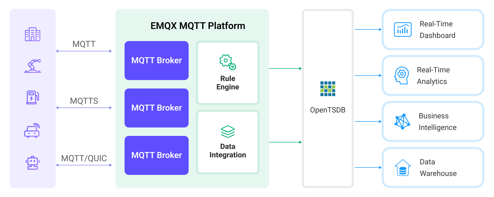

# OpenTSDBへのMQTTデータ取り込み

[OpenTSDB](http://opentsdb.net/)はスケーラブルで分散型の時系列データベースです。EMQXはOpenTSDBとの連携をサポートしており、MQTTメッセージをOpenTSDBに保存して後続の分析や取得に利用できます。

本ページでは、EMQXとOpenTSDB間のデータ統合について包括的に紹介し、実際の作成および検証手順を解説します。

## 動作概要

OpenTSDBデータ統合はEMQXの標準機能であり、EMQXのリアルタイムデータキャプチャと送信機能をOpenTSDBのデータ保存・分析機能と組み合わせています。組み込みの[ルールエンジン](./rules.md)コンポーネントにより、EMQXからOpenTSDBへのデータ取り込みを簡素化し、複雑なコーディングを不要にします。

以下の図はEMQXとOpenTSDB間の典型的なデータ統合アーキテクチャを示しています。



EMQXはルールエンジンとSinkを通じてデバイスデータをOpenTSDBに挿入します。OpenTSDBは豊富なクエリ機能を提供し、レポートやチャート、その他のデータ分析結果の生成をサポートします。産業用エネルギー管理シナリオを例にすると、ワークフローは以下の通りです。

1. **メッセージのパブリッシュと受信**：産業用デバイスはMQTTプロトコルを通じてEMQXに正常に接続し、定期的にエネルギー消費データをパブリッシュします。このデータには生産ラインの識別子やエネルギー消費値が含まれます。EMQXがこれらのメッセージを受信すると、ルールエンジン内でマッチング処理を開始します。  
2. **ルールエンジンによるメッセージ処理**：組み込みのルールエンジンはトピックマッチングに基づき特定のソースからのメッセージを処理します。メッセージが到着するとルールエンジンを通過し、対応するルールとマッチングしてメッセージデータを処理します。これにはデータ形式の変換、特定情報のフィルタリング、メッセージへのコンテキスト情報付加などが含まれます。
3. **OpenTSDBへのデータ取り込み**：ルールエンジンで定義されたルールがトリガーとなり、メッセージをOpenTSDBに書き込む操作が実行されます。

データがOpenTSDBに書き込まれた後は、以下のように柔軟に利用可能です。

- Grafanaなどの可視化ツールに接続し、エネルギー蓄積データを基にチャートを生成。
- ビジネスシステムに接続してエネルギー蓄積装置の状態監視やアラートを実施。

## 特長と利点

OpenTSDBデータ統合は以下の特長と利点を備えています。

- **効率的なデータ処理**：EMQXは膨大な数のIoTデバイス接続とメッセージスループットを処理可能であり、OpenTSDBはデータの書き込み、保存、クエリに優れているため、IoTシナリオのデータ処理ニーズを高いパフォーマンスで満たし、システムに過度な負荷をかけません。
- **メッセージ変換**：EMQXのルールを通じてメッセージは広範囲に処理・変換されてからOpenTSDBに書き込まれます。
- **大規模データ保存**：EMQXとOpenTSDBの連携により、大量のデバイスデータを直接OpenTSDBに保存可能です。OpenTSDBは大規模な時系列データの保存・クエリに特化したデータベースであり、IoTデバイスが生成する膨大な時系列データを効率的に処理できます。
- **豊富なクエリ機能**：OpenTSDBの最適化されたストレージ構造とインデックスにより、数十億のデータポイントの高速な書き込みとクエリが可能であり、IoTデバイスデータのリアルタイム監視、分析、可視化に非常に有用です。
- **スケーラビリティ**：EMQXとOpenTSDBは共にクラスターのスケールアウトに対応しており、ビジネスの拡大に応じて柔軟に水平拡張が可能です。

## はじめる前に

このセクションでは、OpenTSDBデータ統合の作成に先立ち必要な準備とOpenTSDBサーバーのセットアップ方法について説明します。

### 前提条件

- EMQXデータ統合の[ルール](./rules.md)に関する知識
- [データ統合](./data-bridges.md)に関する知識

### OpenTSDBのインストール

Dockerを使ってOpenTSDBをインストールし、Dockerイメージを起動します（現時点ではx86プラットフォームのみ対応）。

```bash
docker pull petergrace/opentsdb-docker

docker run -d --name opentsdb -p 4242:4242 petergrace/opentsdb-docker
```

## コネクターの作成

このセクションでは、SinkをOpenTSDBサーバーに接続するためのコネクター作成手順を示します。

以下の手順はEMQXとOpenTSDBをローカルマシンで実行している場合を想定しています。リモート環境で実行している場合は設定を適宜調整してください。

1. EMQXダッシュボードに入り、**Integration** -> **Connectors**をクリックします。
2. ページ右上の**Create**をクリックします。
3. **Create Connector**ページで**OpenTSDB**を選択し、**Next**をクリックします。
4. **Configuration**ステップで以下を設定します：
   - コネクター名を入力します。英数字の組み合わせで、例：`my_opentsdb`
   - **Server Host**に`http://127.0.0.1:4242`を入力します（OpenTSDBサーバーがリモートの場合は実際のURLを入力）
   - **Enable TLS**：EMQX 6.3.3以降で利用可能です。OpenTSDBサーバーがHTTPSを使用している場合は有効にしてください。EMQXはデフォルトでサーバー証明書を検証します。プライベートCA署名の場合は対応するCA証明書を設定してください。詳細は[外部リソースアクセスのTLS](../../guides/network/overview.md#tls-for-external-resource-access)を参照。
   - その他のオプションはデフォルトのままにします。
5. 高度な設定（任意）：詳細は[Sinkの機能](./data-bridges.md#features-of-sink)を参照してください。
6. **Create**をクリックする前に、**Test Connectivity**を押してコネクターがOpenTSDBサーバーに接続可能かテストできます。
7. ページ下部の**Create**ボタンをクリックしてコネクター作成を完了します。ポップアップで**Back to Connector List**をクリックするか、**Create Rule**をクリックしてルールとSinkの作成に進めます。詳細は[OpenTSDB Sink付きルールの作成](#create-a-rule-with-opentsdb-sink)を参照してください。

## OpenTSDB Sink付きルールの作成

このセクションでは、DashboardでMQTTトピック`t/#`からのメッセージを処理し、処理済みデータを設定済みのSinkを通じてOpenTSDBに保存するルールの作成手順を示します。

1. EMQXダッシュボードにアクセスし、**Integration** -> **Rules**をクリックします。

2. ページ右上の**Create**をクリックします。

3. ルールIDに`my_rule`を入力し、**SQL Editor**で以下の文を設定します。これはトピック`t/#`配下のMQTTメッセージをOpenTSDBに保存することを意味します。

   注意：独自のSQL文を指定する場合は、Sinkが必要とするすべてのフィールドが`SELECT`句に含まれていることを確認してください。

   ```sql
   	SELECT
     		payload.metric as metric, payload.tags as tags, payload.value as value
   	FROM
     		"t/#"
   ```

   注意：初心者の方は**SQL Examples**と**Enable Test**をクリックしてSQLルールの学習とテストが可能です。

4. **+ Add Action**ボタンをクリックして、ルールによりトリガーされるアクションを定義します。このアクションにより、EMQXはルールで処理したデータをOpenTSDBに送信します。

5. **Type of Action**ドロップダウンから`OpenTSDB`を選択します。**Action**はデフォルトの`Create Action`のままにします。既に作成済みのSinkを選択することも可能です。この例では新規Sinkを作成します。

6. Sink名を入力します。英数字の組み合わせで指定してください。

7. **Connector**ドロップダウンから先ほど作成した`my_opentsdb`を選択します。ドロップダウン横のボタンから新規コネクター作成も可能です。設定パラメータは[コネクターの作成](#create-a-connector)を参照してください。

8. **Write Data**フィールドで、MQTTメッセージをOpenTSDBが要求する形式に正しく変換するためのデータ書き込み方法を指定します。例えば、クライアントが以下のデータを報告したとします。

   - トピック：`t/opents`
   - ペイロード：

   ```json
   {
     "metric": "cpu",
     "tags": {
       "host": "serverA"
     },
     "value": 12
   }
   ```

   提供されたペイロードデータ形式に基づき、以下のフォーマット情報を設定します。

   - **Timestamp**：OpenTSDBはデータポイントの時刻記録にタイムスタンプを必要とします。MQTTメッセージにタイムスタンプが含まれない場合、EMQXのSink設定で現在時刻をタイムスタンプとして使用するか、クライアントの報告データ形式にタイムスタンプフィールドを追加する必要があります。
   - **Metric**：この例の`"metric": "cpu"`はメトリック名が`cpu`であることを示します。
   - **Tags**：タグはメトリックに関する追加情報を表します。ここでは`"tags": {"host": "serverA"}`で、このメトリックデータがホスト`serverA`からのものであることを示します。
   - **Value**：実際のメトリック値です。この例では`"value": 12`で、メトリック値が12であることを示します。

9. **フォールバックアクション（任意）**：メッセージ配信失敗時の信頼性向上のため、1つ以上のフォールバックアクションを定義できます。これらはプライマリSinkがメッセージ処理に失敗した場合にトリガーされます。詳細は[フォールバックアクション](./data-bridges.md#fallback-actions)を参照してください。

10. **高度な設定（任意）**：必要に応じて**sync**または**async**クエリモードを選択します。詳細は[Sinkの機能](./data-bridges.md#features-of-sink)の関連設定情報を参照してください。

11. **Create**をクリックする前に、**Test Connectivity**を押してSinkがOpenTSDBサーバーに接続可能かテストできます。

12. **Create**ボタンをクリックしてSink設定を完了します。新しいSinkが**Action Outputs**に追加されます。

13. **Create Rule**ページに戻り、設定内容を確認します。**Create**ボタンをクリックしてルールを生成します。

これでOpenTSDB Sinkを通じたデータ転送ルールの作成が完了しました。**Integration** -> **Rules**ページで新規作成したルールを確認できます。**Actions(Sink)**タブをクリックすると新しいOpenTSDB Sinkが表示されます。

また、**Integration** -> **Flow Designer**をクリックするとトポロジーを確認でき、トピック`t/#`配下のメッセージがルール`my_rule`で解析されOpenTSDBに送信・保存されていることがわかります。

## ルールのテスト

MQTTXを使ってトピック`t/opents`にメッセージをパブリッシュします。

```bash
mqttx pub -i emqx_c -t t/opents -m '{"metric":"cpu","tags":{"host":"serverA"},"value":12}'
```

Sinkの稼働状況を確認すると、新しい受信メッセージと送信メッセージがそれぞれ1件あるはずです。

OpenTSDBにデータが書き込まれているか確認します。

```bash
curl -X POST -H "Accept: Application/json" -H "Content-Type: application/json" http://localhost:4242/api/query -d '{
    "start": "1h-ago",
    "queries": [
        {
            "aggregator": "last",
            "metric": "cpu",
            "tags": {
                "host": "*"
            }
        }
    ],
    "showTSUIDs": "true",
    "showQuery": "true",
    "delete": "false"
}'
```

クエリ結果の整形済み出力例は以下の通りです。

```json
[
  {
    "metric": "cpu",
    "tags": {
      "host": "serverA"
    },
    "aggregateTags": [],
    "query": {
      "aggregator": "last",
      "metric": "cpu",
      "tsuids": null,
      "downsample": null,
      "rate": false,
      "filters": [
        {
          "tagk": "host",
          "filter": "*",
          "group_by": true,
          "type": "wildcard"
        }
      ],
      "percentiles": null,
      "index": 0,
      "rateOptions": null,
      "filterTagKs": [
        "AAAB"
      ],
      "explicitTags": false,
      "useFuzzyFilter": true,
      "preAggregate": false,
      "rollupUsage": null,
      "rollupTable": "raw",
      "showHistogramBuckets": false,
      "useMultiGets": true,
      "tags": {
        "host": "wildcard(*)"
      },
      "histogramQuery": false
    },
    "tsuids": [
      "000001000001000001"
    ],
    "dps": {
      "1683532519": 12
    }
  }
]
```
