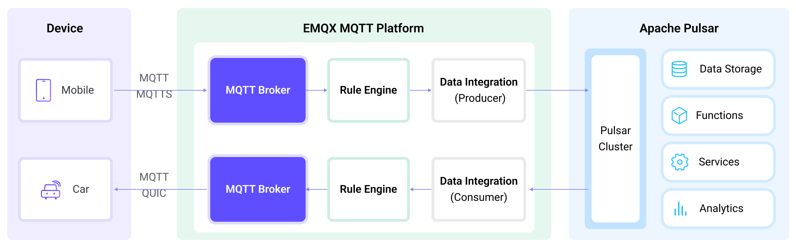

# Apache PulsarへのMQTTデータストリーミング

[Apache Pulsar](https://pulsar.apache.org/)は、アプリケーションやシステム間でリアルタイムデータストリームを効率的に送信するために設計された、人気のあるオープンソースの分散イベントストリーミングプラットフォームです。Apache Pulsarは、より高いスケーラビリティ、より高速なスループット、そして低いレイテンシを提供します。IoTアプリケーションでは、デバイスが生成するデータは通常、軽量なMQTTプロトコルを使って送信されます。Apache PulsarとEMQX間のデータ統合により、ユーザーはMQTTデータを簡単にApache Pulsarにストリーミングし、IoTデバイスが生成するデータのリアルタイム処理、保存、分析のために他のデータシステムと連携させることが可能です。

本ページでは、EMQXとPulsar間のデータ統合について詳細に解説し、データ統合の作成および検証に関する実践的な手順を提供します。

## 動作の仕組み

Apache Pulsarとのデータ統合は、EMQXの標準機能であり、EMQXのデバイス接続およびメッセージ送信機能とPulsarの強力なデータ処理機能を組み合わせています。組み込みのルールエンジンコンポーネントにより、両プラットフォーム間のデータストリーミングと処理が簡素化されます。これにより、複雑なコーディングを必要とせずにMQTTデータをPulsarに送信し、Pulsarの強力な機能を活用してデータ処理を行うことができ、IoTデータの管理と活用がより効率的かつ便利になります。



EMQXはルールエンジンと設定されたSinkを介してMQTTデータをApache Pulsarに転送し、その全体の流れは以下の通りです：

1. **メッセージのパブリッシュと受信**：IoTデバイスはMQTTプロトコルを介して正常に接続を確立し、その後特定のトピックにテレメトリやステータスデータをパブリッシュします。EMQXがこれらのメッセージを受信すると、ルールエンジン内でマッチング処理を開始します。
2. **ルールエンジンによるメッセージ処理**：組み込みのルールエンジンを使用して、特定のソースからのMQTTメッセージをトピックマッチングに基づいて処理します。ルールエンジンは対応するルールをマッチングし、データフォーマットの変換、特定情報のフィルタリング、コンテキスト情報の付加などのメッセージ処理を行います。
3. **Apache Pulsarへのデータストリーミング**：ルールがトリガーされると、メッセージをPulsarに転送するアクションが実行されます。データはPulsarのメッセージキーおよびバリューに簡単にマッピング可能です。MQTTトピックもPulsarトピックにマッピングでき、データの整理や識別が容易になり、後続のデータ処理や分析を促進します。

MQTTメッセージデータがApache Pulsarに書き込まれた後は、以下のような柔軟なアプリケーション開発が可能です：

- Pulsarのコンシューマーアプリケーションを作成し、これらのメッセージをサブスクライブして処理します。ビジネスニーズに応じて、MQTTデータを他のデータソースと関連付けたり集約したり変換したりして、リアルタイムのデータ同期と統合を実現できます。
- 特定のMQTTメッセージを受信した際に、Pulsarのルールエンジンコンポーネントを使って対応するアクションやイベントをトリガーし、システム間やアプリケーション間のイベント駆動機能を実現します。
- Pulsar内でMQTTデータストリームをリアルタイムに分析し、異常や特定のイベントパターンを検出してアラート通知を行ったり、条件に応じた対応を実施したりします。
- 複数のMQTTトピックからのデータを統合し、Pulsarの計算機能を活用してリアルタイムの集約や計算、分析を行い、より包括的なデータインサイトを得ることができます。

## 特長と利点

Pulsarとのデータ統合は、以下の特長と利点をビジネスにもたらします：

- **信頼性の高いIoTデータメッセージ配信**：EMQXはMQTTメッセージをバッチで確実にPulsarに送信でき、IoTデバイスとPulsarおよびアプリケーションシステムの統合を可能にします。
- **MQTTメッセージの変換**：ルールエンジンを使い、EMQXはMQTTメッセージの抽出、フィルタリング、付加情報の追加、変換を行い、Pulsarに送信します。
- **柔軟なトピックマッピング**：Pulsar SinkはMQTTトピックをPulsarトピックに柔軟にマッピングでき、Pulsarメッセージ内のキー（Key）や値（Value）を簡単に設定可能です。
- **柔軟なパーティション選択**：Pulsar SinkはMQTTトピックやクライアントに基づいて異なる戦略でPulsarのパーティションを選択でき、データの整理や識別に柔軟性を提供します。
- **高スループットシナリオでの処理能力**：Pulsar Sinkは同期および非同期の書き込みモードをサポートし、シナリオに応じてレイテンシとスループットのバランスを柔軟に調整できます。

## はじめる前に

このセクションでは、EMQXダッシュボードでPulsarデータ統合を作成する前に必要な準備について説明します。

### 前提条件

- EMQXのデータ統合に関する[ルール](./rules.md)の知識
- [データ統合](./data-bridges.md)に関する知識

### Pulsarのインストール

DockerでPulsarを起動します。

```bash
docker run --rm -it -p 6650:6650 --name pulsar apachepulsar/pulsar:2.11.0 bin/pulsar standalone -nfw -nss
```

詳細な操作手順は[Pulsarドキュメントのクイックスタートセクション](https://pulsar.apache.org/docs/2.11.x/getting-started-home/)を参照してください。

### Pulsarトピックの作成

EMQXでデータ統合を作成する前に、関連するPulsarトピックを作成してください。以下のコマンドで、`public`テナントの`default`ネームスペースに1パーティションの`my-topic`というトピックを作成します。

```bash
docker exec -it pulsar bin/pulsar-admin topics create-partitioned-topic persistent://public/default/my-topic -p 1
```

## コネクターの作成

このセクションでは、SinkをPulsarサーバーに接続するためのコネクターの作成方法を示します。

以下の手順は、EMQXとPulsarの両方をローカルマシンで実行していることを前提としています。リモートで実行している場合は設定を適宜調整してください。

1. EMQXダッシュボードに入り、**Integration** -> **Connectors**をクリックします。
2. ページ右上の**Create**をクリックします。
3. **Create Connector**ページで**Pulsar**を選択し、**Next**をクリックします。
4. **Configuration**ステップで以下の情報を設定します：
   - コネクター名を入力します。英数字の組み合わせで、例：`my_pulsar`。
   - **Bridge Role**はデフォルトで`Producer`が選択されています。
   - Pulsarサーバーへの接続およびメッセージ書き込み情報を設定します：
     - **Servers**：`pulsar://localhost:6650`を入力します。リモート環境の場合は適宜調整してください。
     - **Authentication**：認証方式を`none`、`Basic auth`、または`token`から選択します。`Basic auth`の場合、EMQXは`Username`と`Password`を`:`で連結して認証文字列を作成します。
     - **Enable TLS**：暗号化接続を確立したい場合はトグルスイッチをオンにします。TLS接続の詳細は[外部リソースアクセスのTLS](../../guides/network/overview.md#tls-for-external-resource-access)を参照してください。
5. 詳細設定（任意）：[高度な設定](#advanced-configurations)を参照してください。
6. **Create**をクリックする前に、**Test Connectivity**をクリックしてコネクターがPulsarサーバーに接続できるかテストできます。
7. ページ下部の**Create**ボタンをクリックしてコネクターの作成を完了します。ポップアップダイアログでは**Back to Connector List**をクリックするか、**Create Rule**をクリックしてルールとSinkの作成を続行できます。詳細は[Create a Rule with Pulsar Sink](#create-a-rule-with-pulsar-sink)を参照してください。

## Pulsar Sinkを使ったルールの作成

このセクションでは、ソースMQTTトピック`t/#`からのメッセージを処理し、処理済みデータを設定したSinkを介してPulsarトピック`my-topic`に保存するルールをダッシュボードで作成する方法を示します。

1. EMQXダッシュボードにアクセスし、**Integration** -> **Rules**をクリックします。

2. ページ右上の**Create**をクリックします。

3. ルールIDを入力します。例：`my_rule`。

4. **SQL Editor**に以下のステートメントを入力します。これはトピック`t/#`のMQTTメッセージをPulsarに保存する例です。

   注意：独自のSQL構文を指定する場合は、Sinkが必要とするすべてのフィールドを`SELECT`句に含めていることを確認してください。

   ```sql
   SELECT
     *
   FROM
     "t/#"
   ```

   注意：初心者の方は**SQL Examples**と**Enable Test**をクリックしてSQLルールを学習・テストできます。

5. **+ Add Action**ボタンをクリックして、ルールによってトリガーされるアクションを定義します。このアクションにより、EMQXはルールで処理したデータをPulsarに送信します。

6. **Action Type**ドロップダウンリストから`Pulsar`を選択します。

7. **Action**ドロップダウンはデフォルトの`Create Action`のままにします。既に作成済みのSinkを選択することも可能です。この例では新しいSinkを作成します。

8. Sinkの名前を入力します。英数字の組み合わせにしてください。

9. **Connector**ドロップダウンから先ほど作成した`my_pulsar`を選択します。新しいコネクターを作成する場合はドロップダウン横のボタンをクリックします。設定パラメータの詳細は[Create a Connector](#create-a-connector)を参照してください。

10. Sinkの以下のオプションを設定します：

    - **Pulsar Topic Name**：事前に作成した`persistent://public/default/my-topic`を入力します。変数はサポートされていません。
    - **Partition Strategy**：プロデューサーがメッセージをPulsarのパーティションに振り分ける方法を選択します。`random`、`roundrobin`、`key_dispatch`から選べます。
    - **Compression**：圧縮アルゴリズムの使用有無と、Pulsarメッセージ内のレコード圧縮・解凍に使用するアルゴリズムを指定します。`no_compression`、`snappy`、`zlib`が選択可能です。
    - **Retention Period**：Pulsarトピックにパブリッシュされたメッセージの保持期間を設定します。この設定により、メッセージがサブスクライバーにより消費可能な期間を制御できます。デフォルトは`infinity`で、メッセージの自動期限切れはありません。秒数で数値を指定すると、その期間を超えたメッセージは自動的に期限切れとなりトピックから削除されます。
    - **Message Key**：Pulsarメッセージのキーを指定します。プレースホルダー（${var}）を含む文字列または単純な文字列を入力可能です。
    - **Message Value**：Pulsarメッセージの値を指定します。こちらもプレースホルダーを含む文字列または単純な文字列を入力可能です。

11. **フォールバックアクション（任意）**：メッセージ配信失敗時の信頼性向上のため、1つ以上のフォールバックアクションを定義できます。これらはプライマリSinkがメッセージ処理に失敗した場合にトリガーされます。詳細は[フォールバックアクション](./data-bridges.md#fallback-actions)を参照してください。

12. **詳細設定（任意）**：[高度な設定](#advanced-configurations)を参照してください。

13. **Create**をクリックする前に、**Test Connectivity**をクリックしてコネクターがPulsarサーバーに接続できるかテストできます。

14. **Create**ボタンをクリックしてSinkの設定を完了します。新しいSinkが**Action Outputs**に追加されます。

15. **Create Rule**ページに戻り、設定内容を確認してから**Create**ボタンをクリックし、ルールを生成します。

これでルールの作成が完了しました。**Integration** -> **Rules**ページで新規作成したルールを確認できます。**Actions(Sink)**タブをクリックすると、新しいPulsar Sinkが表示されます。

また、**Integration** -> **Flow Designer**をクリックするとトポロジーが表示され、トピック`t/#`のメッセージがPulsarに送信・保存されていることを確認できます。

## ルールのテスト

MQTTXを使ってトピック`t/1`にメッセージを送信します：

```bash
mqttx pub -i emqx_c -t t/1 -m '{ "msg": "Hello Pulsar" }'
```

Sinkの稼働状況を確認すると、新規の受信メッセージと送信メッセージがそれぞれ1件ずつあるはずです。

以下のPulsarコマンドで、メッセージがトピック`persistent://public/default/my-topic`に書き込まれているか確認します：

```bash
docker exec -it pulsar bin/pulsar-client consume -n 0 -s mysubscriptionid -p Earliest persistent://public/default/my-topic
```

## 高度な設定

このセクションでは、Pulsar Sinkのパフォーマンスを最適化し、特定のシナリオに応じて動作をカスタマイズするための高度な設定オプションについて説明します。Sink作成時に**Advanced Settings**を展開し、ビジネスニーズに応じて以下の設定を行えます。

| 項目                             | 説明                                                         | 推奨値             |
| -------------------------------- | ------------------------------------------------------------ | ------------------ |
| Max Inflight                     | プロデューサーが各パーティションに送信できるメッセージバッチの最大数。<br/>この数を増やすとスループットが向上します。 | `10`               |
| Sync Publish Timeout             | 同期パブリッシュ操作で、メッセージが正常に配信されたことを確認するまでの最大待機時間（秒）。<br/>このタイムアウトはデータ信頼性確保に重要で、配信問題やネットワーク障害時に無限待機を防ぎます。 | `3` 秒             |
| Socket Send Buffer Size          | ネットワーク送信性能を最適化するためのソケットバッファサイズ。 | `1` MB             |
| Batch Size                      | Pulsarメッセージ内にバッチングする個別リクエストの最大数を指定。 | `100`              |
| Max Batch Bytes                 | Pulsarバッチ内で収集するメッセージの最大サイズ（バイト）。<br/>Pulsarブローカーのデフォルトは1MBですが、EMQXはメッセージエンコードのオーバーヘッドを考慮し、1MBよりやや小さい値に設定しています。単一メッセージがこの制限を超える場合は別バッチとして送信されます。 | `900` KB           |
| Query Mode                     | メッセージ送信を最適化するため、`asynchronous`または`synchronous`モードを選択可能。非同期モードではPulsarへの書き込みがMQTTメッセージのパブリッシュ処理をブロックしませんが、クライアントがPulsar到着前にメッセージを受信する可能性があります。 | `Async`            |
| Buffer Mode                    | メッセージ送信前にバッファリングするかどうかを定義。メモリバッファリングは送信速度を向上させます。<br/>`memory`：メッセージをメモリにバッファ。EMQXノード再起動時に失われます。<br/>`disk`：メッセージをディスクにバッファし、ノード再起動後も保持されます。<br/>`hybrid`：初めはメモリにバッファし、一定サイズ（`segment_bytes`設定参照）を超えると徐々にディスクにオフロード。メモリモード同様、ノード再起動時に失われます。 | `memory`           |
| Pulsar Per-partition Buffer Limit | 各Pulsarパーティションの最大バッファサイズ（バイト）。この制限に達すると、古いメッセージを破棄してバッファスペースを確保します。<br/>メモリ使用量とパフォーマンスのバランス調整に役立ちます。 | `2` GB             |
| Segment File Bytes             | バッファモードが`disk`または`hybrid`の場合に適用。メッセージ保存用の分割ファイルサイズを制御し、ディスクストレージの最適化に影響します。 | `100` MB           |
| Memory Overload Protection      | バッファモードが`memory`の場合に適用。EMQXはメモリ使用率が高い場合に古いバッファメッセージを自動破棄し、システムの安定性を確保します。<br/>**注意**：Linuxシステムのみ有効です。 | `disabled`         |
| Start Timeout                 | コネクターが自動起動したリソースの正常状態を待つ最大時間（秒）。リソース（例：Polarのインスタンス）が完全に稼働し、データ処理可能になるまで操作を進めないようにします。 | `5` 秒             |
| Health Check Interval         | Sinkの稼働状況をチェックする間隔。 | `1` 秒             |
