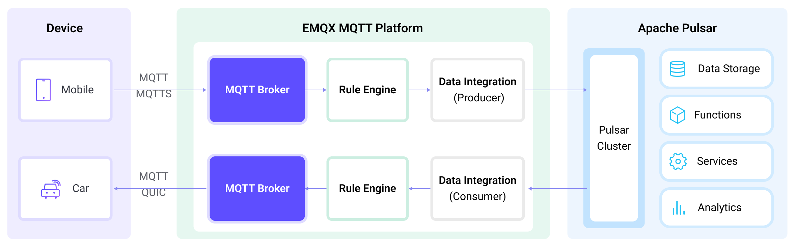

# Apache PulsarへのMQTTデータストリーミング

[Apache Pulsar](https://pulsar.apache.org/) は、アプリケーションやシステム間でリアルタイムデータストリームを効率的に送信するために設計された、人気のあるオープンソースの分散イベントストリーミングプラットフォームです。Apache Pulsarは、より高いスケーラビリティ、より高速なスループット、そして低いレイテンシを提供します。IoTアプリケーションにおいては、デバイスから生成されるデータは通常、軽量なMQTTプロトコルを用いて送信されます。Apache PulsarとEMQXのデータ統合により、ユーザーはMQTTデータを容易にApache Pulsarへストリーミングし、IoTデバイスから生成されたデータのリアルタイム処理、保存、分析のために他のデータシステムと接続できます。

本ページでは、EMQXとPulsar間のデータ統合について詳細に解説し、データ統合の作成および検証方法を実践的に説明します。

## 動作原理

Apache Pulsarとのデータ統合は、EMQXの標準機能であり、EMQXのデバイス接続およびメッセージ送信機能とPulsarの強力なデータ処理機能を組み合わせています。組み込みのルールエンジンコンポーネントにより、両プラットフォーム間のデータストリーミングおよび処理プロセスが簡素化されています。これにより、複雑なコーディングを必要とせずにMQTTデータをPulsarに送信し、Pulsarの強力な機能を活用してデータ処理を行うことができ、IoTデータの管理と活用がより効率的かつ便利になります。



EMQXはルールエンジンと設定されたSinkを介してMQTTデータをApache Pulsarに転送し、その全体の流れは以下の通りです：

1. **メッセージのパブリッシュと受信**：IoTデバイスはMQTTプロトコルを通じて正常に接続を確立し、特定のトピックにテレメトリおよびステータスデータをパブリッシュします。EMQXはこれらのメッセージを受信すると、ルールエンジン内でマッチング処理を開始します。
2. **ルールエンジンによるメッセージ処理**：組み込みのルールエンジンを用いて、特定のソースからのMQTTメッセージをトピックマッチングに基づいて処理します。ルールエンジンは対応するルールをマッチングし、データ形式の変換、特定情報のフィルタリング、コンテキスト情報の付加などの処理を行います。
3. **Apache Pulsarへのデータストリーミング**：ルールがトリガーされると、メッセージをPulsarに転送するアクションが実行されます。データはPulsarのメッセージキーおよび値に簡単に設定でき、MQTTトピックもPulsarトピックにマッピング可能で、データの整理や識別を容易にし、後続のデータ処理や分析を促進します。

MQTTメッセージデータがApache Pulsarに書き込まれた後は、以下のような柔軟なアプリケーション開発が可能です：

- Pulsarのコンシューマーアプリケーションを作成し、これらのメッセージをサブスクライブして処理します。ビジネスニーズに応じて、MQTTデータを他のデータソースと関連付けたり集約したり変換したりして、リアルタイムのデータ同期と統合を実現できます。
- 特定のMQTTメッセージを受信した際に、Pulsarのルールエンジンコンポーネントを利用して対応するアクションやイベントをトリガーし、システム間やアプリケーションのイベント駆動型機能を実現します。
- Pulsar内でMQTTデータストリームをリアルタイムに分析し、異常や特定のイベントパターンを検知してアラート通知を行ったり、条件に応じた対応を実施したりします。
- 複数のMQTTトピックからのデータを統合して単一のデータストリームにまとめ、Pulsarの計算機能を活用してリアルタイムの集約、計算、分析を行い、より包括的なデータインサイトを得ることができます。

## 特長とメリット

Pulsarとのデータ統合により、以下の特長と利点がもたらされます：

- **信頼性の高いIoTデータメッセージ配信**：EMQXはMQTTメッセージをバッチ処理で確実にPulsarへ送信でき、IoTデバイスとPulsarおよびアプリケーションシステムの統合を可能にします。
- **MQTTメッセージの変換**：ルールエンジンを利用して、EMQXはMQTTメッセージの抽出、フィルタリング、エンリッチメント、変換を行い、Pulsarへ送信できます。
- **柔軟なトピックマッピング**：Pulsar SinkはMQTTトピックをPulsarトピックに柔軟にマッピングでき、Pulsarメッセージ内のキー（Key）および値（Value）を簡単に設定可能です。
- **柔軟なパーティション選択**：Pulsar SinkはMQTTトピックやクライアントに基づき、異なる戦略でPulsarのパーティションを選択でき、データの整理や識別に柔軟性を提供します。
- **高スループットシナリオでの処理能力**：Pulsar Sinkは同期および非同期の書き込みモードをサポートし、シナリオに応じてレイテンシとスループットのバランスを柔軟に調整できます。

## はじめる前に

このセクションでは、EMQXダッシュボードでPulsarデータ統合を作成する前に必要な準備について説明します。

### 前提条件

- EMQXのデータ統合に関する[ルール](./rules.md)の知識
- [データ統合](./data-bridges.md)に関する知識

### Pulsarのインストール

DockerでPulsarを起動します。

```bash
docker run --rm -it -p 6650:6650 --name pulsar apachepulsar/pulsar:2.11.0 bin/pulsar standalone -nfw -nss
```

詳細な操作手順は、[Pulsarドキュメントのクイックスタート](https://pulsar.apache.org/docs/2.11.x/getting-started-home/)を参照してください。

### Pulsarトピックの作成

EMQXでデータ統合を作成する前に、関連するPulsarトピックを作成しておく必要があります。以下のコマンドで、`public`テナントの`default`ネームスペースに1パーティションの`my-topic`という名前のトピックを作成します。

```bash
docker exec -it pulsar bin/pulsar-admin topics create-partitioned-topic persistent://public/default/my-topic -p 1
```

## コネクターの作成

このセクションでは、SinkをPulsarサーバーに接続するためのコネクターの作成方法を説明します。

以下の手順は、EMQXとPulsarをローカルマシンで実行していることを前提としています。リモートで実行している場合は設定を適宜調整してください。

1. EMQXダッシュボードに入り、**Integration** -> **Connectors** をクリックします。
2. ページ右上の **Create** をクリックします。
3. **Create Connector** ページで **Pulsar** を選択し、**Next** をクリックします。
4. **Configuration** ステップで以下の情報を設定します：
   - コネクター名を入力します。英数字の組み合わせで、例：`my_pulsar`。
   - **Bridge Role** はデフォルトで `Producer` が選択されています。
   - Pulsarサーバーへの接続およびメッセージ書き込み情報を設定します：
     - **Servers**：`pulsar://localhost:6650` を入力します。リモート環境の場合は適宜変更してください。
     - **Authentication**：認証方式を選択します。`none`、`Basic auth`、`token` のいずれかです。`Basic auth`の場合、EMQXは`Username`と`Password`を`:`で連結して認証文字列を作成します。
     - **Enable TLS**：暗号化接続を確立する場合はトグルスイッチをオンにします。TLS接続の詳細は[外部リソースアクセスのTLS](../../guides/network/overview.md#tls-for-external-resource-access)を参照してください。
5. 詳細設定（任意）：[詳細設定](#advanced-configurations)を参照してください。
6. **Create**をクリックする前に、**Test Connectivity** をクリックしてコネクターがPulsarサーバーに接続できるかテストできます。
7. ページ下部の **Create** ボタンをクリックしてコネクターの作成を完了します。ポップアップダイアログで **Back to Connector List** または **Create Rule** を選択できます。ルールとSinkを作成してPulsarに転送するデータを指定する場合は、[Pulsar Sink付きルールの作成](#create-a-rule-with-pulsar-sink)を参照してください。

## Pulsar Sink付きルールの作成

このセクションでは、ソースMQTTトピック `t/#` からのメッセージを処理し、処理済みデータを設定済みのSinkを介してPulsarトピック `my-topic` に保存するルールの作成方法を説明します。

1. EMQXダッシュボードで **Integration** -> **Rules** をクリックします。

2. ページ右上の **Create** をクリックします。

3. ルールIDを入力します。例：`my_rule`。

4. **SQL Editor** に以下のステートメントを入力します。これはトピック `t/#` のMQTTメッセージをPulsarに保存する例です。

   注意：独自のSQL構文を指定する場合は、Sinkが必要とするすべてのフィールドを`SELECT`部分に含めていることを確認してください。

   ```sql
   SELECT
     *
   FROM
     "t/#"
   ```

   注意：初心者の方は **SQL Examples** と **Enable Test** をクリックしてSQLルールの学習とテストが可能です。

5. **+ Add Action** ボタンをクリックし、ルールによってトリガーされるアクションを定義します。このアクションにより、EMQXはルールで処理したデータをPulsarに送信します。

6. **Action Type** ドロップダウンリストから `Pulsar` を選択します。

7. **Action** ドロップダウンはデフォルトの `Create Action` のままにします。既に作成済みのSinkを選択することも可能です。この例では新しいSinkを作成します。

8. Sinkの名前を入力します。英数字の組み合わせで指定してください。

9. **Connector** ドロップダウンから先ほど作成した `my_pulsar` を選択します。新しいコネクターを作成する場合は、ドロップダウン横のボタンをクリックしてください。設定パラメータの詳細は[コネクターの作成](#create-a-connector)を参照してください。

10. Sinkの以下のオプションを設定します：

    - **Pulsar Topic Name**：事前に作成したPulsarトピック `persistent://public/default/my-topic` を入力します。変数はサポートされていません。
    - **Partition Strategy**：プロデューサーがPulsarのパーティションにメッセージを振り分ける方法を選択します。`random`、`roundrobin`、`key_dispatch` のいずれかです。
    - **Compression**：圧縮アルゴリズムの使用有無および圧縮/解凍に使用するアルゴリズムを指定します。選択肢は `no_compression`、`snappy`、`zlib` です。
    - **Retention Period**：Pulsarトピックにパブリッシュされたメッセージの保持期間を定義します。この設定により、サブスクライバーがメッセージを消費可能な期間を制御できます。デフォルトは `infinity` で、メッセージの自動期限切れはありません。秒数で数値を指定すると、その時間を超えたメッセージは自動的に期限切れとなりトピックから削除されます。
    - **Message Key**：Pulsarメッセージのキーを指定します。プレーン文字列またはプレースホルダー（${var}）を含む文字列を入力可能です。
    - **Message Value**：Pulsarメッセージの値を指定します。プレーン文字列またはプレースホルダー（${var}）を含む文字列を入力可能です。

11. **フォールバックアクション（任意）**：メッセージ配信失敗時の信頼性向上のため、1つ以上のフォールバックアクションを定義できます。プライマリSinkがメッセージ処理に失敗した場合にこれらのアクションがトリガーされます。詳細は[フォールバックアクション](./data-bridges.md#fallback-actions)を参照してください。

12. **詳細設定（任意）**：[詳細設定](#advanced-configurations)を参照してください。

13. **Create** をクリックする前に、**Test Connectivity** をクリックしてコネクターがPulsarサーバーに接続できるかテストできます。

14. **Create** ボタンをクリックしてSinkの設定を完了します。新しいSinkが **Action Outputs** に追加されます。

15. **Create Rule** ページに戻り、設定内容を確認してから **Create** をクリックし、ルールを生成します。

これでルールの作成が完了しました。**Integration** -> **Rules** ページで新規作成したルールが確認できます。**Actions(Sink)** タブをクリックすると、新しいPulsar Sinkが表示されます。

また、**Integration** -> **Flow Designer** をクリックしてトポロジーを表示すると、トピック `t/#` のメッセージがPulsarに送信・保存されていることが確認できます。

## ルールのテスト

MQTTXを使ってトピック `t/1` にメッセージを送信します：

```bash
mqttx pub -i emqx_c -t t/1 -m '{ "msg": "Hello Pulsar" }'
```

Sinkの稼働状況を確認すると、新規の受信メッセージと送信メッセージがそれぞれ1件ずつあるはずです。

以下のPulsarコマンドで、メッセージがトピック `persistent://public/default/my-topic` に書き込まれているか確認します：

```bash
docker exec -it pulsar bin/pulsar-client consume -n 0 -s mysubscriptionid -p Earliest persistent://public/default/my-topic
```

## 詳細設定

このセクションでは、Pulsar Sinkのパフォーマンスを最適化し、特定のシナリオに応じて動作をカスタマイズするための詳細設定オプションを説明します。Sink作成時に **Advanced Settings** を展開し、ビジネスニーズに応じて以下の設定を行えます。

| 項目                             | 説明                                                         | 推奨値             |
| -------------------------------- | ------------------------------------------------------------ | ------------------ |
| Max Inflight                    | プロデューサーが各パーティションに送信できるメッセージバッチの最大数。<br/>この数値を大きくするとスループットが向上します。 | `10`               |
| Sync Publish Timeout            | 同期パブリッシュ操作で、メッセージが正常に配信されたという応答または確認を待つ最大時間（秒）。<br/>このタイムアウト設定は、配信問題やネットワーク障害時にパブリッシャーが無期限にブロックされるのを防ぎ、データ信頼性を確保します。 | `3` 秒             |
| Socket Send Buffer Size         | ネットワーク送信性能を最適化するためのソケットバッファサイズ管理。 | `1` MB             |
| Batch Size                     | 1つのPulsarメッセージ内にバッチングされる個別リクエストの最大数を指定。 | `100`              |
| Max Batch Bytes                | Pulsarバッチ内で収集されるメッセージの最大サイズ（バイト）。通常、Pulsarブローカーのデフォルトバッチサイズ制限は1MBですが、EMQXのデフォルト値はPulsarメッセージのエンコードオーバーヘッドを考慮し、特に小さなメッセージが多い場合に備えて1MBよりやや低く設定されています。この制限を超える単一メッセージは別バッチとして送信されます。 | `900` KB           |
| Query Mode                    | メッセージ送信要件に応じて `asynchronous` または `synchronous` モードを選択可能。非同期モードではPulsarへの書き込みがMQTTメッセージのパブリッシュ処理をブロックしませんが、クライアントがPulsar到着前にメッセージを受信する可能性があります。 | `Async`            |
| Buffer Mode                   | メッセージ送信前にバッファリングするかどうかを定義。メモリバッファリングは送信速度を向上させます。<br/>`memory`：メッセージはメモリにバッファされ、EMQXノード再起動時に失われます。<br/>`disk`：メッセージはディスクにバッファされ、EMQXノード再起動後も保持されます。<br/>`hybrid`：メッセージは最初メモリにバッファされ、一定サイズ（`segment_bytes`設定参照）に達すると徐々にディスクにオフロードされます。メモリモード同様、EMQXノード再起動時にメッセージは失われます。 | `memory`           |
| Pulsar Per-partition Buffer Limit | 各Pulsarパーティションに許容される最大バッファサイズ（バイト）。この制限に達すると、古いメッセージが破棄されてバッファスペースが確保されます。<br/>メモリ使用量とパフォーマンスのバランスを取るための設定です。 | `2` GB             |
| Segment File Bytes            | バッファモードが `disk` または `hybrid` の場合に適用。メッセージ保存用のセグメントファイルサイズを制御し、ディスクストレージの最適化レベルに影響します。 | `100` MB           |
| Memory Overload Protection    | バッファモードが `memory` の場合に適用。高メモリ圧迫時にEMQXが古いバッファメッセージを自動破棄し、システムの安定性を確保します。<br/>**注意**：Linuxシステムのみ有効です。 | `disabled`         |
| Start Timeout                 | コネクターが自動起動したリソースの正常状態を待つ最大時間（秒）。この設定により、Polarなどの接続リソースが完全に稼働しデータ処理準備が整うまで処理を進めないようにします。 | `5` 秒             |
| Health Check Interval         | Sinkの稼働状態をチェックする間隔。 | `1` 秒             |
