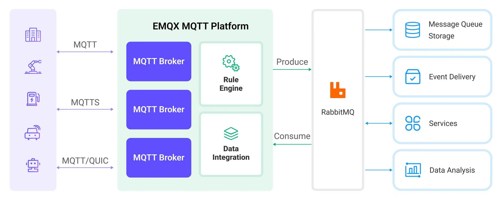
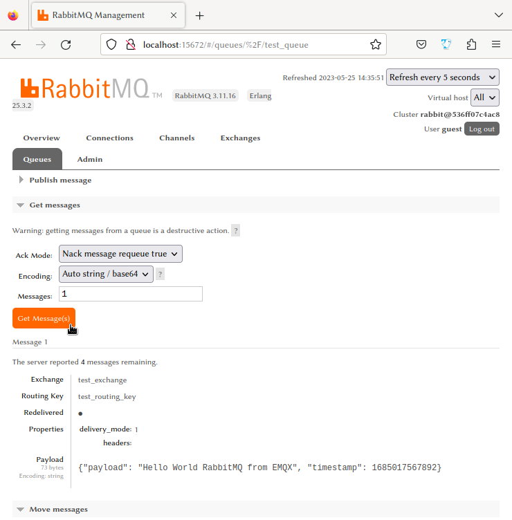
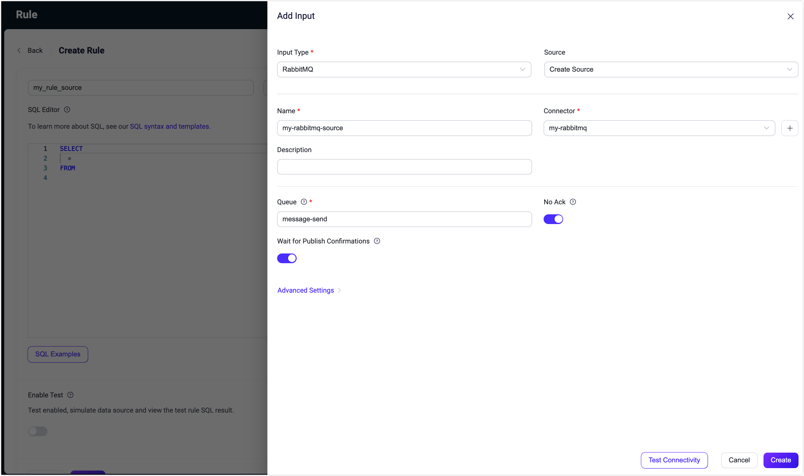

# RabbitMQへのMQTTデータ取り込み

[RabbitMQ](https://www.rabbitmq.com/)は、Advanced Message Queuing Protocol（AMQP）を実装した広く使われているオープンソースのメッセージブローカーです。分散システム間のメッセージングにおいて堅牢でスケーラブルなプラットフォームを提供します。EMQXはRabbitMQとの統合をサポートしており、MQTTメッセージやイベントをRabbitMQへ転送できます。また、RabbitMQサーバーからデータを取得し、EMQXの特定のトピックにパブリッシュすることも可能で、RabbitMQからMQTTへのメッセージ配送を実現します。

本ページでは、EMQXとRabbitMQ間のデータ統合の詳細な概要と、データ統合の作成および検証に関する実践的な手順を提供します。

## 動作概要

RabbitMQデータ統合は、MQTTベースのIoTデータとRabbitMQの強力なメッセージキュー処理機能を橋渡しするためにEMQXに標準搭載された機能です。組み込みの[ルールエンジン](./rules.md)コンポーネントにより、EMQXからRabbitMQへのデータ取り込みが簡素化され、複雑なコーディングを不要にします。

RabbitMQ Sinkを例に、以下の図はEMQXとRabbitMQ間の典型的なデータ統合アーキテクチャを示しています。



MQTTデータをRabbitMQに取り込む流れは以下の通りです：

1. **メッセージのパブリッシュと受信**：産業用IoTデバイスはMQTTプロトコルを通じてEMQXに正常に接続し、リアルタイムのMQTTデータをEMQXにパブリッシュします。EMQXがこれらのメッセージを受信すると、ルールエンジン内でマッチング処理を開始します。
2. **メッセージデータの処理**：メッセージが到着するとルールエンジンを通過し、EMQXで定義されたルールにより処理されます。ルールは事前定義された条件に基づき、RabbitMQにルーティングすべきメッセージを判別します。ペイロードの変換が指定されている場合は、データ形式の変換、特定情報のフィルタリング、追加コンテキストによるペイロードの強化などが適用されます。
3. **RabbitMQへのメッセージ取り込み**：ルールによる処理が完了すると、メッセージをRabbitMQに転送するアクションがトリガーされます。処理済みのメッセージはシームレスにRabbitMQに書き込まれます。
4. **データの永続化と活用**：RabbitMQはメッセージをキューに保存し、適切なコンシューマーに配信します。メッセージは他のアプリケーションやサービスによって消費され、データ分析、可視化、保存などのさらなる処理に利用されます。

## 特長と利点

RabbitMQとのデータ統合は、以下の特長とメリットをビジネスにもたらします：

- **信頼性の高いIoTデータメッセージ配送**：EMQXはデバイスからクラウドへの信頼性の高い接続とメッセージ配送を保証し、RabbitMQはメッセージのパーシステンスと異なるサービス間での信頼性の高い配送を担い、データの信頼性を全プロセスで確保します。
- **MQTTメッセージの変換**：ルールエンジンを用いて、EMQXはMQTTメッセージの抽出、フィルタリング、強化、変換を行い、RabbitMQへ送信します。
- **柔軟なメッセージマッピング**：RabbitMQデータ統合はMQTTトピックとRabbitMQのルーティングキーおよびエクスチェンジの柔軟なマッピングをサポートし、MQTTとRabbitMQ間のシームレスな統合を実現します。
- **高可用性とクラスター対応**：EMQXとRabbitMQは共に高可用なメッセージブローカークラスターの構築をサポートし、ノード障害時でもサービス継続を保証します。クラスター機能により優れたスケーラビリティも提供されます。
- **高スループット環境での処理能力**：RabbitMQデータ統合は同期および非同期の書き込みモードをサポートし、レイテンシとスループットのバランスをシナリオに応じて柔軟に調整可能です。

## はじめる前に

このセクションでは、RabbitMQデータ統合の作成前に必要な準備について説明します。RabbitMQサーバーの起動方法やテスト用のエクスチェンジとキューの作成方法を含みます。

### 前提条件

- EMQXデータ統合の[ルール](./rules.md)に関する知識
- [データ統合](./data-bridges.md)および[メッセージ再パブリッシュアクション](./rule-get-started.md#add-republish-action)に関する知識
- UNIXターミナルおよびコマンドの基本知識

### RabbitMQサーバーの起動

ここでは[Docker](https://www.docker.com/)を使ったRabbitMQサーバーの起動方法を紹介します。

以下のコマンドを実行して、管理プラグインを有効にしたRabbitMQサーバーを起動します。管理プラグインによりWebインターフェースでRabbitMQを監視できます。

```bash
docker run -it --rm --name rabbitmq -p 127.0.0.1:5672:5672 -p 127.0.0.1:15672:15672 rabbitmq:3.11-management
```

Docker Hubの[RabbitMQのDocker実行に関する情報](https://hub.docker.com/_/rabbitmq)もご参照ください。

### メッセージ受信用のエクスチェンジとキューの作成

RabbitMQサーバー起動後、RabbitMQ管理Webインターフェースを使って、EMQXから転送されるメッセージ受信用のテスト用エクスチェンジとキューを作成できます。既にテスト用のエクスチェンジとキューがある場合はこのセクションをスキップしてください。

1. Webブラウザで http://localhost:15672/ にアクセスし、RabbitMQ管理Webインターフェースを開きます。ログイン画面で以下のデフォルト認証情報を入力し、**Login**をクリックします。
   - **Username**: `guest`
   - **Password**: `guest`
2. 上部メニューの**Exchanges**タブをクリックし、**Add a new exchange**を展開して以下を入力します：
   * **Name**: `test_exchange` と入力
   * **Type**: ドロップダウンから `direct` を選択
   * **Durability**: `Durable` を選択（RabbitMQサーバー再起動後もエクスチェンジが存在するように永続化）
   * **Auto delete**: `No`
   * **Internal**: `No`
   * **Arguments**: 空欄のまま
3. **Add exchange**ボタンをクリックしてテスト用エクスチェンジを作成します。
4. 上部メニューの**Queues**タブをクリックし、**Add a new queue**を展開して以下を入力します：
   * **Type**: `Default for virtual host`
   * **Name**: `test_queue` と入力
   * **Durability**: `Durable` を選択（キューを永続化）
   * **Arguments**: 空欄のまま
5. **Add queue**ボタンをクリックしてテスト用キューを作成します。新しい`test_queue`が**All queues**セクションに表示されます。
6. キュー名の**test_queue**をクリックして詳細ページを開き、**Bindings**を展開します。**Add binding to this queue**セクションに以下を入力します：
   * **From exchange**: `test_exchange` と入力
   * **Routing key**: `test_routing_key` と入力
   * **Arguments**: 空欄のまま
7. **Bind**ボタンをクリックして、`test_queue`を`test_exchange`に指定したルーティングキーでバインドします。

### メッセージパブリッシュ用のキュー作成

RabbitMQ管理Webインターフェースを使って、RabbitMQメッセージのパブリッシュ用キューを作成できます。

1. RabbitMQ管理Webインターフェースにログインします。
2. 上部メニューの**Queues**タブをクリックし、**Add a new queue**を展開して以下を入力します：
   * **Type**: `Default for virtual host`
   * **Name**: `message-send` と入力
   * **Durability**: `Durable` を選択（キューを永続化）
   * **Arguments**: 空欄のまま
3. **Add queue**ボタンをクリックしてキューを作成します。新しい`message-send`が**All queues**セクションに表示されます。

## コネクターの作成

このセクションでは、Rabbit Sink/SourceをRabbitMQサーバーに接続するためのコネクター作成方法を説明します。

以下の手順はEMQXとRabbitMQをローカルマシンで実行している前提です。RabbitMQが別の環境にある場合は設定を適宜調整してください。

1. ダッシュボードに入り、**Integration** -> **Connectors**をクリックします。
2. 画面右上の**Create**をクリックします。
3. **Create Connector**ページで**RabbitMQ**を選択し、**Next**をクリックします。
4. コネクター名を入力します。英数字の組み合わせで、例：`my_rabbitmq`。
5. 接続情報を入力します。
   - **Servers**: `host[:port]`形式のRabbitMQノードをカンマ区切りで入力します。例：`rmq1:5672,rmq2:5672`。1つのノードへの接続が失敗した場合は次のノードに接続を試みます。異なる接続プールワーカーはリスト内の異なる位置から開始し、接続の分散を助けます。

     ::: tip
     EMQX 6.0.4以降、複数のRabbitMQノードを設定可能です。接続確立時にフェイルオーバーが発生しますが、確立済みのAMQP接続はノード間で移動しません。単一ノード指定の既存設定は引き続き互換性があります。
     :::

   - **Port**: **Servers**でポート未指定のノードに適用されるデフォルトポート。デフォルトは`5672`。
   - **Username**: `guest`
   - **Password**: `guest`
   - **Virtual Host**: RabbitMQのバーチャルホスト。デフォルトは`/`。
   - 暗号化接続を行う場合は**Enable TLS**をオンにします。TLS接続の詳細は[外部リソースアクセスのTLS](../../guides/network/overview.md#tls-for-external-resource-access)を参照してください。

6. **Create**をクリックする前に、**Test Connectivity**をクリックしてRabbitMQサーバーへの接続テストが可能です。
7. 画面下部の**Create**ボタンをクリックしてコネクター作成を完了します。ポップアップで**Back to Connector List**または**Create Rule**を選択できます。**Create Rule**を選ぶと以下のオプションがあります：
   - **Action Outputs**：RabbitMQ Sinkを使ったルール作成で、RabbitMQに転送するデータを指定します。[RabbitMQ Sinkでルールを作成](#create-a-rule-with-rabbitmq-sink)の手順も参照してください。
   - **Data Inputs**：RabbitMQ Sourceを使ったルール作成です。[RabbitMQ Sourceでルールを作成](#create-a-rule-with-rabbitmq-source)の手順も参照してください。

## RabbitMQ Sinkを使ったルール作成

このセクションでは、ダッシュボードでMQTTのソーストピック`t/#`からのメッセージを処理し、処理結果をRabbitMQのキュー`test_queue`に転送するルールの作成方法を説明します。

### SQLを定義したルール作成

1. EMQXダッシュボードで、**Integration -> Rules**をクリックします。
2. 画面右上の**Create**をクリックします。
3. ルールIDを入力します。例：`my_rule`。
4. SQLエディタに以下の文を入力します。トピックパターン`t/#`にマッチするMQTTメッセージを転送します。

   ```sql
   SELECT
     payload,
     now_timestamp() as timestamp
   FROM
     "t/#"
   ```

   ::: tip

   初心者の方は**SQL Examples**をクリックし、**Enable Test**でSQLルールの学習とテストが可能です。

   :::

5. ルールにアクションを追加し、Sinkを設定します。詳細は[ルールにRabbitMQ Sinkを追加](#add-rabbitmq-sink)を参照してください。
6. アクション追加後、**Action Outputs**セクションに新しいSinkが表示されます。**Create Rule**ページの**Save**ボタンをクリックしてルール作成を完了します。

これでルールが正常に作成されました。**Rules**ページで新しいルールを確認でき、**Actions (Sink)**タブで新しいRabbitMQ Sinkも確認できます。

また、**Integration -> Flow Designer**をクリックするとトポロジーが表示され、トピック`t/#`のメッセージがルール`my_rule`で解析されRabbitMQに書き込まれる様子を視覚的に確認できます。

### RabbitMQ Sinkの追加

このセクションでは、処理結果をRabbitMQに書き込むためにルールにSinkを追加する方法を説明します。

1. **Create Rule**ページの**Action Outputs**セクションで**Add Action**をクリックし、ルールでトリガーされるアクションを定義します。このアクションにより、EMQXはルールで処理したデータをRabbitMQに送信します。
2. **Type of Action**ドロップダウンから`RabbitMQ`を選択します。**Action**はデフォルトの`Create Action`のままにします。既存のSinkを選択することもできますが、ここでは新規作成します。
3. Sinkの名前を入力します。英数字の組み合わせで入力してください。
4. **Connector**ドロップダウンから`my_rabbitmq`を選択します。新規コネクターを作成する場合は隣のボタンから作成可能です。設定パラメータは[コネクターの作成](#create-a-connector)を参照してください。
5. Sinkの設定を以下のように行います：

   * **Exchange**: 事前に作成した`test_exchange`を入力します。メッセージはこのエクスチェンジにパブリッシュされます。

       ::: tip 注意

       RabbitMQにエクスチェンジが作成済みであることを確認してください。存在しない場合、アクションは一時的に動作しなくなり、定期的に再接続を試みます。

       :::

   * **Routing Key**: 事前に作成した`test_routing_key`を入力します。RabbitMQのメッセージパブリッシュ用ルーティングキーです。

       ::: tip

       エクスチェンジとルーティングキーはテンプレート値として設定可能で、プレースホルダーを使い受信MQTTメッセージのペイロードから動的に値を抽出しルーティングできます。

       例えば、ペイロードのフィールドに基づきルーティングキーを動的設定したい場合、`${payload.akey}`のように設定します。これによりペイロードの`akey`フィールドの値がルーティングキーとして使われます。

       **注意**：バッチモードでは、エクスチェンジとルーティングキーのテンプレート値はバッチ内の全メッセージで一定である必要があります。これにより一貫したルーティングが保証され、バッチ処理中の競合を防ぎます。

       :::

   * **Virtual Host**: RabbitMQのバーチャルホスト。デフォルトは`/`。
   * **Message Delivery Mode**ドロップダウンで`non_persistent`または`persistent`を選択します：

     * `non_persistent`（デフォルト）：メッセージはディスクに永続化されず、RabbitMQの再起動やクラッシュ時に失われる可能性があります。
     * `persistent`：メッセージはディスクに永続化され、RabbitMQの再起動やクラッシュ時にも耐久性があります。

       ::: tip

       メッセージの損失を防ぐために、キューとエクスチェンジもDurableに設定する必要があります。詳細はRabbitMQの[ドキュメント](https://www.rabbitmq.com/documentation.html)をご参照ください。

       :::

   * **Wait for Publish Confirmations**：デフォルトで有効。メッセージがRabbitMQに正常にパブリッシュされたことを確認します。

     ::: tip

     このオプション有効時、RabbitMQブローカーはメッセージの受領をアック（ACK）し、成功を保証するためメッセージ配送の信頼性が向上します。

     :::

   * **Headers Template**および**Properties Template**：テンプレートを使ってRabbitMQのカスタムHeadersおよびPropertiesを定義できます。詳細は[HeadersとPropertiesテンプレートの設定](#set-headers-and-properties-templates)を参照してください。
   * **Payload Template**：デフォルトは空文字列で、メッセージペイロードはJSON形式のテキストとしてRabbitMQに転送されます。

     プレースホルダーを使い、受信したMQTTメッセージのデータを動的に含めるカスタムペイロード形式も定義可能です。例えば、MQTTメッセージのペイロードとタイムスタンプを含めたい場合は以下のテンプレートを使います：

     ```json
      {"payload": "${payload}", "timestamp": ${timestamp}}
     ```

     このテンプレートは、受信MQTTメッセージのペイロードとタイムスタンプを含むJSON形式のメッセージを生成します。`${payload}`や`${timestamp}`はプレースホルダーで、実際の値に置き換えられます。

6. **フォールバックアクション（任意）**：メッセージ配送失敗時の信頼性向上のため、1つ以上のフォールバックアクションを定義可能です。詳細は[フォールバックアクション](./data-bridges.md#fallback-actions)を参照してください。
7. **高度な設定（任意）**：

   - **Publish Confirmation Timeout**：デフォルトは30秒。パブリッシュ確認のタイムアウト時間です。
   - 必要に応じて**sync**または**async**クエリモードを選択可能です。詳細は[Sinkの機能](./data-bridges.md#features-of-sink)を参照してください。

8. **Create**をクリックする前に、**Test Connectivity**をクリックしてSinkがRabbitMQサーバーに接続できるかテスト可能です。
9. **Create**ボタンをクリックしてSinkの設定を完了します。作成成功後、ルール作成ページに戻り、新しいSinkが**Action Outputs**に追加されます。

#### HeadersおよびPropertiesテンプレートの設定

EMQX 6.0以降、RabbitMQ Sinkアクション作成時にカスタムHeadersおよびPropertiesを定義可能です。これによりメッセージにメタデータを付加し、RabbitMQ内での互換性やルーティングの柔軟性が向上します。

これらのフィールドはルールSQLの結果からの変数（例：`${payload.device_id}`）を使ったテンプレート指定が可能です。HeadersおよびPropertiesは任意で、空欄の場合は追加メタデータは付加されません。

##### Headersテンプレートの設定方法

RabbitMQ Headersとして1つ以上のキー・バリューのペアを追加できます。これらはユーザー定義のメタデータで、RabbitMQのコンシューマーが解釈可能です。

- **Key**：ヘッダー名。文字列で指定。
- **Value**：キーに対応する値。静的文字列またはテンプレート変数を使用可能。

例：MQTTペイロードのデバイスIDを含める場合

| Key         | Value                  |
| ----------- | ---------------------- |
| `device_id` | `${payload.device_id}` |

##### Propertiesテンプレートの設定方法

RabbitMQは標準的なメッセージプロパティをサポートします。EMQXではこれらを定義し、メッセージレベルのメタデータ（コンテンツタイプや相関IDなど）を付与可能です。

- **Key**：以下の有効なプロパティキーから選択（無効なキーは無視されます）。
- **Value**：静的値またはテンプレート変数を設定。

有効なプロパティキー：

- `content_type`
- `content_encoding`
- `priority`
- `correlation_id`
- `reply_to`
- `expiration`
- `message_id`
- `timestamp`
- `type`
- `user_id`
- `app_id`
- `cluster_id`

例：コンテンツタイプとアプリケーションIDを指定する場合

| Key            | Value              |
| -------------- | ------------------ |
| `content_type` | `application/json` |
| `app_id`       | `my_iot_app`       |

##### 利用例

MQTTメッセージのペイロードが以下の場合：

```json
{
  "device_id": "sensor-123",
  "status": "ok"
}
```

以下を設定したいとします：

- ヘッダー`device_id`をMQTTペイロードから取得
- プロパティ`app_id`を静的値で設定

設定例：

**Headersテンプレート**：

| Key         | Value                  |
| ----------- | ---------------------- |
| `device_id` | `${payload.device_id}` |

**Propertiesテンプレート**：

| Key      | Value    |
| -------- | -------- |
| `app_id` | `my_app` |

この設定により、RabbitMQに転送される全メッセージに以下が含まれます：

- コンシューマー向けのカスタムメタデータ（Headers）
- メッセージ処理やデバッグ用の標準メタデータ（Properties）

## RabbitMQ Sinkを使ったルールのテスト

EMQXダッシュボードに内蔵されたWebSocketクライアントを使い、ルールとSinkの動作をテストできます。

1. ダッシュボード左メニューの**Diagnose** -> **WebSocket Client**をクリックします。
2. 現在のEMQXインスタンスへの接続情報を入力します。
   - ローカルでEMQXを実行している場合はデフォルト値を使用可能です。
   - 認証設定を変更している場合はユーザー名やパスワードを入力してください。
3. **Connect**をクリックしてEMQXに接続します。
4. ページ下部のパブリッシュエリアに以下を入力します：
   * **Topic**：`t/test`
   * **Payload**：`Hello World RabbitMQ from EMQX`
   * **QoS**：`2`
5. **Publish**をクリックしてメッセージを送信します。

   Sinkとルールが正常に作成されていれば、指定したエクスチェンジに指定ルーティングキーでメッセージがパブリッシュされているはずです。

6. http://localhost:15672 のRabbitMQ管理コンソールにアクセスし、**Queues**セクションに移動します。

   ::: tip

   デフォルト設定の場合、ユーザー名とパスワードは共に`guest`です。

   :::

7. メッセージが適切なキューにルーティングされていることを確認します。キューをクリックし、**Get Message(s)**ボタンを押して詳細なメッセージ内容を確認できます。



## RabbitMQ Sourceを使ったルール作成

このセクションでは、RabbitMQキューからEMQXへデータを転送するルールの作成方法を説明します。RabbitMQ Sourceとメッセージ再パブリッシュアクションの両方を作成し、RabbitMQサービスからメッセージを消費してEMQXに転送します。

1. ダッシュボードの**Integration** -> **Rules**ページに移動します。
2. 画面右上の**Create**をクリックします。
3. ルールIDに`my_rule_source`を入力します。
4. ルールをトリガーするソース（Data Inputs）を設定します。画面右側の**Data Inputs**タブをクリックし、デフォルトの`Messages`入力を削除してから**Add Input**をクリックし、RabbitMQ Sourceを作成します。
5. **Add Input**ポップアップで、**Input Type**ドロップダウンから`RabbitMQ`を選択します。**Source**はデフォルトの`Create Source`のままにします。この例では新規Sourceを作成しルールに追加します。
6. Sourceの**Name**と（任意で）**Description**を入力します。英数字の組み合わせで、例：`my-rabbitmq-source`。
7. **Connector**ドロップダウンから先に作成した`my-rabbitmq`コネクターを選択します。新規作成する場合は隣のボタンから作成可能です。設定は[コネクターの作成](#create-a-connector)を参照してください。
8. RabbitMQからEMQXへメッセージを消費するためのSource情報を設定します：

   - **Queue**：RabbitMQで作成済みの`message-send`キュー名を入力。
   - **No Ack**：状況に応じて選択。`no_ack`モードでRabbitMQからメッセージを消費するかどうか。`no_ack`有効時は、RabbitMQはメッセージをコンシューマーの処理成否に関わらず即座にキューから削除します。
   - **Wait for Publish Confirmations**：メッセージパブリッシャーのアック待ちを行うか指定します。

9. 高度な設定（任意）：デフォルト値を使用。
10. **Create**ボタンをクリックしてSource作成を完了し、ルールのデータ入力に追加します。同時にルールSQLは以下のように変更されます：

    ```sql
    SELECT
    *
    FROM
    "$bridges/rabbitmq:my-rabbitmq-source"
    ```

    ルールSQLはRabbitMQ Sourceから以下のフィールドにアクセス可能で、SQLを調整してデータ処理を行えます。ここではデフォルトSQLを使用します。

    | フィールド名   | 説明                                                      |
    | :------------- | :--------------------------------------------------------- |
    | payload        | RabbitMQメッセージの内容                                   |
    | event          | イベントトピック。形式は`$bridges/rabbitmq:<source name>` |
    | metadata       | ルールID情報                                              |
    | timestamp      | メッセージがEMQXに到着したタイムスタンプ                  |
    | node           | メッセージが到着したEMQXノード名                          |
    | queue          | メッセージが消費されたキュー名                            |
    | exchange       | メッセージがルーティングされたエクスチェンジ名            |
    | routing_key    | エクスチェンジからキューへのルーティングに使われたルーティングキー |

これでRabbitMQ Sourceの作成は完了しましたが、サブスクライブしたデータはまだEMQXに直接パブリッシュされません。次にメッセージ再パブリッシュアクションを作成し、SourceのメッセージをEMQXに転送します。



### ルールに再パブリッシュアクションを追加

このセクションでは、RabbitMQ Sourceから消費したメッセージをEMQXトピック`t/1`にパブリッシュするために、ルールにRepublishアクションを追加する方法を説明します。

1. 画面右側の**Action Output**タブを選択し、**Add Action**をクリックします。**Type of Action**ドロップダウンから`Republish`アクションを選択します。
2. メッセージ再パブリッシュの設定を入力します：

   - **Topic**：MQTTにパブリッシュするトピック。ここでは`t/1`を入力。
   - **QoS**：`0`、`1`、`2`、`${qos}`のいずれかを選択、または他のフィールドからQoSを設定するためのプレースホルダーを入力可能。`${qos}`を選択すると元のメッセージのQoSに従います。
   - **Retain**：`true`または`false`を選択。メッセージをリテインメッセージとしてパブリッシュするかどうか。プレースホルダーも使用可能。ここでは`false`を選択。
   - **Payload**：転送するメッセージペイロードのテンプレート。空欄の場合はルール出力結果をそのまま転送。ここでは`${payload}`を入力し、ペイロードのみ転送。
   - **MQTT 5.0 Message Properties**：デフォルトで無効。詳細は[再パブリッシュアクションの追加](./rule-get-started.md#add-republish-action)を参照。
3. **Create**をクリックしてアクション作成を完了します。成功するとルール作成ページに戻り、再パブリッシュアクションが**Action Outputs**タブに追加されます。
4. ルール作成ページで**Create**ボタンをクリックし、ルール全体の作成を完了します。

これでルールが正常に作成され、**Rules**ページで新しいルールを確認できます。**Sources**タブでは新しいRabbitMQ Sourceが表示されます。

また、**Integrate -> Flow Designer**をクリックするとトポロジーが表示され、RabbitMQ Sourceからのメッセージが再パブリッシュを通じて`t/1`にパブリッシュされる様子を直感的に確認できます。

## RabbitMQ Sourceを使ったルールのテスト

1. [MQTTX CLI](https://mqttx.app/cli)を使い、トピック`t/1`をサブスクライブします：

   ```bash
   mqttx sub -t t/1
   ```

2. 以下のコマンドでRabbitMQにメッセージを生成できます：

   ```bash
   rabbitmqadmin --username=guest --password=guest \
        publish routing_key=message-send \
        payload="{ \"msg\": \"Hello EMQX\"}"
   ```

   - `publish`はメッセージをパブリッシュするコマンドです。
   - `routing_key=message-send`はメッセージのルーティングキーを設定します。この例ではキュー名をルーティングキーとして使用しています。
   - `payload="{ \"msg\": \"Hello EMQX\"}"`はメッセージの内容を設定します。

   または、RabbitMQ管理インターフェースからもメッセージをパブリッシュ可能です：

   1. 上部メニューの**Queues**タブをクリック。
   2. **Name**列の`message-send`をクリックして詳細ページを開く。
   3. **Publish message**を展開し、**Payload**欄に`"Hello EMQX"`と入力し、**Publish message**ボタンをクリック。

3. MQTTXの出力に以下のように表示されます：

   ```bash
   [2024-2-23] [16:59:28] › payload: {"payload":{"msg":"Hello EMQX"},"event":"$bridges/rabbitmq:my-rabbitmq-source","metadata":{"rule_id":"rule_0ly1"},"timestamp":1708678768449,"node":"emqx@127.0.0.1"}
   ```
