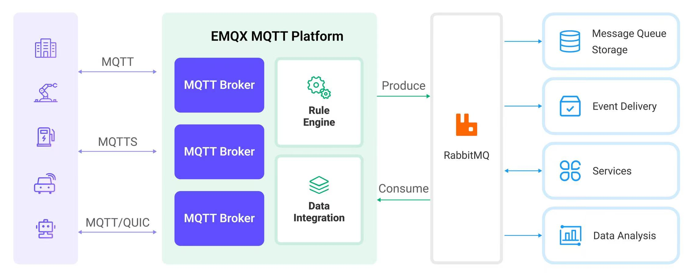
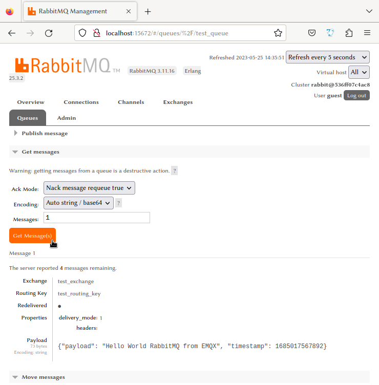
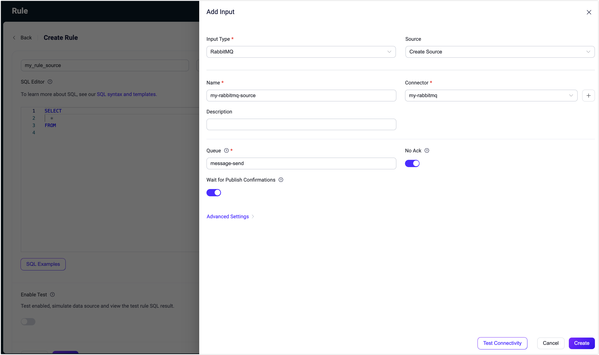

# RabbitMQへのMQTTデータ取り込み

[RabbitMQ](https://www.rabbitmq.com/)は、Advanced Message Queuing Protocol（AMQP）を実装した広く使われているオープンソースのメッセージブローカーです。分散システム間のメッセージングにおいて堅牢かつスケーラブルなプラットフォームを提供します。EMQXはRabbitMQとの統合をサポートしており、MQTTメッセージやイベントをRabbitMQへ転送することが可能です。また、RabbitMQサーバーからデータを消費し、EMQXの特定トピックにパブリッシュすることもでき、RabbitMQからMQTTへのメッセージ配信を実現します。

本ページでは、EMQXとRabbitMQ間のデータ統合について詳細に解説し、データ統合の作成および検証手順を実践的に説明します。

## 動作概要

RabbitMQデータ統合は、MQTTベースのIoTデータとRabbitMQの強力なメッセージキュー処理機能をつなぐEMQXの標準機能です。組み込みの[ルールエンジン](./rules.md)コンポーネントにより、EMQXからRabbitMQへのデータ取り込みが簡素化され、複雑なコーディングを不要にします。

RabbitMQ Sinkを例に、以下の図はEMQXとRabbitMQ間の典型的なデータ統合アーキテクチャを示しています。



MQTTデータをRabbitMQに取り込む流れは以下の通りです。

1. **メッセージのパブリッシュと受信**：産業用IoTデバイスはMQTTプロトコルを通じてEMQXに正常に接続し、リアルタイムMQTTデータをEMQXにパブリッシュします。EMQXがこれらのメッセージを受信すると、ルールエンジン内でマッチング処理が開始されます。
2. **メッセージデータの処理**：メッセージが到着するとルールエンジンを通過し、EMQXで定義されたルールにより処理されます。ルールは事前定義された条件に基づき、RabbitMQへルーティングすべきメッセージを判定します。ペイロード変換が指定されている場合は、データ形式の変換、特定情報のフィルタリング、追加コンテキストによるペイロードの強化などが適用されます。
3. **RabbitMQへのメッセージ取り込み**：ルールの処理が完了すると、RabbitMQへのメッセージ転送アクションがトリガーされます。処理済みメッセージはシームレスにRabbitMQに書き込まれます。
4. **データの永続化と活用**：RabbitMQはメッセージをキューに保存し、適切なコンシューマに配信します。メッセージは他のアプリケーションやサービスで消費され、データ分析、可視化、保存などのさらなる処理に利用されます。

## 特徴と利点

RabbitMQとのデータ統合は、以下の特徴とメリットをもたらします。

- **信頼性の高いIoTデータメッセージ配信**：EMQXはデバイスからクラウドへの信頼性の高い接続とメッセージ配信を保証し、RabbitMQはメッセージの永続化と異なるサービス間での信頼性の高い配信を担当し、データの信頼性を全工程で確保します。
- **MQTTメッセージの変換**：ルールエンジンを用いてEMQXはMQTTメッセージのフィルタリングや変換が可能です。データ抽出、フィルタリング、強化、変換を経てRabbitMQへ送信されます。
- **柔軟なメッセージマッピング**：RabbitMQデータ統合はMQTTトピックとRabbitMQのルーティングキーおよびエクスチェンジの柔軟なマッピングをサポートし、MQTTとRabbitMQ間のシームレスな統合を実現します。
- **高可用性とクラスターサポート**：EMQXとRabbitMQは共に高可用なメッセージブローカークラスターの構築をサポートし、ノード障害時にもサービス継続が可能です。クラスター機能により優れたスケーラビリティも提供されます。
- **高スループットシナリオでの処理能力**：RabbitMQデータ統合は同期・非同期の書き込みモードをサポートし、シナリオに応じてレイテンシとスループットのバランスを柔軟に調整できます。

## はじめる前に

このセクションでは、RabbitMQデータ統合の作成に先立って必要な準備について説明します。RabbitMQサーバーの起動やテスト用のエクスチェンジとキューの作成方法を含みます。

### 前提条件

- EMQXデータ統合の[ルール](./rules.md)に関する知識
- [データ統合](./data-bridges.md)および[リパブリッシュアクション](./rule-get-started.md#add-republish-action)に関する知識
- UNIXターミナルとコマンドの基本知識

### RabbitMQサーバーの起動

ここでは[Docker](https://www.docker.com/)を使ったRabbitMQサーバーの起動方法を紹介します。

以下のコマンドを実行すると、管理プラグインが有効なRabbitMQサーバーが起動します。管理プラグインによりWebインターフェースでRabbitMQを監視できます。

```bash
docker run -it --rm --name rabbitmq -p 127.0.0.1:5672:5672 -p 127.0.0.1:15672:15672 rabbitmq:3.11-management
```

詳細は[Docker HubのRabbitMQ実行に関する情報](https://hub.docker.com/_/rabbitmq)をご参照ください。

### メッセージ受信用のエクスチェンジとキューの作成

RabbitMQサーバー起動後、RabbitMQ管理Webインターフェースを使って、EMQXから転送されるメッセージ受信用のテスト用エクスチェンジとキューを作成できます。すでにテスト用のエクスチェンジとキューがある場合はこのセクションをスキップしてください。

1. ブラウザで http://localhost:15672/ にアクセスし、RabbitMQ管理Webインターフェースを開きます。ログイン画面で以下のデフォルト認証情報を入力し、**Login**をクリックします。
   - **Username**: `guest`
   - **Password**: `guest`
2. 上部メニューの**Exchanges**タブをクリックし、**Add a new exchange**を展開して以下を入力します。
   * **Name**: `test_exchange`
   * **Type**: ドロップダウンから`direct`を選択
   * **Durability**: `Durable`を選択（RabbitMQ再起動後もエクスチェンジが残る）
   * **Auto delete**: `No`
   * **Internal**: `No`
   * **Arguments**: 空欄のまま
3. **Add exchange**ボタンをクリックしてエクスチェンジを作成します。
4. 上部メニューの**Queues**タブをクリックし、**Add a new queue**を展開して以下を入力します。
   * **Type**: `Default for virtual host`
   * **Name**: `test_queue`
   * **Durability**: `Durable`を選択（キューを永続化）
   * **Arguments**: 空欄のまま
5. **Add queue**ボタンをクリックしてキューを作成します。新しい`test_queue`が**All queues**に表示されます。
6. `test_queue`の名前をクリックし詳細ページを開きます。**Bindings**を展開し、**Add binding to this queue**で以下を入力します。
   * **From exchange**: `test_exchange`
   * **Routing key**: `test_routing_key`
   * **Arguments**: 空欄のまま
7. **Bind**ボタンをクリックして`test_queue`を`test_exchange`に指定ルーティングキーでバインドします。

### メッセージ送信用のキュー作成

RabbitMQ管理Webインターフェースでメッセージ送信用のキューを作成できます。

1. RabbitMQ管理Webインターフェースにログインします。
2. **Queues**タブをクリックし、**Add a new queue**を展開して以下を入力します。
   * **Type**: `Default for virtual host`
   * **Name**: `message-send`
   * **Durability**: `Durable`を選択（再起動後もキューを保持）
   * **Arguments**: 空欄のまま
3. **Add queue**ボタンをクリックしてキューを作成します。`message-send`が**All queues**に表示されます。

## コネクターの作成

このセクションでは、Rabbit Sink/SourceをRabbitMQサーバーに接続するためのコネクター作成方法を説明します。

以下の手順はEMQXとRabbitMQをローカルマシンで動作させていることを前提としています。RabbitMQが別環境にある場合は設定を適宜調整してください。

1. ダッシュボードに入り、**Integration** -> **Connectors**をクリックします。
2. 画面右上の**Create**をクリックします。
3. **Create Connector**ページで**RabbitMQ**を選択し、**Next**をクリックします。
4. コネクター名を入力します。英数字の組み合わせで、例：`my_rabbitmq`。
5. 接続情報を入力します。
   - **Servers**: `host[:port]`形式のRabbitMQノードをカンマ区切りで入力します。例：`rmq1:5672,rmq2:5672`。1つのノードへの接続が失敗した場合、EMQXはリスト内の次のノードに接続を試みます。接続プールのワーカーはリストの異なる位置から開始し、接続を分散します。

     ::: tip
     EMQX 6.0.4以降、複数のRabbitMQノードを設定可能です。フェイルオーバーは接続確立時に発生し、確立済みのAMQP接続はノード間で移動しません。従来の単一ノード指定の`server`と`port`設定も互換性があります。
     :::

   - **Port**: Serversでポート指定がないノード用のデフォルトポート。デフォルトは`5672`。
   - **Username**: `guest`
   - **Password**: `guest`
   - **Virtual Host**: RabbitMQの仮想ホスト。デフォルトは`/`。
   - 暗号化接続を行う場合は**Enable TLS**をオンにします。TLS接続の詳細は[外部リソースアクセスのTLS](../../guides/network/overview.md#tls-for-external-resource-access)を参照してください。

6. **Create**をクリックする前に、**Test Connectivity**でRabbitMQサーバーへの接続テストが可能です。
7. 画面下部の**Create**ボタンをクリックしてコネクター作成を完了します。ポップアップで**Back to Connector List**または**Create Rule**を選択できます。**Create Rule**を選ぶと以下の選択肢があります。
   - **Action Outputs**: RabbitMQ Sinkを使ったルール作成。RabbitMQへ転送するデータを指定します。[RabbitMQ Sinkでルールを作成](#create-a-rule-with-rabbitmq-sink)の手順も参照してください。
   - **Data Inputs**: RabbitMQ Sourceを使ったルール作成。[RabbitMQ Sourceでルールを作成](#create-a-rule-with-rabbitmq-source)の手順も参照してください。

## RabbitMQ Sinkでルールを作成する

このセクションでは、ダッシュボードでMQTTのソーストピック`t/#`からのメッセージを処理し、処理結果をRabbitMQのキュー`test_queue`に転送するルールの作成方法を説明します。

### SQLを定義してルールを作成する

1. EMQXダッシュボードで、**Integration -> Rules**をクリックします。

2. 画面右上の**Create**をクリックします。

3. ルールIDを入力します。例：`my_rule`。

4. SQLエディタに以下のステートメントを入力します。これはトピックパターン`t/#`にマッチするMQTTメッセージを転送します。

   ```sql
   SELECT
     payload,
     now_timestamp() as timestamp
   FROM
     "t/#"
   ```

   ::: tip

   初心者の方は**SQL Examples**をクリックし、**Enable Test**を使ってSQLルールを学習・テストできます。

   :::

5. ルールにアクションを追加し、Sinkを設定します。詳細は[ルールにRabbitMQ Sinkを追加する](#add-rabbitmq-sink)を参照してください。
6. アクション追加後、**Action Outputs**に新しいSinkが表示されます。**Create Rule**ページの**Save**をクリックしてルール作成を完了します。

これでルールが正常に作成されました。**Rules**ページで新規ルールを確認でき、**Actions (Sink)**タブで新しいRabbitMQ Sinkも確認できます。

また、**Integration** -> **Flow Designer**をクリックするとトポロジーが表示され、トピック`t/#`のメッセージがルール`my_rule`で処理されRabbitMQに書き込まれる様子を視覚的に確認できます。

### RabbitMQ Sinkを追加する

このセクションでは、処理結果をRabbitMQに書き込むためにルールにSinkを追加する方法を説明します。

1. **Create Rule**ページの**Action Outputs**セクションで**Add Action**をクリックし、ルールでトリガーされるアクションを定義します。このアクションによりEMQXはルールで処理したデータをRabbitMQに送信します。

2. **Type of Action**ドロップダウンから`RabbitMQ`を選択します。**Action**はデフォルトの`Create Action`のままにします。既存のSinkを選択することも可能ですが、ここでは新規作成します。

3. Sinkの名前を入力します。英数字の組み合わせで指定してください。

4. **Connector**ドロップダウンから`my_rabbitmq`を選択します。新規コネクターを作成する場合はドロップダウン横のボタンをクリックしてください。設定パラメータは[コネクターの作成](#create-a-connector)を参照。

5. Sinkの設定を以下のように行います。

   * **Exchange**: 事前に作成した`test_exchange`を入力します。メッセージはこのエクスチェンジにパブリッシュされます。

       ::: tip 注意

       RabbitMQにエクスチェンジが作成済みであることを確認してください。存在しない場合、アクションは一時的に機能しなくなり、定期的に再接続を試みます。
       :::

   * **Routing Key**: 事前に作成した`test_routing_key`を入力します。RabbitMQのメッセージルーティングキーです。

       ::: tip

       エクスチェンジとルーティングキーはテンプレート値として設定可能で、プレースホルダーを使い受信MQTTメッセージのペイロードから値を動的に抽出してルーティングできます。

       例：ルーティングキーをペイロード内のフィールドに基づき動的に設定する場合、`${payload.akey}`と指定します。これによりペイロードの`akey`フィールドの値がルーティングキーとして使用されます。

       **注意**：バッチモードではエクスチェンジとルーティングキーのテンプレート値はバッチ内のすべてのメッセージで一定である必要があります。これにより一貫したルーティングが保証され、バッチ処理時の競合を防ぎます。
       :::

   * **Virtual Host**: RabbitMQの仮想ホスト。デフォルトは`/`。

   * **Message Delivery Mode**ドロップダウンで`non_persistent`または`persistent`を選択します。

     * `non_persistent`（デフォルト）：メッセージはディスクに永続化されず、RabbitMQの再起動やクラッシュ時に失われる可能性があります。

     * `persistent`：メッセージはディスクに永続化され、RabbitMQの再起動やクラッシュ時にも耐久性があります。

       ::: tip

       メッセージの損失を防ぐため、キューやエクスチェンジも耐久性（Durable）に設定する必要があります。詳細はRabbitMQの[ドキュメント](https://www.rabbitmq.com/documentation.html)を参照してください。

       :::

   * **Wait for Publish Confirmations**: デフォルトで有効。RabbitMQへのメッセージパブリッシュ成功を保証します。

     ::: tip

     このオプションを有効にすると、RabbitMQブローカーはメッセージ受信をアック（ACK）してから成功とみなすため、メッセージ配信の信頼性が向上します。

     :::

   * **Headers Template**および**Properties Template**: テンプレートを使ってRabbitMQのカスタムHeadersおよびPropertiesを定義できます。詳細は[HeadersおよびPropertiesテンプレートの設定](#set-headers-and-properties-templates)を参照してください。

   * **Payload Template**: デフォルトは空文字列で、メッセージペイロードをJSON形式のテキストとしてRabbitMQにそのまま転送します。

     また、テンプレート内にプレースホルダーを使い、受信MQTTメッセージのデータを動的に含めるカスタムペイロード形式を定義可能です。例えば、MQTTメッセージのペイロードとタイムスタンプを含めたい場合は以下のように設定します。

     ```json
      {"payload": "${payload}", "timestamp": ${timestamp}}
     ```

     このテンプレートは、受信MQTTメッセージのペイロードとタイムスタンプを含むJSON形式のメッセージを生成します。`${payload}`と`${timestamp}`はプレースホルダーで、転送時に実際の値に置き換えられます。

6. **フォールバックアクション（任意）**: メッセージ配信失敗時の信頼性向上のため、1つ以上のフォールバックアクションを定義可能です。詳細は[フォールバックアクション](./data-bridges.md#fallback-actions)を参照してください。

7. **詳細設定（任意）**:

   - **Publish Confirmation Timeout**: デフォルト30秒。パブリッシャーがブローカーのアックを待つ最大時間です。
   - 必要に応じて**sync**または**async**クエリモードを選択可能です。詳細は[Sinkの特徴](./data-bridges.md#features-of-sink)を参照してください。

8. **Create**をクリックする前に、**Test Connectivity**でSinkがRabbitMQサーバーに接続できるかテスト可能です。

9. **Create**ボタンをクリックしてSinkの設定を完了します。作成成功後、ルール作成ページに戻り、新しいSinkが**Action Outputs**に追加されます。

#### HeadersおよびPropertiesテンプレートの設定

EMQX 6.0以降、RabbitMQ Sinkアクション作成時にカスタムHeadersおよびPropertiesを定義可能です。これにより、メッセージにメタデータを直接付加でき、RabbitMQ内でのメッセージ互換性やルーティングの柔軟性が向上します。

これらのフィールドはルールSQLの変数（例：`${payload.device_id}`）を用いてテンプレート化できます。HeadersおよびPropertiesテンプレートは任意で、空欄の場合は追加メタデータは付加されません。

##### Headersテンプレートの設定方法

1つ以上のキー・バリューのペアをRabbitMQ Headersとして追加できます。これらはユーザー定義のメタデータで、RabbitMQのサブスクライバーが解釈可能です。

- **Key**: ヘッダー名（文字列）
- **Value**: 静的文字列またはテンプレート変数

例：MQTTペイロードからデバイスIDを含める場合

| Key         | Value                  |
| ----------- | ---------------------- |
| `device_id` | `${payload.device_id}` |

##### Propertiesテンプレートの設定方法

RabbitMQは標準のメッセージプロパティセットをサポートします。EMQXはこれらを定義可能で、メッセージレベルのメタデータ（コンテンツタイプや相関IDなど）を付加できます。

- **Key**: 以下の有効なプロパティキーから選択（無効なキーは無視されます）
- **Value**: 静的値またはテンプレート変数

有効なプロパティキー：

- `content_type`
- `content_encoding`
- `priority`
- `correlation_id`
- `reply_to`
- `expiration`
- `message_id`
- `timestamp`
- `type`
- `user_id`
- `app_id`
- `cluster_id`

例：コンテンツタイプとアプリケーションIDを指定する場合

| Key            | Value              |
| -------------- | ------------------ |
| `content_type` | `application/json` |
| `app_id`       | `my_iot_app`       |

##### 利用例

MQTTメッセージペイロードが以下の場合：

```json
{
  "device_id": "sensor-123",
  "status": "ok"
}
```

以下を設定したいとします。

- ヘッダー`device_id`をMQTTペイロードから設定
- プロパティ`app_id`を静的値で設定

設定例：

**Headersテンプレート**：

| Key         | Value                  |
| ----------- | ---------------------- |
| `device_id` | `${payload.device_id}` |

**Propertiesテンプレート**：

| Key      | Value    |
| -------- | -------- |
| `app_id` | `my_app` |

この設定により、RabbitMQに転送されるすべてのメッセージには以下が含まれます。

- 消費者ロジック用のカスタムメタデータ（Headers）
- メッセージ処理やデバッグ用の標準メタデータ（Properties）

## RabbitMQ Sinkでルールをテストする

EMQXダッシュボードに組み込まれたWebSocketクライアントを使ってルールとSinkをテストできます。

1. ダッシュボード左メニューの**Diagnose** -> **WebSocket Client**をクリックします。

2. 現在のEMQXインスタンスの接続情報を入力します。
   - ローカルでEMQXを動かしている場合はデフォルト値を使用可能です。
   - 認証設定を変更している場合はユーザー名やパスワードを入力してください。

3. **Connect**をクリックしてクライアントをEMQXに接続します。

4. ページ下部のパブリッシュエリアに以下を入力します。
   * **Topic**: `t/test`
   * **Payload**: `Hello World RabbitMQ from EMQX`
   * **QoS**: `2`

5. **Publish**をクリックしてメッセージを送信します。

   Sinkとルールが正常に作成されていれば、指定したエクスチェンジに指定ルーティングキーでメッセージがパブリッシュされているはずです。

6. RabbitMQ管理コンソール（http://localhost:15672）にアクセスし、**Queues**セクションに移動します。

   ::: tip

   デフォルト設定のままならユーザー名・パスワードともに`guest`を使用してください。

   :::

7. メッセージが適切なキューにルーティングされていることを確認します。キューをクリックし、**Get Message(s)**ボタンを押して詳細なメッセージ内容を確認できます。



## RabbitMQ Sourceでルールを作成する

このセクションでは、RabbitMQキューからEMQXへデータを転送するルール作成方法を説明します。RabbitMQ Sourceとメッセージリパブリッシュアクションの両方を作成し、RabbitMQサービスからメッセージを消費してEMQXに転送します。

1. ダッシュボードの**Integration** -> **Rules**ページに移動します。

2. 画面右上の**Create**をクリックします。

3. ルールIDに`my_rule_source`を入力します。

4. ルールをトリガーするソース（Data Inputs）を設定します。画面右側の**Data Inputs**タブをクリックし、デフォルトの`Messages`入力を削除してから**Add Input**をクリックし、RabbitMQ Sourceを作成します。

5. **Add Input**ポップアップで**Input Type**ドロップダウンから`RabbitMQ`を選択します。**Source**はデフォルトの`Create Source`のままにします。この例では新規Sourceを作成しルールに追加します。

6. Sourceの**Name**と（任意で）**Description**を入力します。名前は英数字の組み合わせで、例：`my-rabbitmq-source`。

7. **Connector**ドロップダウンから先に作成した`my-rabbitmq`コネクターを選択します。新規作成する場合はドロップダウン横のボタンをクリックし、[コネクターの作成](#create-a-connector)を参照して設定してください。

8. RabbitMQからEMQXへメッセージを消費するためのSource情報を設定します。

   - **Queue**: 先にRabbitMQで作成した`message-send`キュー名を入力。
   - **No Ack**: RabbitMQの`no_ack`モードでメッセージを消費するか選択。`no_ack`有効時はRabbitMQがメッセージのアックを待たずに即座にキューから削除します。
   - **Wait for Publish Confirmations**: メッセージパブリッシャーのアックを待つか指定。

9. 詳細設定（任意）：デフォルト値を使用。

10. **Create**ボタンをクリックしてSource作成を完了し、ルールのデータ入力に追加します。同時にルールSQLは以下のように変更されます。

    ```sql
    SELECT
    *
    FROM
    "$bridges/rabbitmq:my-rabbitmq-source"
    ```

    RabbitMQ Sourceから以下のフィールドにアクセス可能で、SQLを調整してデータ処理を行えます。ここではデフォルトSQLを使用します。

    | フィールド名  | 説明                                                        |
    | :------------ | :---------------------------------------------------------- |
    | payload       | RabbitMQメッセージの内容                                    |
    | event         | イベントトピック。形式は`$bridges/rabbitmq:<source name>` |
    | metadata      | ルールID情報                                                |
    | timestamp     | メッセージがEMQXに到着したタイムスタンプ                   |
    | node          | メッセージが到着したEMQXノード名                            |
    | queue         | メッセージが消費されたキュー名                              |
    | exchange      | メッセージがルーティングされたエクスチェンジ名             |
    | routing_key   | エクスチェンジからキューへメッセージをルーティングするためのルーティングキー |

ここまででRabbitMQ Sourceの作成は完了しましたが、購読したデータはまだEMQXに直接パブリッシュされません。次にメッセージリパブリッシュアクションを作成し、SourceのメッセージをEMQXに転送します。



### ルールにリパブリッシュアクションを追加する

このセクションでは、RabbitMQ Sourceから消費したメッセージをEMQXトピック`t/1`にパブリッシュするためのリパブリッシュアクション追加方法を説明します。

1. 画面右側の**Action Output**タブを選択し、**Add Action**をクリック、**Type of Action**ドロップダウンから`Republish`を選択します。

2. メッセージリパブリッシュ設定を入力します。

   - **Topic**: MQTTにパブリッシュするトピック。ここでは`t/1`を入力。
   - **QoS**: `0`、`1`、`2`、`${qos}`のいずれかを選択、または他のフィールドからQoSを設定するためのプレースホルダーを入力可能。`${qos}`を選ぶと元メッセージのQoSに従います。
   - **Retain**: `true`または`false`を選択。メッセージをリテインメッセージとしてパブリッシュするか決定。プレースホルダーも使用可能。ここでは`false`を選択。
   - **Payload**: 転送するメッセージペイロードのテンプレート。空欄はルール出力結果をそのまま転送。ここでは`${payload}`を入力し、ペイロードのみ転送。
   - **MQTT 5.0 Message Properties**: デフォルト無効。詳細は[リパブリッシュアクションの追加](./rule-get-started.md#add-republish-action)を参照。

3. **Create**をクリックしてアクション作成を完了します。成功するとルール作成ページに戻り、リパブリッシュアクションが**Action Outputs**に追加されます。

4. ルール作成ページで**Create**をクリックし、ルール全体の作成を完了します。

これでルールが正常に作成されました。**Rules**ページで新規ルールを確認でき、**Sources**タブで新規RabbitMQ Sourceも確認できます。

また、**Integrate** -> **Flow Designer**をクリックするとトポロジーが表示され、RabbitMQ Sourceからのメッセージがリパブリッシュを経てトピック`t/1`にパブリッシュされる様子を直感的に確認できます。

## RabbitMQ Sourceでルールをテストする

1. [MQTTX CLI](https://mqttx.app/cli)を使い、トピック`t/1`をサブスクライブします。

   ```bash
   mqttx sub -t t/1
   ```

2. 以下のコマンドでRabbitMQにメッセージを生成できます。

   ```bash
   rabbitmqadmin --username=guest --password=guest \
        publish routing_key=message-send \
        payload="{ \"msg\": \"Hello EMQX\"}"
   ```

   - `publish`はメッセージをパブリッシュするコマンドです。
   - `routing_key=message-send`はメッセージのルーティングキーを設定します。この例ではキュー名をルーティングキーとして使用しています。
   - `payload="{ \"msg\": \"Hello EMQX\"}"`はメッセージ内容を設定します。

   または、RabbitMQ管理インターフェースからもメッセージをパブリッシュ可能です。

   1. 上部メニューの**Queues**タブをクリック。
   2. **Name**列の`message-send`をクリックして詳細ページを開く。
   3. **Publish message**を展開し、**Payload**欄に`"Hello EMQX"`を入力して**Publish message**ボタンをクリック。

3. MQTTXで以下の出力を確認できます。

   ```bash
   [2024-2-23] [16:59:28] › payload: {"payload":{"msg":"Hello EMQX"},"event":"$bridges/rabbitmq:my-rabbitmq-source","metadata":{"rule_id":"rule_0ly1"},"timestamp":1708678768449,"node":"emqx@127.0.0.1"}
   ```
