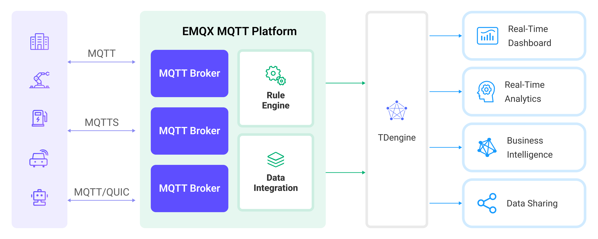
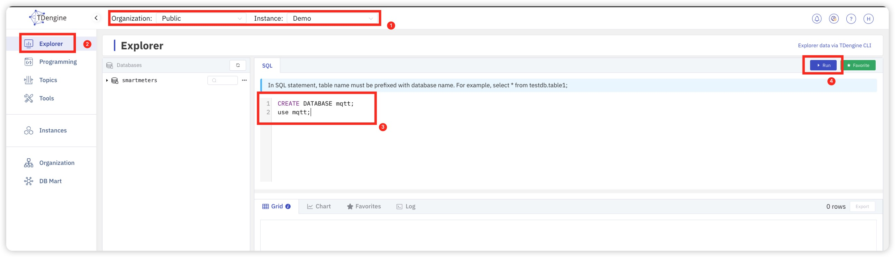
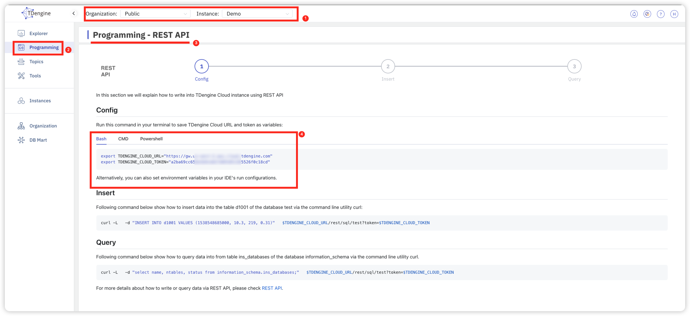

# TDengineへのMQTTデータ取り込み

[TDengine](https://tdengine.com/)は、IoTおよび産業用IoT（IIoT）シナリオ向けに設計・最適化されたビッグデータプラットフォームです。その中核には、高性能な時系列データベースがあり、クラスター指向のアーキテクチャ、クラウドネイティブ設計、ミニマリスティックなアプローチを特徴としています。EMQXはTDengineとの統合をサポートしており、多数のデバイスやデータコレクターからの大量データの送信、保存、分析、配信を可能にします。これにより、ビジネス運用状態のリアルタイム監視や早期警告が提供され、リアルタイムのビジネスインサイトを得ることができます。

本ページでは、EMQXとTDengine間のデータ統合について包括的に紹介し、データ統合の作成および検証に関する実践的な手順を提供します。

## 動作概要

TDengineデータ統合はEMQXに組み込まれた機能です。組み込みの[ルールエンジン](./rules.md)コンポーネントを利用することで、EMQXからTDengineへのデータ取り込みを簡素化し、複雑なコーディングを不要にします。EMQXはルールエンジンとSinkを介してデバイスデータをTDengineに転送します。TDengineデータ統合を通じて、MQTTメッセージやクライアントイベントをTDengineに保存できます。さらに、TDengine内のデータ更新や削除はイベントによってトリガーされ、デバイスのオンライン状態や過去のオンライン/オフラインイベントの記録が可能です。

以下の図は、産業用IoTにおけるEMQXとTDengineのデータ統合の典型的なアーキテクチャを示しています。



産業用エネルギー消費管理シナリオを例に、ワークフローは以下の通りです：

1. **メッセージのパブリッシュと受信**：産業用デバイスはMQTTプロトコルを通じてEMQXに正常に接続し、定期的にエネルギー消費データをパブリッシュします。このデータには生産ライン識別子やエネルギー消費値が含まれます。EMQXがこれらのメッセージを受信すると、ルールエンジン内でマッチング処理を開始します。  
2. **ルールエンジンによるメッセージ処理**：組み込みのルールエンジンは、トピックマッチングに基づき特定のソースからのメッセージを処理します。メッセージが到着するとルールエンジンを通過し、対応するルールとマッチングしてメッセージデータを処理します。これにはデータ形式の変換、特定情報のフィルタリング、コンテキスト情報によるメッセージの付加などが含まれます。
3. **TDengineへのデータ取り込み**：ルールエンジンで定義されたルールは、メッセージをTDengineに書き込む操作をトリガーします。TDengine SinkはSQLテンプレートを提供し、特定のメッセージフィールドをTDengineの対応テーブル・カラムに柔軟に書き込むデータ形式を定義できます。

エネルギー消費データがTDengineに書き込まれた後は、標準SQLおよび強力な時系列拡張機能を用いてリアルタイムにデータ分析が可能です。多数のサードパーティのバッチ分析、リアルタイム分析、レポーティングツール、AI/MLツール、可視化ツールとシームレスに統合できます。例えば：

- Grafanaなどの可視化ツールに接続し、エネルギー消費データのグラフを生成・表示。
- ERPやPower BIなどのアプリケーションシステムに接続し、生産分析や生産計画の調整を実施。
- ビジネスシステムに接続し、リアルタイムのエネルギー使用分析を行い、データ駆動型のエネルギー管理を促進。

## 特長とメリット

TDengineデータ統合は以下の特長と利点をビジネスにもたらします：

- **効率的なデータ処理**：EMQXは多数のIoTデバイス接続とメッセージスループットを効率的に処理可能です。TDengineはデータの書き込み、保存、クエリに優れ、IoTシナリオのデータ処理ニーズをシステムに負荷をかけずに満たします。
- **メッセージ変換**：メッセージはEMQXのルール内で豊富な処理・変換を経てからTDengineに書き込まれます。
- **クラスターとスケーラビリティ**：EMQXとTDengineはクラスター機能をサポートし、クラウドネイティブアーキテクチャ上に構築されています。クラウドプラットフォームの弾力的なストレージ、コンピューティング、ネットワークリソースを最大限活用し、ビジネスの成長に応じて柔軟な水平スケーリングが可能です。
- **高度なクエリ機能**：TDengineはタイムスタンプデータの効率的なクエリ・分析のために最適化された関数、演算子、インデックス技術を提供し、IoT時系列データから正確なインサイトを抽出できます。

## はじめる前に

本節では、TDengineデータ統合の作成を開始する前に必要な準備、TDengineサーバーのセットアップおよびデータテーブルの作成方法について説明します。

### 前提条件

- EMQXデータ統合の[ルール](./rules.md)に関する知識
- [データ統合](./data-bridges.md)に関する知識

### TDengineの起動とデータベース作成

TDengineを起動またはTDengineサービスに接続し、データベースを作成するには以下の2つの方法があります。

:::: tabs

::: tab Docker

```bash
# TDengineのDockerイメージを起動
docker run --name TDengine -p 6041:6041 tdengine/tdengine

# コンテナにアクセス
docker exec -it TDengine bash

# コンテナ内でTDengineサーバーを起動
taos

# データベースの作成と選択
CREATE DATABASE mqtt;

use mqtt;
```

:::

::: tab TDengine Cloud

[TDengine Cloud](https://cloud.tdengine.com/)を利用している場合は、コンソールにログインし、インスタンスを選択、左メニューの**Explorer**をクリックしてSQL実行画面に入ります。以下のステートメントを実行してデータベースを作成してください。

```bash
# データベースの作成と選択

CREATE DATABASE mqtt;

use mqtt;
```



:::

::::

### TDengineでのデータテーブル作成

メッセージ保存と状態記録のため、TDengineデータベースに2つのデータテーブルを作成します。

1. 以下のSQL文で、クライアントID、トピック、ペイロード、作成時間を保存する`t_mqtt_msg`テーブルを作成します。

```sql
   CREATE TABLE t_mqtt_msg (
       ts timestamp,
       msgid NCHAR(64),
       mqtt_topic NCHAR(255),
       qos TINYINT,
       payload BINARY(1024),
       arrived timestamp
     );
```

2. 以下のSQL文で、クライアントID、イベントタイプ、作成時間を保存する`emqx_client_events`テーブルを作成します。

```sql
     CREATE TABLE emqx_client_events (
         ts timestamp,
         clientid VARCHAR(255),
         event VARCHAR(255)
       );
```

## コネクターの作成

本節では、SinkをTDengineサーバーに接続するためのコネクター作成方法を示します。

1. EMQXダッシュボードに入り、**Integration** -> **Connectors**をクリックします。

2. ページ右上の**Create**をクリックします。

3. **Create Connector**ページで**TDengine**を選択し、**Next**をクリックします。

4. **Configuration**ステップで、接続先に応じて以下の情報を設定します。

   :::: tabs

   ::: tab TDengineに接続

   以下の設定はEMQXとTDengineをローカルマシンで実行している場合を想定しています。リモートで実行している場合は適宜調整してください。

   - **Connector name**：コネクター名を入力します。英数字の組み合わせで、例：`my_tdengine`
   - **Server Host**：`http://127.0.0.1:6041` またはリモートで実行している場合は実際のURLを入力
   - **Database Name**：`mqtt`
   - **Username**：`root`
   - **Password**：`taosdata`
   - **Token**：空欄のまま。コネクターは**Username**と**Password**で認証を試みます。

   :::

   ::: tab TDengine Cloudに接続

   1. TDengine Cloudコンソールページで正しい**Instance**を選択します。

   2. 左メニューの**Programming**に移動し、**REST API**接続方法を選択します。以下の画像のように接続URLとTokenを取得できます。

      

   3. 以下のコネクター設定情報を入力します：

      - **Connector name**：英数字の組み合わせでコネクター名を入力、例：`my_tdengine`
      - **Server Host**：TDengine Cloudが提供する`TDENGINE_CLOUD_URL`の値（例：`https://gw.***.cloud.tdengine.com`）
      - **Database Name**：`mqtt`
      - **Username**：空欄
      - **Password**：空欄
      - **Token**：TDengine Cloudが提供する`TDENGINE_CLOUD_TOKEN`の値（例：`a2ba69cc6****f0c18cd`）
   
      :::
   
      ::::

5. **TLSの有効化**：EMQX 6.3.3以降で利用可能です。TDengineサーバーがHTTPSを使用している場合はこのオプションを有効にしてください。EMQXはデフォルトでサーバー証明書を検証します。プライベートCA署名の証明書を使用する場合は対応するCA証明書を設定してください。詳細は[外部リソースアクセスのTLS](../../guides/network/overview.md#tls-for-external-resource-access)を参照してください。

6. 高度な設定（任意）：詳細は[Sinkの機能](./data-bridges.md#features-of-sink)を参照してください。

7. **Create**をクリックする前に、**Test Connectivity**をクリックしてコネクターがTDengineサーバーに接続できるかテスト可能です。

8. ページ下部の**Create**ボタンをクリックしてコネクター作成を完了します。ポップアップダイアログで**Back to Connector List**をクリックするか、**Create Rule**をクリックしてSinkを指定したルール作成に進めます。詳細は[メッセージ保存用のTDengine Sinkを使ったルール作成](#create-a-rule-with-tdengine-sink-for-message-storage)および[イベント記録用のTDengine Sinkを使ったルール作成](#create-a-rule-with-tdengine-sink-for-events-recording)を参照してください。

## メッセージ保存用のTDengine Sinkを使ったルール作成

本節では、ソースMQTTトピック`t/#`からのメッセージを処理し、処理済みデータを設定済みSinkを介してTDengineの`t_mqtt_msg`データテーブルに保存するルールをダッシュボードで作成する方法を示します。

1. EMQXダッシュボードで**Integration** -> **Rules**をクリックします。

2. ページ右上の**Create**をクリックします。

3. ルールIDに`my_rule`を入力し、**SQL Editor**でメッセージ保存用のルールを作成します。例えば、以下のステートメントはトピック`t/#`配下のMQTTメッセージをTDengineに保存します。

   注意：独自のSQL構文を指定する場合は、Sinkが必要とするすべてのフィールドを`SELECT`部に含めていることを確認してください。

   ```sql
     SELECT
       *,
       now_timestamp('millisecond')  as ts
     FROM
       "t/#"
   ```

   ::: tip

   初心者の方は**SQL Examples**をクリックし、**Enable Test**でSQLルールを学習・テストできます。

   :::

4. + **Add Action**ボタンをクリックし、ルールによってトリガーされるアクションを定義します。このアクションにより、EMQXはルールで処理されたデータをTDengineに送信します。

5. **Type of Action**ドロップダウンリストから`TDengine`を選択します。**Action**はデフォルトの`Create Action`のままにします。既に作成済みのTDengine Sinkがあれば選択可能です。本デモでは新規Sinkを作成します。

6. Sinkの名前を入力します。名前は英数字の組み合わせで指定してください。

7. **Connector**ドロップダウンから先ほど作成した`my_tdengine`を選択します。隣のボタンをクリックして新規コネクターを作成することも可能です。設定パラメータは[コネクターの作成](#create-a-connector)を参照してください。

8. Sinkの**SQL Template**を設定します。以下のSQLを使用してデータ挿入を完了できます。CSVファイルによるバッチ設定もサポートしています。詳細は[バッチ設定](#batch-setting)を参照してください。

   ::: warning 重要なお知らせ

   EMQX 6.3.1以降、Sink作成時にSQLテンプレートを解析し、SQLコンテキストに基づいてプレースホルダー値をエスケープし、サポートされない構文は拒否します。テンプレートは単一のTDengine `INSERT`文である必要があります。複数テーブルの`VALUES`挿入や`USING ... TAGS`句をサポートします。素のテーブル名やバッククォートで囲まれたテーブル名にプレースホルダーを含めることができ（例：`test_${clientid}`）、EMQXは完全なターゲット名を1つの引用識別子としてレンダリングします。SQLコメント、`FILE`入力、追加ステートメントはサポートされません。

   この検証により、以前のバージョンで受け入れられたテンプレートが拒否される場合があります。アップグレード前に互換性のないテンプレートを修正してください。

   :::

   ::: tip

   EMQX 6.3.0では文字列プレースホルダー値の周囲に手動で引用符を追加する必要がありましたが、6.3.1以降はプレースホルダーを完全な値としてまたは文字列リテラル内で使用でき、EMQXはSQLコンテキストに応じてレンダリング値をエスケープします。

   :::

   ```sql
   INSERT INTO t_mqtt_msg(ts, msgid, mqtt_topic, qos, payload, arrived) 
       VALUES (${ts}, '${id}', '${topic}', ${qos}, '${payload}', ${timestamp})
   ```

   SQLテンプレート内でプレースホルダー変数が未定義の場合、**SQL template**上の**Undefined Vars as Null**スイッチでルールエンジンの動作を切り替えられます：

   - **Disabled**（デフォルト）：ルールエンジンは文字列`undefined`をデータベースに挿入可能。
   - **Enabled**：未定義変数の場合、ルールエンジンは`NULL`をデータベースに挿入。

     ::: tip

     可能な限りこのオプションは常に有効にしてください。無効化は後方互換性確保のためのみ推奨されます。

     :::

9. **フォールバックアクション（任意）**：メッセージ配信失敗時の信頼性向上のため、1つ以上のフォールバックアクションを定義可能です。これらはプライマリSinkがメッセージ処理に失敗した場合にトリガーされます。詳細は[フォールバックアクション](./data-bridges.md#fallback-actions)を参照してください。

10. **高度な設定（任意）**：必要に応じて**sync**または**async**クエリモードを選択します。詳細は[Sinkの機能](./data-bridges.md#features-of-sink)を参照してください。

11. **Create**をクリックする前に、**Test Connectivity**をクリックしてSinkがTDengineに接続可能かテストできます。

12. **Create**ボタンをクリックしてSink設定を完了します。新しいSinkが**Action Outputs**に追加されます。

13. **Create Rule**ページに戻り、設定内容を確認後、**Create**をクリックしてルールを生成します。

これでTDengine Sink用のルールが正常に作成されました。**Integration** -> **Rules**ページで新規作成されたルールを確認できます。**Actions(Sink)**タブをクリックすると新しいTDengine Sinkが表示されます。

また、**Integration** -> **Flow Designer**をクリックするとトポロジーが表示され、トピック`t/#`配下のメッセージがルール`my_rule`で解析され、TDengineに送信・保存されていることが確認できます。

### バッチ設定

TDengineでは1つのデータエントリに数百のデータポイントを含む場合があり、SQL文の記述が困難になることがあります。これに対応するため、EMQXはSQLのバッチ設定機能を提供しています。

SQLテンプレート編集時に、バッチ設定機能を使ってCSVファイルから挿入操作用のフィールドをインポートできます。

1. **SQL Template**下の**Batch Setting**ボタンをクリックし、**Import Batch Setting**ポップアップを開きます。

2. 指示に従いバッチ設定テンプレートファイルをダウンロードし、テンプレート内のフィールドのキー・値ペアを入力します。デフォルトのテンプレートファイル内容は以下の通りです：

   | Field      | Value             | Char Value | 備考（任意）       |
   | ---------- | ----------------- | ---------- | ------------------ |
   | ts         | now               | FALSE      | 例示備考           |
   | msgid      | ${id}             | TRUE       |                    |
   | mqtt_topic | ${topic}          | TRUE       |                    |
   | qos        | ${qos}            | FALSE      |                    |
   | temp       | ${payload.temp}   | FALSE      |                    |
   | hum        | ${payload.hum}    | FALSE      |                    |
   | status     | ${payload.status} | FALSE      |                    |

   - **Field**：フィールドキー。定数または`${var}`形式のプレースホルダーをサポート。
   - **Value**：フィールド値。定数または`${var}`形式のプレースホルダーをサポート。SQLでは文字列型は引用符で囲む必要がありますが、テンプレートファイルでは不要です。文字列型かどうかは`Char Value`列で指定します。
   - **Char Value**：フィールドが文字列型かどうかを指定し、インポート時にSQL生成時に引用符を付加します。文字列型の場合は`TRUE`または`1`、それ以外は`FALSE`または`0`を入力してください。
   - **備考**：CSVファイル内の注釈用で、EMQXへのインポート対象外です。

   CSVファイルのバッチ設定データは2048行を超えないようにしてください。

3. 入力済みテンプレートファイルを保存し、**Import Batch Setting**ポップアップにアップロード後、**Import**をクリックしてバッチ設定を完了します。

4. インポート後、**SQL Template**内のSQLをさらに調整可能です（テーブル名設定、SQLコードの整形など）。

## イベント記録用のTDengine Sinkを使ったルール作成

本節では、クライアントのオンライン/オフライン状態を記録し、イベントデータを設定済みSinkを介してTDengineの`emqx_client_events`テーブルに保存するルール作成方法を示します。

ルール作成手順は[メッセージ保存用のTDengine Sinkを使ったルール作成](#メッセージ保存用のtdengine-sinkを使ったルール作成)とほぼ同様で、SQLルール構文とSQLテンプレートのみ異なります。

オンライン/オフライン状態記録用のSQLルール構文は以下の通りです：

```sql
SELECT
      *,
      now_timestamp('millisecond')  as ts
    FROM 
      "$events/client_connected", "$events/client_disconnected"
```

SinkのSQLテンプレートは以下の通りです：

上記のSQLテンプレート制限はこのテンプレートにも適用されます。

以下のテンプレートはシングルクォートで囲まれた文字列プレースホルダーを使用しています。SQL文の末尾にセミコロン（`;`）を付けないでください。

```sql
INSERT INTO emqx_client_events(ts, clientid, event) VALUES (
      ${ts},
      '${clientid}',
      '${event}'
    )
```

## ルールのテスト

MQTTXを使ってトピック`t/1`にメッセージを送信し、オンライン/オフラインイベントをトリガーします。

```bash
mqttx pub -i emqx_c -t t/1 -m '{ "msg": "hello TDengine" }'
```

2つのSinkの稼働状況を確認すると、新規の受信メッセージ1件、送信メッセージ1件、イベント記録2件があるはずです。

`t_mqtt_msg`データテーブルにデータが書き込まれているか確認します。

```bash
taos> select * from t_mqtt_msg;
           ts            |             msgid              |           mqtt_topic           | qos  |            payload             |         arrived         |
==============================================================================================================================================================
 2023-02-13 06:10:53.787 | 0005F48EB5A83865F440000014F... | t/1                            |    0 | { "msg": "hello TDengine" }    | 2023-02-13 06:10:53.787 |
Query OK, 1 row(s) in set (0.002968s)
```

`emqx_client_events`テーブル：

```bash
taos> select * from emqx_client_events;
           ts            |            clientid            |             event              |
============================================================================================
 2023-02-13 06:10:53.777 | emqx_c                         | client.connected               |
 2023-02-13 06:10:53.791 | emqx_c                         | client.disconnected            |
Query OK, 2 row(s) in set (0.002327s)
```
