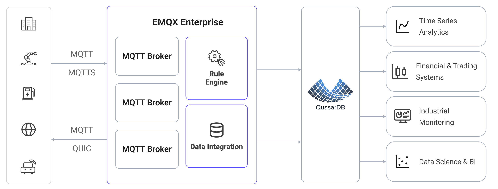

# QuasarDBへのMQTTデータ取り込み

[QuasarDB](https://www.quasardb.net/)は、大量のタイムスタンプ付きデータの保存とクエリに特化した高性能なカラム指向時系列データベースです。EMQXはQuasarDBとの統合をサポートしており、MQTTメッセージやクライアントイベントをQuasarDBに保存できます。これにより、IoTテレメトリの管理や分析のためのデータパイプラインや分析プロセスの構築が容易になります。

本ページでは、EMQXとQuasarDB間のデータ統合の詳細な概要と、データ統合の作成および検証に関する実践的な手順を提供します。

## 動作概要

QuasarDBデータ統合はEMQXの標準機能であり、EMQXのデバイス接続およびメッセージ送信機能とQuasarDBの高性能時系列ストレージを組み合わせています。組み込みの[ルールエンジン](./rules.md)コンポーネントとSinkを通じて、MQTTメッセージやクライアントイベントをQuasarDBに保存できます。この統合により、EMQXからQuasarDBへのデータ取り込みが簡素化され、複雑なコーディングを不要にします。

以下の図は、EMQXとQuasarDB間の典型的なデータ統合アーキテクチャを示しています。



QuasarDBへのMQTTデータ取り込みの流れは以下の通りです：

1. **メッセージのパブリッシュと受信**：IoTデバイスはMQTTプロトコルを介してEMQXに正常に接続し、リアルタイムのMQTTデータをEMQXにパブリッシュします。EMQXがこれらのメッセージを受信すると、ルールエンジン内でマッチング処理を開始します。
2. **メッセージデータの処理**：メッセージが到着するとルールエンジンを通過し、EMQXで定義されたルールによって処理されます。ルールは事前定義された条件に基づいて、どのメッセージをQuasarDBにルーティングするかを決定します。ペイロード変換が指定されている場合は、データ形式の変換、特定情報のフィルタリング、追加コンテキストによるペイロードの強化などが適用されます。
3. **QuasarDBへのデータ取り込み**：ルールがトリガーされると、メッセージの書き込みがQuasarDBに対して実行されます。SQLテンプレートを利用して、ルール処理結果からデータを抽出しSQLを構築、QuasarDBに送信して実行することで、メッセージの特定フィールドを対応するテーブルに書き込みます。
4. **データの保存と活用**：データがQuasarDBに保存されることで、企業はその時系列クエリ機能を活用し、分析、監視、運用用途に利用できます。

## 特長と利点

QuasarDBとのデータ統合は以下の特長と利点を提供します：

- **リアルタイムデータストリーミング**：EMQXはリアルタイムデータストリームの処理に最適化されており、ソースシステムからQuasarDBへの効率的かつ信頼性の高いデータ伝送を実現します。即時の洞察やアクションが必要なユースケースに最適です。
- **高性能な時系列ストレージ**：QuasarDBのカラムエンジンは時系列ワークロードに最適化されており、大量のタイムスタンプ付きデータに対して高速な取り込みスループットと効率的な範囲クエリを提供します。
- **柔軟なデータ変換**：EMQXは強力なSQLベースのルールエンジンを備えており、QuasarDBに保存する前にデータの前処理が可能です。フィルタリング、ルーティング、集約、強化など多様なデータ変換機能をサポートします。
- **バッチ処理対応**：QuasarDB Sinkはバッチ書き込みをサポートしており、往復回数を削減し全体の取り込みスループットを向上させます。

## はじめる前に

このセクションでは、QuasarDBデータ統合作成前に必要な準備、ODBCドライバーの設定やQuasarDBのインストール方法について説明します。

### 前提条件

- EMQXデータ統合の[ルール](./rules.md)の知識
- [データ統合](./data-bridges.md)の知識

### ODBCドライバーのインストールと設定

QuasarDBコネクターはODBCを用いてデータベースに接続します。EMQXが稼働するホストにQuasarDB ODBCドライバーをインストールし設定する必要があります。

詳細なインストール手順は[QuasarDB ODBCドキュメント](https://doc.quasar.ai/master/user-guide/integration/odbc.html)を参照してください。以下はDebian系システムでドライバー3.14.1を使用した典型的なセットアップ例です。

1. QuasarDB C APIパッケージとODBCドライバーをダウンロードおよびインストール：

   ```bash
   curl -fsSL -O https://download.quasar.ai/quasardb/3.14/3.14.1/api/c/qdb-api_3.14.1.deb
   curl -fsSL -O https://download.quasar.ai/quasardb/3.14/3.14.1/api/odbc/qdb-3.14.1-linux-64bit-odbc-driver.tar.gz
   apt-get install -yqq ./qdb-api_3.14.1.deb
   tar -C /tmp/qdb_odbc_driver -xf qdb-3.14.1-linux-64bit-odbc-driver.tar.gz
   ```

2. `/etc/odbcinst.ini`にドライバーを登録：

   ```ini
   [qdb_odbc_driver]
   Description=Quasardb ODBC Driver
   Driver=/tmp/qdb_odbc_driver/lib/libqdb_odbc_driver.so
   Setup=/tmp/qdb_odbc_driver/lib/libqdb_odbc_driver.so
   ```

3. `/etc/odbc.ini`にDSN（Data Source Name）エントリを作成：

   ```ini
   [qdb]
   Driver = qdb_odbc_driver
   Description = QuasarDB ODBC Data Source
   #URI = qdb://172.100.239.30:2836
   #UID = user_name
   #PWD = user_key
   #KEY = cluster_public_key
   ```

ここで設定したDSN名（例：`qdb`）は、コネクター作成時の**ODBC Data Source Name**フィールドに入力します。

### QuasarDBのインストールと接続

このセクションでは、Dockerを使ってQuasarDBインスタンスを起動する方法を説明します。

1. QuasarDB Dockerイメージをプルして起動：

   ```bash
   docker run -d --name qdb \
     -p 2836:2836 \
     bureau14/qdb:3.14.1
   ```

   ::: tip

   QuasarDBはホスト名ではなく**IPアドレス**での接続を要求します。URIには`127.0.0.1`（または実際のホストIP）を使用してください。ホスト名ベースの接続はサポートされていません。

   :::

2. QuasarDBシェルで接続確認：

   ```bash
   docker run -it --rm bureau14/qdbsh --cluster qdb://127.0.0.1:2836
   ```

ユーザー認証やクラスタキー認証の有効化については、[QuasarDBセキュリティドキュメント](https://doc.quasar.ai/)を参照してください。

### テーブルの作成

QuasarDBに取り込むデータを受け取るテーブルを作成します。以下は温度と湿度の読み取り値を保存するテーブルの例です：

```sql
CREATE TABLE temp_hum (temp DOUBLE, hum DOUBLE);
```

::: tip

QuasarDBのテーブルには常に暗黙の`$timestamp`インデックス列が含まれます。テーブル作成時に宣言する必要はありませんが、INSERT文で参照可能です。

:::

## コネクターの作成

EMQXとQuasarDBを接続するコネクターの作成方法を説明します。

1. EMQXダッシュボードで**Integration** -> **Connectors**をクリックします。

2. 画面右上の**Create**をクリックします。

3. **Create Connector**ページで**QuasarDB**を選択し、**Next**をクリックします。

4. コネクター名を入力します。英数字の組み合わせで、例として`my_quasardb`などを指定します。

5. 接続情報を設定します：

   - **Server URI**：QuasarDBクラスタのURIをIPアドレスで入力します。例：`qdb://127.0.0.1:2836`
   - **ODBC Data Source Name**：`/etc/odbc.ini`で定義したDSN名を入力します。例：`qdb`
   - **Username**：ユーザー名（あれば）
   - **Password**：ユーザーのシークレットキー（あれば）
   - **Cluster Public Key**：クラスタの公開鍵（あれば）

6. 詳細設定（任意）：[詳細設定](#advanced-configuration)を参照してください。

7. **Create**をクリックする前に、**Test Connectivity**をクリックしてEMQXがQuasarDBに接続できるか確認できます。

8. **Create**をクリックしてコネクターの設定を完了します。作成成功のダイアログが表示され、ルールを今すぐ作成するか尋ねられます。**Create Rule**をクリックするとコネクターが事前選択された状態でルール作成画面に進みます。**Back To Connector List**をクリックすると後でルールを作成できます。

## QuasarDB Sinkを使ったルールの作成

このセクションでは、ソースMQTTトピック`t/#`のメッセージを処理し、QuasarDBの`temp_hum`テーブルに保存するルールの作成方法を説明します。

1. 直前のステップで**Create Rule**をクリックした場合、**Add Action**パネルが自動的に開き、**Type of Action**が`QuasarDB`、コネクターが事前選択されています。ステップ5に進んでください。

   そうでない場合は、EMQXダッシュボードで**Integration** -> **Rules**をクリックし、右上の**Create**をクリック、続いて**+ Add Action**をクリックします。

2. 左側の**SQL Editor**にルールIDと以下のSQLを入力し、トピック`t/#`のメッセージにマッチさせます：

   注意：独自のSQL構文を指定する場合は、Sinkが必要とするすべてのフィールドが`SELECT`句に含まれていることを確認してください。

   ```sql
   SELECT
     *
   FROM
     "t/#"
   ```

   ::: tip

   初心者の方は**SQL Examples**をクリックし、**Enable Test**でSQLルールの学習とテストが可能です。

   :::

3. 右側の**Add Action**パネルで、**Type of Action**ドロップダウンから`QuasarDB`を選択します。**Action**ドロップダウンはデフォルトの`Create Action`のままにします。

4. **Connectors**ドロップダウンから先ほど作成した`my_quasardb`コネクターを選択します。新しいコネクターを作成する場合はドロップダウン横のボタンをクリックしてください。設定パラメータは[コネクターの作成](#create-a-connector)を参照してください。

5. Sinkの名前と任意の説明を入力します。

6. QuasarDBへの書き込み方法を定義する**SQL Template**を設定します。

   ::: tip 注意

   SQLテンプレートは**INSERT**文のみを受け付けます。UPDATEやDELETEなどの文はサポートされていません。

   :::

   SQLテンプレートは`${clientid}`などのプレースホルダー変数をサポートします。QuasarDBは暗黙のタイムスタンプインデックス列として`$timestamp`を使用し、`now()`で現在のサーバー時刻を挿入できます。

   ::: tip 注意

   QuasarDB ODBCドライバーはプリペアドステートメントをサポートしていません。`STRING`または`BLOB`型に解決される値は、SQLテンプレート内で手動でシングルクォート（`'`）で囲む必要があります。

   :::

   ```sql
   insert into temp_hum($timestamp, temp, hum)
   values (now(), ${.temp}, ${.hum})
   ```

7. **フォールバックアクション（任意）**：メッセージ配信失敗時の信頼性向上のために1つ以上のフォールバックアクションを定義できます。詳細は[フォールバックアクション](./data-bridges.md#fallback-actions)を参照してください。

8. 詳細設定（任意）：[Sink詳細設定](#sink-advanced-settings)を参照してください。

9. **Create**をクリックする前に、**Test Connectivity**をクリックしてSinkがQuasarDBに接続できるかテストできます。

10. **Create**をクリックしてSinkの設定を完了します。新しいSinkが**Action Outputs**に追加されます。

11. **Create Rule**ページに戻り、設定内容を確認して**Save**をクリックしルールを生成します。

これでルールの作成が完了しました。**Integration** -> **Rules**ページで新規作成したルールを確認できます。**Actions(Sink)**タブをクリックすると新しいQuasarDB Sinkが表示されます。

また、**Integration** -> **Flow Designer**をクリックするとトポロジーが表示され、トピック`t/#`のメッセージがルール`my_rule`で処理された後にQuasarDBへ転送されていることを確認できます。

## ルールのテスト

MQTTXを使ってトピック`t/1`にメッセージを送信し、ルールをトリガーします。

```bash
mqttx pub -i emqx_c -t t/1 -m '{ "temp": "27.5", "hum": "41.8" }'
```

QuasarDB Sinkの稼働統計を確認します。1件の新規マッチと1件の新規送信メッセージがあるはずです。QuasarDBの`temp_hum`テーブルにデータが書き込まれていることを検証してください。

## 詳細設定

このセクションでは、QuasarDBコネクターおよびSinkの詳細設定オプションについて説明します。ダッシュボードで設定する際は、**Advanced Settings**を展開し、ニーズに応じて以下のパラメータを調整できます。

### コネクター詳細設定

| フィールド名               | 説明                                                                                 | デフォルト値   |
|----------------------------|--------------------------------------------------------------------------------------|---------------|
| Connection Pool Size       | プール内で維持される同時接続数。大きすぎるとシステムリソースを枯渇させ、小さすぎるとスループットが制限されます。 | `8`           |
| Connect Timeout            | QuasarDBへの接続確立時に待機する最大時間。                                            | `5`秒         |
| Start Timeout              | 自動起動したリソースが正常になるまで待機する最大時間。                                | `5`秒         |
| Health Check Interval      | QuasarDB接続の自動ヘルスチェックを実行する間隔。                                     | `15`秒        |
| Health Check Timeout       | 各ヘルスチェックが完了するまでの最大許容時間。                                       | `60`秒        |

### Sink詳細設定

| フィールド名               | 説明                                                                                 | デフォルト値   |
|----------------------------|--------------------------------------------------------------------------------------|---------------|
| Buffer Pool Size           | EMQXとQuasarDB間のデータフローを処理するバッファワーカープロセス数。負荷が高い場合は増加させてスループットを向上可能。 | `16`          |
| Request TTL                | バッファ内で有効なリクエストの最大時間。キュー内または未アックのリクエストがこの時間を超えると破棄されます。 | `45`秒        |
| Health Check Interval      | SinkがQuasarDB接続の自動ヘルスチェックを実行する間隔。                               | `15`秒        |
| Health Check Interval Jitter | 複数ノードが同時にチェックするのを防ぐためにヘルスチェック間隔に加えるランダム遅延。複数のActionやSourceが同一コネクターを共有する場合に有効。 | `0`ミリ秒     |
| Health Check Timeout       | 各Sinkヘルスチェックが完了するまでの最大許容時間。                                   | `60`秒        |
| Max Buffer Queue Size      | 各バッファワーカーが保持可能な最大バイト数。ワークロードがバーストを生じる場合は増加推奨。 | `256`MB       |
| Batch Size                 | 1回の操作でQuasarDBに送信する最大レコード数。`1`に設定するとバッチ処理を無効にして個別送信。 | `100`         |
| Query Mode                 | `async`はQuasarDBの書き込み確認を待たずにパブリッシュを継続し、`sync`は確認完了まで待機。Asyncはスループットが高いが順序が前後する可能性あり。 | `Async`       |
| Inflight Window            | 同時に未アックのリクエスト数の最大値。**Query Mode**が`async`の場合、クライアントごとのメッセージ順序保証のために`1`に設定推奨。 | `100`         |
