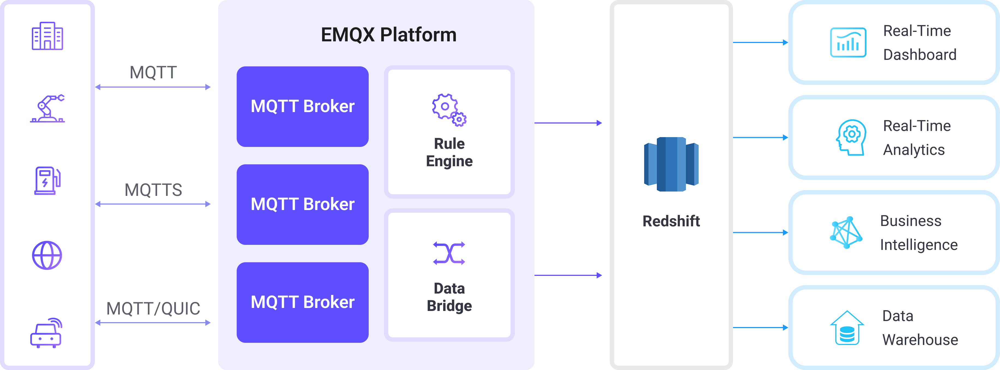

# RedshiftへのMQTTデータ取り込み

[Amazon Redshift](https://aws.amazon.com/redshift/?nc1=h_ls)は、ペタバイト規模のクラウドデータウェアハウスで、高性能な分析処理に特化したフルマネージドサービスです。PostgreSQLをベースにし、オンライン分析処理（OLAP）に最適化されており、複雑なクエリの実行や大規模データ分析を高速に行えます。EMQXはAmazon Redshiftと直接連携し、IoTデバイスからのMQTTテレメトリをリアルタイムに近い形で取り込み、保存できます。

本ページでは、EMQXとRedshift間のデータ統合について包括的に解説し、データ統合の作成および検証手順を実践的に説明します。

## 動作概要

EMQXのRedshiftデータ統合は組み込み機能で、MQTTベースのIoTデータストリームをAmazon Redshiftの分散型PostgreSQL互換データウェアハウスに直接取り込みます。EMQXの組み込み[ルールエンジン](./rules.md)を使うことで、複雑なカスタムコードを書かずにIoTデータをRedshiftにストリーミングし、大規模な分析処理が可能です。

以下の図は、EMQXとRedshift間の典型的なデータ統合アーキテクチャを示しています。



RedshiftへのMQTTデータ取り込みは以下のように動作します。

1. **IoTデバイスがEMQXに接続**：IoTデバイスがMQTTプロトコルで正常に接続されると、デバイスIDや送信元IPアドレスなどの属性を含むオンラインイベントが発生します。
2. **メッセージのパブリッシュと受信**：デバイスはテレメトリや状態データを特定のトピックにパブリッシュします。EMQXがこれらのメッセージを受信すると、ルールエンジン内でマッチング処理が開始されます。
3. **ルールエンジンによるメッセージ処理**：EMQXのルールエンジンは、トピックやメッセージ内容に基づいて定義されたルールにマッチさせてイベントやメッセージを処理します。処理内容には、データ変換（例：JSONからSQL用フォーマットへの変換）、フィルタリング、コンテキスト情報によるデータ強化などが含まれ、データベース挿入前に行われます。
4. **Redshiftへの書き込み**：マッチしたルールにより、SQLベースでRedshiftへの取り込みがトリガーされます。SQLテンプレートを用いて処理済みデータのフィールドをRedshiftのテーブルやカラムにマッピングします。高スループットの取り込みには、Amazon S3からのCOPYやRedshift Streaming Ingestionを活用して、カラムナストアへの効率的なロードを実現します。RedshiftのクエリオプティマイザとMPP（Massively Parallel Processing）実行エンジンにより、データは即座に分析クエリに利用可能となります。

イベントおよびメッセージデータがRedshiftに書き込まれた後は、以下のことが可能です。

- Amazon QuickSight、Grafana、TableauなどのツールとRedshiftを接続し、IoTメトリクスやトレンドを追跡するダッシュボードを構築。
- RedshiftデータをAWSの分析やAI/MLサービス（例：Amazon SageMaker）と連携し、異常検知やデバイスの挙動予測を実施。
- Redshiftの並列クエリ実行を活用し、大規模なIoTデータセットに対して集計、結合、時系列分析を実行。過去データとリアルタイムデータの両方に対応したインサイトを提供。

## 特長と利点

Redshiftとのデータ統合がもたらす主な特長と利点は以下の通りです。

- **柔軟なイベント処理**：EMQXのルールエンジンを活用し、Redshiftはデバイスのライフサイクルイベント（接続、切断、状態変化）を低レイテンシで保存・処理可能です。RedshiftのMPPクエリエンジンと組み合わせることで、障害検知や異常検知、長期的な利用傾向の分析が迅速に行えます。
- **メッセージ変換**：メッセージはEMQXルールで高度に処理・変換されてからRedshiftに書き込まれるため、保存データは分析に最適化されています。この前処理によりクエリの複雑さが軽減され、下流処理が効率化されます。
- **SQLテンプレートによる柔軟なデータ操作**：EMQXのSQLテンプレートマッピングを通じて、構造化されたIoTデータをRedshiftのテーブル・カラムに挿入可能です。RedshiftはPostgreSQL互換のSQLをサポートし、JSON向けのSUPER型など半構造化データ型や高度なインデックス機能も備えています。カラムナストレージ、データ圧縮、ゾーンマップにより大規模データのスキャン時間を短縮し、クエリを高速化します。
- **ビジネスプロセス統合**：RedshiftはAWSエコシステムとシームレスに統合されており、IoTデータをAmazon QuickSightなどのBIツール、AWS GlueやAWS Data Pipelineなどの分析サービス、Amazon SageMakerなどのAI/MLサービスに接続できます。
- **高度な地理空間機能**：RedshiftはGEOMETRYおよびGEOGRAPHY型を通じて地理空間データ型と関数をサポートし、ジオフェンシング、位置情報分析、ルート最適化を実現します。EMQXのリアルタイム取り込みと組み合わせることで、資産追跡、車両監視、位置情報に基づくイベントトリガーをほぼリアルタイムで行えます。
- **組み込みのメトリクスと監視**：EMQXは各Redshiftシンクのランタイムメトリクスを提供し、RedshiftはAmazon CloudWatchと連携してクラスターのパフォーマンス、クエリ実行メトリクス、ストレージ使用状況を監視可能です。これにより取り込みから分析までのエンドツーエンドの可観測性が確保されます。

## はじめる前に

このセクションでは、Redshift統合の作成を開始する前に必要な準備について説明します。Redshiftクラスターの作成やデータベース・テーブルの作成方法も含みます。

### 前提条件

- EMQXデータ統合の[ルール](./rules.md)に関する知識
- [データ統合](./data-bridges.md)に関する知識

### Amazon Redshiftでのデータベースとテーブルの作成

EMQXでRedshiftコネクターを設定する前に、Amazon Redshiftクラスター（またはServerlessワークグループ）が稼働しており、IoTデータを格納するスキーマが準備されていることを確認してください。

1. Redshiftクラスターまたはワークグループをデプロイします。環境の起動には[Amazon Redshiftクラスター作成ガイド](https://docs.aws.amazon.com/redshift/latest/mgmt/create-cluster.html)を参照してください。

2. データベースユーザーの認証情報を設定します。初期クラスター作成時に、管理者ユーザー（通常は`adminuser`）の認証情報を指定します。

   もしくは、Redshift SQLを使ってEMQX専用のデータベースユーザーを作成してください。このユーザーは接続、テーブル作成、読み書きの権限を持つ必要があります。例：

   ```sql
   CREATE USER emqx_user PASSWORD 'YourStrongPassword1';
   ```

   詳細は[Redshift入門ガイド](https://docs.aws.amazon.com/redshift/latest/gsg/t_adding_redshift_user_cmd.html)および[ユーザーガイド](https://docs.aws.amazon.com/redshift/latest/dg/r_Users.html)を参照してください。

   後でEMQXのコネクター設定に使用するため、ユーザー名（`emqx_user`）とパスワードは控えておいてください。

3. `psql`、SQL Workbench/J、DBeaverなどのPostgreSQL互換クライアントを使用し、ホスト名、ポート、既存のデータベース名（例：デフォルトの`dev`）、ユーザー名、パスワードで[Redshiftエンドポイントに接続](https://docs.aws.amazon.com/redshift/latest/mgmt/cluster-syntax.html)します。

4. 接続後、EMQXからのIoTデータ受け取り先となる`emqx_data`データベースを作成します。

   ```sql
   CREATE DATABASE emqx_data;
   ```

5. `emqx_data`データベースに接続し、MQTTメッセージとクライアントイベントデータを格納するための2つのテーブルを作成します。

   - クライアントID、トピック、ペイロード、作成日時を格納するデータテーブル`t_mqtt_msg`を以下のSQLで作成します。

     ```sql
     CREATE TABLE t_mqtt_msg (
       id BIGINT GENERATED BY DEFAULT AS IDENTITY PRIMARY KEY,
       msgid VARCHAR(64),
       sender VARCHAR(64),
       topic  VARCHAR(255),
       qos    INTEGER,
       retain INTEGER,
       -- ペイロードがJSONの場合はSUPER型を検討、それ以外は大きめのVARCHARを使用
       payload SUPER,
       arrived TIMESTAMPTZ
     );
     ```

   - クライアントのオンライン/オフラインイベントをタイムスタンプ付きで格納する`emqx_client_events`テーブルを以下のSQLで作成します。

     ```sql
     CREATE TABLE emqx_client_events (
       id BIGINT GENERATED BY DEFAULT AS IDENTITY PRIMARY KEY,
       clientid  VARCHAR(255),
       event     VARCHAR(255),
       created_at TIMESTAMPTZ DEFAULT CURRENT_TIMESTAMP
     );
     ```

## Redshiftコネクターの作成

Redshiftシンクを追加する前に、EMQXでRedshiftコネクターを作成する必要があります。コネクターはEMQXがAmazon RedshiftクラスターまたはServerlessワークグループに接続する方法を定義します。

::: tip 注意

Amazon Redshift Serverlessを使用している場合、コネクターが作成され接続が確立されると、データが書き込まれていなくても料金が発生する可能性があります。未使用のコネクターは削除するか、リソースを一時停止して予期せぬコストを回避してください。

:::

1. EMQXダッシュボードで、**Integration** -> **Connector** に移動します。
2. ページ右上の**Create**をクリックします。
3. **Create Connector**ページで**Redshift**を選択し、**Next**をクリックします。
4. コネクター名を入力します。名前は英数字で始まり、英数字、ハイフン、アンダースコアを含めることができます。例：`my_redshift`
5. Redshift接続情報を入力します。

   - **Server Host**：Redshiftエンドポイントのホスト名（例：`redshift-cluster-1.abc123xyz.us-east-1.redshift.amazonaws.com`）。AWS Redshiftコンソールの**Clusters**または**Workgroups**ページで確認可能です。
   - **Database Name**：EMQXデータを格納する対象データベース。例：`emqx_data`
   - **Username**：データ挿入権限を持つデータベースユーザー名。例：`emqx_user`
   - **Password**：`emqx_user`のパスワード
   - **Enable TLS**：Redshift接続にSSL/TLS暗号化が必要な場合はオンにします（クラウドサービス接続では推奨）。詳細は[外部リソースアクセスのTLS](../../guides/network/overview.md#tls-for-external-resource-access)を参照してください。
6. 詳細設定（任意）：接続プールサイズ、アイドルタイムアウト、リクエストタイムアウトなどの追加接続プロパティを設定可能です。詳細は[シンクの機能](./data-bridges.md#features-of-sink)を参照してください。
7. **Test Connectivity**をクリックし、EMQXが指定した設定でRedshiftクラスターに正常に接続できるか確認します。

8. **Create**をクリックしてコネクターを保存します。

9. 作成後、以下のいずれかを選択できます。

   - **Back to Connector List**をクリックして全コネクターを表示
   - **Create Rule**をクリックして、このコネクターを使ったRedshiftへのデータ転送ルールをすぐに作成

   詳細な例は以下を参照してください。

   - [メッセージ保存用のRedshiftシンクを使ったルール作成](#create-a-rule-with-redshift-sink-for-message-storage)
   - [イベント記録用のRedshiftシンクを使ったルール作成](#create-a-rule-with-redshift-sink-for-events-recording)

## メッセージ保存用Redshiftシンクを使ったルール作成

このセクションでは、DashboardでソースMQTTトピック`t/#`からのメッセージを処理し、処理済みデータを設定済みシンク経由でRedshiftの`t_mqtt_msg`テーブルに保存するルールの作成方法を示します。

1. Dashboardの**Integration** -> **Rules**ページに移動します。

2. ページ右上の**Create**をクリックします。

3. ルールIDに`my_rule`を入力し、SQLエディターにルールを記述します。ここではトピック`t/#`のMQTTメッセージをRedshiftに保存するため、SELECT句でSQLテンプレートに使用するすべての変数を含むようにします。ルールSQLは以下の通りです。

   ```sql
   SELECT
   *
   FROM
   "t/#"
   ```

   ::: tip

   初心者の方は**SQL Examples**をクリックし、**Enable Test**でSQLルールの学習とテストが可能です。

   :::

4. + **Add Action**ボタンをクリックし、ルールでトリガーされるアクションを定義します。このアクションでEMQXはルールで処理したデータをRedshiftに送信します。

5. **Type of Action**ドロップダウンからRedshiftを選択し、**Action**ドロップダウンはデフォルトの`Create Action`のままにするか、既存のRedshiftアクションを選択します。本例では新規シンクを作成してルールに追加します。

6. シンクの名前と説明をフォームに入力します。

7. **Connector**ドロップダウンから先ほど作成した`my_redshift`を選択します。新規コネクターはドロップダウン横のボタンから作成可能です。設定パラメータは[Redshiftコネクターの作成](#create-a-redshift-connector)を参照してください。

8. **SQL Template**を設定します。以下のSQL文を使ってデータを挿入します。

   注意：これは[プリプロセス済みSQL](./data-bridges.md#prepared-statement)のため、フィールドは引用符で囲まず、文末にセミコロンを付けないでください。

   ```sql
   INSERT INTO t_mqtt_msg (
       msgid,
       topic,
       qos,
       payload,
       arrived
   )
   VALUES (
       ${id},
       ${topic},
       ${qos},
       ${payload},
       timestamp 'epoch' + (${timestamp} :: bigint / 1000) * interval '1 second'
   )
   ```

9. **フォールバックアクション（任意）**：メッセージ配信失敗時の信頼性向上のため、1つ以上のフォールバックアクションを定義できます。詳細は[フォールバックアクション](./data-bridges.md#fallback-actions)を参照してください。

10. **詳細設定（任意）**：詳細は[シンクの機能](./data-bridges.md#features-of-sink)を参照してください。

11. **Create**をクリックする前に、**Test Connectivity**でシンクがRedshiftサーバーに接続できるかテストできます。

12. **Create**ボタンをクリックしてシンク設定を完了します。新しいシンクが**Action Outputs**に追加されます。

13. **Create Rule**ページで設定内容を確認し、**Save**をクリックしてルールを生成します。

ルール作成が完了すると、**Integration** -> **Rules**ページで新規ルールを確認でき、**Action (Sink)**タブに新規Redshiftシンクも表示されます。

また、**Integration** -> **Flow Designer**でトポロジーを可視化でき、トピック`t/#`のメッセージがルール`my_rule`で解析されRedshiftに書き込まれている様子を確認できます。

## イベント記録用Redshiftシンクを使ったルール作成

このセクションでは、クライアントのオンライン/オフライン状態を記録し、イベントデータを設定済みシンク経由でRedshiftの`emqx_client_events`テーブルに保存するルールの作成方法を示します。

手順は[メッセージ保存用Redshiftシンクを使ったルール作成](#create-a-rule-with-redshift-sink-for-message-storage)とほぼ同様で、SQLテンプレートとSQLルールのみ異なります。

オンライン/オフライン状態記録用のSQLルールは以下の通りです。

```sql
SELECT
  *
FROM
  "$events/client_connected", "$events/client_disconnected"
```

イベント記録用のSQLテンプレートは以下の通りです。

注意：これは[プリプロセス済みSQL](./data-bridges.md#prepared-statement)のため、フィールドは引用符で囲まず、文末にセミコロンを付けないでください。

```sql
INSERT INTO emqx_client_events(clientid, event, created_at) VALUES (
  ${clientid},
  ${event},
  TO_TIMESTAMP((${timestamp} :: bigint)/1000)
)
```

## ルールのテスト

MQTTクライアントMQTTXを使い、トピック`t/1`にメッセージを送信してオンライン/オフラインイベントをトリガーします。

```bash
mqttx pub -i emqx_c -t t/1 -m '{ "msg": "hello Redshift" }'
```

2つのシンクの稼働状況を確認します。メッセージ保存用シンクでは新規の受信メッセージと送信メッセージが1件ずつあるはずです。イベント記録用シンクでは2件のイベントレコードがあります。

`t_mqtt_msg`データテーブルにデータが書き込まれているか確認します。

```bash
emqx_data=# select * from t_mqtt_msg;
 id |              msgid               | sender | topic | qos | retain |            payload
        |       arrived
----+----------------------------------+--------+-------+-----+--------+-------------------------------+---------------------
  1 | 0005F298A0F0AEE2F443000012DC0002 | emqx_c | t/1   |   0 |        | { "msg": "hello Redshift" } | 2023-01-19 07:10:32
(1 row)

```

`emqx_client_events`テーブルにデータが書き込まれているか確認します。

```bash
emqx_data=# select * from emqx_client_events;
 id | clientid |        event        |     created_at
----+----------+---------------------+---------------------
  3 | emqx_c   | client.connected    | 2023-01-19 07:10:32
  4 | emqx_c   | client.disconnected | 2023-01-19 07:10:32
(2 rows)

```
