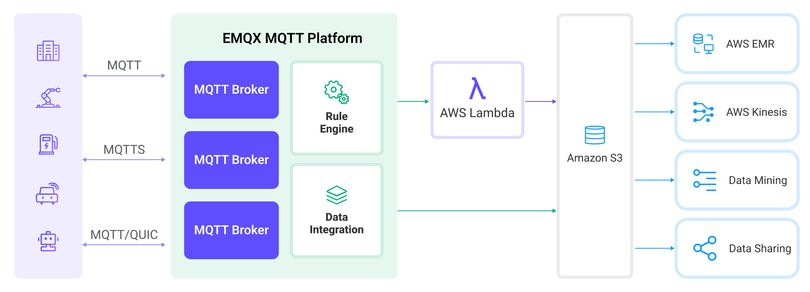
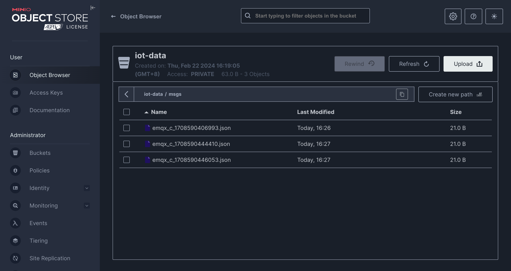

# Amazon S3へのMQTTデータ取り込み

[Amazon S3](https://aws.amazon.com/s3/)は、高い信頼性、安定性、セキュリティを備えたインターネットベースのストレージサービスであり、迅速なデプロイと使いやすさが特徴です。EMQXはMQTTメッセージをAmazon S3バケットに効率的に保存することができ、柔軟なIoTデータストレージ機能を実現します。

本ページでは、EMQXとAmazon S3間のデータ統合について詳しく紹介し、ルールおよびSinkの作成方法を実践的に解説します。

:::tip

EMQXはAmazon S3以外にも、S3プロトコルに対応した以下のストレージサービスと互換性があります。

- [MinIO](https://min.io/)：高性能で分散型のオブジェクトストレージシステム。Amazon S3 API互換のオープンソースオブジェクトストレージサーバーで、プライベートクラウド構築に適しています。
- [Google Cloud Storage](https://cloud.google.com/storage)：Google Cloudの統合オブジェクトストレージで、大量データの保存に対応。Amazon S3互換のインターフェースを提供しています。

ビジネスニーズや利用シナリオに応じて適切なストレージサービスを選択可能です。

:::

## 動作概要

EMQXのAmazon S3データ統合はすぐに利用可能な機能で、複雑なビジネス開発も容易に設定できます。典型的なIoTアプリケーションでは、EMQXがデバイス接続とメッセージ送受信を担うIoTプラットフォームとして機能し、Amazon S3がメッセージデータの保存プラットフォームとして役割を果たします。



EMQXはルールエンジンとSinkを活用してデバイスのイベントやデータをAmazon S3に転送します。アプリケーションはAmazon S3からデータを読み取り、さらなるデータ活用を行います。具体的なワークフローは以下の通りです。

1. **デバイスのEMQX接続**：IoTデバイスはMQTTプロトコルで正常に接続されるとオンラインイベントをトリガーします。このイベントにはデバイスID、送信元IPアドレスなどのプロパティ情報が含まれます。
2. **デバイスのメッセージパブリッシュと受信**：デバイスは特定のトピックを通じてテレメトリやステータスデータをパブリッシュします。EMQXはメッセージを受信し、ルールエンジン内で照合します。
3. **ルールエンジンによるメッセージ処理**：組み込みのルールエンジンはトピックマッチングに基づき特定のソースからのメッセージやイベントを処理します。対応するルールをマッチさせ、データ形式変換、特定情報のフィルタリング、コンテキスト情報の付加などの処理を行います。
4. **Amazon S3への書き込み**：ルールがトリガーされるとメッセージをS3に書き込むアクションが実行されます。Amazon S3 Sinkを利用して処理結果からデータを抽出しS3に送信します。メッセージはテキストまたはバイナリ形式で保存可能で、複数行の構造化データを単一のCSV、JSON Lines、またはParquetファイルにまとめることもできます。これはメッセージ内容やSinkの設定によります。

イベントやメッセージデータがAmazon S3に書き込まれた後は、Amazon S3に接続してデータを読み取り、以下のような柔軟なアプリケーション開発が可能です。

- データアーカイブ：デバイスメッセージをAmazon S3のオブジェクトとして長期保存し、コンプライアンス要件やビジネスニーズに対応。
- データ分析：S3のデータをSnowflakeなどの分析サービスに取り込み、予知保全やデバイス効率評価などのデータ分析を実施。

## 特長とメリット

EMQXのAmazon S3データ統合を利用することで、以下の特長と利点をビジネスにもたらします。

- **メッセージ変換**：メッセージはEMQXのルール内で多様な処理・変換を経てからAmazon S3に書き込まれ、後続の保存や利用が容易になります。
- **柔軟なデータ操作**：S3 Sinkにより、特定のデータフィールドを簡単にAmazon S3バケットに書き込めます。バケット名やオブジェクトキーを動的に設定でき、柔軟なデータ保存が可能です。
- **統合された業務プロセス**：S3 Sinkを使うことでデバイスデータをAmazon S3の豊富なエコシステムアプリケーションと連携させ、データ分析やアーカイブなど多様なビジネスシナリオを実現します。
- **低コストの長期保存**：データベースと比較して、Amazon S3は高可用性かつ信頼性の高いコスト効率の良いオブジェクトストレージサービスであり、長期保存に最適です。

これらの特長により、効率的で信頼性が高くスケーラブルなIoTアプリケーションを構築し、ビジネスの意思決定や最適化に役立てられます。

## はじめる前に

このセクションでは、EMQXでAmazon S3 Sinkを作成する前に必要な準備について説明します。

### 前提条件

以下の内容を理解していることを確認してください。

#### EMQXの概念：

- [ルールエンジン](./rules.md)：MQTTメッセージからデータを抽出・変換するロジックを定義する方法を理解します。
- [データ統合](./data-bridges.md)：EMQXのコネクターとSinkの概念を理解します。

#### AWSの概念：

AWS S3が初めての場合は、以下の概念を確認してください。

- **EC2**：AWSの仮想マシンサービス（コンピュートインスタンス）。
- **IAM**：AWSのIdentity and Access Management。インスタンスロールはそのインスタンス上で動作するプログラムに一時的な認証情報を発行可能です。
- **IMDSv2**：EC2のInstance Metadata Service v2。メタデータや一時認証情報を取得するためのトークンベースでより安全なサービスです。

### S3バケットの準備

EMQXはAmazon S3およびその他のS3互換ストレージサービスをサポートしています。AWSクラウドサービスを利用するか、DockerでMinIOインスタンスをデプロイすることが可能です。

:::: tabs

::: tab Amazon S3

1. [AWS S3コンソール](https://console.amazonaws.cn/s3/home)で、**Create bucket**ボタンをクリックします。バケット名やリージョンなどの必要情報を入力し、S3バケットを作成します。詳細な操作は[AWSドキュメント](https://docs.amazonaws.cn/AmazonS3/latest/userguide/creating-bucket.html)を参照してください。
2. バケットの権限を設定します。バケット作成後、対象バケットを選択し**Permissions**タブをクリックします。ニーズに応じてパブリック読み書き、プライベートなどの権限を設定可能です。
3. アクセスキーを取得します。
   - **手動設定**：AWSコンソールで**IAM**サービスを検索し選択。S3用の新規ユーザーを作成し、Access Key IDとSecret Access Keyを取得します。[AWSガイド：アクセスキーの管理](https://docs.aws.amazon.com/IAM/latest/UserGuide/id_credentials_access-keys.html)を参照。
   - **自動取得（EC2のみ）**：EMQXが**AWS EC2**上で動作している場合、十分な権限を持つ[**IAMロール**](https://docs.aws.amazon.com/IAM/latest/UserGuide/id_roles_use_switch-role-ec2.html)をアタッチします。EMQXは[**IMDSv2** API](https://docs.aws.amazon.com/AWSEC2/latest/UserGuide/instance-metadata-security-credentials.html)経由でインスタンスメタデータから一時認証情報を自動取得可能です。

Amazon S3バケットの作成と設定が完了したら、EMQXでAmazon S3 Sinkの作成準備が整いました。

:::

::: tab MinIO

1. DockerでMinIOをインストールし起動します。

   ```bash
   docker run \
      -p 9000:9000 \
      -p 9001:9001 \
      --name minio \
      -e "MINIO_ROOT_USER=admin" \
      -e "MINIO_ROOT_PASSWORD=MyMinIOPassword" \
      minio/minio:RELEASE.2024-02-17T01-15-57Z.fips \
      server /data --console-address ":9001"
   ```

   ポート`9000`はS3 API用、ポート`9001`はMinIO管理インターフェース用です。

   起動後、ブラウザで`http://localhost:9001`にアクセスし、ログイン情報`admin`と`MyMinIOPassword`でMinIOコンソールにログインできます。

2. バケットを作成します。MinIOコンソールで**Administrator** -> **Buckets**に移動し、ストレージバケット管理画面を開きます。右上の**Create Bucket +**ボタンをクリックし、`iot-data`と入力して**Create Bucket**をクリックし作成完了です。

3. アクセスキーを作成します。MinIOコンソールで**User** -> **Access Keys**に移動し、アクセスキー画面を開きます。右上の**Create access key +**ボタンをクリックし、Access KeyとSecret Keyを入力して**Create**をクリックし作成完了です。

MinIOのインストールと設定が完了したら、EMQXでAmazon S3 Sinkの作成準備が整いました。

:::

::::

## コネクターの作成

S3 Sinkを追加する前に、対応するコネクターを作成する必要があります。

1. ダッシュボードの**Integration** -> **Connector**ページに移動します。

2. 右上の**Create**ボタンをクリックします。
3. コネクタータイプで**Amazon S3**を選択し、**Next**をクリックします。
4. コネクター名を入力します。名前は英数字で始まり、英数字、ハイフン、アンダースコアを含めることができます。ここでは例として`my-s3`と入力します。
5. 接続情報を入力します。
   - Amazon S3バケットを使用する場合、以下を入力します。
     - **Host**：実際のS3バケット名を含まないS3エンドポイントホストを入力します。標準的なAWSリージョナルエンドポイントは`s3.{region}.amazonaws.com`形式です。例：`s3.us-west-2.amazonaws.com`。

       AWS PrivateLinkのAmazon S3インターフェースエンドポイントを使用する場合は、そのリージョナルまたはゾーンDNS名を入力します。例：`bucket.vpce-0123456789abcdef0-example.s3.us-west-2.vpce.amazonaws.com`。このDNS名の`bucket`は実際のS3バケット名ではなくリテラルプレフィックスです。実際のバケット名はSink作成時の**Bucket**欄で設定します。EMQX 6.1.6以降では、これらのDNS名から署名リージョンを推測可能です。
     
     - **Port**：`443`を入力します。
     - **Access Key ID**および**Secret Access Key**：
     
       - AWSで作成したアクセスキーを入力するか、
       - EC2上でIAMロールがアタッチされている場合は空欄のままにします。
     
       詳細は[Prepare an S3 Bucket](#prepare-an-s3-bucket)の「Amazon S3」タブを参照してください。
   - MinIOを使用する場合は以下を入力します。
     - **Host**：`127.0.0.1`を入力します。リモートでMinIOを動作させている場合は実際のホストアドレスを入力してください。
     - **Port**：`9000`を入力します。
     - **Access Key ID**および**Secret Access Key**：MinIOで作成したアクセスキーを入力します。

   Amazon S3またはS3互換サービスのいずれかに応じて以下のフィールドを設定します。

   - **Signing Region**：EMQX 6.1.6以降で利用可能。S3リクエストや署名付きURLの署名リージョンを指定し、**Host**から推測される値を上書きします。空欄の場合は**Host**から推測、または`us-east-1`がデフォルトです。カスタムドメインなどリージョン識別子が含まれないエンドポイントホストの場合に設定してください。
   - **Bucket Access Method**：`path`または`vhost`を選択します。デフォルトは`path`です。`path`はリクエストパスにバケット名を含め、`vhost`はエンドポイントホストの前にバケット名を付加します。`vhost`使用時は**Host**にバケット名を含めず、Sinkの**Bucket**欄で別途設定してください。
   
6. 残りの設定はデフォルト値のままで問題ありません。

7. **Create**をクリックする前に、**Test Connectivity**をクリックしてコネクターがS3サービスに接続できるかテスト可能です。

8. 画面下部の**Create**ボタンをクリックし、コネクター作成を完了します。

これでコネクター作成が完了し、次にS3サービスに書き込むデータを指定するルールとSinkの作成に進みます。

## Amazon S3 Sinkを使ったルールの作成

このセクションでは、EMQXでMQTTトピック`t/#`からのメッセージを処理し、処理結果をS3の`iot-data`バケットに書き込むルールの作成方法を示します。

1. ダッシュボードの**Integration** -> **Rules**ページに移動します。

2. 右上の**Create**ボタンをクリックします。

3. ルールIDに`my_rule`を入力し、SQLエディターに以下のルールSQLを入力します。

   ```sql
   SELECT
     *
   FROM
       "t/#"
   ```

   ::: tip

   SQLに不慣れな場合は、**SQL Examples**や**Enable Debug**をクリックしてルールSQLの学習や結果のテストが可能です。

   :::

4. アクションを追加し、**Action Type**ドロップダウンから`Amazon S3`を選択します。アクションドロップダウンはデフォルトの`create action`のままにするか、既存のAmazon S3アクションを選択可能です。ここでは新規Sinkを作成し、ルールに追加します。

5. Sinkの名前と説明を入力します。

6. 先ほど作成した`my-s3`コネクターをコネクタードロップダウンから選択します。ドロップダウン横の作成ボタンをクリックするとポップアップで新規コネクターを素早く作成可能です。必要な設定パラメータは[Create a Connector](#create-a-connector)を参照してください。

7. **Bucket**に`iot-data`を入力します。このフィールドは`${var}`形式のプレースホルダーもサポートしますが、対応するバケット名は事前にS3側で作成しておいてください。

8. 必要に応じて**ACL**を選択し、アップロードされるオブジェクトのアクセス権限を指定します。

9. **Upload Method**を選択します。2つの方法の違いは以下の通りです。

   - **Direct Upload**：ルールがトリガーされるたびに、設定済みのオブジェクトキーと内容に従ってデータを直接S3にアップロードします。バイナリや大きなテキストデータの保存に適していますが、多数のファイルが生成される可能性があります。
   - **Aggregated Upload**：複数回のルールトリガー結果を1つのファイル（例：CSVファイル）にまとめてS3にアップロードします。構造化データの保存に適し、ファイル数を減らし書き込み効率を向上させます。

   選択した方法に応じて設定パラメータが異なります。以下のタブから該当する方法の設定を行ってください。

   :::: tabs type

   ::: tab Direct Upload

   Direct Uploadでは以下のフィールドを設定します。

   - **Object Key**：アップロード先バケット内のオブジェクトの場所を定義します。`${var}`形式のプレースホルダーをサポートし、`/`で保存ディレクトリを指定可能です。管理や識別のためオブジェクトのサフィックスも設定が必要です。ここでは`msgs/${clientid}_${timestamp}.json`を入力します。`${clientid}`はクライアントID、`${timestamp}`はメッセージのタイムスタンプで、各デバイスのメッセージを異なるオブジェクトに書き込むことを保証します。
   - **Object Content**：デフォルトはすべてのフィールドを含むJSONテキスト形式です。`${var}`形式のプレースホルダーをサポートします。ここでは`${payload}`を入力し、メッセージ本文をオブジェクト内容として使用します。オブジェクトの保存形式はメッセージ本文の形式に依存し、圧縮ファイルや画像、その他バイナリ形式もサポートします。

   :::

   ::: tab Aggregate Upload

   Aggregate Uploadでは以下のパラメータを設定します。

   - **Object Key**：オブジェクトの保存パスを指定します。以下の変数が使用可能です。

     - **`${action}`**：アクション名（必須）。
     - **`${node}`**：アップロードを実行するEMQXノード名（必須）。
     - **`${datetime.{format}}`**：集約開始日時。`{format}`で指定した形式で出力（必須）。
       - **`${datetime.rfc3339utc}`**：UTC形式のRFC3339日時。
       - **`${datetime.rfc3339}`**：ローカルタイムゾーン形式のRFC3339日時。
       - **`${datetime.unix}`**：Unixタイムスタンプ。
     - **`${datetime_until.{format}}`**：集約終了日時。上記と同様の形式。
     - **`${sequence}`**：同一時間帯内の集約アップロードのシーケンス番号（必須）。

     必須とマークされたプレースホルダーがテンプレート内に含まれていない場合、これらは自動的にS3オブジェクトキーのパスサフィックスとして追加され、重複を防ぎます。その他のプレースホルダーは無効とみなされます。

   - **Aggregation Type**：S3に保存するバッチ化されたMQTTメッセージのデータファイル形式を定義します。サポート値：
      - `CSV`：カンマ区切りのCSV形式でS3に書き込みます。
      
      - `JSON Lines`：S3に[JSON Lines](https://jsonlines.org/)形式で書き込みます。
      
      - `parquet`：S3に[Apache Parquet](https://parquet.apache.org/)形式で書き込みます。列指向で大規模分析クエリに最適化されています。
      
        > スキーマ定義、圧縮、行グループ設定など詳細な構成は[Parquet Format Options](#parquet-format-options)を参照してください。
      
   - **Column Order**（`CSV`用）：ドロップダウンでルール結果の列順を調整します。生成されるCSVファイルは選択列を優先的にソートし、未選択列はアルファベット順に続きます。

   - **Max Records**：最大レコード数に達すると1ファイルの集約を完了してアップロードし、時間間隔をリセットします。

   - **Time Interval**：時間間隔に達すると最大レコード数に満たなくても1ファイルの集約を完了してアップロードし、最大レコード数をリセットします。

   :::

   ::::

11. **フォールバックアクション（任意）**：メッセージ配信失敗時の信頼性向上のため、1つ以上のフォールバックアクションを定義可能です。プライマリSinkがメッセージ処理に失敗した場合にこれらがトリガーされます。詳細は[Fallback Actions](./data-bridges.md#fallback-actions)を参照してください。

12. **Advanced Settings**を展開し、必要に応じて高度な設定オプションを調整します（任意）。詳細は[Advanced Settings](#advanced-settings)を参照してください。

13. 残りの設定はデフォルト値のままにし、**Create**ボタンをクリックしてSink作成を完了します。作成成功後、ルール作成画面に戻り、新規Sinkがルールアクションに追加されます。

14. ルール作成画面で**Create**ボタンをクリックし、ルール作成全体を完了します。

これでルールの作成が完了し、**Rules**ページで新規ルールを、**Actions (Sink)**タブで新規S3 Sinkを確認できます。

また、**Integration** -> **Flow Designer**をクリックするとトポロジーを視覚的に確認可能です。トポロジーはトピック`t/#`配下のメッセージがルール`my_rule`で解析され、S3に書き込まれる流れを示します。

### Parquetフォーマットオプション

**Aggregation Type**が`parquet`に設定されている場合、EMQXは集約されたルール結果をApache Parquet形式で保存します。Parquetは列指向かつ圧縮されたファイル形式で、分析処理に最適化されています。

本節ではParquet出力フォーマットの全設定オプションを説明します。

#### Parquetスキーマ（Avro）

このオプションはMQTTメッセージのフィールドをParquetファイルの列にマッピングする方法を定義します。EMQXはApache Avroスキーマ仕様を用いてParquetデータの構造を記述します。

以下のいずれかを選択可能です。

- **スキーマレジストリに存在するAvroスキーマ**：EMQXの[スキーマレジストリ](./schema-registry.md)で管理されている既存の[Avroスキーマ](./schema-registry-example-avro.md)を使用します。

  この場合、シリアライズに使用するスキーマを識別するために**Schema Name**を指定する必要があります。

  ::: tip

  スキーマを中央管理し、複数システム間で一貫したスキーマ進化を行いたい場合に推奨します。

  :::

- **Avroスキーマを直接定義**：EMQX内でスキーマJSON構造を**Schema Definition**欄に直接入力して定義します。

  例：

  ```json
  {
    "type": "record",
    "name": "MessageRecord",
    "fields": [
      {"name": "clientid", "type": "string"},
      {"name": "timestamp", "type": "long"},
      {"name": "payload", "type": "string"}
    ]
  }
  ```

::: tip

フィールド名やデータ型はルールSQLの戻り値フィールドと一致させてください。不正または不足があるとParquet書き込み時にシリアライズエラーが発生する可能性があります。

:::

#### Parquetデフォルト圧縮

Parquetデータページに適用する圧縮アルゴリズムを指定します。圧縮によりストレージ容量を削減し、分析クエリ時のI/O効率を向上させます。

サポート値：

| 値                  | 説明                                                         |
| ------------------ | ------------------------------------------------------------ |
| `snappy`（デフォルト） | 高速な圧縮・解凍と良好な圧縮率のバランスが取れた選択肢。ほとんどのケースで推奨されます。 |
| `zstd`             | 中程度のCPU使用率でより高い圧縮率を提供。大規模分析データや長期保存に最適。 |
| `None`             | 圧縮を無効化。デバッグ時や圧縮不要な場合に適します。           |

#### Parquet最大行グループサイズ（Max Row Group Bytes）

Parquetの読み書き単位である行グループの最大サイズ（バイト単位）を指定します。バッファされたデータサイズがこの閾値を超えると、EMQXは現在の行グループをフラッシュし新しい行グループを開始します。

- **デフォルト値**：`128 MB`

ガイドライン：

- 値を大きくすると、AthenaやSparkなど分析クエリの読み取り性能が向上します。
- 値を小さくすると、書き込み時のメモリ使用量を抑制したり、小規模データセットでの処理に適します。

::: tip

Parquetリーダーは行グループ単位でデータを読み込みます。大きな行グループはメタデータのオーバーヘッドを減らし、分析クエリ性能を向上させます。

:::

## ルールのテスト

このセクションでは、Direct Upload方式で設定したルールのテスト方法を示します。

MQTTXを使ってトピック`t/1`にメッセージをパブリッシュします。

```bash
mqttx pub -i emqx_c -t t/1 -m '{ "msg": "hello S3" }'
```

数回メッセージを送信した後、MinIOコンソールまたはAmazon S3コンソールで結果を確認します。

:::: tabs

::: tab Amazon S3コンソール

AWSマネジメントコンソールにログインし、Amazon S3コンソールを開きます：<https://console.aws.amazon.com/s3/>。

バケット一覧から`iot-data`バケットを選択し、バケット内に入ります。オブジェクト一覧に先ほどパブリッシュしたメッセージが`msg`オブジェクトとして正常に書き込まれていることが確認できます。オブジェクト横のチェックボックスを選択し、**Download**をクリックしてローカルにダウンロードし内容を確認可能です。

:::

::: tab MinIOコンソール

`iot-data`バケットを開きます。パブリッシュしたメッセージがMinIOの`msgs`ディレクトリに正常に書き込まれていることが確認できます。



:::

::::

## 高度な設定

このセクションでは、S3 Sinkの高度な設定オプションについて詳述します。ダッシュボードのSink設定画面で**Advanced Settings**を展開し、必要に応じて以下のパラメータを調整してください。

| フィールド名                     | 説明                                                         | デフォルト値    |
| -------------------------------- | ------------------------------------------------------------ | --------------- |
| **Buffer Pool Size**             | EMQXとS3間のデータフローを管理するバッファワーカープロセス数を指定します。これらのワーカーはデータを一時的に保存・処理し、ターゲットサービスへ送信します。パフォーマンス最適化とスムーズなデータ送信に重要です。 | `16`            |
| **Request TTL**                  | リクエストTTL（Time To Live）は、リクエストがバッファに入ってから有効とみなされる最大秒数を指定します。TTLを超えてバッファに滞留するか、送信後にS3からの応答やアックが得られない場合、リクエストは期限切れと判定されます。 | `45`            |
| **Health Check Interval**        | SinkがS3との接続状態を自動でヘルスチェックする間隔（秒）を指定します。 | `15`秒          |
| **Health Check Interval Jitter** | ヘルスチェック間隔に加える一様ランダム遅延です。複数ノードが同時にヘルスチェックを開始する確率を減らします。複数のアクションやソースが同じコネクターを共有する場合、ジッターを有効にするとヘルスチェック開始時刻がずれます。 | `0`ミリ秒       |
| **Health Check Timeout**         | コネクターがS3テーブルとの接続ヘルスチェックを行う際のタイムアウト時間を指定します。 | `60`秒          |
| **Max Buffer Queue Size**        | S3 Sinkの各バッファワーカーがバッファリング可能な最大バイト数を指定します。バッファワーカーはデータを一時保存し、S3への送信を効率化します。システム性能やデータ送信要件に応じて調整してください。 | `256`MB         |
| **Query Mode**                   | 同期（`synchronous`）または非同期（`asynchronous`）のリクエストモードを選択し、メッセージ送信を最適化します。非同期モードではS3への書き込みがMQTTメッセージのパブリッシュ処理をブロックしません。ただしクライアントがS3到達前にメッセージを受信する可能性があります。 | `Asynchronous`  |
| **In-flight Window**            | 「インフライトキューリクエスト」とは、開始されたがまだ応答やアックを受け取っていないリクエストを指します。この設定はSinkとS3間通信時に同時に存在可能なインフライトキューリクエストの最大数を制御します。<br/>**Request Mode**が`asynchronous`の場合、このパラメータは特に重要です。同一MQTTクライアントからのメッセージを厳密に順序処理したい場合は、値を`1`に設定してください。 | `100`           |
| **Min Part Size**               | 集約完了後のパートアップロードの最小チャンクサイズです。アップロード対象データはこのサイズに達するまでメモリに蓄積されます。 | `5MB`           |
| **Max Part Size**               | パートアップロードの最大チャンクサイズです。S3 Sinkはこのサイズを超えるパートのアップロードを試みません。 | `5GB`           |
