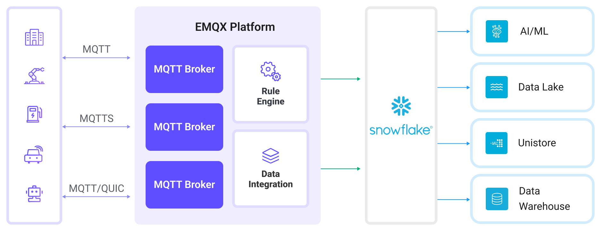

# SnowflakeへのMQTTデータ取り込み

[Snowflake](https://www.snowflake.com/en/) は、クラウドベースのデータプラットフォームであり、高いスケーラビリティと柔軟性を備えたデータウェアハウジング、分析、セキュアなデータ共有のソリューションを提供します。構造化データおよび半構造化データの処理に優れ、大量のデータを高速なクエリ性能で保存し、さまざまなツールやサービスとのシームレスな統合が可能です。

本ページでは、EMQXとSnowflake間のデータ統合について詳細に紹介し、ルールとSinkの作成方法について実践的なガイダンスを提供します。

## 動作の仕組み

EMQXにおけるSnowflakeデータ統合はすぐに使える機能であり、複雑なIoTビジネスワークフローを簡単にサポートできるように構成可能です。典型的なIoTアプリケーションでは、EMQXがデバイス接続とメッセージ送信を担うIoTプラットフォームとして機能し、Snowflakeはメッセージデータの取り込み、保存、分析を担当するデータストレージおよび処理プラットフォームとして利用されます。



EMQXはルールエンジンとSinkを利用して、デバイスイベントやデータをSnowflakeに転送します。エンドユーザーやアプリケーションはSnowflakeのテーブル内のデータにアクセスできます。具体的なワークフローは以下の通りです：

1. **デバイスのEMQXへの接続**：IoTデバイスはMQTTプロトコルで正常に接続されるとオンラインイベントをトリガーします。このイベントにはデバイスID、送信元IPアドレス、その他識別情報が含まれます。

2. **デバイスメッセージのパブリッシュと受信**：デバイスは特定のトピックを通じてテレメトリやステータスデータをパブリッシュします。EMQXはメッセージを受信し、ルールエンジン内で比較処理を行います。

3. **ルールエンジンによるメッセージ処理**：組み込みのルールエンジンはトピックマッチングに基づき特定のソースからのメッセージやイベントを処理します。対応するルールにマッチしたメッセージやイベントは、データ形式の変換、特定情報のフィルタリング、コンテキスト情報の付加などの処理が行われます。

4. **Snowflakeへの書き込み**：ルールはメッセージデータをSnowflakeに書き込むアクションをトリガーします。メッセージをファイルにバッチングしてStageとPipe経由でロードする（集約モード）か、Snowpipe Streaming APIを使って直接ストリーミングする（ストリーミングモード）方法があります。

イベントやメッセージデータがSnowflakeに書き込まれた後は、以下のようなビジネスおよび技術的な用途で活用可能です：

- **データアーカイブ**：IoTデータをSnowflakeに安全に長期保存し、コンプライアンスや履歴データの保持を実現。
- **データ分析**：Snowflakeのデータウェアハウジングおよび分析機能を活用し、リアルタイムまたはバッチ分析を行い、予知保全、運用インサイト、デバイス性能評価を可能に。

## 特長と利点

EMQXのSnowflakeデータ統合を利用することで、以下の特長と利点が得られます：

- **メッセージ変換**：メッセージはEMQXのルール内で高度に処理・変換されてからSnowflakeに書き込まれるため、後続の保存や活用が容易になります。
- **柔軟なデータ操作**：Snowflake Sinkは、Snowflakeに書き込む特定フィールドの選択を可能にし、ビジネスニーズに応じた効率的かつ動的なストレージ構成を実現します。
- **統合されたビジネスプロセス**：Snowflake Sinkにより、デバイスデータをSnowflakeの豊富なエコシステムアプリケーションと組み合わせることができ、データ分析やアーカイブなど多様なビジネスシナリオを実現します。
- **低コストの長期保存**：Snowflakeのスケーラブルなストレージ基盤は、従来のデータベースと比較して低コストでの長期データ保持に最適であり、大量のIoTデータ保存に適しています。

これらの特長により、効率的で信頼性が高くスケーラブルなIoTアプリケーションを構築し、ビジネスの意思決定や最適化に役立てることが可能です。

## はじめる前に

このセクションでは、EMQXでSnowflake Sinkを作成する前に必要な準備について説明します。

### 前提条件

- EMQXの[ルール](./rules.md)および[データ統合](./data-bridges.md)の概念を理解していること。
- 管理者権限を持つ有効なSnowflakeアカウントを保有していること。

### アップロードモードの選択

::: tip

モードを最初に選択してください。これにより、EMQXとSnowflake環境の両方の設定方法が決まります。

:::

EMQXはSnowflakeへのデータ送信に以下の2つのモードをサポートしています：

| モード       | 説明                                                         | ODBCが必要か |
| ---------- | ------------------------------------------------------------ | ----------- |
| 集約（Aggregated） | EMQXはMQTTメッセージをローカルファイルにバッファリングし、Snowflakeのステージにアップロードします。`COPY INTO`文を設定したパイプが自動的にステージ上のファイルをターゲットテーブルにロードします。詳細は[Snowflake Snowpipeドキュメント](https://docs.snowflake.com/en/user-guide/data-load-snowpipe-intro)を参照してください。 | はい        |
| ストリーミング（Streaming） | Snowpipe Streaming APIを使用し、データをリアルタイムで送信し、行単位でSnowflakeテーブルに直接書き込みます。 | はい        |

### Snowflake ODBCドライバーの初期化

EMQXがSnowflakeと通信し効率的にデータ転送を行うためには、SnowflakeのOpen Database Connectivity（ODBC）ドライバーをインストールおよび設定する必要があります。このドライバーはEMQXがSnowflakeのステージにデータを書き込むための通信ブリッジとして機能し、データの適切なフォーマット、認証、転送を保証します。

詳細は公式の[ODBCドライバー](https://docs.snowflake.com/en/developer-guide/odbc/odbc)ページおよび[ライセンス契約](https://sfc-repo.snowflakecomputing.com/odbc/Snowflake_ODBC_Driver_License_Agreement.pdf)を参照してください。

#### LinuxでのSnowflake ODBCドライバー初期化

EMQXはDebian系（Ubuntuなど）向けにSnowflake ODBCドライバーの迅速な導入と必要なシステム設定を行う[インストールスクリプト](https://github.com/emqx/emqx/blob/master/scripts/install-snowflake-driver.sh)を提供しています。

::: tip 注意

このスクリプトはテスト用であり、本番環境でのODBCドライバー設定方法の推奨ではありません。公式の[Linux向けインストール手順](https://docs.snowflake.com/en/developer-guide/odbc/odbc-linux)を参照してください。

:::

**インストールスクリプトの実行**

`scripts/install-snowflake-driver.sh`スクリプトをローカルにコピーし、`chmod a+x`で実行権限を付与してから`sudo`で実行します：

```bash
chmod a+x scripts/install-snowflake-driver.sh
sudo ./scripts/install-snowflake-driver.sh
```

スクリプトはSnowflake ODBCの`.deb`インストールパッケージ（例：`snowflake-odbc-3.4.1.x86_64.deb`）をカレントディレクトリに自動ダウンロードし、ドライバーをインストール後、以下のシステム設定ファイルを更新します：

- `/etc/odbc.ini`：Snowflakeデータソース設定を追加
- `/etc/odbcinst.ini`：Snowflakeドライバーパスを登録

**設定例**

`/etc/odbc.ini`の内容を確認するには以下を実行：

```
emqx@emqx-0:~$ cat /etc/odbc.ini

[snowflake]
Description=SnowflakeDB
Driver=SnowflakeDSIIDriver
Locale=en-US
PORT=443
SSL=on

[ODBC Data Sources]
snowflake = SnowflakeDSIIDriver
```

`/etc/odbcinst.ini`の内容を確認するには以下を実行：

```
emqx@emqx-0:~$ cat /etc/odbcinst.ini

[ODBC Driver 18 for SQL Server]
Description=Microsoft ODBC Driver 18 for SQL Server
Driver=/opt/microsoft/msodbcsql18/lib64/libmsodbcsql-18.5.so.1.1
UsageCount=1

[ODBC Driver 17 for SQL Server]
Description=Microsoft ODBC Driver 17 for SQL Server
Driver=/opt/microsoft/msodbcsql17/lib64/libmsodbcsql-17.10.so.6.1
UsageCount=1

[SnowflakeDSIIDriver]
APILevel=1
ConnectFunctions=YYY
Description=Snowflake DSII
Driver=/usr/lib/snowflake/odbc/lib/libSnowflake.so
DriverODBCVer=03.52
SQLLevel=1
UsageCount=1
```

#### macOSでのSnowflake ODBCドライバー初期化

macOSでSnowflake ODBCドライバーをインストールおよび設定する手順は以下の通りです：

1. unixODBCをインストール（例）：

   ```
   brew install unixodbc
   ```

2. [iODBCのダウンロードとインストール](https://github.com/openlink/iODBC/releases/download/v3.52.16/iODBC-SDK-3.52.16-macOS11.dmg)。

3. [Snowflake ODBCドライバーのダウンロードとインストール](https://sfc-repo.snowflakecomputing.com/odbc/macuniversal/3.3.2/snowflake_odbc_mac_64universal-3.3.2.dmg)。

4. 詳細なインストールおよび設定手順は[macOS向けODBCドライバーのインストールと設定](https://docs.snowflake.com/en/developer-guide/odbc/odbc-mac)を参照。

5. インストール後、以下の設定ファイルを更新：

   - Snowflake ODBCドライバーの権限と設定を更新：

     ```bash
     chown $(id -u):$(id -g) /opt/snowflake/snowflakeodbc/lib/universal/simba.snowflake.ini
     echo 'ODBCInstLib=libiodbcinst.dylib' >> /opt/snowflake/snowflakeodbc/lib/universal/simba.snowflake.ini
     ```

   - ODBC接続設定のために`~/.odbc.ini`ファイルを作成または更新：

     ```
     cat << EOF > ~/.odbc.ini
     [ODBC]
     Trace=no
     TraceFile=
     
     [ODBC Drivers]
     Snowflake = Installed
     
     [ODBC Data Sources]
     snowflake = Snowflake
     
     [Snowflake]
     Driver = /opt/snowflake/snowflakeodbc/lib/universal/libSnowflake.dylib
     EOF
     ```

### ユーザーアカウント作成とSnowflakeリソース設定

アップロードモードに関わらず、Snowflake環境の設定（ユーザーアカウント、データベース、関連リソースの作成）が必要です。以下の認証情報は後でEMQXのコネクターおよびSink設定時に使用します：

| 項目名                 | 値                                               | 説明                                                         |
| ---------------------- | ------------------------------------------------ | ------------------------------------------------------------ |
| データソース名（DSN）  | `snowflake`（集約モードのみ）                    | `/etc/odbc.ini`に設定したODBC DSN。集約アップロードで使用。 |
| ユーザー名             | `snowpipeuser`                                   | Snowflake接続認証に使用するユーザー。適切な権限が必要。     |
| パスワード             | `Snowpipeuser99`                                 | キーペア認証を使う場合は省略可能。                           |
| データベース名         | `testdatabase`                                   | 対象テーブルが存在するSnowflakeデータベース。               |
| スキーマ               | `public`                                         | データベース内のテーブルおよびパイプが存在するスキーマ。     |
| ステージ（集約モード） | `emqx`                                           | データ取り込み前にファイルを保持するSnowflakeステージ。     |
| パイプ（集約モード）   | `emqx`                                           | ステージからテーブルにデータをロードするパイプ。             |
| パイプ（ストリーミング） | `emqxstreaming`                                  | Snowpipe Streaming API経由でデータを取り込むためのパイプ。   |
| プライベートキー       | `file://<path to snowflake_rsa_key.private.pem>` | API認証用JWT署名に使うRSAプライベートキーのパス。            |

#### RSAキーペアの生成（集約モードは任意）

Snowflakeは複数の認証方式をサポートしています。EMQXでの認証方式はアップロードモードと接続設定に依存します：

| アップロードモード       | 認証オプション                                               | キーペア必須か |
| ----------------- | ------------------------------------------------------------ | ------------- |
| ストリーミング（HTTPS） | RSAキーペア＋JWT（唯一サポートされる方式）                   | 必須          |
| 集約（ODBC）       | ユーザー名/パスワード（DSNまたはEMQX経由）<br />RSAキーペア＋JWT（任意、EMQXのみ設定） | 任意          |

キーペア認証はストリーミングモードのみ必須で、EMQXはJWTに署名してSnowflakeのStreaming APIに安全に認証します。

集約モードはユーザー名/パスワードまたはRSAキーペアのいずれかで認証可能です。認証情報の提供方法は以下のいずれかです：

- ダッシュボードのEMQXコネクター設定にユーザー名とパスワードを直接入力。
- キーペア認証を使う場合はプライベートRSAキーのパスを指定。
- どちらも指定しない場合は、システムのODBC DSN（Linuxなら`/etc/odbc.ini`、macOSなら`~/.odbc.ini`）に正しく設定されていることを確認。

::: tip

認証にはパスワードかプライベートキーのいずれかを使用し、両方を同時に使わないでください。

EMQXでどちらも設定されていない場合は、コネクターが`/etc/odbc.ini`の認証情報を参照します。

:::

**例：ユーザー名/パスワードを使った`/etc/odbc.ini`設定**

```ini
[snowflake]
Driver=SnowflakeDSIIDriver
Server=<account>.snowflakecomputing.com
UID=snowpipeuser
PWD=Snowpipeuser99
Database=testdatabase
Schema=public
Warehouse=compute_wh
Role=snowpipe
```

> この方法により、EMQXは設定で直接認証情報を含めずに`DSN`（`snowflake`）を参照できます。

**キーペア認証を使う場合**

RSAキーペア認証（例：ストリーミングモードで必須）を利用する場合、以下のコマンドでキーを生成し設定します：

```bash
# プライベートキー生成
openssl genrsa 2048 | openssl pkcs8 -topk8 -inform PEM -out snowflake_rsa_key.private.pem -nocrypt

# パブリックキー生成
openssl rsa -in snowflake_rsa_key.private.pem -pubout -out snowflake_rsa_key.public.pem
```

EMQXがキーペア認証を使う場合（集約・ストリーミング両モード対応）：

- EMQXはプライベートRSAキーでJWTに署名し、安全で検証可能なIDトークンとして機能。
- Snowflakeはパブリックキーで署名を検証。

詳細は[キーペア認証とキーペアローテーション](https://docs.snowflake.com/en/user-guide/key-pair-auth)を参照してください。

#### SQLによるSnowflakeリソースの設定

RSAキーペア生成後、SQLコマンドで`aggregated`または`streaming`取り込み用のSnowflakeオブジェクトを作成します。

内容は以下を含みます：

- データベースとテーブルの作成
- ステージとパイプの作成（集約用）
- ストリーミングパイプの作成（ストリーミング用）
- ユーザーとロールの作成および権限付与

1. SnowflakeコンソールのSQLワークシートで以下を実行：

   ```sql
   USE ROLE accountadmin;

   -- データ保存用データベース作成（存在しない場合）
   CREATE DATABASE IF NOT EXISTS testdatabase;

   -- MQTTデータ受け取り用テーブル作成
   CREATE OR REPLACE TABLE testdatabase.public.emqx (
       clientid STRING,
       topic STRING,
       payload STRING,
       publish_received_at TIMESTAMP_LTZ
   );

   -- ファイルアップロード用Snowflakeステージ作成（集約モードのみ）
   CREATE STAGE IF NOT EXISTS testdatabase.public.emqx
   FILE_FORMAT = (TYPE = CSV PARSE_HEADER = TRUE FIELD_OPTIONALLY_ENCLOSED_BY = '"')
   COPY_OPTIONS = (ON_ERROR = CONTINUE PURGE = TRUE);

   -- ステージからロードする集約モード用パイプ作成
   CREATE PIPE IF NOT EXISTS testdatabase.public.emqx AS
   COPY INTO testdatabase.public.emqx
   FROM @testdatabase.public.emqx
   MATCH_BY_COLUMN_NAME = CASE_INSENSITIVE;

   -- ストリーミングモード用パイプ作成（直接取り込み）
   CREATE PIPE IF NOT EXISTS testdatabase.public.emqxstreaming AS
   COPY INTO testdatabase.public.emqx (
       clientid,
       topic,
       payload,
       publish_received_at
   )
   FROM (
       SELECT
           $1:clientid::STRING,
           $1:topic::STRING,
           $1:payload::STRING,
           $1:publish_received_at::TIMESTAMP_LTZ
       FROM TABLE(DATA_SOURCE(TYPE => 'STREAMING'))
   );

   ```

   - パイプ内の`COPY INTO`はSnowflakeがステージまたはストリームされたデータを自動的にテーブルにロードすることを保証します。
   - ストリーミングパイプの`$1:field`構文はEMQX経由で取り込まれたJSONペイロードからフィールドを抽出します。

2. EMQX認証用の専用ユーザー（例：`snowpipeuser`）を作成し、そのユーザーにRSAパブリックキーをバインド：

   ```sql
   -- ユーザーアカウント作成
   CREATE USER IF NOT EXISTS snowpipeuser
       PASSWORD = 'Snowpipeuser99'
       MUST_CHANGE_PASSWORD = FALSE;

   -- RSAパブリックキーをユーザーに設定
   ALTER USER snowpipeuser SET RSA_PUBLIC_KEY = '
   <YOUR_PUBLIC_KEY_CONTENTS_LINE_1>
   <YOUR_PUBLIC_KEY_CONTENTS_LINE_2>
   <YOUR_PUBLIC_KEY_CONTENTS_LINE_3>
   <YOUR_PUBLIC_KEY_CONTENTS_LINE_4>
   ';
   ```

   ::: tip

   PEMファイルの`-----BEGIN PUBLIC KEY-----`および`-----END PUBLIC KEY-----`の行は削除し、改行を保持したまま中身のみを含めてください。

   :::

   このキーはSnowflakeユーザーにアップロードされ、Snowflake内部に保存されます。

3. ユーザーに必要なロールを作成し、権限を付与：

   ```sql
   CREATE OR REPLACE ROLE snowpipe;
   
   -- データベースとスキーマの使用権限付与
   GRANT USAGE ON DATABASE testdatabase TO ROLE snowpipe;
   GRANT USAGE ON SCHEMA testdatabase.public TO ROLE snowpipe;
   GRANT INSERT, SELECT ON testdatabase.public.emqx TO ROLE snowpipe;
   
   -- 集約モード用にステージとパイプの権限付与
   GRANT READ, WRITE ON STAGE testdatabase.public.emqx TO ROLE snowpipe;
   GRANT OPERATE, MONITOR ON PIPE testdatabase.public.emqx TO ROLE snowpipe;
   
   -- ストリーミングモード用にストリーミングパイプの権限付与
   GRANT OPERATE, MONITOR ON PIPE testdatabase.public.emqxstreaming TO ROLE snowpipe;
   
   -- ユーザーにロールを割り当て、デフォルトに設定
   GRANT ROLE snowpipe TO USER snowpipeuser;
   ALTER USER snowpipeuser SET DEFAULT_ROLE = snowpipe;
   ```

## 集約モード用Snowflakeコネクターの作成

Snowflake Sinkで集約アップロードモードを使用する場合、Snowflake環境への接続を確立するためにSnowflakeコネクターを作成する必要があります。このコネクターはODBC（DSN経由）を使い、ステージを通じて接続します。

1. ダッシュボードの **Integration** -> **Connector** ページに移動。

2. 右上の **Create** ボタンをクリック。

3. コネクタータイプで **Snowflake** を選択し、次へ。

4. コネクター名を英数字の組み合わせで入力。ここでは `my-snowflake` と入力。

5. 接続情報を入力。

   - **Server Host**：SnowflakeのエンドポイントURL。通常は `<Your Snowflake Organization ID>-<Your Snowflake Account Name>.snowflakecomputing.com` の形式。`<Your Snowflake Organization ID>-<Your Snowflake Account Name>` はSnowflake固有のサブドメインに置き換える必要があります。

   - **Account**：Snowflakeの組織IDとアカウント名をハイフン（`-`）で区切って入力。SnowflakeコンソールのURLの一部として確認可能。

   - **Data Source Name (DSN)**：ODBCドライバー設定時に`.odbc.ini`で設定した`snowflake`を入力。

   - **Username**：前述の設定で作成した`snowpipeuser`を入力。

   - **Password**：ODBC経由でユーザー名/パスワード認証を行う場合のパスワード。任意入力です：

     - ここにパスワード（例：`Snowpipeuser99`）を入力するか、

     - `/etc/odbc.ini`に設定するか、

     - キーペア認証を使う場合は空欄のままにします。

       ::: tip

       認証にはパスワードかプライベートキーのいずれかを使用し、両方を同時に使わないでください。ここでどちらも設定しない場合は、`/etc/odbc.ini`に適切な認証情報が設定されていることを確認してください。

       :::

   - **Private Key Path**：ODBC経由でSnowflake認証に使うRSAプライベートキーの絶対パス。クラスター内すべてのノードで同一パスである必要があります。例：`/etc/emqx/certs/snowflake_rsa_key.private.pem`。

   - **Private Key Password**：プライベートキーが暗号化されている場合の復号パスワード。OpenSSLの`-nocrypt`オプションで生成した場合は空欄。

   - **Proxy**：HTTPプロキシ経由でSnowflakeに接続する設定。HTTPSプロキシはサポートされていません。デフォルトはプロキシなし。プロキシを使う場合は`Enable Proxy`を選択し、以下を入力：

     - **Proxy Host**：プロキシサーバーのホスト名またはIPアドレス。

     - **Proxy Port**：プロキシサーバーのポート番号。

6. 暗号化接続を有効にする場合は **Enable TLS** トグルをオンにします。TLS接続の詳細は[外部リソースアクセスのTLS](../../guides/network/overview.md#tls-for-external-resource-access)を参照。ストリーミングモードではHTTPS通信のためTLS必須です。

7. 詳細設定（任意）：[詳細設定](#advanced-settings)を参照。

8. **Create**をクリックする前に、**Test Connectivity**でSnowflakeへの接続テストが可能。

9. **Create**ボタンをクリックしてコネクター作成を完了。

これでコネクター作成が完了し、ルールとSinkの作成に進めます。

## Snowflakeストリーミングコネクターの作成

Snowflake Sinkでストリーミングアップロードモードを使用する場合、Snowflake環境への接続を確立するためにSnowflakeストリーミングコネクターを作成します。このコネクターはHTTPSとSnowpipe Streaming REST APIを使用します。

1. ダッシュボードの **Integration** -> **Connector** ページに移動。

2. 右上の **Create** ボタンをクリック。

3. コネクタータイプで **Snowflake Streaming** を選択し、次へ。

4. コネクター名を英数字の組み合わせで入力。ここでは `my-snowflake-streaming` と入力。

5. 接続情報を入力。

   - **Server Host**：SnowflakeのエンドポイントURL。通常は `<Your Snowflake Organization ID>-<Your Snowflake Account Name>.snowflakecomputing.com` の形式。`<Your Snowflake Organization ID>-<Your Snowflake Account Name>` はSnowflake固有のサブドメインに置き換える必要があります。

   - **Account**：Snowflakeの組織IDとアカウント名をハイフン（`-`）で区切って入力。SnowflakeコンソールのURLの一部として確認可能。

   - **Pipe User**：対象パイプを操作可能な権限を持つSnowflakeユーザー名（例：`snowpipeuser`）。`OPERATE`および`MONITOR`権限が必要。

   - **Private Key Path**：EMQXがJWT署名に使うRSAプライベートキー。PEM形式のキー全文を文字列として直接貼り付けるか、`file://`で始まるファイルパスを指定可能。例：`file:///etc/emqx/certs/snowflake_rsa_key.private.pem`。

   - **Private Key Password**：プライベートキーが暗号化されている場合の復号パスワード。OpenSSLの`-nocrypt`オプションで生成した場合は空欄。

   - **Proxy**：HTTPプロキシ経由でSnowflakeに接続する設定。HTTPSプロキシはサポートされていません。デフォルトはプロキシなし。プロキシを使う場合は`Enable Proxy`を選択し、以下を入力：

     - **Proxy Host**：プロキシサーバーのホスト名またはIPアドレス。

     - **Proxy Port**：プロキシサーバーのポート番号。

6. 暗号化接続を有効にする場合は **Enable TLS** トグルをオンにします。TLS接続の詳細は[外部リソースアクセスのTLS](../../guides/network/overview.md#tls-for-external-resource-access)を参照。ストリーミングモードではHTTPS通信のためTLS必須です。

7. 詳細設定（任意）：[詳細設定](#advanced-settings)を参照。

8. **Create**をクリックする前に、**Test Connectivity**でSnowflakeへの接続テストが可能。

9. **Create**ボタンをクリックしてコネクター作成を完了。

これでコネクター作成が完了し、ルールとSinkの作成に進めます。

## Snowflake Sinkを使ったルールの作成

このセクションでは、EMQXでルールを作成し、メッセージ（例：ソースMQTTトピック`t/#`）を処理して、処理結果を設定済みのSnowflake Sink経由でSnowflakeに書き込む方法を示します。

### SQLを定義したルールの作成

1. ダッシュボードの **Integration** -> **Rules** ページに移動。

2. 右上の **Create** ボタンをクリック。

3. ルールIDに `my_rule` を入力し、SQLエディターに以下のルールSQLを入力：

   ```sql
   SELECT
     clientid,
     unix_ts_to_rfc3339(publish_received_at, 'millisecond') as publish_received_at,
     topic,
     payload
   FROM
       "t/#"
   ```

   ::: tip

   SQLに不慣れな場合は、**SQL Examples**や**Enable Debug**をクリックしてルールSQLの学習やテストが可能です。

   :::
   ::: tip

   Snowflake連携では、選択フィールドがSnowflakeのテーブルのカラム数および名前と完全に一致することが重要です。余分なフィールドを追加したり`*`で選択しないでください。

   :::

4. ルールにアクションを追加し、Sinkを設定します。
   - 集約アップロードモードでSnowflakeに書き込む場合は、[集約アップロードモードでSnowflake Sinkを追加](#add-snowflake-sink-with-aggregated-upload-mode)を参照。
   - ストリーミングアップロードモードでSnowflakeに書き込む場合は、[ストリーミングアップロードモードでSnowflake Sinkを追加](#add-snowflake-sink-with-streaming-upload-mode)を参照。
5. アクション追加後、**Action Outputs**セクションに新しいSinkが表示されます。**Create Rule**ページの**Save**ボタンをクリックしてルール作成を完了。

これでルールが正常に作成され、**Rules**ページで新規ルールを確認でき、**Actions (Sink)**タブに新規Snowflake Sinkが表示されます。

また、**Integration** -> **Flow Designer**でトポロジーを視覚的に確認できます。トポロジーは、トピック`t/#`のメッセージがルール`my_rule`で解析され、Snowflakeに書き込まれる流れを示します。

### 集約アップロードモードでSnowflake Sinkを追加

このセクションでは、ルールにSinkを追加して処理結果を集約アップロードモードでSnowflakeに書き込む方法を示します。このモードは複数のルールトリガー結果を1つのファイル（例：CSVファイル）にまとめてSnowflakeにアップロードし、ファイル数を減らして書き込み効率を向上させます。

1. **Create Rule**ページの**Action Outputs**セクションで**Add Action**をクリックし、ルールにアクションを追加。

2. **Action Type**ドロップダウンから`Snowflake`を選択し、**Action**はデフォルトの`Create Action`のままか、既存のSnowflakeアクションを選択。ここでは新規Sinkを作成してルールに追加。

3. Sink名（例：`snowflake_sink`）と簡単な説明を入力。

4. **Connectors**ドロップダウンから先に作成した`my-snowflake`コネクターを選択。隣の作成ボタンでポップアップから新規コネクター作成も可能。設定パラメータは[集約モード用Snowflakeコネクターの作成](#create-a-snowflake-connector-for-aggregated-mode)を参照。

5. 集約アップロードモードの設定を行う。

   - **Database Name**：`testdatabase`。EMQXデータ保存用に作成したSnowflakeデータベース。

   - **Schema**：`public`。`testdatabase`内のデータテーブルがあるスキーマ。

   - **Stage**：`emqx`。Snowflakeで作成した、データロード前にファイルを保持するステージ。

   - **Pipe**：`emqx`。ステージからテーブルへのロードを自動化するパイプ。

   - **Pipe User**：`snowpipeuser`。パイプ管理に必要な権限を持つSnowflakeユーザー。

   - **Private Key**：パイプユーザーがSnowflakeパイプに安全にアクセスするためのRSAプライベートキー。以下いずれかの形式で提供可能：

     - **プレーンテキスト**：PEM形式のプライベートキー全文を文字列として直接貼り付け。

     - **ファイルパス**：`file://`で始まるプライベートキーファイルのパス。クラスター内すべてのノードで同一パスかつEMQXアプリケーションユーザーがアクセス可能である必要があります。例：`file:///etc/emqx/certs/snowflake_rsa_key.private.pem`。

   - **Private Key Password**：プライベートキーが暗号化されている場合の復号パスワード。OpenSSLの`-nocrypt`オプションで生成した場合は空欄。

   - **Aggregation Upload Format**：現在サポートされているのは`csv`のみ。データはカンマ区切りのCSV形式でSnowflakeにステージングされます。

   - **Column Order**：ドロップダウンから列の並び順を選択。生成されるCSVファイルは選択した列順にソートされ、未選択列はアルファベット順に続きます。

   - **Max Records**：集約トリガーとなる最大レコード数。例：`1000`に設定すると1000レコード収集後にアップロードされ、タイムインターバルがリセットされます。

   - **Time Interval**：集約が発生する時間間隔（秒）。例：`60`に設定すると最大レコード数に達していなくても60秒ごとにアップロードされ、最大レコード数がリセットされます。

   - **Proxy**：HTTPプロキシ経由でSnowflakeに接続する設定。HTTPSプロキシはサポートされていません。デフォルトはプロキシなし。プロキシを使う場合は`Enable Proxy`を選択し、以下を入力：

     - **Proxy Host**：プロキシサーバーのホスト名またはIPアドレス。

     - **Proxy Port**：プロキシサーバーのポート番号。

6. **フォールバックアクション（任意）**：メッセージ配信失敗時の信頼性向上のため、1つ以上のフォールバックアクションを定義可能。詳細は[フォールバックアクション](./data-bridges.md#fallback-actions)を参照。

7. **詳細設定**を展開し、必要に応じて設定（任意）。詳細は[詳細設定](#advanced-settings)を参照。

8. **Create**をクリックする前に、**Test Connectivity**でSnowflakeへの接続テストが可能。

9. **Create**ボタンをクリックしてSink作成を完了。作成成功後、ルール作成画面に戻り、新規Sinkがルールアクションに追加されます。

### ストリーミングアップロードモードでSnowflake Sinkを追加

このセクションでは、ルールにSinkを追加して処理結果をストリーミングアップロードモードでSnowflakeに書き込む方法を示します。このモードはSnowpipe Streaming APIを使ったリアルタイム取り込みを可能にします。

1. **Create Rule**ページの**Action Outputs**セクションで**Add Action**をクリックし、ルールにアクションを追加。

2. **Action Type**ドロップダウンから`Snowflake Streaming`を選択し、**Action**はデフォルトの`Create Action`のままか、既存のSnowflakeアクションを選択。ここでは新規Sinkを作成してルールに追加。

3. Sink名（例：`snowflake_sink_streaming`）と簡単な説明を入力。

4. コネクタードロップダウンから先に作成した`my-snowflake-streaming`コネクターを選択。隣の作成ボタンでポップアップから新規コネクター作成も可能。設定パラメータは[Snowflakeストリーミングコネクターの作成](#create-a-snowflake-streaming-connector)を参照。

5. ストリーミングアップロードモードの設定を行う。

   - **Database Name**：`testdatabase`。EMQXデータ保存用に作成したSnowflakeデータベース。

   - **Schema**：`public`。`testdatabase`内のデータテーブルがあるスキーマ。

   - **Pipe**：`emqxstreaming`。SQLで作成したSnowflakeストリーミングパイプの名前。Snowflakeで定義した名前と完全一致させる必要あり。

   - **HTTP Pipelining**：レスポンスを待たずに送信可能なHTTPリクエストの最大数。デフォルト：`100`。

   - **Connect Timeout**：Snowflakeへの接続確立のタイムアウト秒数。デフォルト：`15`秒。

   - **Connection Pool Size**：EMQXがこのSink用にSnowflakeと維持可能な同時接続数の最大値。デフォルト：`8`。

   - **Max Inactive**：HTTPクライアントが再接続を試みるまでの最大非アクティブ時間。EMQX 6.0.4以降、60秒間リクエスト送信がない場合に再接続を行います。60秒より長い値を設定すると優先されます。レスポンスが60秒以上かかる可能性がある場合は、最大応答時間以上に設定してください。デフォルト：`10`秒。

6. **フォールバックアクション（任意）**：メッセージ配信失敗時の信頼性向上のため、1つ以上のフォールバックアクションを定義可能。詳細は[フォールバックアクション](./data-bridges.md#fallback-actions)を参照。

7. **詳細設定**を展開し、必要に応じて設定（任意）。詳細は[詳細設定](#advanced-settings)を参照。

8. **Create**をクリックする前に、**Test Connectivity**でSnowflakeへの接続テストが可能。

9. **Create**ボタンをクリックしてSink作成を完了。作成成功後、ルール作成画面に戻り、新規Sinkがルールアクションに追加されます。

## ルールのテスト

このセクションでは、設定したルールのテスト方法を示します。

### テストメッセージのパブリッシュ

MQTTXを使い、トピック`t/1`にメッセージをパブリッシュします：

```bash
mqttx pub -i emqx_c -t t/1 -m '{ "msg": "Hello Snowflake" }'
```

複数回繰り返してテストメッセージを生成してください。

### Snowflake内のデータ確認

テストメッセージ送信後、Snowflakeにデータが正常に書き込まれたかを以下の手順で確認します。

1. SnowflakeのWebインターフェースにログイン。

2. Snowflakeコンソールで以下のSQLを実行し、ルールで書き込まれた`emqx`テーブルのデータを確認：

   ```
   SELECT * FROM testdatabase.public.emqx;
   ```

   これにより、`clientid`、`topic`、`payload`、`publish_received_at`フィールドを含むすべてのレコードが表示されます。

3. 送信したテストメッセージ（例：`{ "msg": "Hello Snowflake" }`）や、トピック、タイムスタンプなどのメタデータが確認できるはずです。

## 詳細設定

このセクションでは、Snowflake Sinkの詳細な設定オプションについて説明します。ダッシュボードのSink設定時に**Advanced Settings**を展開し、用途に応じて以下のパラメータを調整できます。

| 項目名                         | 説明                                                         | デフォルト値    |
| ------------------------------ | ------------------------------------------------------------ | --------------- |
| **Buffer Pool Size**            | EMQXとSnowflake間のデータフローを管理するバッファワーカープロセスの数を指定します。これらのワーカーはデータを一時的に保持・処理し、ターゲットサービスへの送信を最適化し、スムーズなデータ転送を保証します。 | `16`            |
| **Request TTL**                 | バッファに入ったリクエストが有効とみなされる最大期間（秒）を指定します。リクエストがこのTTLを超えてバッファ内にあるか、送信後にSnowflakeから適時の応答やアックを受け取れない場合、リクエストは期限切れとみなされます。 | `45`            |
| **Health Check Interval**       | SinkがSnowflakeとの接続の自動ヘルスチェックを行う間隔（秒）を指定します。 | `15`            |
| **Health Check Interval Jitter**| 複数ノードが同時にヘルスチェックを開始するのを防ぐため、基本間隔に加える一様ランダム遅延（ミリ秒）です。複数のActionやSourceが同じConnectorを共有する場合に有効です。 | `0`             |
| **Health Check Timeout**        | ConnectorがSnowflake接続の自動ヘルスチェックを行う際のタイムアウト時間（秒）を指定します。 | `60`            |
| **Max Buffer Queue Size**       | Snowflake Sinkの各バッファワーカーがバッファリング可能な最大バイト数を指定します。バッファワーカーはデータを一時的に保持し、効率的なデータストリーム処理を行います。システム性能やデータ転送要件に応じて調整してください。 | `256` MB        |
| **Query Mode**                  | `synchronous`または`asynchronous`のリクエストモードを選択し、メッセージ送信を最適化します。非同期モードではSnowflakeへの書き込みがMQTTメッセージのパブリッシュをブロックしませんが、クライアントがSnowflake到達前にメッセージを受信する可能性があります。 | `Asynchronous`  |
| **Batch Size**                  | EMQXからSnowflakeへ単一転送操作で送信するデータバッチの最大サイズを指定します。サイズ調整によりデータ転送効率と性能を微調整可能です。<br />`Batch Size`が`1`の場合、データレコードは個別に送信され、バッチ化されません。 | `100`           |
| **Inflight Window**             | 「インフライトキューリクエスト」とは、開始されたがまだ応答やアックを受け取っていないリクエストを指します。この設定はSnowflakeとの通信中に同時に存在可能なインフライトリクエストの最大数を制御します。<br/>`Request Mode`が`asynchronous`の場合、同一MQTTクライアントからのメッセージを厳密に順序処理する必要がある場合は、この値を`1`に設定してください。 | `100`           |
