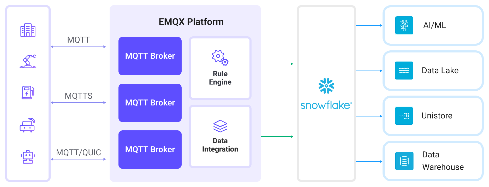

# SnowflakeへのMQTTデータ取り込み

[Snowflake](https://www.snowflake.com/en/) は、クラウドベースのデータプラットフォームであり、高いスケーラビリティと柔軟性を備えたデータウェアハウジング、分析、セキュアなデータ共有のソリューションを提供します。構造化データおよび半構造化データの処理に優れており、大量のデータを高速なクエリ性能で保存し、さまざまなツールやサービスとのシームレスな統合を実現しています。

本ページでは、EMQXとSnowflake間のデータ統合について詳しく解説し、ルールとSinkの作成方法について実践的なガイダンスを提供します。

## 動作概要

EMQXにおけるSnowflakeデータ統合は、すぐに利用可能な機能であり、複雑なIoTビジネスワークフローを簡単にサポートできるように構成可能です。典型的なIoTアプリケーションでは、EMQXがデバイス接続とメッセージ送信を担当するIoTプラットフォームとして機能し、Snowflakeはメッセージデータの取り込み、保存、分析を行うデータストレージおよび処理プラットフォームとして機能します。



EMQXはルールエンジンとSinkを利用してデバイスイベントやデータをSnowflakeに転送します。エンドユーザーやアプリケーションはSnowflakeのテーブル内のデータにアクセスできます。具体的なワークフローは以下の通りです：

1. **デバイスのEMQXへの接続**：IoTデバイスはMQTTプロトコルで正常に接続するとオンラインイベントをトリガーします。このイベントにはデバイスID、送信元IPアドレスなどの識別情報が含まれます。

2. **デバイスメッセージのパブリッシュと受信**：デバイスは特定のトピックを通じてテレメトリやステータスデータをパブリッシュします。EMQXはメッセージを受信し、ルールエンジン内で比較処理を行います。

3. **ルールエンジンによるメッセージ処理**：組み込みのルールエンジンは、トピックマッチングに基づき特定のソースからのメッセージやイベントを処理します。対応するルールにマッチしたメッセージやイベントに対して、データフォーマット変換、特定情報のフィルタリング、コンテキスト情報の付加などの処理を行います。

4. **Snowflakeへの書き込み**：ルールはメッセージデータをSnowflakeに書き込むアクションをトリガーします。メッセージをファイルにバッチングしてStageとPipe経由でロードする方法（集約モード）か、Snowpipe Streaming APIを使って直接ストリーミングする方法（ストリーミングモード）があります。

イベントやメッセージデータがSnowflakeに書き込まれた後、以下のようなビジネスおよび技術的用途に利用可能です：

- **データアーカイブ**：IoTデータをSnowflakeに安全に長期保存し、コンプライアンスや履歴データの利用を確保します。
- **データ分析**：Snowflakeのデータウェアハウジングおよび分析機能を活用し、リアルタイムまたはバッチ分析を行い、予知保全、運用インサイト、デバイス性能評価を実現します。

## 特長と利点

EMQXのSnowflakeデータ統合を利用することで、以下の特長と利点をビジネスにもたらします：

- **メッセージ変換**：Snowflakeに書き込む前にEMQXルール内でメッセージを大幅に処理・変換でき、後続の保存や利用を容易にします。
- **柔軟なデータ操作**：Snowflake Sinkは、書き込むフィールドを選択可能で、ビジネスニーズに応じた効率的かつ動的なストレージ構成を実現します。
- **統合されたビジネスプロセス**：Snowflake Sinkにより、デバイスデータをSnowflakeの豊富なエコシステムアプリケーションと組み合わせ、データ分析やアーカイブなど多様なビジネスシナリオを可能にします。
- **低コストの長期保存**：Snowflakeのスケーラブルなストレージ基盤は、従来のデータベースより低コストで長期データ保持に最適であり、大量のIoTデータ保存に適しています。

これらの特長により、効率的で信頼性の高いスケーラブルなIoTアプリケーションを構築し、ビジネスの意思決定や最適化に役立てることができます。

## はじめる前に

このセクションでは、EMQXでSnowflake Sinkを作成する前の準備について説明します。

### 前提条件

- EMQXの[ルール](./rules.md)および[データ統合](./data-bridges.md)の概念理解
- 管理者権限を持つSnowflakeアカウント

### アップロードモードの選択

::: tip

モードを先に選択してください。これによりEMQXおよびSnowflake環境の設定方法が決まります。

:::

EMQXはSnowflakeへのデータ送信に以下の2つのモードをサポートしています：

| モード       | 説明                                                         | ODBC必要性    |
| ------------ | ------------------------------------------------------------ | ------------ |
| 集約（Aggregated） | EMQXはMQTTメッセージをローカルファイルにバッファリングし、Snowflakeのステージにアップロードします。`COPY INTO`文で設定されたパイプが自動的にステージファイルをターゲットテーブルにロードします。詳細は[Snowflake Snowpipeドキュメント](https://docs.snowflake.com/en/user-guide/data-load-snowpipe-intro)参照。 | 必須         |
| ストリーミング（Streaming） | Snowpipe Streaming APIを使いリアルタイムでデータを送信し、行を直接Snowflakeテーブルに書き込みます。 | 必須         |

### Snowflake ODBCドライバーの初期化

EMQXがSnowflakeと通信し効率的にデータ転送を行うためには、Snowflake Open Database Connectivity（ODBC）ドライバーのインストールと設定が必要です。このドライバーはEMQXがSnowflakeのステージにデータを書き込むための通信ブリッジとして機能し、データの適切なフォーマット、認証、転送を保証します。

詳細は公式の[ODBCドライバー](https://docs.snowflake.com/en/developer-guide/odbc/odbc)ページおよび[ライセンス契約](https://sfc-repo.snowflakecomputing.com/odbc/Snowflake_ODBC_Driver_License_Agreement.pdf)を参照してください。

#### LinuxでのSnowflake ODBCドライバー初期化

EMQXはDebian系（Ubuntuなど）向けにSnowflake ODBCドライバーの迅速な導入と必要なシステム設定を行う[インストールスクリプト](https://github.com/emqx/emqx/blob/master/scripts/install-snowflake-driver.sh)を提供しています。

::: tip 注意

このスクリプトはテスト用であり、本番環境でのODBCドライバー設定方法の推奨ではありません。公式の[Linux向けインストール手順](https://docs.snowflake.com/en/developer-guide/odbc/odbc-linux)を参照してください。

:::

**インストールスクリプトの実行**

`scripts/install-snowflake-driver.sh`をローカルにコピーし、`chmod a+x`で実行権限を付与後、`sudo`で実行します：

```bash
chmod a+x scripts/install-snowflake-driver.sh
sudo ./scripts/install-snowflake-driver.sh
```

スクリプトはSnowflake ODBCの`.deb`インストールパッケージ（例：`snowflake-odbc-3.4.1.x86_64.deb`）をカレントディレクトリにダウンロードし、ドライバーをインストール、以下のシステム設定ファイルを更新します：

- `/etc/odbc.ini`：Snowflakeデータソース設定を追加
- `/etc/odbcinst.ini`：Snowflakeドライバーパスを登録

**設定例**

`/etc/odbc.ini`の内容確認：

```
emqx@emqx-0:~$ cat /etc/odbc.ini

[snowflake]
Description=SnowflakeDB
Driver=SnowflakeDSIIDriver
Locale=en-US
PORT=443
SSL=on

[ODBC Data Sources]
snowflake = SnowflakeDSIIDriver
```

`/etc/odbcinst.ini`の内容確認：

```
emqx@emqx-0:~$ cat /etc/odbcinst.ini

[ODBC Driver 18 for SQL Server]
Description=Microsoft ODBC Driver 18 for SQL Server
Driver=/opt/microsoft/msodbcsql18/lib64/libmsodbcsql-18.5.so.1.1
UsageCount=1

[ODBC Driver 17 for SQL Server]
Description=Microsoft ODBC Driver 17 for SQL Server
Driver=/opt/microsoft/msodbcsql17/lib64/libmsodbcsql-17.10.so.6.1
UsageCount=1

[SnowflakeDSIIDriver]
APILevel=1
ConnectFunctions=YYY
Description=Snowflake DSII
Driver=/usr/lib/snowflake/odbc/lib/libSnowflake.so
DriverODBCVer=03.52
SQLLevel=1
UsageCount=1
```

#### macOSでのSnowflake ODBCドライバー初期化

macOSでSnowflake ODBCドライバーをインストール・設定する手順は以下の通りです：

1. unixODBCをインストール（例）：

   ```
   brew install unixodbc
   ```

2. [iODBCをダウンロード・インストール](https://github.com/openlink/iODBC/releases/download/v3.52.16/iODBC-SDK-3.52.16-macOS11.dmg)。

3. [Snowflake ODBCドライバーをダウンロード・インストール](https://sfc-repo.snowflakecomputing.com/odbc/macuniversal/3.3.2/snowflake_odbc_mac_64universal-3.3.2.dmg)。

4. 詳細なインストール・設定手順は[macOS向けODBCドライバーのインストールと設定](https://docs.snowflake.com/en/developer-guide/odbc/odbc-mac)を参照。

5. インストール後、以下の設定ファイルを更新：

   - Snowflake ODBCドライバーの権限と設定を更新：

     ```bash
     chown $(id -u):$(id -g) /opt/snowflake/snowflakeodbc/lib/universal/simba.snowflake.ini
     echo 'ODBCInstLib=libiodbcinst.dylib' >> /opt/snowflake/snowflakeodbc/lib/universal/simba.snowflake.ini
     ```

   - `~/.odbc.ini`ファイルを作成または更新し、ODBC接続を設定：

     ```
     cat << EOF > ~/.odbc.ini
     [ODBC]
     Trace=no
     TraceFile=

     [ODBC Drivers]
     Snowflake = Installed

     [ODBC Data Sources]
     snowflake = Snowflake

     [Snowflake]
     Driver = /opt/snowflake/snowflakeodbc/lib/universal/libSnowflake.dylib
     EOF
     ```

### ユーザーアカウント作成とSnowflakeリソースの設定

アップロードモードに関わらず、Snowflake環境でユーザーアカウント、データベース、関連リソースを設定し、データ取り込み用の準備を行う必要があります。以下の認証情報は後にEMQXのコネクターおよびSink設定で使用します：

| 項目名                 | 値                                               | 説明                                                         |
| ---------------------- | ------------------------------------------------ | ------------------------------------------------------------ |
| データソース名（DSN）  | `snowflake`（集約モードのみ）                    | `/etc/odbc.ini`に設定したODBC DSN。集約アップロードで使用。  |
| ユーザー名             | `snowpipeuser`                                   | Snowflake接続認証に使用するユーザー。適切な権限を持つ必要あり。|
| パスワード             | `Snowpipeuser99`                                 | キーペア認証使用時は省略可能。                                |
| データベース名         | `testdatabase`                                   | 対象テーブルが存在するSnowflakeデータベース名。              |
| スキーマ               | `public`                                         | データベース内のスキーマ名。テーブルやパイプが存在する場所。  |
| ステージ（集約モード） | `emqx`                                           | データ取り込み前にファイルを保持するSnowflakeステージ名。    |
| パイプ（集約モード）   | `emqx`                                           | ステージからテーブルへデータをロードするパイプ名。            |
| パイプ（ストリーミング）| `emqxstreaming`                                  | Snowpipe Streaming API経由でデータを取り込むためのパイプ名。  |
| プライベートキー       | `file://<path to snowflake_rsa_key.private.pem>` | API認証用JWT署名に使うRSA秘密鍵のパス。                       |

#### RSAキーペアの生成（集約モードは任意）

Snowflakeは複数の認証方法をサポートしています。EMQXでの認証方法はアップロードモードと接続設定に依存します：

| アップロードモード   | 認証オプション                                               | キーペア必要性 |
| -------------------- | ------------------------------------------------------------ | ------------- |
| ストリーミング（HTTPS）| RSAキーペア＋JWT（唯一のサポート方法）                       | 必須          |
| 集約（ODBC）          | ユーザー名/パスワード（DSNまたはEMQX経由）<br>RSAキーペア＋JWT（任意、EMQX設定のみ） | 任意          |

キーペア認証はストリーミングモードでのみ必須で、EMQXはJWTを署名してSnowflake Streaming APIに安全に認証します。

集約モードではユーザー名/パスワードまたはRSAキーペアのいずれかを使用可能です。認証情報の提供方法は以下のいずれかです：

- ダッシュボードのEMQXコネクター設定に直接ユーザー名とパスワードを入力
- キーペア認証を使用する場合は秘密鍵のパスを指定
- いずれも設定しない場合は、システムのODBC DSN（Linuxなら`/etc/odbc.ini`、macOSなら`~/.odbc.ini`）に正しく設定されていることを確認

::: tip

認証にはパスワードかプライベートキーのいずれかを使用し、両方を同時に使わないでください。

EMQXにどちらも設定されていない場合、コネクターは`/etc/odbc.ini`の認証情報を使用します。

:::

**例：ユーザー名/パスワードを含む`/etc/odbc.ini`**

```ini
[snowflake]
Driver=SnowflakeDSIIDriver
Server=<account>.snowflakecomputing.com
UID=snowpipeuser
PWD=Snowpipeuser99
Database=testdatabase
Schema=public
Warehouse=compute_wh
Role=snowpipe
```

> この方法により、EMQXは認証情報を直接含めずにDSN（`snowflake`）を参照できます。

**キーペア認証を使用する場合**

RSAキーペア認証を選択または必須の場合（例：ストリーミングモード）、以下のコマンドで鍵を生成し設定します：

```bash
# 秘密鍵の生成
openssl genrsa 2048 | openssl pkcs8 -topk8 -inform PEM -out snowflake_rsa_key.private.pem -nocrypt

# 公開鍵の生成
openssl rsa -in snowflake_rsa_key.private.pem -pubout -out snowflake_rsa_key.public.pem
```

EMQXがキーペア認証を使用する場合（集約・ストリーミング両モード対応）：

- EMQXは秘密鍵でJWTに署名し、安全で検証可能なIDトークンとして機能させます。
- Snowflakeは公開鍵でトークンの署名を検証します。

詳細は[キーペア認証とキーペアローテーション](https://docs.snowflake.com/en/user-guide/key-pair-auth)を参照してください。

#### SQLでSnowflakeリソースを設定

RSAキーペア生成後、SQLコマンドで`aggregated`または`streaming`取り込み用のSnowflakeオブジェクトを作成します。

対象は以下を含みます：

- データベースとテーブルの作成
- ステージとパイプの作成（集約用）
- ストリーミングパイプの作成（ストリーミング用）
- ユーザーとロールの作成および権限付与

1. SnowflakeコンソールのSQLワークシートで以下のSQLを実行し、データベース、テーブル、ステージ、パイプを作成します：

   ```sql
   USE ROLE accountadmin;

   -- データ保存用データベースの作成（存在しない場合）
   CREATE DATABASE IF NOT EXISTS testdatabase;

   -- MQTTデータ受け取り用テーブルの作成
   CREATE OR REPLACE TABLE testdatabase.public.emqx (
       clientid STRING,
       topic STRING,
       payload STRING,
       publish_received_at TIMESTAMP_LTZ
   );

   -- ファイルアップロード用Snowflakeステージの作成（集約モードのみ）
   CREATE STAGE IF NOT EXISTS testdatabase.public.emqx
   FILE_FORMAT = (TYPE = CSV PARSE_HEADER = TRUE FIELD_OPTIONALLY_ENCLOSED_BY = '"')
   COPY_OPTIONS = (ON_ERROR = CONTINUE PURGE = TRUE);

   -- ステージからのコピーを行うパイプの作成（集約モード）
   CREATE PIPE IF NOT EXISTS testdatabase.public.emqx AS
   COPY INTO testdatabase.public.emqx
   FROM @testdatabase.public.emqx
   MATCH_BY_COLUMN_NAME = CASE_INSENSITIVE;

   -- ストリーミングモード用パイプの作成（直接取り込み）
   CREATE PIPE IF NOT EXISTS testdatabase.public.emqxstreaming AS
   COPY INTO testdatabase.public.emqx (
       clientid,
       topic,
       payload,
       publish_received_at
   )
   FROM (
       SELECT
           $1:clientid::STRING,
           $1:topic::STRING,
           $1:payload::STRING,
           $1:publish_received_at::TIMESTAMP_LTZ
       FROM TABLE(DATA_SOURCE(TYPE => 'STREAMING'))
   );

   ```

   - パイプ内の`COPY INTO`により、Snowflakeはステージまたはストリームされたデータを自動的にテーブルにロードします。
   - ストリーミングパイプの`$1:field`構文は、EMQX経由で取り込んだJSONペイロードからフィールドを抽出します。

2. EMQX認証用の専用ユーザー（例：`snowpipeuser`）を作成し、そのユーザーにRSA公開鍵をバインドします：

   ```sql
   -- ユーザーアカウント作成
   CREATE USER IF NOT EXISTS snowpipeuser
       PASSWORD = 'Snowpipeuser99'
       MUST_CHANGE_PASSWORD = FALSE;

   -- RSA公開鍵のバインド
   ALTER USER snowpipeuser SET RSA_PUBLIC_KEY = '
   <YOUR_PUBLIC_KEY_CONTENTS_LINE_1>
   <YOUR_PUBLIC_KEY_CONTENTS_LINE_2>
   <YOUR_PUBLIC_KEY_CONTENTS_LINE_3>
   <YOUR_PUBLIC_KEY_CONTENTS_LINE_4>
   ';
   ```

   ::: tip

   PEMファイルの`-----BEGIN PUBLIC KEY-----`および`-----END PUBLIC KEY-----`の行は削除し、残りの内容を改行を維持して含めてください。

   :::

   この鍵はSnowflakeユーザーにアップロードされ、Snowflake内に保存されます。

3. ユーザーに必要なロールを作成し、Snowflakeリソース管理権限を付与します：

   ```sql
   CREATE OR REPLACE ROLE snowpipe;

   -- データベースとスキーマの使用権限付与
   GRANT USAGE ON DATABASE testdatabase TO ROLE snowpipe;
   GRANT USAGE ON SCHEMA testdatabase.public TO ROLE snowpipe;
   GRANT INSERT, SELECT ON testdatabase.public.emqx TO ROLE snowpipe;

   -- 集約モード用にステージとパイプの権限付与
   GRANT READ, WRITE ON STAGE testdatabase.public.emqx TO ROLE snowpipe;
   GRANT OPERATE, MONITOR ON PIPE testdatabase.public.emqx TO ROLE snowpipe;

   -- ストリーミングモード用にストリーミングパイプの権限付与
   GRANT OPERATE, MONITOR ON PIPE testdatabase.public.emqxstreaming TO ROLE snowpipe;

   -- ユーザーにロールを割り当て、デフォルトに設定
   GRANT ROLE snowpipe TO USER snowpipeuser;
   ALTER USER snowpipeuser SET DEFAULT_ROLE = snowpipe;
   ```

## 集約モード用Snowflakeコネクターの作成

Snowflake Sinkで集約アップロードモードを使用する場合、Snowflake環境との接続を確立するためにSnowflakeコネクターを作成する必要があります。このコネクターはODBC（DSN経由）を使用し、ステージを介して接続します。

1. ダッシュボードの **Integration** -> **Connector** ページに移動します。

2. 右上の **Create** ボタンをクリックします。

3. コネクタータイプで **Snowflake** を選択し、次へ進みます。

4. コネクター名を英数字の組み合わせで入力します。ここでは `my-snowflake` とします。

5. 接続情報を入力します。

   - **Server Host**：SnowflakeのエンドポイントURL。通常は `<Your Snowflake Organization ID>-<Your Snowflake Account Name>.snowflakecomputing.com` の形式です。`<Your Snowflake Organization ID>-<Your Snowflake Account Name>` はSnowflakeインスタンス固有のサブドメインに置き換えてください。

   - **Account**：Snowflakeの組織IDとアカウント名をハイフン（`-`）で区切って入力します。SnowflakeコンソールのURLに含まれています。

   - **Data Source Name (DSN)**：ODBCドライバー設定時に`.odbc.ini`で設定した`snowflake`を入力します。

   - **Username**：前述の設定で作成した`snowpipeuser`を入力します。

   - **Password**：ODBC経由でユーザー名/パスワード認証する場合のパスワード。任意入力です：

     - ここにパスワード（例：`Snowpipeuser99`）を入力するか、

     - `/etc/odbc.ini`に設定するか、

     - キーペア認証を使う場合は空欄にします。

       ::: tip

       認証にはパスワードかプライベートキーのいずれかを使用し、両方を同時に使わないでください。ここに設定がない場合は`/etc/odbc.ini`の認証情報を使用します。

       :::

   - **Private Key Path**：ODBC経由でSnowflake認証に使用するRSA秘密鍵の絶対パス。クラスター内の全ノードで同一パスである必要があります。例：`/etc/emqx/certs/snowflake_rsa_key.private.pem`。

   - **Private Key Password**：秘密鍵ファイルが暗号化されている場合の復号パスワード。OpenSSLの`-nocrypt`オプションで生成した鍵は空欄にします。

   - **Proxy**：HTTPプロキシ経由でSnowflakeに接続する設定。HTTPSプロキシは非対応。デフォルトはプロキシなし。プロキシを使う場合は`Enable Proxy`を選択し、以下を入力：

     - **Proxy Host**：プロキシサーバーのホスト名またはIPアドレス。

     - **Proxy Port**：プロキシサーバーのポート番号。

6. 暗号化接続を有効にする場合は **Enable TLS** トグルをオンにします。TLS接続の詳細は[外部リソースアクセスのTLS](../../guides/network/overview.md#tls-for-external-resource-access)を参照してください。ストリーミングモードではHTTPS通信のためTLS必須です。

7. 詳細設定（任意）：[詳細設定](#advanced-settings)を参照してください。

8. **Create**をクリックする前に、**Test Connectivity**でSnowflakeへの接続確認が可能です。

9. **Create**ボタンをクリックしてコネクター作成を完了します。

これでコネクター作成が完了し、ルールとSinkを作成してSnowflakeへの書き込みを指定できます。

## ストリーミングモード用Snowflakeコネクターの作成

Snowflake Sinkでストリーミングアップロードモードを使用する場合、Snowflake環境との接続を確立するためにSnowflakeストリーミングコネクターを作成します。このコネクターはHTTPSおよびSnowpipe Streaming REST APIを使用します。

1. ダッシュボードの **Integration** -> **Connector** ページに移動します。

2. 右上の **Create** ボタンをクリックします。

3. コネクタータイプで **Snowflake Streaming** を選択し、次へ進みます。

4. コネクター名を英数字の組み合わせで入力します。ここでは `my-snowflake-streaming` とします。

5. 接続情報を入力します。

   - **Server Host**：SnowflakeのエンドポイントURL。通常は `<Your Snowflake Organization ID>-<Your Snowflake Account Name>.snowflakecomputing.com` の形式です。`<Your Snowflake Organization ID>-<Your Snowflake Account Name>` はSnowflakeインスタンス固有のサブドメインに置き換えてください。

   - **Account**：Snowflakeの組織IDとアカウント名をハイフン（`-`）で区切って入力します。SnowflakeコンソールのURLに含まれています。

   - **Pipe User**：対象パイプを操作する権限を持つSnowflakeユーザー名（例：`snowpipeuser`）。ロールには最低でも`OPERATE`と`MONITOR`権限が必要です。

   - **Private Key Path**：EMQXがJWT署名に使用するRSA秘密鍵。PEM形式の秘密鍵全文を文字列として貼り付けるか、`file://`で始まる秘密鍵ファイルのパスを指定します。例：`file:///etc/emqx/certs/snowflake_rsa_key.private.pem`。

   - **Private Key Password**：秘密鍵ファイルが暗号化されている場合の復号パスワード。OpenSSLの`-nocrypt`オプションで生成した鍵は空欄にします。

   - **Proxy**：HTTPプロキシ経由でSnowflakeに接続する設定。HTTPSプロキシは非対応。デフォルトはプロキシなし。プロキシを使う場合は`Enable Proxy`を選択し、以下を入力：

     - **Proxy Host**：プロキシサーバーのホスト名またはIPアドレス。

     - **Proxy Port**：プロキシサーバーのポート番号。

6. 暗号化接続を有効にする場合は **Enable TLS** トグルをオンにします。TLS接続の詳細は[外部リソースアクセスのTLS](../../guides/network/overview.md#tls-for-external-resource-access)を参照してください。ストリーミングモードではHTTPS通信のためTLS必須です。

7. 詳細設定（任意）：[詳細設定](#advanced-settings)を参照してください。

8. **Create**をクリックする前に、**Test Connectivity**でSnowflakeへの接続確認が可能です。

9. **Create**ボタンをクリックしてコネクター作成を完了します。

これでコネクター作成が完了し、ルールとSinkを作成してSnowflakeへの書き込みを指定できます。

## Snowflake Sinkを使ったルールの作成

このセクションでは、EMQXでルールを作成し、メッセージ（例：ソースMQTTトピック`t/#`）を処理して、処理結果を設定済みのSnowflake Sinkを通じてSnowflakeに書き込む方法を示します。

### SQLを定義したルールの作成

1. ダッシュボードの **Integration** -> **Rules** ページに移動します。

2. 右上の **Create** ボタンをクリックします。

3. ルールIDに `my_rule` を入力し、SQLエディターに以下のルールSQLを入力します：

   ```sql
   SELECT
     clientid,
     unix_ts_to_rfc3339(publish_received_at, 'millisecond') as publish_received_at,
     topic,
     payload
   FROM
       "t/#"
   ```

   ::: tip

   SQLに不慣れな場合は、**SQL Examples**をクリックし、**Enable Debug**を有効にしてルールSQLの結果を学習・テストできます。

   :::
   ::: tip

   Snowflake連携では、選択するフィールドはSnowflakeのテーブルのカラム数および名前と完全に一致させる必要があります。余分なフィールドを追加したり`*`で選択したりしないでください。

   :::

4. ルールにアクションを追加し、Sinkを設定します。
   - 集約アップロードモードでSnowflakeに書き込む場合は、[集約アップロードモードでSnowflake Sinkを追加](#add-snowflake-sink-with-aggregated-upload-mode)を参照してください。
   - ストリーミングアップロードモードでSnowflakeに書き込む場合は、[ストリーミングアップロードモードでSnowflake Sinkを追加](#add-snowflake-sink-with-streaming-upload-mode)を参照してください。
5. アクション追加後、**Action Outputs**セクションに新しいSinkが表示されます。**Create Rule**ページで**Save**ボタンをクリックし、ルール作成を完了します。

これでルール作成が完了し、**Rules**ページで新規ルールを確認でき、**Actions (Sink)**タブで新しいSnowflake Sinkを確認できます。

また、**Integration** -> **Flow Designer**をクリックするとトポロジーが表示され、トピック`t/#`のメッセージがルール`my_rule`で解析され、Snowflakeに書き込まれる様子を視覚的に確認できます。

### 集約アップロードモードでSnowflake Sinkを追加

このセクションでは、集約アップロードモードで処理結果をSnowflakeに書き込むSinkをルールに追加する方法を示します。このモードは複数のルールトリガー結果を1つのファイル（例：CSVファイル）にまとめてSnowflakeにアップロードし、ファイル数を削減し書き込み効率を向上させます。

1. **Create Rule**ページの**Action Outputs**セクションで**Add Action**をクリックし、ルールにアクションを追加します。

2. **Action Type**ドロップダウンから`Snowflake`を選択し、**Action**はデフォルトの`Create Action`のままか、既存のSnowflakeアクションを選択します。ここでは新規Sinkを作成しルールに追加します。

3. Sinkの名前（例：`snowflake_sink`）と簡単な説明を入力します。

4. **Connectors**ドロップダウンから先に作成した`my-snowflake`コネクターを選択します。ドロップダウン横の作成ボタンをクリックしてポップアップで新規コネクター作成も可能です。必要な設定パラメータは[集約モード用Snowflakeコネクターの作成](#create-a-snowflake-connector-for-aggregated-mode)を参照してください。

5. 集約アップロードモードの設定を行います。

   - **Database Name**：`testdatabase`を入力。EMQXデータ保存用に作成したSnowflakeデータベース名です。
   - **Schema**：`public`を入力。`testdatabase`内のデータテーブルがあるスキーマ名です。
   - **Stage**：`emqx`を入力。Snowflakeでデータを保持するステージ名です。
   - **Pipe**：`emqx`を入力。ステージからテーブルへのロードを自動化するパイプ名です。
   - **Pipe User**：`snowpipeuser`を入力。パイプ管理権限を持つSnowflakeユーザー名です。
   - **Private Key**：パイプユーザーがSnowflakeパイプに安全にアクセスするためのRSA秘密鍵。以下のいずれかの形式で指定可能：
     - **プレーンテキスト**：PEM形式の秘密鍵全文を文字列として直接貼り付け。
     - **ファイルパス**：`file://`で始まる秘密鍵ファイルのパスを指定。クラスター内の全ノードで同一パスかつEMQXアプリケーションユーザーがアクセス可能である必要があります。例：`file:///etc/emqx/certs/snowflake_rsa_key.private.pem`。
   - **Private Key Password**：秘密鍵ファイルが暗号化されている場合の復号パスワード。OpenSSLの`-nocrypt`オプションで生成した鍵は空欄にします。

   - **Aggregation Upload Format**：現在は`csv`のみサポート。データはカンマ区切りCSV形式でSnowflakeにステージされます。
   - **Column Order**：ドロップダウンからカラムの並び順を選択。生成されるCSVファイルは選択したカラム順にソートされ、未選択カラムはアルファベット順にソートされます。
   - **Max Records**：集約トリガーとなる最大レコード数。例：`1000`に設定すると1000件集まった時点でアップロードし、時間間隔をリセットします。
   - **Time Interval**：集約が発生する時間間隔（秒）。例：`60`に設定すると最大レコード数に達していなくても60秒ごとにアップロードし、最大レコード数をリセットします。
   - **Proxy**：HTTPプロキシ経由でSnowflakeに接続する設定。HTTPSプロキシは非対応。デフォルトはプロキシなし。プロキシを使う場合は`Enable Proxy`を選択し、以下を入力：
     - **Proxy Host**：プロキシサーバーのホスト名またはIPアドレス。
     - **Proxy Port**：プロキシサーバーのポート番号。

6. **フォールバックアクション（任意）**：メッセージ配信失敗時の信頼性向上のため、1つ以上のフォールバックアクションを定義可能です。プライマリSinkがメッセージ処理に失敗した場合にトリガーされます。詳細は[フォールバックアクション](./data-bridges.md#fallback-actions)を参照してください。

7. **詳細設定**を展開し、必要に応じて詳細設定オプションを構成します（任意）。詳細は[詳細設定](#advanced-settings)を参照してください。

8. **Create**をクリックする前に、**Test Connectivity**でSnowflakeサーバーへの接続確認が可能です。

9. **Create**ボタンをクリックしてSink作成を完了します。作成成功後、ルール作成画面に戻り、新しいSinkがルールアクションに追加されます。

### ストリーミングアップロードモードでSnowflake Sinkを追加

このセクションでは、ストリーミングアップロードモードで処理結果をSnowflakeに書き込むSinkをルールに追加する方法を示します。このモードはSnowpipe Streaming APIを使ったリアルタイム取り込みを可能にします。

1. **Create Rule**ページの**Action Outputs**セクションで**Add Action**をクリックし、ルールにアクションを追加します。

2. **Action Type**ドロップダウンから`Snowflake Streaming`を選択し、**Action**はデフォルトの`Create Action`のままか、既存のSnowflakeアクションを選択します。ここでは新規Sinkを作成しルールに追加します。

3. Sinkの名前（例：`snowflake_sink_streaming`）と簡単な説明を入力します。

4. コネクターのドロップダウンから先に作成した`my-snowflake-streaming`コネクターを選択します。ドロップダウン横の作成ボタンをクリックしてポップアップで新規コネクター作成も可能です。必要な設定パラメータは[ストリーミングモード用Snowflakeコネクターの作成](#create-a-snowflake-streaming-connector)を参照してください。

5. ストリーミングアップロードモードの設定を行います。

   - **Database Name**：`testdatabase`を入力。EMQXデータ保存用に作成したSnowflakeデータベース名です。
   - **Schema**：`public`を入力。`testdatabase`内のデータテーブルがあるスキーマ名です。
   - **Pipe**：`emqxstreaming`を入力。SQLで作成したSnowflakeストリーミングパイプ名。Snowflakeで定義した名前と完全一致させる必要があります。
   - **HTTP Pipelining**：レスポンスを待たずに送信可能なHTTPリクエストの最大数。デフォルト：`100`。
   - **Connect Timeout**：Snowflakeへの接続確立のタイムアウト時間（秒）。デフォルト：`15`秒。
   - **Connection Pool Size**：このSinkがSnowflakeに対して維持可能な同時接続数の最大値。デフォルト：`8`。
   - **Max Inactive**：HTTPクライアントが再接続を試みるまでの最大非アクティブ時間。EMQX 6.0.4以降、リクエスト待ち状態で60秒間送信がない場合に再接続します。`Max Inactive`が60秒より長い場合はそちらが優先されます。レスポンスが60秒以上かかる可能性がある場合は、最大応答時間以上に設定してください。デフォルト：`10`秒。

6. **フォールバックアクション（任意）**：メッセージ配信失敗時の信頼性向上のため、1つ以上のフォールバックアクションを定義可能です。プライマリSinkがメッセージ処理に失敗した場合にトリガーされます。詳細は[フォールバックアクション](./data-bridges.md#fallback-actions)を参照してください。

7. **詳細設定**を展開し、必要に応じて詳細設定オプションを構成します（任意）。詳細は[詳細設定](#advanced-settings)を参照してください。

8. **Create**をクリックする前に、**Test Connectivity**でSnowflakeサーバーへの接続確認が可能です。

9. **Create**ボタンをクリックしてSink作成を完了します。作成成功後、ルール作成画面に戻り、新しいSinkがルールアクションに追加されます。

## ルールのテスト

このセクションでは、設定したルールのテスト方法を示します。

### テストメッセージのパブリッシュ

MQTTXを使い、トピック`t/1`にメッセージをパブリッシュします：

```bash
mqttx pub -i emqx_c -t t/1 -m '{ "msg": "Hello Snowflake" }'
```

複数回繰り返してテストメッセージを生成してください。

### Snowflake内のデータ確認

テストメッセージ送信後、Snowflakeにデータが正常に書き込まれたか確認します。

1. SnowflakeのWebインターフェースにログインします。

2. Snowflakeコンソールで以下のSQLクエリを実行し、ルールで書き込まれた`emqx`テーブルのデータを表示します：

   ```
   SELECT * FROM testdatabase.public.emqx;
   ```

3. 送信したテストメッセージ（例：`{ "msg": "Hello Snowflake" }`）と、トピックやタイムスタンプなどのメタデータが表示されるはずです。

## 詳細設定

このセクションでは、Snowflake Sinkの詳細設定オプションについて説明します。ダッシュボードでSinkを設定する際、**Advanced Settings**を展開し、以下のパラメータを用途に応じて調整できます。

| 項目名                         | 説明                                                         | デフォルト値   |
| ------------------------------ | ------------------------------------------------------------ | ------------- |
| **Buffer Pool Size**            | EMQXとSnowflake間のデータフローを管理するバッファワーカープロセス数を指定します。これらのワーカーはデータを一時的に保持・処理し、ターゲットサービスへの送信を最適化しスムーズなデータ転送を支えます。 | `16`          |
| **Request TTL**                 | バッファに入ったリクエストが有効とみなされる最大時間（秒）です。バッファに滞留する時間がこのTTLを超えるか、送信後にSnowflakeからの応答やアックがタイムリーに得られない場合、リクエストは期限切れとみなされます。 | `45`          |
| **Health Check Interval**       | Snowflakeとの接続状態を自動的にチェックする間隔（秒）を指定します。 | `15`          |
| **Health Check Interval Jitter**| 複数ノードが同時にヘルスチェックを実行するのを防ぐため、基本間隔に加える一様乱数遅延です。複数のActionやSourceが同じConnectorを共有する場合、ジッターを有効にするとチェックがずれて実行されます。 | `0`ミリ秒     |
| **Health Check Timeout**        | Snowflake接続の自動ヘルスチェックのタイムアウト時間（秒）を指定します。 | `60`          |
| **Max Buffer Queue Size**       | Snowflake Sinkの各バッファワーカーが一時的に保持可能な最大バイト数を指定します。バッファワーカーはデータ送信前にデータを保持し、データストリームの効率的な処理を担います。システム性能やデータ転送要件に応じて調整してください。 | `256` MB      |
| **Query Mode**                  | `synchronous`または`asynchronous`のリクエストモードを選択し、メッセージ送信を最適化します。非同期モードではSnowflakeへの書き込みがMQTTメッセージのパブリッシュをブロックしませんが、クライアントがSnowflake到達前にメッセージを受信する可能性があります。 | `Asynchronous`|
| **Batch Size**                  | EMQXからSnowflakeへ一度に送信するデータバッチの最大サイズを指定します。サイズ調整によりデータ転送の効率と性能を微調整可能です。<br />`1`に設定するとバッチ化せず個別に送信します。 | `100`         |
| **Inflight Window**             | レスポンスやアックをまだ受け取っていない進行中のリクエスト数の最大値を制御します。<br/>`Request Mode`が`asynchronous`の場合、同一MQTTクライアントからのメッセージを厳密に順序処理したい場合は`1`に設定してください。 | `100`         |
