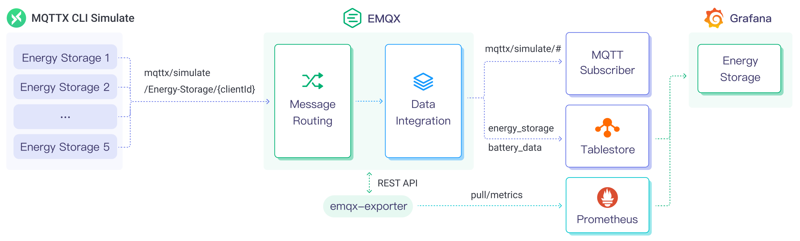
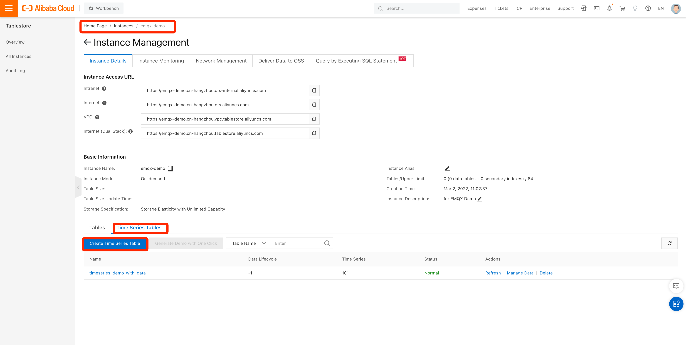
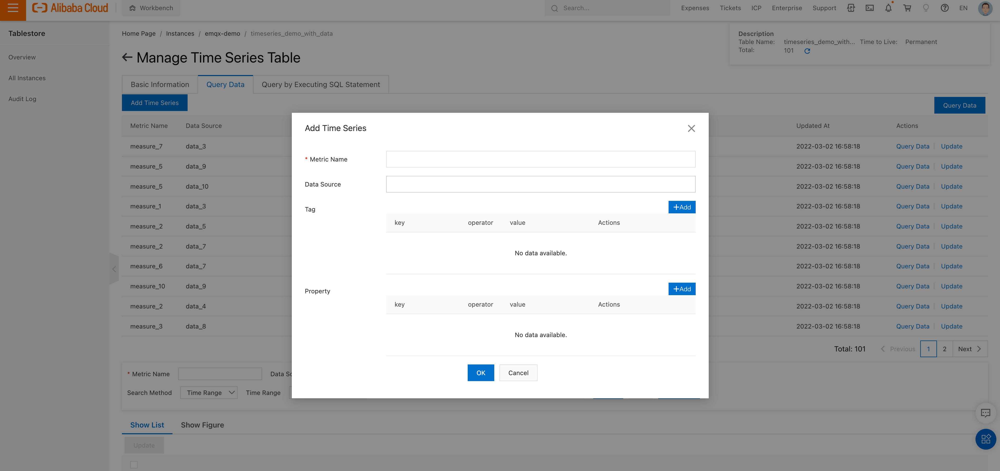
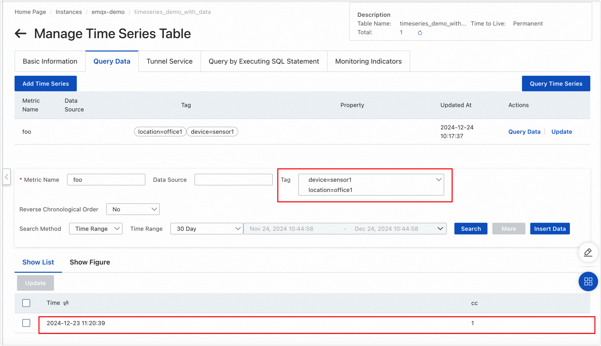

# MQTTデータをTablestoreに取り込む

[Tablestore](https://www.alibabacloud.com/en/product/table-store/pricing?spm=a3c0i.29367734.6737026690.8.78847d3fcEhuVv&_p_lc=1)は、IoTシナリオに最適化されたスケーラブルでサーバレスなデータベースです。時系列データ、構造化データ、半構造化データを管理するためのワンストップソリューションであるIoTstoreを提供しています。IoT、車載ネットワーク、リスク管理、メッセージング、レコメンデーションシステムなどのシナリオに最適です。Tablestoreは、コスト効率の高い高性能なデータストレージを提供し、ミリ秒単位のクエリや検索、柔軟なデータ分析機能を備えています。EMQXはTablestore Cloud、Tablestore OSS、Tablestore Enterpriseとシームレスに統合し、IoTユースケースにおける効率的なデータ管理を実現します。

## 動作概要

EMQXのTablestoreデータ統合は、EMQXのリアルタイムデータキャプチャおよび送信機能と、Tablestoreの高性能なデータストレージおよび分析機能をシームレスに組み合わせています。組み込みの[ルールエンジン](./rules.md)を活用することで、EMQXからTablestoreへのデータ取り込みと保存のプロセスを簡素化し、複雑なコーディングを不要にします。EMQXはルールエンジンとSinkを介してIoTデバイスのデータをTablestoreに転送し、効率的な保存と分析を可能にします。

データが保存されると、Tablestoreはレポートやチャート、その他の可視化を生成する強力な分析ツールを提供し、これらはTablestoreの可視化機能を通じてユーザーに提示されます。

以下の図は、エネルギー貯蔵シナリオにおけるEMQXとTablestore間の典型的なデータ統合アーキテクチャを示しています。



EMQXとTablestoreは、エネルギー消費データをリアルタイムに効率的に収集・分析するための拡張可能なIoTプラットフォームを提供します。このアーキテクチャでは、EMQXがIoTプラットフォームとしてデバイスのアクセス、メッセージ送信、データルーティングを担当し、Tablestoreがデータストレージおよび分析プラットフォームとしてデータの保存と分析を担います。ワークフローは以下の通りです。

1. **メッセージのパブリッシュと受信**：エネルギー貯蔵デバイスや産業用IoTデバイスはMQTTプロトコルを通じてEMQXに正常に接続し、電力消費量、入出力電力などの情報を含むエネルギー消費データを定期的にMQTTプロトコルでパブリッシュします。EMQXがこれらのメッセージを受信すると、ルールエンジン内でマッチング処理を開始します。
2. **メッセージデータの処理**：組み込みのルールエンジンを使用して、特定のソースからのメッセージをトピックマッチングに基づいて処理できます。メッセージが到着すると、ルールエンジンを通過し、対応するルールとマッチングしてメッセージデータを処理します。例えば、データ形式の変換、特定情報のフィルタリング、コンテキスト情報によるメッセージの拡充などです。
3. **Tablestoreへのデータ取り込み**：ルールエンジンで定義されたルールがメッセージをTablestoreに書き込む操作をトリガーします。Tablestore Sinkは柔軟に書き込みデータ形式を定義できる設定項目を提供し、メッセージの特定フィールドをTablestore内の対応するメジャメントやフィールドにマッピングします。

エネルギー消費データがTablestoreに書き込まれた後、以下のようなデータ分析が可能です。

- Grafanaなどの可視化ツールに接続し、データに基づくチャートを生成してエネルギー貯蔵データを表示する。
- 監視やアラートのためにビジネスシステムに接続し、エネルギー貯蔵デバイスの状態を監視する。

## 特徴と利点

Tablestoreデータ統合は以下の特徴と利点を提供します。

- **効率的なデータ処理**：EMQXは大量のIoTデバイス接続とメッセージスループットを処理可能であり、Tablestoreはデータの書き込み、保存、クエリに優れた性能を発揮します。IoTシナリオのデータ処理ニーズをシステムに過度な負荷をかけずに満たします。
- **メッセージ変換**：メッセージはEMQXルールを通じて幅広い処理や変換が可能であり、その後Tablestoreに書き込まれます。
- **スケーラビリティ**：EMQXとTablestoreはどちらもクラスター拡張に対応しており、ビジネスの成長に応じて柔軟に水平拡張が可能です。
- **豊富なクエリ機能**：Tablestoreは最適化された関数、演算子、インデックス技術を提供し、タイムスタンプ付きデータの効率的なクエリと分析を可能にし、IoT時系列データから価値ある洞察を正確に抽出します。
- **効率的なストレージ**：Tablestoreは高圧縮率のエンコード方式を採用し、ストレージコストを大幅に削減します。また、データ種別ごとに保存期間をカスタマイズでき、不要なデータがストレージを占有するのを防ぎます。

## はじめる前に

このセクションでは、Tablestoreデータ統合の作成を始める前に必要な準備、つまりデータベースインスタンスの作成や時系列テーブルの作成・管理について説明します。

::: tip

現在、Tablestoreとのデータ統合はTimeSeriesモデルのみをサポートしています。そのため、以下の手順はTimeSeriesモデルに焦点を当てています。

:::

### 前提条件

以下を事前にご確認ください。

- EMQXデータ統合の[ルール](./rules.md)の理解
- EMQXにおける[データ統合](./data-bridges.md)の仕組みの知識

### 時系列テーブルの作成

1. [Tablestoreコンソール](https://account.alibabacloud.com/login/login.htm)にログインします。
2. 時系列モデルのインスタンスを作成します。インスタンス名として `emqx-demo` などを指定します。インスタンス作成の詳細は[Tablestore公式ドキュメント](https://www.alibabacloud.com/help/en/tablestore/product-overview/activate-service-and-create-a-instance)を参照してください。
3. **インスタンス管理**ページに移動します。
4. **インスタンス詳細**タブで**時系列テーブル**を選択し、**時系列テーブルの作成**ボタンをクリックします。
5. 時系列テーブル情報を設定し、テーブル名として `timeseries_demo_with_data` などを入力し、**確認**をクリックします。



### 時系列テーブルの管理

先ほど作成した時系列テーブルを管理するには、テーブル名をクリックして**時系列テーブル管理**ページに入ります。ビジネス要件に応じて以下の手順を実行できます。

1. **データクエリ**タブをクリックします。

2. **時系列の追加**をクリックします。

   ::: tip

   このステップは任意です。時系列テーブルがまだ存在しない場合、Tablestoreはデータ書き込み時に自動的に作成するため、この例では時系列の手動操作は示していません。

   :::



## コネクターの作成

このセクションでは、SinkをTablestoreサーバーに接続するためのコネクターの作成方法を示します。

以下の手順は、EMQXとTablestoreをローカルマシンで実行していることを前提としています。TablestoreやEMQXがリモートで稼働している場合は、設定を適宜調整してください。

1. EMQXダッシュボードに入り、**Integration** -> **Connectors**をクリックします。
2. ページ右上の**Create**をクリックします。
3. **Create Connector**ページで**Tablestore**を選択し、**Next**をクリックします。
4. **Configuration**ステップで以下の情報を設定します。
   - コネクター名を入力します。英数字の組み合わせで指定してください。例：`my_tablestore`
   - Tablestoreサーバー接続情報を入力します。
     - **Endpoint**：TablestoreインスタンスのアクセスURLを入力します。これはTablestoreコンソールのインスタンス詳細ページで確認できる、Tablestoreサービスがホストされているアドレスです。デプロイ方法に応じてURLを入力してください。例：パブリックネットワークの場合は `https://emqx-demo.cn-hangzhou.ots.aliyuncs.com`
     - **Instance Name**：接続するTablestoreインスタンス名。例として作成した `emqx-demo` を使用します。
     - **Access Key ID**：Tablestore認証に使用するアクセスキーID。Alibaba Cloudから発行されたキーです。
     - **Access Key Secret**：アクセスキーIDに対応する認証用のシークレットキー。
     - **Storage Model Type**：現在は `TimeSeries` のみサポートされています。
     - **Probe Table Name**：EMQX 6.3.2以降のオプションで、EMQXが接続性チェックに使用する既存の時系列テーブルを指定できます。テーブル数が多いインスタンスでは、コネクター起動時やヘルスチェック時に全テーブルを列挙するのを避けるため推奨されます。未設定の場合、EMQXは設定されたエンドポイントに対して生のTCP接続チェックを行い、Tablestoreの認証やテーブルアクセスは検証しません。
   - **Enable TLS**：TablestoreはHTTPSエンドポイントを使用するため、通常は追加のTLS設定は不要です。EMQX 6.3.3以降では、証明書検証やTLS設定のカスタマイズにこのオプションを使用できます。有効にすると、EMQXはサーバー証明書を検証します。プライベートCA署名の場合は対応するCA証明書を設定してください。詳細は[外部リソースアクセスのTLS](../../guides/network/overview.md#tls-for-external-resource-access)を参照してください。
5. **Create**をクリックする前に、**Test Connectivity**をクリックしてコネクターがTablestoreサーバーに接続できるかテストできます。
6. ページ下部の**Create**ボタンをクリックしてコネクター作成を完了します。ポップアップダイアログで**Back to Connector List**をクリックするか、**Create Rule**をクリックしてルールとSinkの作成を続行できます。詳細は[Tablestore Sink付きルールの作成](#create-a-rule-with-tablestore-sink)を参照してください。

## Tablestore Sink付きルールの作成

このセクションでは、EMQXでソースMQTTトピック `t/#` のメッセージを処理し、処理結果を設定済みのSinkを通じてTablestoreに送信するルールの作成方法を示します。

1. EMQXダッシュボードで左側メニューの**Integration** -> **Rules**をクリックします。

2. ページ右上の**Create**をクリックします。

3. ルール作成ページで、ルールIDに `my_rule` を入力します。

4. **SQL Editor**でルールを設定します。例えば、トピック `t/#` のMQTTメッセージをTablestoreに保存したい場合、以下のSQL構文を使用できます。

   ::: tip

   独自のSQL構文を指定する場合は、後で設定するSinkのデータ形式に含まれるすべての変数が`SELECT`句に含まれていることを確認してください。

   :::

   ```sql
   SELECT
     *
   FROM
     "t/#"
   ```

   注：初心者の方は**SQL Examples**をクリックし、**Enable Test**を有効にしてSQLルールを学習・テストしてください。

5. + **Add Action**ボタンをクリックして、ルールがトリガーするアクションを定義します。このアクションにより、EMQXはルールで処理したデータをTablestoreに送信します。

6. **Type of Action**ドロップダウンリストから `Alibaba Tablestore` を選択します。**Action**はデフォルトの `Create Action` のままにします。既に作成済みのSinkがあれば選択も可能です。この例では新規Sinkを作成します。

7. Sinkの名前を入力します。英数字の組み合わせで指定してください。

8. **Connector**ドロップダウンから先ほど作成した `my_tablestore` を選択します。新規コネクターはドロップダウン横のボタンから作成可能です。設定パラメータは[コネクターの作成](#create-a-connector)を参照してください。

9. 以下の項目を設定します。

   - **Data Source**：EMQXがメッセージを取得するデータソース。処理対象のデータの起点を示します。特定のトピックやデータストリームなどが該当します。

   - **Table Name**：データを保存するTablestoreのテーブル名。先に作成したテーブル名を入力します。`${table}`のような変数を使って動的に割り当てることも可能です。

   - **Measurement**：Tablestoreで使用するメジャメント名。通常はデータの論理的なグルーピングやカテゴリを示します。例：`temperature_readings`や`sensor_data`。`${measurement}`のような変数も使用可能です。

   - **Storage Model Type**：Tablestoreで使用するデータストレージモデルの種類。現在は時系列データに最適化された `timeseries` のみサポートされています。

   - **Tags**：Tablestoreの各データエントリに関連付けられるキー・バリュー形式のタグ。メタデータやラベルとして利用でき、クエリやフィルタリングを容易にします。**Add**をクリックして複数のタグを定義可能です。例：

     | Key        | Value     |
     | ---------- | --------- |
     | `location` | `office1` |
     | `device`   | `sensor1` |

   - **Fields**：Tablestoreに送信するデータのフィールドリスト。各フィールドはTablestoreテーブルのカラムにマッピングされます。**Add**をクリックして以下を追加します。
     - **Column**：Tablestoreのカラム名。`${column_name}`のような変数を使って定義可能で、後述のメッセージペイロードのフィールド名と対応させます。
     - **Message value**：カラムに割り当てる値。`${value}`のような動的参照、`true`のようなブール値、`1.3`のような数値、バイナリデータなどが指定可能です。
     - **Is Int**：カラムが数値型の場合、EMQXはデフォルトで浮動小数点型としてTablestoreに挿入します。整数値として挿入するにはこのフラグを`true`に設定します。設定ファイル経由の場合は`${isint}`のような変数で動的指定も可能です。
     - **Is Binary**：カラムがバイナリの場合、EMQXはデフォルトで文字列型としてTablestoreに挿入します。バイナリデータとして挿入するにはこのフラグを`true`に設定します。設定ファイル経由の場合は`${isbinary}`のような変数で動的指定も可能です。

   - **Timestamp**：Tablestoreに記録されるタイムスタンプ。マイクロ秒単位の整数値で指定します。固定値の指定、文字列 `"NOW"`（メッセージ処理時にEMQXが現在時刻を動的に埋め込み）、`${microsecond_timestamp}`のような変数プレースホルダーで動的割り当てが可能です。

   - **Meta Update Model**：Tablestoreのメタデータ更新戦略を定義します。
     - `MUM_IGNORE`：メタデータの更新を無視し、競合があっても変更しません。
     - `MUM_NORMAL`：通常のメタデータ更新を行います。メタデータが存在しない場合は動的に作成してからデータを書き込みます。既存メタデータと競合する場合は上書きされる可能性があります。

10. **フォールバックアクション（任意）**：メッセージ配信失敗時の信頼性向上のため、1つ以上のフォールバックアクションを定義できます。プライマリSinkがメッセージ処理に失敗した場合にトリガーされます。詳細は[フォールバックアクション](./data-bridges.md#fallback-actions)を参照してください。

11. **詳細設定（任意）**：詳細は[詳細設定](#advanced-configurations)を参照してください。

12. **Create**をクリックする前に、**Test Connectivity**をクリックしてSinkがTablestoreサーバーに接続できるかテスト可能です。

13. **Create**をクリックしてSink作成を完了します。ルール作成ページに戻ると、**Action Outputs**タブに新しいSinkが表示されます。

14. ルール作成ページで設定内容を確認し、**Create**ボタンをクリックしてルールを生成します。

これでルールの作成が完了し、**Rule**ページに新しいルールが表示されます。**Actions(Sink)**タブをクリックすると、新しいTablestore Sinkを確認できます。

また、**Integration** -> **Flow Designer**をクリックしてトポロジーを確認できます。トピック `t/#` のメッセージがルール `my_rule` によって解析され、Tablestoreに送信・保存されていることがわかります。

## ルールのテスト

1. MQTTXを使ってトピック `t/1` にメッセージを送信し、オンライン/オフラインイベントをトリガーします。

   ```bash
   mqttx pub -i emqx_c -t t/1 -m '{ "table": "timeseries_demo_with_data", "measurement": "foo", "microsecond_timestamp": 1734924039271024, "column_name": "cc", "value": 1}'
   ```

2. Sinkの稼働状況を確認し、新規の受信メッセージと送信メッセージが1件ずつあることを確認します。

3. [Tablestoreコンソール](https://account.alibabacloud.com/login/login.htm?spm=5176.12901015-2.0.0.1a364b84fgwsH6)にアクセスし、データがTablestoreに書き込まれているか確認します。

   - **Metric Name**にメジャメント名（このデモでは `foo`）を入力します。
   - **Tag**に `location=office1` と `device=sensor1` をクエリ条件として指定し、**Search**をクリックします。

   

## 詳細設定

このセクションでは、TablestoreコネクターおよびSinkの詳細設定オプションについて説明します。ダッシュボードでコネクターやSinkを設定する際、**Advanced Settings**に移動して以下のパラメータをニーズに合わせて調整できます。

| **項目**               | **説明**                                                                                                         | **推奨値** |
| ---------------------- | ---------------------------------------------------------------------------------------------------------------- | ---------- |
| Buffer Pool Size       | EMQXとTablestore間のegressタイプのブリッジにおいて、データフロー管理のために割り当てられるバッファワーカープロセスの数を指定します。これらのワーカーは、データを送信する前に一時的に保存・処理します。パフォーマンス最適化やスムーズなデータ送信に重要です。Ingress（受信）データのみを扱うSinkでは無関係なため、"0"に設定可能です。 | `16`       |
| Request TTL            | バッファに入ったリクエストが有効とみなされる最大期間（秒）を指定します。リクエストがこの期間を超えてバッファ内にあるか、送信後にTablestoreからの応答やアック（ACK）がタイムリーに得られない場合、リクエストは期限切れとみなされます。 | `45`       |
| Health Check Interval  | SinkがTablestoreへの接続のヘルスチェックを自動的に実施する間隔（秒）を指定します。                                           | `15`       |
| Max Buffer Queue Size  | Tablestore Sinkの各バッファワーカーが一時的に保持できる最大バイト数を指定します。バッファワーカーはデータ送信前の中継役として機能し、データフローを効率的に処理します。システムの性能やデータ転送要件に応じて調整してください。 | `256`      |
| Batch Size             | EMQXからTablestoreへ一度に転送可能なデータバッチのサイズを指定します。サイズを調整することで、データ転送の効率と性能を最適化できます。                         | `1`        |
| Query Mode             | メッセージ送信の最適化のために、`asynchronous`（非同期）または`synchronous`（同期）クエリモードを選択できます。非同期モードでは、Tablestoreへの書き込みがMQTTメッセージのパブリッシュ処理をブロックしません。ただし、クライアントがTablestore到着前にメッセージを受信する可能性があります。 | `Async`    |
| Inflight Window        | 「インフライトクエリ」とは、開始されたが応答やアック（ACK）をまだ受け取っていないクエリを指します。SinkがTablestoreと通信する際に同時に存在できるインフライトクエリの最大数を制御します。<br/>**Query Mode**が`async`の場合、このパラメータは特に重要です。同一MQTTクライアントからのメッセージを厳密に順序通り処理する必要がある場合は、この値を1に設定してください。 | `100`      |
