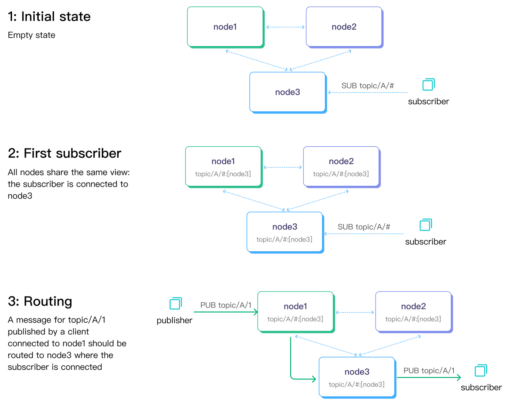
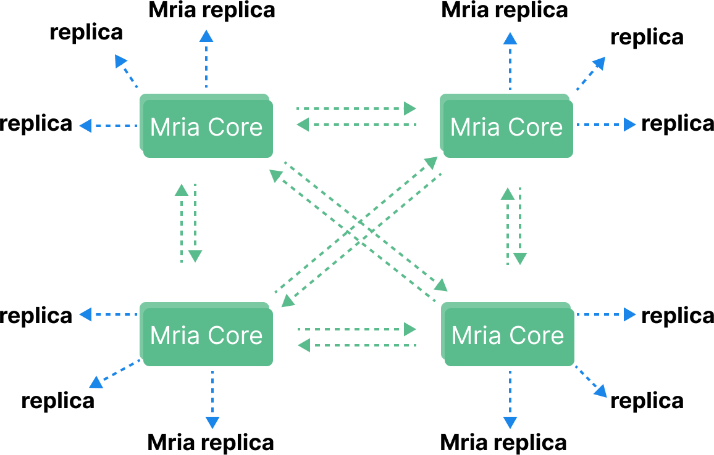

# EMQXクラスタリングの設計

MQTTはステートフルなプロトコルであり、ブローカーは各MQTTセッションの状態情報（サブスクライブされたトピックや未完了のメッセージ送信など）を保持する必要があります。MQTTブローカーのクラスタリングにおける主要な課題の一つは、これらの状態をクラスタ内のすべてのノード間で効率的かつ信頼性高く同期・複製することです。

EMQXは高いスケーラビリティとフォールトトレランスを備えたMQTTブローカーであり、複数ノードによるクラスタモードで動作可能です。EMQXのクラスタリングは、IoTメッセージングシステムのスケーラビリティ、可用性、信頼性、管理性を向上させるため、大規模またはミッションクリティカルな用途に推奨される手法です。本ページでは、MQTTブローカーのクラスタリングの必要性とEMQXがどのようにそれを実現しているかを解説し、単一クラスタ内で数百万のユニークなワイルドカードサブスクライバーをサポートする仕組みを紹介します。

EMQXクラスタの作成および運用に関する詳細な手順は、[EMQX Cluster](../cluster/introduction.md)をご参照ください。

## クラスタリングの主要なポイント

クラスタ設計において考慮すべき重要なポイントがいくつかあります。これらはクラスタの成功を左右する最も重要な要素であることが多いです。以下に簡単にまとめます。

* **集中管理**：クラスタ内のすべてのノードを単一の管理コンソールから監視・制御できること。

* **データ整合性**：クラスタ内のすべてのノードがルーティング情報の一貫したビューを持つこと。これはデータをクラスタ内の全ノードに複製することで実現されます。

* **スケールの容易さ**：クラスタ管理の複雑さを減らすため、ノードの追加は複雑な作業であってはならず、新しいノードを自動検出してクラスタに追加できること。

* **クラスタのリバランス**：最小限の運用オーバーヘッドで、各ノードの負荷の不均衡を検知し、負荷の少ないノードにワークロードを再割り当てできること。これにより、1台以上のノードが障害を起こしてもクラスタが継続稼働可能となります。

* **大規模クラスタ対応**：システムの要求増加に応じてノードを追加し、水平スケールできること。

* **自動フェイルオーバー**：ノード障害時にクラスタが自動的に検知し、残りのノードにワークロードを再割り当てできること。

* **ネットワークパーティション耐性**：ネットワークパーティションが発生してもクラスタが継続稼働可能であること。

EMQXはこれらの目標を最も効率的に達成するために多様な手法を用いています。以下のセクションでクラスタリングの主要なポイントを詳述します。

## データ複製チャネル

メタデータおよびメッセージの複製を実現するために、Erlang分散プロトコルとカスタム分散プロトコルがブローカー間のリモートプロシージャコールに利用されています。EMQXクラスタには2つのデータ複製チャネルがあります。

- メタデータ複製：どのノードがどの（ワイルドカード）トピックをサブスクライブしているかなどのルーティング情報。これは「Erlang分散」プロトコルによって実現されており、各ノードはクライアント兼サーバーとして機能します。このプロトコルのデフォルトリッスンポートは4370です。

- メッセージ配信：ノード間でメッセージを転送する際に使用されます。メッセージ配信チャネルはコネクションプールを用い、各ノードはデフォルトでポート5370（Dockerコンテナ内では5369）でリッスンします。Erlang分散プロトコルとは異なり、こちらは単一コネクションではなく複数コネクションを利用します。

下図はパブリッシュ・サブスクライブのフローを示し、破線はメタデータ複製チャネル、実線矢印はメッセージ配信チャネルを表しています。



## 組み込みデータベース

EMQXは内部データを2種類の組み込みデータベース管理システムのいずれかに保存します。

- *Mria*：軽量なインメモリデータベースで、ルーティングテーブルやランタイム設定など読み取り負荷の高いワークロードに使用されます。CAP定理の観点では*可用性*を重視した設計です。

- *Durable Storage (DS)*：ディスクベースのストリーミングデータベースで、[耐久セッション](../../guides/durability/durability_introduction.md)や[メッセージキュー](../message-queue/message-queue-concept.md)など書き込み負荷の高い大量データに使用されます。*整合性*を重視した設計です。

これら2つのデータベース管理システムは性質が大きく異なり、ネットワークパーティション時の保証内容も異なります。本ドキュメントでは主に*Mria*とEMQXの動作に焦点を当て、耐久性機能の詳細には踏み込みません。耐久ストレージに関しては[Durable Storage](./durable-storage.md)をご参照ください。

*Mria*テーブルはさらに2種類に分類されます。

- *Regular*：テーブル内容がグローバルに一様であるもの。Mriaテーブルの大半はこちら。

- *Merge*：各レコードが特定のEMQXノードに所有される特殊なテーブル。他ノードからは読み取り専用として見え、所有ノードのみが変更可能。

### ノードの役割：CoreとReplicant

Mriaは`core`と`replicant`の2種類のノード役割を持つ混合ネットワークトポロジーを採用しています。



EMQXクラスタには最低1台のCoreノードと任意の数のReplicantノードが存在します。

CoreノードはMriaの中核として機能し、*regular*テーブルの更新を調整します。これらのテーブルへの更新はCoreノード間で同期的に複製されます。調整コストが高いため、Coreノードは冗長性要件を満たす最小限の数（通常3台）に抑え、残りはReplicant役割を割り当てることが推奨されます。

Replicantノードはトランザクション処理に直接関与せず、Coreノードに接続してデータ更新を受動的に複製します。書き込み操作は許可されず、書き込み要求はCoreノードに転送されます。ReplicantはCoreノードからデータを複製するため、ローカルに完全なデータコピーを持ち、読み取り操作のレイテンシ低減に寄与します。

Replicantノードは書き込みに関与しないため、Replicantノード数が増えても書き込みレイテンシには影響しません。これにより、数十台のReplicantノードを持つ大規模クラスタ構築が可能です。

パフォーマンス向上のため、データ複製は独立したデータストリームに分割されます。複数の関連テーブルは同一のRLOG Shard（複製ログシャード）に割り当てられ、トランザクションはCoreノードからReplicantノードへ順次複製されます。異なるRLOG Shardは独立しています。

### Mergeテーブル

MergeテーブルはMriaの特殊なテーブルで、各レコードが特定のEMQXノードに明確に紐づけられます。代表例がEMQXのルーティングテーブルです。ルーティングテーブルはMQTTブローカーにおける最重要分散データ構造であり、すべてのトピックのルーティング情報を保持し、どのノードが特定トピックのメッセージを受信するかを決定します。

通常のテーブルとは異なり、すべてのEMQXノード（CoreおよびReplicant）は自身のレコードを直接更新し、他ノードとの調整は行いません。更新は非同期的にクラスタ全体へ複製されます。言い換えれば、各ノードはMergeテーブルに関してはCoreかつReplicantとして機能します。

この設計の利点は以下の通りです。

- 書き込みレイテンシの低減
- Coreノードの負荷軽減
- パーティション耐性の向上：完全に分断されたネットワークでも各ノードは自身のルートを保持可能

ネットワークパーティションが解消されると、ノードはルーティングテーブルの内容をマージします。これが名称の由来です。

## 集中管理

EMQXはクラスタ内のすべてのノードを単一の管理コンソールから監視・制御できるため集中管理が可能です。これにより多数のデバイスやメッセージの管理が容易になります。コンソールはWebブラウザからアクセスでき、ユーザーフレンドリーなインターフェースを提供します。任意の`core`タイプノードが管理用HTTP APIエンドポイントとして機能します。

オンライン設定管理機能により、ノードの再起動なしにクラスタ内の全ノードの設定変更が可能です。これはノードの追加・削除などクラスタ設定の更新に特に有用です。

## スケールの容易さ

EMQXは水平スケールが容易にできるよう設計されています。CLI、API、またはダッシュボードからいつでもノードの追加・削除が可能です。

例えば、新しいノードをクラスタに追加するには以下のようなコマンドを実行するだけです。

```bash
emqx ctl cluster join emqx@node1.my.net
```

ここで`emqx@node1.my.net`はクラスタ内の既存ノードの一つです。

またダッシュボードからボタン操作で新ノードのクラスタ参加を招待することもできます。

豊富な管理インターフェースを活用すれば、クラスタ管理をスクリプト化しDevOpsパイプラインに組み込むことも容易です。

EMQX v5では`replica`ノードはステートレス設計のため、オートスケーリンググループに配置してより良いDevOps運用が可能です。

## クラスタのリバランス

新規ノードがクラスタに参加すると、最初は空の状態から開始します。優れたロードバランサーがあれば、新規接続クライアントは新ノードに接続しやすくなりますが、既存クライアントは依然として旧ノードに接続したままです。

クライアントが短期間で再接続すればクラスタは速やかにバランスを取れますが、再接続がなければ長期間アンバランスな状態が続きます。

この問題に対処するため、EMQX（v4.4以降）は「[クラスタロードリバランシング](../../guides/cluster/rebalancing.md)」機能を導入しました。この機能により、クラスタは過負荷ノードから負荷の少ないノードへセッションを自動的に移行し、負荷をリバランスします。

リバランスの極端な例が「エバキュエーション（evacuation）」であり、特定ノードの全セッションを移行します。これはノードをクラスタから除去したい場合に有用です。

## クラスタサイズ

数百万の同時接続規模では、単一マシンでの処理は不可能なため水平スケールが必須です。

EMQX v5の`core`-`replica`クラスタリングアーキテクチャにより、より大規模なクラスタ構築が可能となりました。

ベンチマークでは23ノードクラスタで5,000万のパブリッシャーと5,000万のワイルドカードサブスクライバーを処理しました。詳細は[ブログ記事](https://www.emqx.com/en/blog/reaching-100m-mqtt-connections-with-emqx-5-0)をご覧ください。

なぜワイルドカードかというと、ワイルドカードサブスクライブはMQTTブローカークラスタのスケーラビリティを評価するゴールドスタンダードであり、基盤となるデータ構造やアルゴリズムに最大限の負荷をかけるためです。

## 自動フェイルオーバー

MQTTプロトコル仕様にはセッションアフィニティの概念がありません。つまりクライアントはクラスタ内の任意のノードに接続しても、サブスクライブしたトピックのメッセージを受信可能です。またMQTTにはサービスディスカバリ機構もないため、クライアントはクラスタノードのアドレスを知っている必要があります。通常はクラスタ内のすべてのノードのリスト、またはロードバランサーを設定します。

EMQXはクラスタ前段にロードバランサーを配置する設計です。ヘルスチェックエンドポイントにより、ロードバランサーはノードの健全性を検知し、適切なノードへクライアントをルーティングします。

Erlangのノード監視機構を利用し、EMQXノードは互いの健全性を監視し、不健全なノードを自動的にクラスタから除外します。

## ネットワークパーティション耐性

ネットワークパーティションが発生すると、クラスタは複数の孤立したサブクラスタに分割され、それぞれが唯一のアクティブクラスタと誤認する「スプリットブレイン」問題が起こります。実運用クラスタはネットワークパーティションから自動復旧可能であるべきです。

EMQXの`autoheal`機能はネットワークパーティション後のクラスタ自動修復を実現します。有効化されている場合、パーティション発生後の復旧時にクラスタ内ノードは以下の手順で修復を行います。

復旧処理はCoreノードとReplicantノードで異なります。

### Coreノードの復旧

1. ノードは最長稼働時間のリーダーノードにパーティション情報を報告します。  
2. リーダーノードはグローバルなネットワーク分断ビューを作成し、多数派のCoreノードの一つをコーディネーターに選出します。  
3. リーダーノードはコーディネーターに少数派のCoreノードに再起動を指示するよう依頼します。  
4. 少数派のCoreノードはMriaテーブルの内容を多数派の内容で置き換えます。

### Replicantノードの復旧

Replicantノードはネットワークパーティション修復時に再起動されません。これによりクライアント接続を保持可能です。

代わりに以下の処理を行います。

1. 少数派パーティションのReplicantは*regular* Mriaテーブルのレプリカを再初期化します。  
2. ルーティングテーブルの内容をマージし、多数派と少数派のノード間でルートを再確立します。  
3. クライアントはグローバルセッションレジストリへの存在を再確立します。

パーティション復旧時に生成されるログメッセージやアラームについては[MrIaログとアラーム](../../guides/observability/mria-alarms.md)をご参照ください。

## まとめ

本記事ではEMQXの新しいクラスタリングアーキテクチャを紹介しました。スケーラビリティ、自動フェイルオーバー、ネットワークパーティション耐性など、プロダクション対応MQTTブローカークラスタの主要要素と、それらを実現するEMQXの仕組みについて解説しました。
