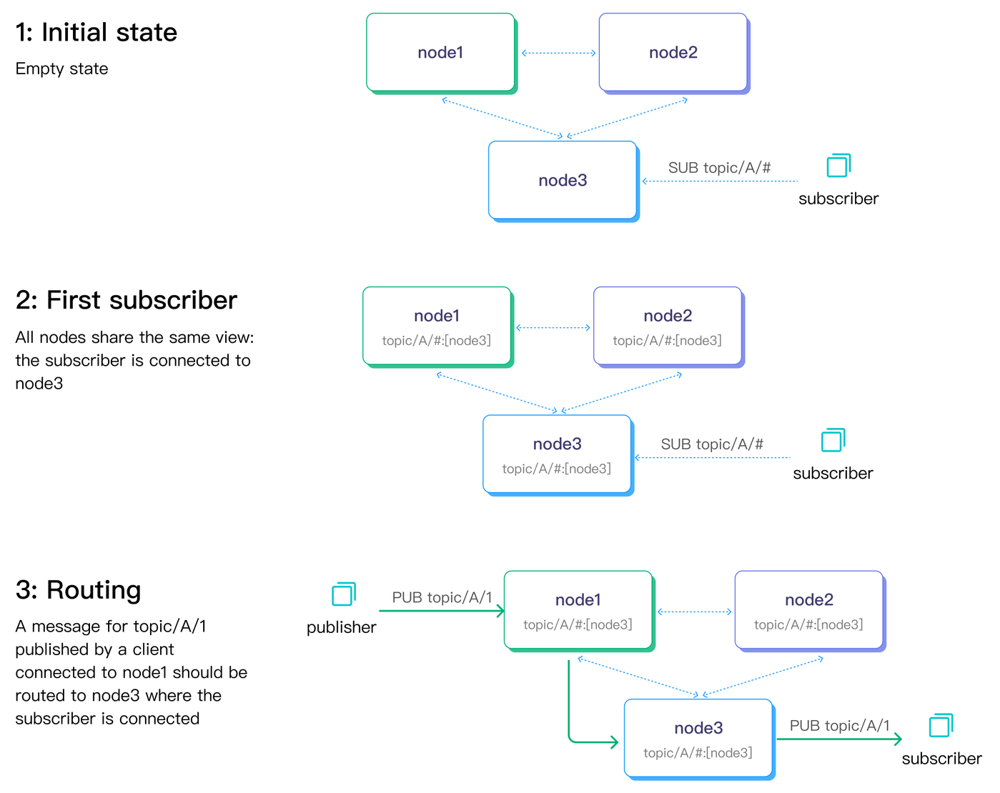
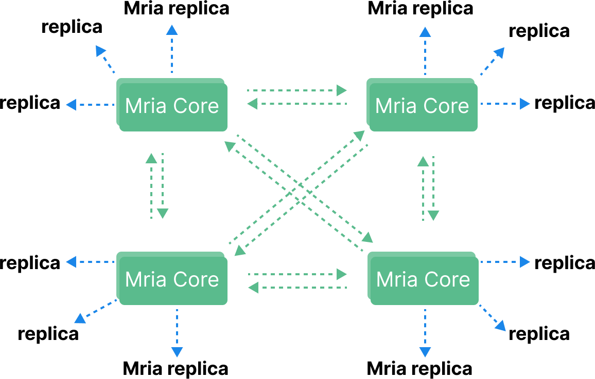

# EMQXクラスタリングの設計

MQTTはステートフルなプロトコルであり、ブローカーは各MQTTセッションの状態情報（サブスクライブされたトピックや未完了のメッセージ送信など）を保持する必要があります。MQTTブローカーのクラスタリングにおける主な課題の一つは、これらの状態をすべてのクラスタノード間で効率的かつ信頼性高く同期・複製することです。

EMQXは高いスケーラビリティとフォールトトレランスを備えたMQTTブローカーであり、複数ノードによるクラスタモードで動作可能です。EMQXのクラスタリングは、IoTメッセージングシステムのスケーラビリティ、可用性、信頼性、管理性を向上させ、大規模またはミッションクリティカルなアプリケーションに推奨されるアプローチです。本ページでは、MQTTブローカーのクラスタリングの必要性とEMQXがどのようにこれを実現し、単一クラスタ内で数百万のユニークなワイルドカードサブスクライバーをサポート可能にしているかを解説します。

EMQXクラスタの作成および運用に関する詳細な手順は、[EMQX Cluster](../cluster/introduction.md)をご参照ください。

## クラスタリングの主要な側面

クラスタ設計において考慮すべき主要な側面がいくつかあります。これらはクラスタの成功を左右する重要な要素です。簡単にまとめると以下の通りです：

* **集中管理**：クラスタ内のすべてのノードを単一の管理コンソールから監視・制御できるように、集中管理が可能であること。

* **データ整合性**：クラスタ内のすべてのノードがルーティング情報を一貫した状態で保持できるよう、データを全ノードに複製すること。

* **スケールの容易さ**：クラスタ管理の複雑さを減らすため、新しいノードの追加が複雑でなく、クラスタが自動的に新ノードを検出し追加できること。

* **クラスタ再バランス**：最小限の運用負荷で、各ノードの負荷不均衡を検知し、負荷の少ないノードに処理を再割り当てできること。これにより、1つまたは複数のノードが故障してもクラスタが継続稼働可能となる。

* **大規模クラスタサイズ**：システムの増大する要求に応じて、ノードを追加することで水平スケールが可能であること。

* **自動フェイルオーバー**：ノード障害時にクラスタが自動的に検知し、残りのノードに処理を再割り当てすること。

* **ネットワークパーティション耐性**：ネットワークパーティションが発生してもクラスタが継続稼働可能であること。

EMQXはこれらの目標を最も効率的に達成するために様々なアプローチを採用しています。以下のセクションでクラスタリングの主要な側面について詳述します。

## データ複製チャネル

メタデータおよびメッセージの複製を実現するために、Erlang分散プロトコルとカスタム分散プロトコルがブローカー間のリモートプロシージャコールに利用されています。EMQXクラスタには2つのデータ複製チャネルがあります：

- メタデータ複製：どのノードがどの（ワイルドカード）トピックをサブスクライブしているかなどのルーティング情報。これは「Erlang分散」プロトコルにより実現され、各ノードがクライアント兼サーバーとして機能します。このプロトコルのデフォルトリッスンポートは4370番です。

- メッセージ配信：ノード間でメッセージを転送する際に使用されます。メッセージ配信チャネルはコネクションプールを用い、各ノードはデフォルトで5370番ポート（Dockerコンテナ内では5369番）をリッスンします。これはErlang分散プロトコルとは異なり、後者は単一コネクションを使用します。

以下の図は、2つのデータ複製チャネルとパブサブフローを示しています。ノード間の破線はメタデータ複製を、実線矢印はメッセージ配信チャネルを表しています。



## 組み込みデータベース

EMQXは内部データを2種類の組み込みデータベース管理システムに格納します：

- *Mria*：軽量なインメモリデータベースで、ルーティングテーブルやランタイム設定など読み取り負荷の高いワークロードに使用されます。CAP定理においては*可用性*を重視した設計です。

- *Durable Storage (DS)*：ディスクベースのストリーミングデータベースで、書き込み負荷の高いワークロードや大量データ（[耐久セッション](../../guides/durability/durability_introduction.md)や[メッセージキュー](../message-queue/message-queue-concept.md)へのメッセージ送信など）に使用されます。*整合性*を重視した設計です。

これら2つのデータベース管理システムは性質が大きく異なり、ネットワークパーティション時の保証も異なります。本ドキュメントでは主に*Mria*とEMQXの動作に焦点を当て、耐久機能の詳細には触れません。耐久ストレージに関する情報は[Durable Storage](./durable-storage.md)をご参照ください。

*Mria*テーブルはさらに以下の2種類に分類されます：

- *Regular*：テーブルの内容がグローバルに一様であるもの。ほとんどのMriaテーブルはこれに該当します。

- *Merge*：各レコードが特定のEMQXノードに帰属する特殊なテーブル。レコードを所有するノードのみが書き込み可能で、他ノードからは読み取り専用として見えます。

### ノードの役割：CoreとReplicant

Mriaは`core`と`replicant`という2種類のノード役割を持つ混合ネットワークトポロジーを採用しています。



各EMQXクラスタは最低1つのCoreノードと任意数のReplicantノードを持ちます。

CoreノードはMriaのバックボーンとして機能し、*regular*テーブルの更新を調整します。これらのテーブルへの更新はCoreノードクラスタ間で同期的に複製されます。この調整にはコストがかかるため、データ冗長性要件を満たす最小限のCoreノード数に抑え、残りをReplicantに割り当てることが推奨されます。典型的なCoreノード数は3です。

Replicantノードはトランザクション処理に直接関与せず、Coreノードに接続してデータ更新を受動的に複製します。Replicantは書き込み操作を行えず、書き込み要求はCoreノードに転送されます。さらに、ReplicantはCoreノードからのデータを完全にローカルに保持するため、読み取り操作の効率が最大化され、EMQXの各種データベースクエリのレイテンシ低減に寄与します。

Replicantノードは書き込みに参加しないため、Replicantノード数が増えても書き込みレイテンシは影響を受けません。これにより、数十台のReplicantノードを持つ大規模クラスタの構築が可能です。

パフォーマンス向上のため、データ複製は独立したデータストリームに分割されます。複数の関連テーブルは同一のRLOG Shard（複製ログシャード）に割り当てられ、トランザクションはCoreノードからReplicantノードへ順次複製されます。異なるRLOG Shardは独立しています。

### Mergeテーブル

MergeテーブルはMriaの特殊なテーブルで、各レコードが特定のEMQXノードに明確に紐づきます。代表例はEMQXのルーティングテーブルです。ルーティングテーブルはMQTTブローカーにおける最重要の分散データ構造であり、すべてのトピックのルーティング情報を格納し、特定トピックにパブリッシュされたメッセージをどのノードに送るかを決定します。

通常のテーブルとは異なり、すべてのEMQXノード（CoreおよびReplicant）は自身のレコードを直接更新し、他ノードとの調整は行いません。その後、更新は非同期的にクラスタ全体に複製されます。つまり、各ノードはMergeテーブルに関してはCoreかつReplicantとして振る舞います。

この設計の利点は以下の通りです：

- 書き込みレイテンシの低減
- Coreノードの負荷軽減
- パーティション耐性の向上：完全にパーティションされたネットワークでも、各ノードは少なくとも自身のルートを保持可能

ネットワークパーティションが回復すると、ノードはルーティングテーブルの内容をマージします。これが名称の由来です。

## 集中管理

EMQXはクラスタ内のすべてのノードを単一の管理コンソールから監視・制御できるため、集中管理が可能です。これにより大量のデバイスやメッセージの管理が容易になります。コンソールはウェブブラウザからアクセス可能で、ユーザーフレンドリーなインターフェースを提供します。任意の`core`タイプノードが管理用HTTP APIエンドポイントとして機能します。

オンライン設定管理機能により、ノードの再起動なしにクラスタ内の全ノードの設定変更が可能です。これはノードの追加・削除などクラスタ設定の更新に特に有用です。

## スケールの容易さ

EMQXは水平スケールが容易にできるよう設計されています。CLI、API、またはダッシュボードからいつでもノードの追加・削除が可能です。

例えば、新しいノードをクラスタに追加するには、以下のようなコマンドを実行するだけです：

```bash
emqx ctl cluster join emqx@node1.my.net
```

ここで`emqx@node1.my.net`はクラスタ内の既存ノードの1つです。

また、ダッシュボードからボタン操作で新ノードをクラスタに招待することもできます。

豊富な管理インターフェースを活用すれば、クラスタ管理をスクリプト化し、DevOpsパイプラインの一部に組み込むことも容易です。

EMQX v5では、`replica`ノードはステートレスに設計されており、オートスケーリンググループに配置してより良いDevOps運用が可能です。

## クラスタ再バランス

新しいノードがクラスタに参加すると、初期状態は空の状態です。優れたロードバランサーがあれば、新規接続クライアントは新ノードに接続しやすくなりますが、既存クライアントは依然として旧ノードに接続し続けます。

クライアントが比較的短期間に再接続すればクラスタは迅速にバランスを取れますが、再接続がない場合は長期間アンバランスな状態が続く可能性があります。

この問題に対処するため、EMQX（バージョン4.4以降）は「[クラスタロード再バランシング](../../guides/cluster/rebalancing.md)」機能を導入しています。この機能により、クラスタは過負荷ノードから負荷の低いノードへセッションを自動的に移行し、負荷を再バランスします。

「再バランス」の極端な例が「避難（evacuation）」であり、特定ノードのすべてのセッションを移行します。これはノードをクラスタから除去したい場合に有効です。

## クラスタサイズ

数百万の同時接続規模では、単一マシンで処理することは不可能であり、水平スケールが必須です。

EMQX v5の`core`-`replica`クラスタリングアーキテクチャにより、より大規模なクラスタの構築が可能となっています。

ベンチマークでは、23ノードクラスタで5,000万のパブリッシャーと5,000万のワイルドカードサブスクライバーをテストしました。詳細は[ブログ記事](https://www.emqx.com/en/blog/reaching-100m-mqtt-connections-with-emqx-5-0)をご覧ください。

なぜワイルドカードかというと、ワイルドカードサブスクライブはMQTTブローカークラスタのスケーラビリティを評価するゴールドスタンダードであり、基盤となるデータ構造やアルゴリズムに最大の負荷をかけるためです。

## 自動フェイルオーバー

MQTTプロトコル仕様にはセッションアフィニティの概念がありません。つまり、クライアントはクラスタ内の任意のノードに接続しても、サブスクライブしたトピックのメッセージを受信可能です。また、MQTTにはサービスディスカバリ機構もないため、クライアントはクラスタノードのアドレスを知っている必要があります。通常はクラスタ内のすべてのノードのリスト、あるいはロードバランサーを設定します。

EMQXはクラスタ前段にロードバランサーを配置する設計です。ヘルスチェックエンドポイントにより、ロードバランサーはノードの健全性を検知し、クライアントを適切なノードにルーティングします。

Erlangのノード監視機構を用いて、EMQXノードは互いの健全性を監視し、不健全なノードを自動的にクラスタから除外します。

## ネットワークパーティション耐性

ネットワークパーティションが発生すると、クラスタは複数の孤立したサブクラスタに分裂し、それぞれが唯一のアクティブクラスタと誤認する「スプリットブレイン」問題が生じます。実運用クラスタはネットワークパーティションから自動的に復旧できる必要があります。

EMQXの「autoheal」機能はネットワークパーティション後のクラスタ自動修復を実現します。有効化されている場合、パーティション発生後の回復時にクラスタ内ノードは以下の手順で修復を行います。

回復処理はCoreノードとReplicantノードで異なります。

### Coreノードの回復

1. ノードは最もアップタイムの長いリーダーノードにパーティション情報を報告します。
1. リーダーノードはグローバルなネットスプリットビューを作成し、多数派のCoreノードの1つをコーディネーターに選出します。
1. リーダーノードはコーディネーターに少数派のCoreノードに再起動を命令するよう依頼します。
1. 少数派CoreノードはMriaテーブルの内容を多数派のパーティションの内容に置き換えます。

### Replicantノードの回復

Replicantノードはネットワークパーティション修復時に再起動されません。これによりクライアント接続を維持します。

代わりに以下の手順を実行します：

1. 少数派パーティションのReplicantは*regular* Mriaテーブルのレプリカを再初期化します。
1. ルーティングテーブルの内容をマージし、多数派と少数派のノード間でルートを再確立します。
1. クライアントはグローバルセッションレジストリへのプレゼンスを再確立します。

パーティション回復時に生成されるログメッセージやアラームについては、[Mria Logs and Alarms](../../guides/observability/mria-alarms.md)をご参照ください。

## まとめ

本記事ではEMQXの新しいクラスタリングアーキテクチャを紹介しました。スケーラビリティ、自動フェイルオーバー、ネットワークパーティション耐性など、実運用に耐えるMQTTブローカークラスタの主要側面と、それらを実現するEMQXの仕組みについて解説しました。
