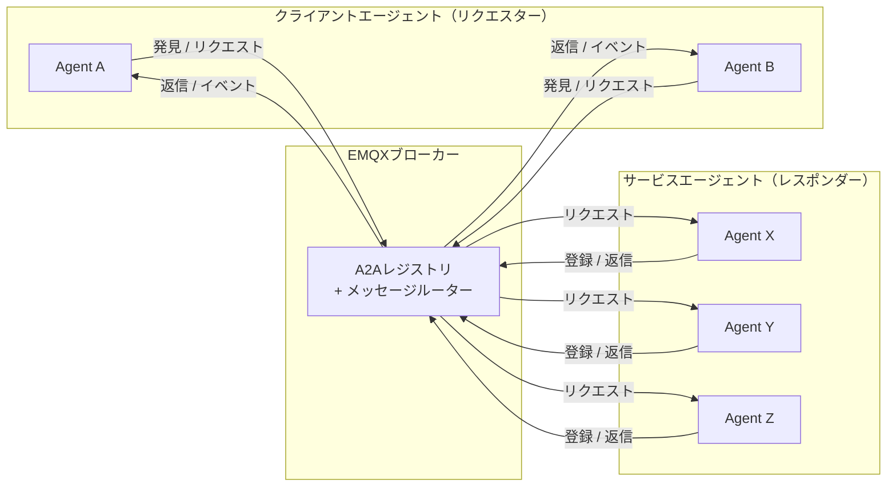
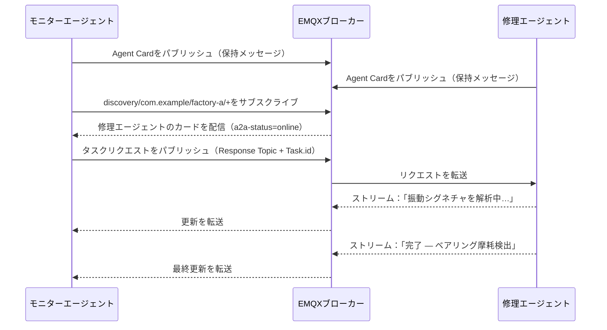

# MQTTによるA2Aの仕組み

このページでは、MQTTによるA2Aの基本概念について説明します。エージェント、クライアント、およびブローカーの構成、エージェントの識別と検出方法、Agent Cardの内容、エージェント間の通信パターンなどを解説します。これらの概念を理解することは、EMQXのA2Aレジストリを扱う上での基礎となります。

## アーキテクチャ

MQTTによるA2Aは、ブローカー中心のモデルで3つの参加者が存在します。

- **エージェント（レスポンダー）**：自身のAgent Cardを検出トピックに保持メッセージとしてパブリッシュし、リクエストトピックをサブスクライブして、受信したタスクリクエストに応答します。
- **クライアントエージェント（リクエスター）**：検出トピックをサブスクライブして利用可能なエージェントを発見し、タスクリクエストを送信して返信を受け取ります。
- **MQTTブローカー（EMQX）**：すべてのメッセージをルーティングし、A2AレジストリにAgent Cardを記録し、認証・認可を適用し、検出メッセージにライブネスメタデータを付加します。



## エージェントの識別

各エージェントは3階層の階層構造で識別されます。

```
{org_id} / {unit_id} / {agent_id}
```

- **org_id**：エージェントが所属する組織（例：`com.example`）。
- **unit_id**：組織内の部署やチーム、デプロイ環境などの区分（例：`factory-a`）。
- **agent_id**：組織・部署内で一意のエージェント識別子（例：`iot-ops-agent-001`）。

3つのセグメントはすべて `^[A-Za-z0-9_.-]+$` にマッチし、`/`、`+`、`#`、空白文字を含んではいけません。エージェントのMQTTクライアントIDは、これらを結合した形式 `{org_id}/{unit_id}/{agent_id}` を使用します。

## トピックモデル

| トピック | 用途 |
|---|---|
| `$a2a/v1/discovery/{org_id}/{unit_id}/{agent_id}` | エージェントの登録・検出（保持メッセージ） |
| `$a2a/v1/request/{org_id}/{unit_id}/{agent_id}` | 特定エージェントへのタスクリクエスト受信 |
| `$a2a/v1/reply/{org_id}/{unit_id}/{agent_id}/{suffix}` | 推奨される返信トピックパターン（下記注釈参照） |
| `$a2a/v1/event/{org_id}/{unit_id}/{agent_id}` | 要求なしのイベントパブリッシュ |
| `$a2a/v1/request/{org_id}/{unit_id}/pool/{pool_id}` | ロードバランスされた共有プールトピック |

::: tip 注意
返信トピックは固定のプロトコルトピックではありません。リクエスターは任意のトピックを返信トピックとして使用できます。レスポンダーはMQTT v5の`Response Topic`プロパティから返信先を取得します。上記パターンは一貫性を保ちACL設定を簡素化するための推奨例です。
:::

検出サブスクリプションはワイルドカードを使いスコープを限定します。

```
$a2a/v1/discovery/com.example/+/+     # 組織内のすべてのエージェント
$a2a/v1/discovery/com.example/factory-a/+  # 部署内のすべてのエージェント
```

## Agent Card

Agent Cardは、エージェントが検出トピックにパブリッシュするJSONドキュメントで、エージェントの識別情報、機能、HTTPエンドポイント、オプションのセキュリティメタデータを記述します。EMQXは受信時にカードをA2Aレジストリに記録します。

最低限必要なフィールド：

| フィールド | 型 | 説明 |
|---|---|---|
| `name` | 文字列 | 人間が読みやすいエージェント名。 |
| `description` | 文字列 | エージェントの概要説明。 |
| `version` | 文字列 | バージョン文字列（例："1.0.0"）。 |
| `url` | 文字列（URI） | エージェントのエンドポイントURI。任意。 |
| `skills` | 配列 | 1つ以上のスキルオブジェクト。各スキルは`id`、`name`、`description`を持つ。 |

最小限のAgent Card例：

```json
{
  "name": "IoT Operations Agent",
  "description": "工場のテレメトリを監視し、修復アクションを調整します。",
  "version": "1.2.3",
  "url": "mqtts://broker.example.com:8883",
  "skills": [
    {
      "id": "device-diagnostics",
      "name": "デバイス診断",
      "description": "テレメトリを解析し、デバイスの異常を検出します。"
    }
  ]
}
```

`capabilities`、`securitySchemes`、`supportedInterfaces`、拡張パラメータを含む完全なAgent Cardスキーマは、[A2A仕様](https://a2a-protocol.org/latest/specification/)をご参照ください。

## エージェントのライブネス

Agent Cardはエージェントが切断後も保持メッセージとして残ります。EMQXは接続状態を追跡し、検出メッセージをサブスクライバーに転送する際にMQTT v5のUser Propertiesを付加します。

| User Property | 値 | 意味 |
|---|---|---|
| `a2a-status` | `online` | エージェントのMQTT接続がアクティブ。 |
| `a2a-status` | `offline` | エージェントが切断（正常終了またはLWTによる）。 |
| `a2a-status-source` | `broker` | ステータスはEMQXによって設定。 |
| `a2a-status-source` | `agent` | ステータスはエージェント自身によって設定。 |
| `a2a-status-source` | `lwt` | 予期しない切断（Last Will）を反映。 |

エージェントは検出トピックに対して、`a2a-status=offline` と `a2a-status-source=lwt` を含むLast Willメッセージを設定すべきです。これにより、非正常切断時にサブスクライバーへ自動通知されます。

## インタラクションパターン

MQTTによるA2Aは、エージェント間の以下のインタラクションパターンをサポートします。各パターンはMQTT v5の`Response Topic`と`Correlation Data`プロパティを用いてリクエスト／リプライのルーティングを行い、リクエスター生成の`Task.id`でタスクの状態をライフサイクル全体にわたり追跡します。

| パターン | 説明 |
|---|---|
| 1リクエスト1レスポンス | リクエスターがタスクリクエストをパブリッシュし、レスポンダーが指定された`Response Topic`に単一の返信をパブリッシュ。 |
| ストリーミングレスポンス | レスポンダーが複数のステータスや成果物更新メッセージをパブリッシュし、最終的なタスク完了状態に達するまで継続。 |
| マルチターン会話 | 関連タスクを`Task.context_id`でグループ化し、中断したタスクの再開を可能に。 |
| 共有プールディスパッチ | 複数のエージェントインスタンスが共有プールトピックを用い、MQTT共有サブスクリプションでロードバランスされたリクエスト処理。 |
| タスク引き継ぎ | レスポンダーが進行中のタスクを`a2a-responder-agent-id` User Propertyを使い別インスタンスへ委譲。 |
| OAuth 2.0認可 | リクエストごとにベアラートークンを`a2a-authorization` MQTT User Propertyとして渡す。 |
| エンドツーエンドセキュリティ | オプションの`ubsp-v1`セキュリティプロファイルにより、信頼できないブローカー環境でもペイロードをエンドツーエンドで暗号化。 |

各パターンの詳細な仕様は、[MQTTによるA2Aトランスポート仕様](https://www.emqx.com/mqtt-for-ai/a2a-over-mqtt/specification/0.1/basic/mqtt_transport.html)をご参照ください。

## 例：工場アラート対応ワークフロー

2つのエージェントが協力して工場フロアのアラートに対応します。異常を検知し診断タスクを委譲する**モニターエージェント**と、それを処理し結果をストリームで返す**修理エージェント**です。

**ステップ1：両エージェントが登録。** 各エージェントは自身のAgent Cardを検出トピックに保持メッセージとしてパブリッシュします。EMQXはカードを記録し、両エージェントをオンラインとマークします。

**ステップ2：モニターエージェントが修理エージェントを検出。** モニターエージェントは`$a2a/v1/discovery/com.example/factory-a/+`をサブスクライブし、即座に修理エージェントの保持カードを受信、機器故障の診断が可能であることを確認します。

**ステップ3：モニターエージェントがタスクリクエストを送信。** モーター`line-7`から異常振動の読み取りが届きます。モニターエージェントは修理エージェントのリクエストトピックにユニークな`Task.id`とMQTTの`Response Topic`プロパティを設定してリクエストをパブリッシュします。

**ステップ4：修理エージェントがステータス更新をストリーム配信。** 修理エージェントは返信トピックに進捗更新をパブリッシュし、最終的に`completed`ステータス（ベアリング摩耗検出、検査予定）を送信します。各更新は元の`Correlation Data`をエコーし、モニターエージェントがリクエストに紐づけられるようにします。


