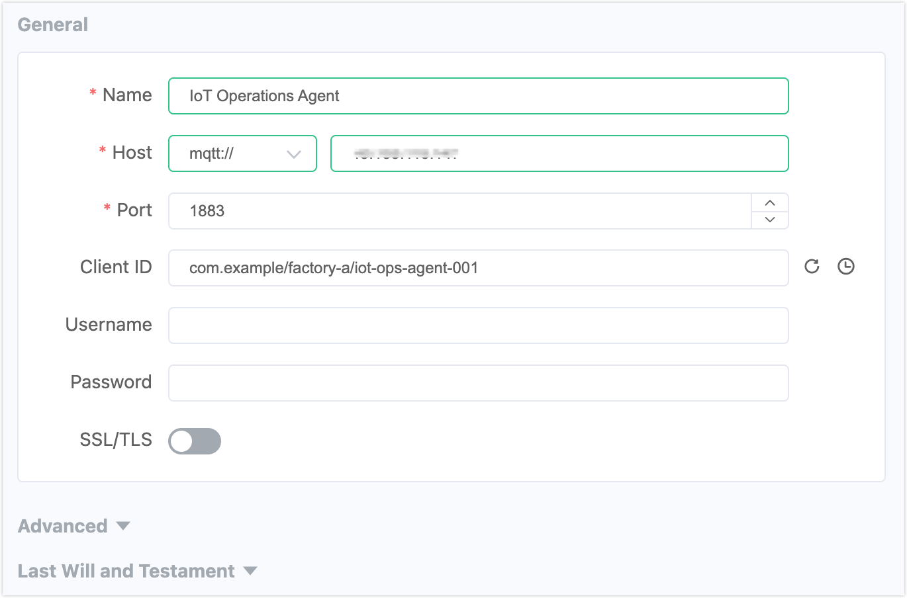
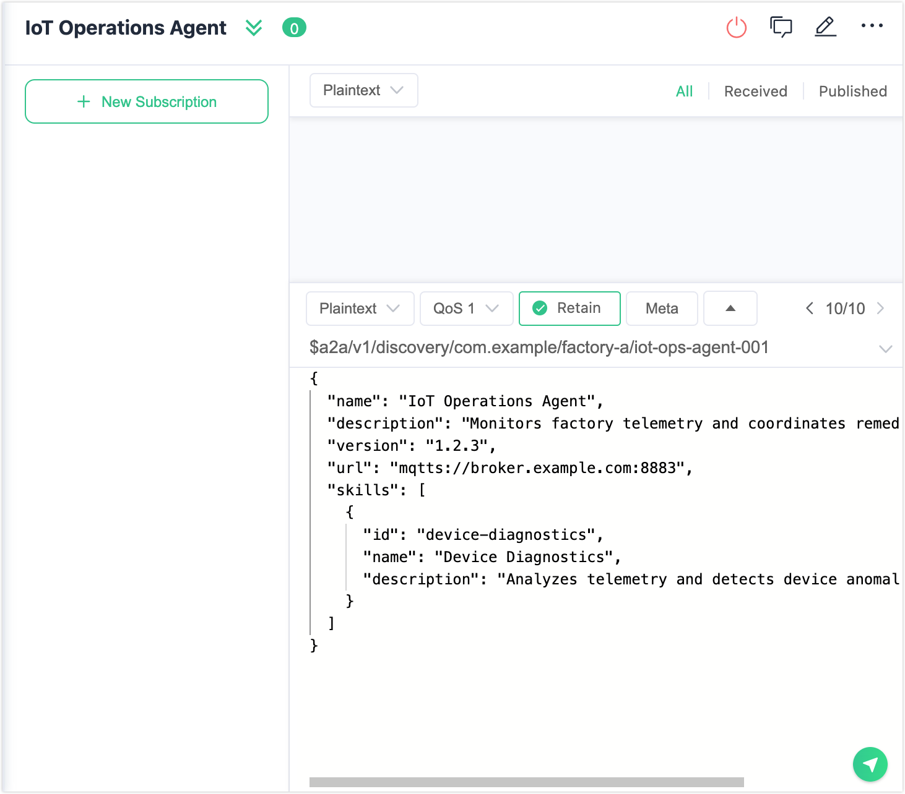
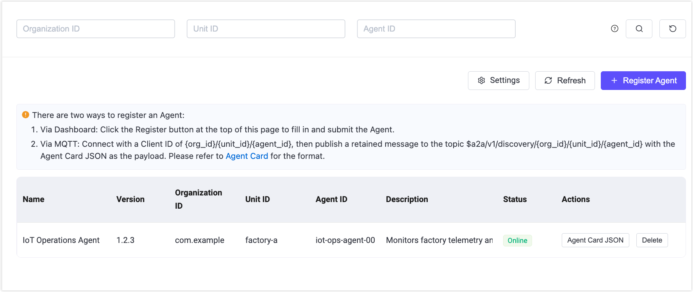

# エージェントの管理

このページでは、A2Aレジストリの有効化方法と、ダッシュボードUI、CLI、またはMQTTを使用してエージェントの登録、表示、削除を行う方法について説明します。

## 前提条件

- EMQX 6.2.0以降
- ダッシュボードまたはEMQXノードの管理者権限

## A2Aレジストリの有効化

A2Aレジストリはデフォルトで無効になっています。エージェントを登録する前に有効化してください。

### ダッシュボードから

1. 左のナビゲーションパネルで **A2A Registry** をクリックします。
2. **Settings** をクリックします。
3. **Enable A2A Registry** をオンに切り替えます。
4. **Validate Schema** はデフォルトで有効です。有効にすると、EMQXは登録時にAgent CardのペイロードをA2Aスキーマに対して検証し、スキーマに準拠しないカードを拒否します。スキーマから逸脱したカードを受け入れる必要がある場合のみ無効にしてください。
5. **Save Changes** をクリックします。

### 設定ファイルから

`emqx.conf` に以下を追加します。

```hocon
a2a_registry {
  enable = true
  validate_schema = true
}
```

設定オプションの詳細：

| パラメーター | 型 | デフォルト | 説明 |
|---|---|---|---|
| `enable` | Boolean | `false` | A2Aレジストリを有効化します。 |
| `validate_schema` | Boolean | `true` | 登録時にAgent CardのペイロードをA2Aスキーマに対して検証します。無効なカードは拒否されます。 |
| `max_card_size` | Integer | `65536` | Agent Cardペイロードの最大サイズ（バイト単位） |
| `registration_rate_limit` | Integer | `10` | エージェントごとの1分あたりの最大登録更新数 |
| `require_security_metadata` | Boolean | `false` | 有効にすると、Agent Cardのセキュリティメタデータ拡張に `jwksUri` の記載を必須とします。 |
| `trusted_jkus` | Array | `[]` | 空でない場合、Agent Card内の `jwksUri` はリスト内のいずれかのプレフィックスと一致する必要があります。空リストはJKU検証を無効化（許容モード）します。 |
| `verify_jku_tls` | Boolean | `true` | JWKSエンドポイント取得時にTLS証明書を検証します。 |

## エージェントの登録

エージェントは自身のAgent CardをA2Aレジストリにパブリッシュすることで登録され、他のエージェントから検出可能になります。登録はダッシュボード、MQTT、またはCLIで行えます。

### ダッシュボードから

1. **A2A Registry** -> **+ Register Agent** をクリックします。
2. 識別情報を入力します：

   - **Organization ID**：エージェントが所属する組織またはトラストドメイン（例：`com.example`）。デプロイ間で一意になるようリバースDNS表記を推奨します。
   - **Unit ID**：組織内のサブユニットや環境（例：`factory-a`）。
   - **Agent ID**：組織・ユニット内で一意のエージェント識別子（例：`iot-ops-agent-001`）。

   これら3つの値は英数字、ハイフン、アンダースコア、ピリオド（`^[A-Za-z0-9._-]+$`）のみ使用可能で、`/`、`+`、`#`、空白は含められません。これらを組み合わせてエージェントのフルアドレス `{org_id}/{unit_id}/{agent_id}` となります。

3. Agent CardのJSONをエディターに貼り付けます。必要なフィールドやテンプレートは **Help** ボタンで確認できます。
4. **Register Agent** をクリックします。

### MQTTXを使って

エージェントは自身のAgent Cardを保持メッセージとして発見用トピックにパブリッシュして登録します。要件は以下の通りです：

- MQTTプロトコルバージョン5
- クライアントIDは `{org_id}/{unit_id}/{agent_id}`
- Retainフラグ有効、QoS 1
- ペイロードは少なくとも `name`、`description`、`version`、`url`、`skills` を含むAgent CardのJSON

**[MQTTX Desktop](https://mqttx.app/downloads) を使用する場合：**

1. MQTTXを開き、**New Connection** をクリックします。

2. 接続情報を入力します：
   - **Name**：接続名（例：`IoT Operations Agent`）
   - **Host**：EMQXブローカーのアドレス
   - **Port**：`1883`（または適切なポート）
   - **Client ID**：`com.example/factory-a/iot-ops-agent-001`
   - **MQTT Version**：`5.0`
   
   
   
3. **Connect** をクリックします。

4. 画面下部のメッセージ作成エリアに以下を入力します：
   - **Topic**：`$a2a/v1/discovery/com.example/factory-a/iot-ops-agent-001`
   - **QoS**：`1`
   - **Retain**：有効
   - **Payload**：Agent CardのJSON（以下の例を参照）
   
5. 送信ボタンをクリックします。

```json
{
  "name": "IoT Operations Agent",
  "description": "Monitors factory telemetry and coordinates remediation actions.",
  "version": "1.2.3",
  "url": "mqtts://broker.example.com:8883",
  "skills": [
    {
      "id": "device-diagnostics",
      "name": "Device Diagnostics",
      "description": "Analyzes telemetry and detects device anomalies."
    }
  ]
}
```



**[MQTTX CLI](https://mqttx.app/cli) を使用する場合：**

```bash
mqttx pub \
  -h localhost -p 1883 \
  -V 5 \
  -i "com.example/factory-a/iot-ops-agent-001" \
  -t '$a2a/v1/discovery/com.example/factory-a/iot-ops-agent-001' \
  -m '{"name":"IoT Operations Agent","description":"Monitors factory telemetry and coordinates remediation actions.","version":"1.2.3","url":"mqtts://broker.example.com:8883","skills":[{"id":"device-diagnostics","name":"Device Diagnostics","description":"Analyzes telemetry and detects device anomalies."}]}' \
  -q 1 -r
```

**Validate Schema** が有効な場合、EMQXはペイロードを登録前に検証し、不正なカードはPUBACKの理由コード付きで拒否されます。

### CLIから

```bash
emqx ctl a2a-registry register <path-to-agent-card.json>
```

JSONファイルにはAgent Cardのフィールドとルーティングに使う識別情報を含める必要があります：

```json
{
  "org_id": "com.example",
  "unit_id": "factory-a",
  "agent_id": "iot-ops-agent-001",
  "name": "IoT Operations Agent",
  "description": "Monitors factory telemetry and coordinates remediation actions.",
  "version": "1.2.3",
  "url": "mqtts://broker.example.com:8883",
  "skills": [
    {
      "id": "device-diagnostics",
      "name": "Device Diagnostics",
      "description": "Analyzes telemetry and detects device anomalies."
    }
  ]
}
```

## 登録済みエージェントの表示

登録済みエージェントはダッシュボードで閲覧・検査でき、CLIでクエリも可能です。

### ダッシュボードから

**A2A Registry** ページに登録済みエージェントが一覧表示されます。各行には **Agent Card JSON** と **Delete** のアクションボタンがあります。

画面上部の **Organization ID**、**Unit ID**、**Agent ID** のフィルターで絞り込み可能です。

任意の行の **Agent Card JSON** をクリックすると、Agent Cardの生JSONがコピー可能な状態で表示されます。



### CLIから

```bash
# すべてのエージェントを一覧表示
emqx ctl a2a-registry list

# 組織とステータスでフィルター
emqx ctl a2a-registry list --org com.example --status online

# 特定エージェントのAgent Cardを取得
emqx ctl a2a-registry get com.example factory-a iot-ops-agent-001

# レジストリ統計を表示
emqx ctl a2a-registry stats
```

## エージェントの削除

エージェントを削除するとA2Aレジストリから登録解除され、保持されたAgent Cardがクリアされて検出不能になります。

### ダッシュボードから

エージェント一覧で削除したいエージェントの削除アクションをクリックし、確認画面でフルアドレス `{org_id}/{unit_id}/{agent_id}` を入力して確定します。

### MQTTから

エージェントの発見用トピックに空の保持メッセージをパブリッシュします。これにより保持されたカードがクリアされ、レジストリから削除されます。

**MQTTX Desktopを使う場合：**

1. エージェントのクライアントID（例：`com.example/factory-a/iot-ops-agent-001`）で接続します。
2. トピックを `$a2a/v1/discovery/com.example/factory-a/iot-ops-agent-001`、QoS `1`、**Retain** 有効に設定し、ペイロードは空にします。
3. 送信ボタンをクリックします。

**MQTTX CLIを使う場合：**

```bash
mqttx pub \
  -h localhost -p 1883 \
  -V 5 \
  -i "com.example/factory-a/iot-ops-agent-001" \
  -t '$a2a/v1/discovery/com.example/factory-a/iot-ops-agent-001' \
  -m '' \
  -q 1 -r
```

### CLIから

```bash
emqx ctl a2a-registry delete com.example factory-a iot-ops-agent-001
```

## MQTTによるエージェントの検出

クライアントエージェントはワイルドカードを使って発見用トピックをサブスクライブし、利用可能なエージェントを検出します。カードは保持されているため、サブスクライブ直後に即座に受信可能です。

**MQTTX Desktopを使う場合：**

1. EMQXブローカーに接続します。
2. **+ New Subscription** をクリックし、ワイルドカードトピック（例：`$a2a/v1/discovery/com.example/+/+`）を入力して組織内の全エージェントを検出します。
3. **Confirm** をクリック。保持されたAgent Cardがメッセージペインに即座に表示されます。

**MQTTX CLIを使う場合：**

```bash
# 組織内の全エージェント
mqttx sub -h localhost -p 1883 -V 5 -t '$a2a/v1/discovery/com.example/+/+' -v

# 特定ユニット内の全エージェント
mqttx sub -h localhost -p 1883 -V 5 -t '$a2a/v1/discovery/com.example/factory-a/+' -v

# 特定エージェント
mqttx sub -h localhost -p 1883 -V 5 -t '$a2a/v1/discovery/com.example/factory-a/iot-ops-agent-001' -v
```

`-v` フラグは受信したペイロードの前にトピック名を表示します。

受信する各メッセージのペイロードにはAgent CardのJSONが含まれ、EMQXは以下のMQTT v5ユーザープロパティを付加してエージェントの生存状態を示します：

| ユーザープロパティ | 値 | 意味 |
|---|---|---|
| `a2a-status` | `online` | エージェントが現在接続中 |
| `a2a-status` | `offline` | エージェントが切断済み |
| `a2a-status-source` | `broker` | EMQXが接続状態に基づいて設定したステータス |
| `a2a-status-source` | `agent` | エージェント自身が積極的にパブリッシュしたステータス（例：正常なオフライン） |
| `a2a-status-source` | `lwt` | Last Will and Testamentにより検出された異常切断のステータス |
