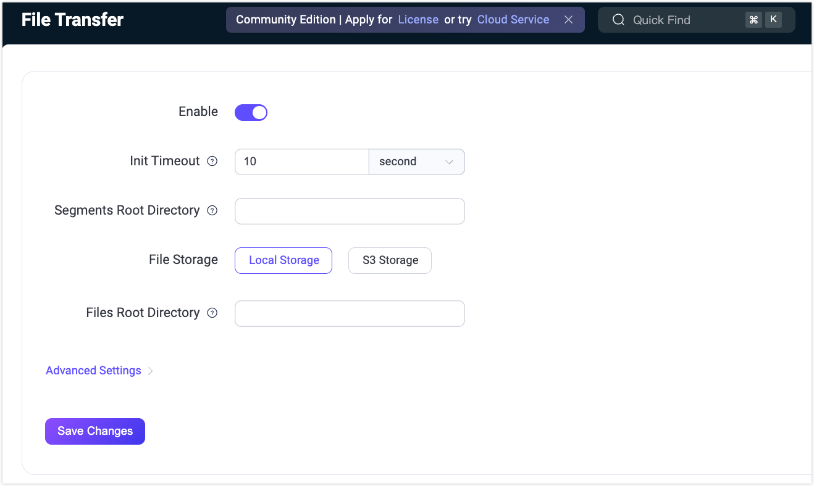

# ファイル転送サーバー側設定の構成

EMQXでは、MQTTファイル転送機能はデフォルトで有効になっていません。この機能を使用する場合は、設定ファイルで有効化する必要があります。

本ページでは、EMQXでファイル転送機能を有効にし、サーバー側でのファイル転送に関する各種機能を設定する方法を主に紹介します。これには、セグメントの保存やマージ済みファイルのローカルディスクおよびS3バケットへのエクスポートが含まれます。また、ファイル転送の処理を最適化するためのMQTT転送設定の構成についても説明します。以下のセクションでは、設定ファイルを通じてこれらの設定を詳細に構成する方法を紹介します。

- [ファイル転送の有効化](#enable-file-transfer)
- [セグメント保存の構成](#configure-segment-storage)
- [ファイルエクスポートの構成](#configure-file-export)
- [MQTT転送設定の構成](#configure-mqtt-transfer-settings)

また、Dashboardからもファイル転送機能の有効化および設定が可能です。詳細は[Dashboardによるファイル転送の有効化と設定](#enable-and-configure-file-transfer-via-dashboard)を参照してください。

さらに、REST APIを通じてエクスポートされたファイルの管理方法も紹介します。詳細は[エクスポートファイルの管理](#manage-exported-files)をご覧ください。

## ファイル転送の有効化

EMQXでは、ファイル転送機能はデフォルトで無効になっており、設定ファイルで有効化する必要があります。

```bash
file_transfer {
  enable = true
}
```

この設定により、EMQXはデフォルトでセグメントファイルを `data/file_transfer/segments` ディレクトリに保存し、ローカルディスクへのエクスポートを有効化して、マージ済みファイルを `data/transfers/exports` ディレクトリに出力します。

ファイル転送機能をさらに詳細に設定する場合は、以下の設定例を参照してください。

## セグメント保存の構成

EMQXはクライアントからファイルのセグメントをアップロードさせ、すべてのセグメントを受信後に完全なファイルにマージします。これをサポートするために、EMQXはセグメントファイルを一時的に保存し管理する必要があります。

現時点でEMQXはセグメントファイルの保存をディスク上のみサポートしており、セグメントの保存場所を設定できます。

ファイルアップロード完了後はセグメントが自動的にクリーンアップされます。アップロードがタイムアウト期間内に完了しなかったファイルについては、セグメントの有効期間とクリーンアップのスケジュールを設定し、ディスク容量の無駄な占有を防止できます。

```bash
file_transfer {
  # ファイル転送機能の有効化
  enable = true

  # セグメント保存設定
  storage.local.segments = {
    # セグメント保存ディレクトリ。I/O性能の高いディスクに設定することが望ましいです。
    root = "./data/file_transfer/segments"

    # 有効期限切れセグメントファイルの定期クリーンアップ設定
    gc {
      # クリーンアップ間隔
      interval = "1h"

      # セグメント保存の最大有効期間。この期間を過ぎるとマージされていなくてもセグメントは削除されます。
      # クライアントが指定する有効期間はこの値を超えられません。
      maximum_segments_ttl = "24h"
    }
  }
}
```

想定されるファイルサイズ、同時転送数、利用可能なディスク容量に応じて適切な設定を行ってください。

## ファイルエクスポートの構成

すべてのセグメントが転送完了後、EMQXはセグメントをマージして完全なファイルを生成し、ローカルディスクまたはS3バケットにエクスポートしてアプリケーション連携を可能にします。

:::tip

ファイルエクスポートが未設定の場合、デフォルトでローカルディスクへのエクスポートが有効になります。EMQXは両方のエクスポート方法を同時に設定することはできず、どちらか一方のみ使用可能です。

:::

### ローカルディスクへのファイルエクスポート

以下の設定例は、マージ済みの完全なファイルをローカルディスクに保存する方法です。エクスポートファイルの保存場所と有効期間を設定できます。

```bash
file_transfer {
  # ファイル転送機能の有効化
  enable = true

  # セグメント保存設定
  # ...

  # ローカルディスクへのファイルエクスポートを有効化
  storage.local.exporter.local {
    # エクスポートファイル保存ディレクトリ。I/O性能の高いディスクに設定することが望ましいです。
    root = "./data/transfers/exports"
  }
}
```

### S3バケットへのファイルエクスポート

以下の設定例は、マージ済みの完全なファイルをS3バケットに保存する方法です。

```hocon
file_transfer {
  # ファイル転送機能の有効化
  enable = true

  # セグメント保存設定
  # ...

  storage.local.exporter.s3 {

    host = "s3.us-east-1.amazonaws.com"
    port = 443

    # 署名リージョン（任意）。未設定の場合、EMQXがhostから推測します。
    region = "us-east-1"

    # バケットへのアクセス方法。pathまたはvhost。デフォルトはpath。
    access_method = path

    # S3アクセス用認証情報
    access_key_id = "AKIA27EZDDM9XLINWXFE"
    secret_access_key = "******"

    # エクスポートファイル保存バケット名
    bucket = "my-bucket"

    # 共有URLの有効期限
    # EMQXはクライアントがS3から直接ファイルをダウンロードできる一時共有URLを生成します。このパラメータはEMQX APIが返すファイルダウンロードURLの有効期限を指定します。有効期限切れ後はURLは無効になりますが、実際のファイルはS3に残ります。
    #url_expire_time = "1h"

    # S3とのHTTP(S)接続に関する設定。安全なファイルアップロードと接続プール管理を可能にします。
    transport_options {
      ssl.enable = true
      connect_timeout = 15s
    }
  }
}
```

以下のフィールドはS3のエンドポイント、署名リージョン、バケットのアドレッシング方法を設定します。

- `host`：実際のS3バケット名を含まないS3エンドポイントのホスト名を入力します。標準的なAWSリージョナルエンドポイントは `s3.{region}.amazonaws.com` の形式で、例として `s3.us-east-1.amazonaws.com` があります。Amazon S3インターフェースエンドポイント（AWS PrivateLink）を使用する場合は、そのリージョナルまたはゾーンDNS名を入力します。例：`bucket.vpce-0123456789abcdef0-example.s3.us-west-2.vpce.amazonaws.com`。このDNS名の `bucket` は文字列のプレフィックスであり、実際のS3バケット名ではありません。実際のバケット名は `bucket` フィールドで設定してください。
- `region`：EMQX 6.2.4以降で利用可能。S3アップロードリクエストや事前署名ダウンロードURLの署名に使用するリージョンを指定し、`host` から推測される値を上書きします。空の場合、EMQXは標準AWSリージョナルエンドポイントやAmazon S3インターフェースエンドポイント（AWS PrivateLink）のリージョナル・ゾーンDNS名からリージョンを推測します。推測できない場合は `us-east-1` にフォールバックします。カスタムドメインなどでリージョン識別子が含まれないエンドポイントホストの場合に設定してください。
- `access_method`：EMQXが設定したバケットにアクセスする方法を制御します。デフォルトの `path` はリクエストパスにバケット名を含めます。`vhost` はバケット名を `host` の前に付加します。`vhost` を使用する場合は、`host` に実際のバケット名を含めず、別途 `bucket` に設定してください。

## MQTT転送設定の構成

ファイル転送処理を最適化し、クライアントの過度な待機を防ぐために、各種ファイル転送操作のタイムアウトを設定できます。以下のMQTT設定を構成可能です。

```bash
file_transfer {
    enable = true
    init_timeout = "10s"
    store_segment_timeout = "10s"
    assemble_timeout = "60s"
}
```

- `init_timeout`：初期化操作のタイムアウト時間。
- `store_segment_timeout`：ファイルセグメント保存のタイムアウト時間。
- `assemble_timeout`：ファイル組み立てのタイムアウト時間。

これらの操作が指定時間を超過した場合、MQTTクライアントは `RC_UNSPECIFIED_ERROR` コードを含むPUBACKパケットを受信します。

## Dashboardによるファイル転送の有効化と設定

このセクションでは、Dashboard上でファイル転送機能を有効化し、各種機能を設定する方法を説明します。

EMQX Dashboardにアクセスし、**管理** -> **ファイル転送** をクリックします。ファイル転送ページで、**有効化** トグルスイッチをクリックしてファイル転送機能を有効にできます。[一般設定](#general-settings)および[詳細設定](#advanced-settings)を参照して機能を設定し、完了したら **変更を保存** をクリックしてください。



### 一般設定

以下の一般設定を構成できます。

- **初期化タイムアウト**：`init` コマンドの実行に許容される最大時間です。システムが過負荷で `init` コマンドをこの時間内に処理できない場合、タイムアウトとなり、エラーコード（0x80）を含むPUBACKメッセージが送信されます。デフォルトは `10s` です。
- **セグメントルートディレクトリ**：アップロードされたファイルの一時セグメントを保存するディレクトリのパスです。絶対パスで指定し、I/O性能の高いディスク上に配置することが推奨されます。これにより、特に負荷が高い場合のファイルセグメント処理が効率化されます。
- **ファイル保存方法**：ファイルのエクスポート方法を選択します。`ローカルストレージ` または `S3ストレージ` があります。`S3ストレージ` を選択した場合、以下の追加設定が必要です：
  - **ホスト**：実際のS3バケット名を含まないS3エンドポイントホストを入力します。標準的なAWSリージョナルエンドポイントは `s3.{region}.amazonaws.com` の形式で、例として `s3.us-east-1.amazonaws.com` があります。Amazon S3インターフェースエンドポイント（AWS PrivateLink）を使用する場合は、そのリージョナルまたはゾーンDNS名を入力します。このDNS名の `bucket` は文字列のプレフィックスであり、実際のバケット名ではありません。
  - **ポート**：S3サービスへの接続に使用するポート番号。例：`443`（安全なHTTPS接続）。
  - **署名リージョン**：EMQX 6.2.4以降で利用可能。S3アップロードリクエストや事前署名ダウンロードURLの署名に使用するリージョンを指定し、ホストから推測される値を上書きします。空の場合、ホストからリージョンを推測します。推測できない場合は `us-east-1` にフォールバックします。カスタムドメインなどでリージョン識別子が含まれない場合に設定してください。
  - **バケットアクセス方法**：`path` または `vhost` を選択します。デフォルトは `path` で、リクエストパスにバケット名を含めます。`vhost` はバケット名をホスト名の前に付加します。`vhost` 使用時はホスト名にバケット名を含めないでください。
  - **アクセスキーID** と **シークレットアクセスキー**：S3バケットへのアクセスに必要な認証情報です。安全に管理してください。
  - **バケット**：ファイルを保存するS3バケットの名前。例：`my-bucket`。
  - **TLSの有効化**：安全なファイル転送のためにTLS（トランスポート層セキュリティ）を使用するかどうかを設定します。詳細は[外部リソースアクセスのTLS](../../guides/network/overview.md#tls-for-external-resource-access)を参照してください。
- **ファイルルートディレクトリ**：ファイル保存のルートディレクトリを絶対パスで指定します。ファイル保存方法で `ローカルストレージ` を選択した場合に、組み立て済みファイルの保存先として使用されます。

### 詳細設定

一般設定で構成したファイル保存方法に応じて、異なる詳細設定が可能です。

#### ローカルストレージ

ファイルをローカルストレージにエクスポートする場合、以下の詳細設定を構成できます。

| 項目名                 | 説明                                                         | 推奨値             |
| --------------------- | ------------------------------------------------------------ | ------------------ |
| セグメント保存タイムアウト | `segment` コマンドでファイルセグメントを保存する最大許容時間。超過した場合（例：システム過負荷）、エラーコード（0x80）を含むPUBACKメッセージが送信され、タイムアウトを通知します。 | `5` 分             |
| 組み立てタイムアウト     | `fin` コマンドでファイル組み立て処理を完了する最大許容時間。タイムアウト時はエラーコード（0x80）を含むPUBACKメッセージが送信されます。リソース制約で組み立てが遅延する場合に重要です。 | `5` 分             |
| ストレージGC間隔       | ファイル保存システムのガベージコレクション（不要データ削除）を実行する間隔です。 | `1` 時間           |
| 最大セグメントTTL      | 保存されたセグメントの最大有効期間。これを超えたセグメントは自動的に削除されます。マージ済みか否かやファイル転送時に指定されたTTLに関わらず適用されます。 | `24` 時間          |
| 最小セグメントTTL      | セグメントの最小有効期間。マージ済みか否かやファイル転送時に指定されたTTLに関わらず、この期間を過ぎるまでは削除されません。後処理や冗長性確保のために最低限の保持期間を保証します。 | `5` 分             |

#### S3ストレージ

S3ストレージにファイルをエクスポートする場合、[ローカルストレージ](#ローカルストレージ)と同様の設定に加え、以下の詳細設定も構成可能です。

| 項目名               | 説明                                                         | 推奨値             |
| ------------------- | ------------------------------------------------------------ | ------------------ |
| URL有効期限         | アップロード済みファイルにアクセスするための生成URLの有効期間。期限切れ後はURLでのアクセスができなくなります。 | -                  |
| 最小パートサイズ     | ファイルを複数パートに分割してS3にアップロードする際の各パートの最小サイズ。小さいほどアップロード回数が増えますが、不安定な環境で大きなファイルを扱う際に有用です。 | `5 MB`             |
| 最大パートサイズ     | 複数パートアップロード時の各パートの最大サイズ。大きいほどアップロード回数は減り、高帯域環境で効率的ですが、メモリ消費が増えます。 | `5 MB`             |
| ACL（アクセス制御リスト） | アップロードされたオブジェクトのアクセス権限を指定します。以下のオプションがあります：<br />`private`：所有者のみフルアクセス<br />`public_read`：全員が読み取り可能<br />`public_read_write`：全員が読み書き可能<br />`authenticated_read`：認証ユーザーのみ読み取り可能<br />`bucket_owner_read`：バケット所有者が読み取り可能<br />`bucket_owner_full_control`：バケット所有者がフルコントロール | -                  |
| IPV6プローブ         | IPv6接続の有無をチェックするかどうか。IPv6対応ネットワークの場合は有効化が推奨されます。 | 有効               |
| 接続タイムアウト     | S3サーバーへの接続確立に許容される最大時間。超過するとタイムアウトとなり、サーバーからの応答を待ち切れません。 | -                  |
| プールタイプ         | S3接続の管理に使用するコネクションプールの種類を指定します：<br />`random`：ランダムに接続を選択<br />`hash`：ハッシュ関数で接続を選択。接続の性能や信頼性に影響します。 | `random`           |
| プールサイズ         | S3接続のコネクションプールのサイズ。大きいほど同時接続数を処理可能ですが、リソース消費も増加します。 | `8`                |
| HTTPパイプライニング | レスポンスを待たずに送信するHTTPリクエスト数。スループット向上に寄与しますが、複雑さが増します。 | `100`              |
| HTTPヘッダー         | S3リクエストに追加するカスタムHTTPヘッダーを指定可能です。キー・バリューのペアを追加してください。 | -                  |
| 最大リトライ回数     | エラー発生時のS3リクエストの最大リトライ回数。増やすと信頼性が向上しますが、遅延が発生する可能性があります。 | -                  |
| リクエストタイムアウト | S3リクエストの完了に許容される最大時間。超過するとタイムアウトとなります。 | -                  |

## エクスポートファイルの管理

エクスポートされたファイルの一覧表示、詳細情報の閲覧、移動、削除、ダウンロードなどの管理が可能です。これらの操作はREST APIまたは手動で行えます。将来的にはDashboard上での管理インターフェースも追加予定です。

### REST APIによるエクスポートファイル管理

EMQXはエクスポートファイル管理用のREST APIを提供しており、[MQTTファイル転送管理API](https://docs.emqx.com/en/enterprise/v5.3/admin/api-docs.html#tag/File-Transfer)を使用してファイルの閲覧やダウンロードが可能です。

::: warning 重要なお知らせ

ファイル転送ストアはグローバルであり、ネームスペースを認識しません。ネームスペース付きDashboardユーザーやAPIキーは、役割やスコープに関わらず、ファイル転送エンドポイントを使ってファイル一覧表示やローカル保存ファイルのダウンロードを行えません。グローバルDashboardユーザーまたはグローバルAPIキーで認証してください。`/file_transfer` 設定エンドポイントは影響を受けません。

:::

### ローカルディスクのエクスポートファイルを手動管理

ディスク上のエクスポートファイルを直接管理する場合（ファイル移動やFTP・HTTPサービスによるダウンロードなど）は、以下のファイル保存場所のルールを参照してください。

ファイル名の競合や単一ディレクトリ内のファイル数過多を防ぐため、EMQXはバケットストレージ方式でエクスポートファイルを保存します。仕組みは以下の通りです。

- まず、ファイルIDとクライアントIDのsha256ハッシュ値を計算します。例：`ABCDEFG012345...`
- 6階層のディレクトリ構造でファイルを保存します。各階層の定義は以下の通りです：
  1. ハッシュの最初の2バイトを第1階層ディレクトリ名とする
  2. 次の2バイトを第2階層ディレクトリ名とする
  3. 残りのハッシュを第3階層ディレクトリ名とする
  4. エスケープされたクライアントID
  5. エスケープされたファイルID
  6. メタデータからのファイル名を最下層に配置

例として、エクスポートファイルは以下のようなディレクトリ構造に保存されます：  
`AB/CD/EFGH.../{clientid}/{file_id}/{filename}`

### S3バケットのエクスポートファイルを手動管理

S3バケットの場合は、S3クライアントツールやS3のREST APIを使用してファイルの削除やダウンロードなどの管理が可能です。ファイル保存場所のルールは以下の通りです。

ローカルエクスポーターのバケットストレージ方式とは異なり、S3エクスポーターでエクスポートされたファイルはシンプルな3階層の階層構造で保存されます：

1. エスケープされたクライアントID
2. エスケープされたファイルID
3. ファイル名

例として、エクスポートファイルは以下のようなディレクトリ構造に保存されます：  
`{clientid}/{file_id}/{filename}`

:::tip

S3クライアントツールやREST APIの利用方法については、以下のリソースを参照してください：

- [Amazon S3](https://aws.amazon.com/s3/?nc1=h_ls) とその [ユーザーガイド](https://docs.aws.amazon.com/AmazonS3/latest/userguide/Welcome.html)
- [MinIO オブジェクトストレージシステム](https://min.io/)

:::
