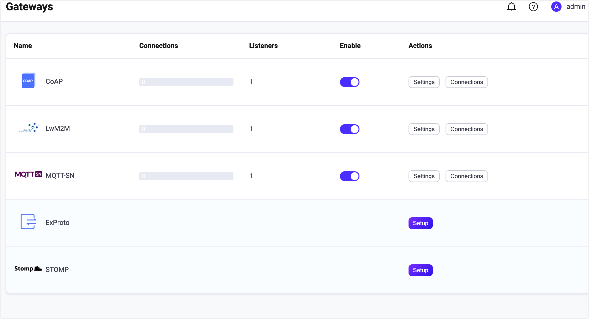
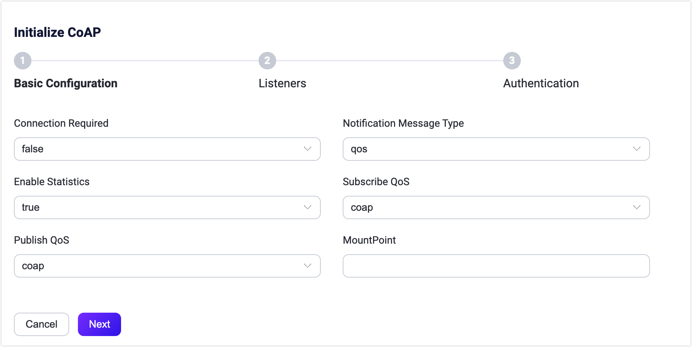
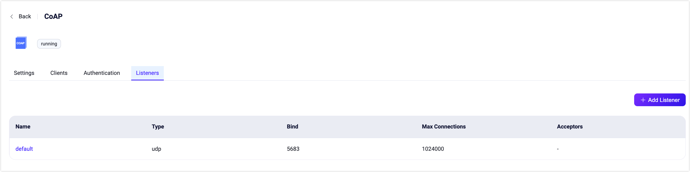

# CoAP ゲートウェイ

EMQX の CoAP ゲートウェイは、[Publish-Subscribe Broker for the CoAP](https://datatracker.ietf.org/doc/html/draft-ietf-core-coap-pubsub-09) プロトコルに準拠し、標準的なパブリッシュ、サブスクライブ、およびメッセージ受信を実装できます。

以下は、コネクションモードとコネクションレスモードでサポートされる機能一覧です。

| 機能               | コネクションレスモード | コネクションモード |
| ------------------ | ---------------------- | ------------------ |
| メッセージパブリッシュ | √                      | √                  |
| トピックサブスクライブ | √                      | √                  |
| トピックのサブスクライブ解除 | ×                      | √                  |
| コネクションの作成    | ×                      | √                  |
| コネクションのクローズ | ×                      | √                  |
| ハートビート         | ×                      | √                  |
| 認証                 | ×                      | √                  |

<!--アーキテクチャの簡単な紹介-->

## CoAP ゲートウェイの有効化

EMQX 5 では、CoAP ゲートウェイはダッシュボード、REST API、および設定ファイル `base.hocon` を通じて設定および有効化できます。本節では、ダッシュボードを使った設定例を示し、操作手順を説明します。

EMQX ダッシュボードの左ナビゲーションメニューで **Extensions** -> **Gateways** をクリックします。**Gateway** ページにはサポートされているすべてのゲートウェイが一覧表示されます。**CoAP** を見つけ、**Actions** 列の **Setup** をクリックすると、**Initialize CoAP** ページに遷移します。

::: tip

EMQX をクラスターで運用している場合、ダッシュボードや REST API で行った設定はクラスター全体に影響します。特定のノードのみ設定を変更したい場合は、[`base.hocon`](../../guides/configuration/configuration.md) で設定してください。

:::

EMQX CoAP ゲートウェイはコネクションレスモードとコネクションモードの両方をサポートしています。コネクションレスモードではメッセージは一回限りの送信として扱われ、センサーの読み取りや単純なコマンド送信など短時間のやり取りに適しています。コネクションモードでは、データ転送の前にクライアントがブローカーとコネクションを確立します。

**Connection Requested** の設定で、コネクションモードを有効にするかコネクションレスモードにするかを選択できます。デフォルトは `false`（コネクションレスモード）です。

コネクションモードを確認したら、設定を続けます。特にカスタマイズが不要な場合は、CoAP ゲートウェイを以下の3ステップで有効化できます。

1. **Basic Configuration** タブで **Next** をクリックし、すべてのデフォルト設定を受け入れます。
2. **Listeners** タブに遷移し、EMQX がポート `5683` で UDP リスナーを事前設定しているので、再度 **Next** をクリックして設定を確定します。
3. **Enable** ボタンをクリックして CoAP ゲートウェイを有効化します。

ゲートウェイの有効化が完了すると、**Gateways** ページに戻り、CoAP ゲートウェイのステータスが **Enabled** と表示されていることを確認できます。



上記の設定は REST API でも行えます。

**例:**

```bash
curl -X 'PUT' 'http://127.0.0.1:18083/api/v5/gateways/coap' \
  -u <your-application-key>:<your-security-key> \
  -H 'Content-Type: application/json' \
  -d '{
  "name": "coap",
  "enable": true,
  "mountpoint": "coap/",
  "connection_required": false,
  "listeners": [
    {
      "type": "udp",
      "name": "default",
      "bind": "5683",
      "max_conn_rate": 1000,
      "max_connections": 1024000
    }
  ]
}'
```

詳細な REST API の説明は [REST API - Gateway](../../guides/api.md) を参照してください。

カスタマイズが必要な場合やリスナーの追加、認証ルールの追加を行いたい場合は、[CoAP ゲートウェイのカスタマイズ](#customize-your-coap-gateway) セクションをお読みください。

CoAP ゲートウェイは UDP と DTLS タイプのリスナーのみをサポートしています。設定可能なパラメータの完全な一覧は [Gateway Configuration - Listeners](https://docs.emqx.com/en/enterprise/v@EE_VERSION@/hocon/) を参照してください。

## CoAP クライアントとの連携

### クライアントライブラリ

CoAP ゲートウェイを構築した後、CoAP クライアントツールを使って接続をテストし、正常に動作することを確認できます。以下は推奨される CoAP クライアントツールの例です。

- [libcoap](https://github.com/obgm/libcoap)
- [californium](https://github.com/eclipse/californium)

## パブリッシュ／サブスクライブ

CoAP ゲートウェイは [Publish-Subscribe Broker for the CoAP](https://datatracker.ietf.org/doc/html/draft-ietf-core-coap-pubsub-09) 標準で定義された URI パスとメソッドを使用します。

詳細なパラメータは [メッセージパブリッシュ](#message-publish)、[トピックサブスクライブ](#topic-subscribe)、[トピックサブスクライブ解除](#topic-unsubscribe) を参照してください。

## CoAP ゲートウェイのカスタマイズ

デフォルト設定に加え、EMQX はさまざまな設定オプションを提供し、特定のビジネス要件に対応できます。本節では **Gateways** ページで利用可能な各フィールドについて詳しく説明します。スクリーンショット下の説明もご参照ください。



- **Connection Required**: コネクションレスモードかコネクションモードかを設定します。デフォルトは `false`（コネクションレスモード）。選択肢は `false`（コネクションレスモード）、`true`（コネクションモード）。

- **Notification Message Type**: 配信される CoAP メッセージのタイプを設定します。デフォルトは `qos`。選択肢は以下の通りです。

  - **qos**: CoAP 通知のアック（ACK）要否は受信メッセージの QoS レベルに依存します。
    - QoS 0 の場合、クライアントからのアックは不要
    - QoS 1/2 の場合、クライアントからのアックが必要
  - **con**: CoAP 通知はクライアントからのアックが必要
  - **non**: CoAP 通知はクライアントからのアック不要

- **Heartbeat**: **Connection Required** が `true` の場合にのみ必要。接続維持のための最小ハートビート間隔を設定します。デフォルトは 30 秒。

- **Enable Statistics**: ゲートウェイの統計収集とレポートを許可するか設定します。デフォルトは `true`。選択肢は `true`、`false`。

- **Subscriber QoS**: サブスクライブ要求のデフォルト QoS レベルを設定します。デフォルトは `coap`。選択肢は以下の通りです。

  - **coap**: **Notification Message Type** の設定に従い QoS レベルを決定
    - アック不要の場合は QoS 0
    - アック必要の場合は QoS 1
  - **qos0**, **qos1**, **qos2**

- **Publish QoS**: パブリッシュ要求のデフォルト QoS レベルを設定します。デフォルトは `coap`。選択肢は `coap`、`qos0`、`qos1`、`qos2`。

- **MountPoint**: パブリッシュやサブスクライブ時にすべてのトピックの先頭に付与される文字列を設定します。これにより異なるプロトコル間でのメッセージルーティングの分離を実現できます。例として *CoAP* など。

  **注意**: このトピックプレフィックスはゲートウェイが管理します。CoAP クライアントはパブリッシュやサブスクライブ時に明示的にこのプレフィックスを付与する必要はありません。

### リスナーの追加

デフォルトで、名前が **default** の UDP リスナーがポート `5683` で設定されており、最大 1,024,000 の同時接続をサポートしています。**Settings** をクリックすると詳細設定が可能で、**Delete** でリスナーを削除、**Add Listener** で新規リスナーを追加できます。



**Add Listener** をクリックすると **Add Listener** ページが開き、以下の設定が可能です。

**基本設定**

- **Name**: リスナーの一意識別子を設定します。
- **Type**: プロトコルタイプを選択します。CoAP では `udp` または `dtls` が選べます。
- **Bind**: リスナーが接続を受け付けるポート番号を設定します。
- **MountPoint**（任意）: パブリッシュやサブスクライブ時にすべてのトピックの先頭に付与される文字列を設定し、異なるプロトコル間でのメッセージルーティング分離を実現します。

**リスナー設定**

- **Max Connections**: リスナーが処理可能な最大同時接続数を設定します。デフォルトは 1024000。
- **Max Connection Rate**: リスナーが1秒あたり受け入れる新規接続の最大レートを設定します。デフォルトは 1000。

**UDP 設定**

- **ActiveN**: ソケットの `{active, N}` オプションを設定します。これはソケットが積極的に処理できる受信パケット数です。詳細は [Erlang Documentation - setopts/2](https://www.erlang.org/doc/apps/kernel/inet.html#setopts/2) を参照してください。
- **Buffer**: 受信および送信パケットを格納するバッファのサイズを KB 単位で設定します。
- **Receive Buffer**: 受信バッファのサイズを KB 単位で設定します。
- **Send Buffer**: 送信バッファのサイズを KB 単位で設定します。
- **SO_REUSEADDR**: ポート番号のローカル再利用を許可するか設定します。

**DTLS 設定**（DTLS リスナーのみ）

TLS Verify の有効化はトグルスイッチで設定可能ですが、その前に関連する **TLS Cert**、**TLS Key**、および **CA Cert** の情報をファイル内容の入力または **Select File** ボタンでアップロードして設定する必要があります。詳細は [Enable SSL/TLS Connections](https://docs.emqx.com/en/enterprise/v5.0/network/emqx-mqtt-tls.html) を参照してください。

### 認証の設定

クライアント ID、ユーザー名、パスワードはクライアントの [Create Connection](#create-connection) リクエストで提供されます。CoAP ゲートウェイは以下の認証方式をサポートしています。

- [組み込みデータベース認証](../../guides/access-control/authn/mnesia.md)
- [MySQL 認証](../../guides/access-control/authn/mysql.md)
- [MongoDB 認証](../../guides/access-control/authn/mongodb.md)
- [PostgreSQL 認証](../../guides/access-control/authn/postgresql.md)
- [Redis 認証](../../guides/access-control/authn/redis.md)
- [HTTP サーバー認証](../../guides/access-control/authn/http.md)
- [JWT 認証](../../guides/access-control/authn/jwt.md)
- [LDAP 認証](../../guides/access-control/authn/ldap.md)

ここではダッシュボードを例に認証設定手順を説明します。

**Gateways** ページで **CoAP** を見つけ、**Actions** 列の **Setup** をクリックし、**Authentication** タブに入ります。

**Create Authentication** をクリックし、**Mechanism** に **Password-Based** または **JWT** を選択し、必要に応じて **Backend** を選択します。

認証方式の詳細な設定方法は、本節冒頭に記載の各ページを参照してください。

ダッシュボード以外に REST API でも認証設定が可能です。例えば、CoAP ゲートウェイ用に組み込みデータベース認証を作成する場合は以下のコードを使用します。

```bash
curl -X 'POST' \
  'http://127.0.0.1:18083/api/v5/gateway/coap/authentication' \
  -u <your-application-key>:<your-security-key> \
  -H 'accept: application/json' \
  -H 'Content-Type: application/json' \
  -d '{
  "backend": "built_in_database",
  "mechanism": "password_based",
  "password_hash_algorithm": {
    "name": "sha256",
    "salt_position": "suffix"
  },
  "user_id_type": "username"
}'
```

::: tip

MQTT プロトコルとは異なり、**ゲートウェイは認証器の作成のみをサポートし、認証器のリスト（または認証チェーン）はサポートしません**。認証器が有効化されていない場合、すべての CoAP クライアントのログインが許可されます。

:::

## リファレンス：CoAP クライアントガイド

### コネクションの作成

`Connection Mode` のみ利用可能です。

このインターフェースは CoAP ゲートウェイへのクライアントコネクションを作成するために使用します。CoAP ゲートウェイの認証が有効な場合、このリクエストで提供された `clientid`、`username`、`password` を検証し、不正ユーザーを防止します。

**リクエストパラメータ:**

- メソッド: `POST`
- URI: `mqtt/connection{?QueryString*}`、`QueryString` は以下の通りです。
  - `clientid`: 必須パラメータ、UTF-8 文字列。ゲートウェイはこの文字列をコネクションの一意識別子として使用します。
  - `username`: 任意パラメータ、UTF-8 文字列。コネクション認証に使用。
  - `password`: 任意パラメータ、UTF-8 文字列。コネクション認証に使用。
- ペイロード: 空

**レスポンス:**

- ステータスコード:
  - `2.01`: コネクション作成成功。このコネクション用のトークン文字列がメッセージボディに返されます。
  - `4.00`: 不正なリクエスト。詳細なエラー情報がメッセージボディに返されます。
  - `4.01`: 認可されていません。リクエスト形式は正しいが認可に失敗。
- ペイロード: ステータスコードが `2.01` の場合は `Token`、それ以外は `ErrorMessage`。
  - `Token`: 後続リクエストで使用するトークン文字列。
  - `ErrorMessage`: エラー説明メッセージ。

`libcoap` を例に示します。

```bash
# clientid 123、username と password に admin/public を指定して接続リクエストを送信。
# 返却されたトークンは 3404490787
coap-client -m post -e "" "coap://127.0.0.1/mqtt/connection?clientid=123&username=admin&password=public"

3404490787
```

:::tip
コネクション作成成功後は、ダッシュボード、REST API、CLI を使って CoAP ゲートウェイのクライアント一覧を確認できます。
:::

### コネクションのクローズ

`Connection Mode` のみ利用可能です。

このインターフェースは CoAP コネクションをクローズするために使用します。

**リクエストパラメータ:**

- メソッド: `DELETE`
- URI: `mqtt/connection{?QueryString*}`、`QueryString` は以下の通りです。
  - `clientid`: 必須パラメータ、UTF-8 文字列。ゲートウェイはこの文字列をコネクションの一意識別子として使用します。
  - `token`: 必須パラメータ。`Create Connection` リクエストで返されたトークン文字列を使用。
- ペイロード: 空

**レスポンス:**

- ステータスコード:
  - `2.01`: コネクションクローズ成功。
  - `4.00`: 不正なリクエスト。詳細なエラー情報がメッセージボディに返されます。
  - `4.01`: 認可されていません。リクエスト形式は正しいが認可に失敗。
- ペイロード: ステータスコードが `2.01` の場合は `Token`、それ以外は `ErrorMessage`。

例:

```bash
coap-client -m delete -e "" "coap://127.0.0.1/mqtt/connection?clientid=123&token=3404490787"
```

### ハートビート

`Connection Mode` のみ利用可能です。

このインターフェースは CoAP クライアントとゲートウェイ間の接続維持に使用します。ハートビートが期限切れになると、ゲートウェイはセッションとサブスクリプションを削除し、そのクライアントのすべてのリソースを解放します。

**リクエストパラメータ:**

- メソッド: `PUT`
- URI: `mqtt/connection{?QueryString*}`、`QueryString` は以下の通りです。
  - `clientid`: 必須パラメータ、UTF-8 文字列。ゲートウェイはこの文字列をコネクションの一意識別子として使用します。
  - `token`: 必須パラメータ。`Create Connection` リクエストで返されたトークン文字列を使用。
- ペイロード: 空

**レスポンス:**

- ステータスコード:
  - `2.01`: コネクションクローズ成功。
  - `4.00`: 不正なリクエスト。詳細なエラー情報がメッセージボディに返されます。
  - `4.01`: 認可されていません。リクエスト形式は正しいが認可に失敗。
- ペイロード: ステータスコードが `2.01` の場合は `Token`、それ以外は `ErrorMessage`。

例:

```bash
coap-client -m put -e "" "coap://127.0.0.1/mqtt/connection?clientid=123&token=3404490787"
```

:::tip
ハートビート間隔は CoAP ゲートウェイの `heartbeat` オプションで決まります。デフォルトは 30 秒です。
:::

### メッセージパブリッシュ

このインターフェースは CoAP クライアントが指定したトピックにメッセージを送信するために使用します。`Connection Mode` が有効な場合は追加の認証情報を含める必要があります。

**リクエストパラメータ:**

- メソッド: `POST`
- URI: `ps/{+topic}{?QueryString*}`
  - `{+topic}` はパブリッシュするメッセージのトピックです。例えば `coap/test` にパブリッシュする場合は URI は `ps/coap/test` となります。
  - `{?QueryString}` はリクエストパラメータです。
    - `clientid`: `Connection Mode` では必須、`Connectionless Mode` では任意。
    - `token`: `Connection Mode` のみ必須。
    - `retain`（任意）: リテインメッセージとしてパブリッシュするか。ブール値でデフォルトは `false`。
    - `qos`: メッセージの QoS。MQTT クライアントがメッセージを受信する際の QoS レベルを指定します。`0`、`1`、`2` の列挙値。
    - `expiry`: メッセージの有効期限（秒単位）。デフォルトは 0（期限なし）。

- ペイロード: メッセージのペイロード

**レスポンス:**

- ステータスコード:
  - `2.04`: パブリッシュ成功
  - `4.00`: 不正なリクエスト。詳細なエラー情報がメッセージボディに返されます。
  - `4.01`: 認可されていません。リクエスト形式は正しいが認可に失敗。
- ペイロード: ステータスコードが `2.04` の場合は空、そうでなければ `ErrorMessage`。

例えば、`Connectionless Mode` でメッセージをパブリッシュする場合：

```bash
coap-client -m post -e "Hi, this is libcoap" "coap://127.0.0.1/ps/coap/test"
```

または、`Connection Mode` で `clientid` と `token` を付与する場合：

```bash
coap-client -m post -e "Hi, this is libcoap" "coap://127.0.0.1/ps/coap/test?clientid=123&token=3404490787"
```

### トピックサブスクライブ

このインターフェースは CoAP クライアントがトピックをサブスクライブするために使用します。`Connection Mode` が有効な場合は追加の認証情報を含める必要があります。

**リクエストパラメータ:**

- メソッド: `GET`
- オプション: `Observe` を `0` に設定
- CoAP トークン: Observe 関係を識別するために空でないトークンを使用
- URI: `ps/{+topic}{?QueryString*}`
  - `{+topic}` はサブスクライブするトピックです。例えば `coap/test` をサブスクライブする場合は URI は `ps/coap/test` となります。
  - `{?QueryString}` はリクエストパラメータです。
    - `clientid`: `Connection Mode` では必須、`Connectionless Mode` では任意。
    - `token`: `Connection Mode` のみ必須。
    - `qos`: サブスクライブ QoS。ゲートウェイが CoAP クライアントにメッセージを配信する際に使用する MessageType（`CON` または `NON`）を指定します。列挙値は以下の通り。
      - `0`: `NON` メッセージで配信
      - `1` または `2`: `CON` メッセージで配信

- ペイロード: 空

**レスポンス:**

- ステータスコード:
  - `2.05`: サブスクライブ成功
  - `4.00`: 不正なリクエスト。詳細なエラー情報がメッセージボディに返されます。
  - `4.01`: 認可されていません。リクエスト形式は正しいが認可に失敗。
- ペイロード: ステータスコードが `2.05` の場合は空、そうでなければ `ErrorMessage`。

例えば、`Connectionless Mode` で `coap/test` をサブスクライブする場合：

```bash
coap-client -m get -s 60 -O 6,0x00 -o - -T "obstoken" "coap://127.0.0.1/ps/coap/test"
```

または、`Connection Mode` で `clientid` と `token` を付与してサブスクライブする場合：

```bash
coap-client -m get -s 60 -O 6,0x00 -o - -T "obstoken" "coap://127.0.0.1/ps/coap/test?clientid=123&token=3404490787"
```

CoAP トークンは `-T "obstoken"` で設定し、Observe 関係を識別します。これは URI クエリパラメータの `token`（`Connection Mode` での認証用）とは別物です。

### トピックのサブスクライブ解除

このインターフェースは CoAP クライアントがトピックのサブスクライブを解除するために使用します。

Observe 関係を明示的に解除するには、同じリソースに対して `Observe: 1` と元の Observe トークンを付与した GET リクエストを送信します。

現状の実装では、サブスクライブ解除操作は `Connection Mode` のみで利用可能です。

**リクエストパラメータ:**

- メソッド: `GET`
- オプション: `Observe` を `1` に設定
- CoAP トークン: 元の Observe リクエストで使用したトークンを使用
- URI: `ps/{+topic}{?QueryString*}`
  - `{+topic}` はサブスクライブ解除するトピックです。例えば `coap/test` の場合は URI は `ps/coap/test`。
  - `{?QueryString}` はリクエストパラメータです。
    - `clientid`: `Connection Mode` では必須、`Connectionless Mode` では任意。
    - `token`: `Connection Mode` のみ必須。

- ペイロード: 空

**レスポンス:**

- ステータスコード:
  - `2.07`: サブスクライブ解除成功
  - `4.00`: 不正なリクエスト。詳細なエラー情報がメッセージボディに返されます。
  - `4.01`: 認可されていません。リクエスト形式は正しいが認可に失敗。
- ペイロード: ステータスコードが `2.07` の場合は空、そうでなければ `ErrorMessage`。

例えば、`Connection Mode` で `coap/test` のサブスクライブを解除する場合：

```bash
coap-client -m get -O 6,0x01 -T "obstoken" "coap://127.0.0.1/ps/coap/test?clientid=123&token=3404490787"
```

### プロトコル仕様との違い

EMQX 6.1.2 以降の 6.1 リリースでは、クライアントが Reset メッセージで確認可能（`CON`）Observe 通知を拒否した場合、またはすべての再送試行を行ってもアックを受け取れなかった場合、EMQX は以下の処理を行います。

- 失敗した通知を破棄
- その通知に関連するトランスポートおよび Block2 状態をクリーンアップ
- Observe 関係およびブローカーのサブスクリプションは保持

そのため、後続のリソース変更は保持された関係を通じて配信され続ける可能性があります。関係を保持することは、失敗した通知が再度配信されることを保証しません。これらの失敗は関係自体をキャンセルしません。通常のクライアントセッションのクリーンアップが適用されます。

この挙動は互換性のために維持されており、[RFC 7641 セクション 4.5](https://www.rfc-editor.org/rfc/rfc7641.html#section-4.5) の仕様とは異なります。RFC では Reset メッセージ受信後または最終再送のタイムアウト後にサーバーがオブザーバーを削除することを要求しています。

### 短縮パラメータ名

メッセージサイズ削減のため、CoAP ゲートウェイは短縮パラメータ名をサポートしています。

例えば、`clientid=barx` は `c=bar` と書けます。サポートされる短縮パラメータ名は以下の通りです。

| パラメータ名  | 短縮名 |
| ------------- | ------- |
| `clientid`    | `c`     |
| `username`    | `u`     |
| `password`    | `p`     |
| `token`       | `t`     |
| `qos`         | `q`     |
| `retain`      | `r`     |
