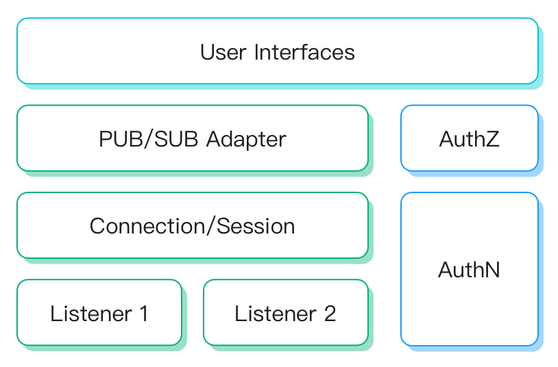

# マルチプロトコルゲートウェイ

EMQX マルチプロトコルゲートウェイは、MQTT以外のすべてのプロトコル接続、認証、およびメッセージの送受信を処理できる機能を提供します。さまざまなプロトコルに対して統一された概念モデルを提供します。

EMQX 5.0以前は、MQTT以外のプロトコルアクセスは個別のプロトコルプラグインによって実装されていました。これらのプラグインは設計や実装が異なり、利用が困難でした。

5.0以降、EMQXはマルチプロトコルゲートウェイを提供し、統一された概念および操作モデルを定義することで、より使いやすくなっています。

マルチプロトコルゲートウェイは、MQTT-SN、STOMP、CoAP、LwM2Mなどのプロトコルをサポートしています。ダッシュボード上で直接有効化および設定できるほか、REST APIや`base.hocon`を使って管理することも可能です。これらのゲートウェイの有効化方法やビジネスニーズに合わせた設定カスタマイズの詳細は、以下のリンクをご参照ください。

::: warning 重要なお知らせ
ExProtoゲートウェイはEMQX 6.2.0で非推奨となり、EMQX 6.3.0で削除されました。
:::

- [MQTT-SN](./mqttsn.md)
- [STOMP](./stomp.md)
- [CoAP](./coap.md)
- [LwM2M](./lwm2m.md)
- [ExProto](./exproto.md)

- [OCPP](./ocpp.md)
- [GB/T 32960](./gbt32960.md)
- [JT/T 808](./jt808.md)
- [NATS](./nats.md)

## マルチプロトコルゲートウェイの仕組み

EMQX マルチプロトコルゲートウェイは、リスナー、接続／セッション、パブリッシュ／サブスクライブ、認証、認可など、いくつかの主要コンポーネントに対して統一された概念および操作モデルを定義しています。

各コンポーネントの概要は以下の通りです。

- **リスナー**：TCP、SSL、UDP、DTLSのリスナータイプをサポートします。各ゲートウェイは複数のリスナーを作成可能です。
- **接続／セッション**：ゲートウェイは受け入れたクライアント接続ごとにセッションを作成し、サブスクリプションリスト、配信／受信キュー、クライアントメッセージの再送制御を管理します。
- **パブリッシュ／サブスクライブ**：各ゲートウェイタイプは、MQTTプロトコルのPUB/SUBメッセージモデルに適応する方法を定義しています。PUB/SUB概念のないプロトコルでは、メッセージのトピックやペイロードを設定する必要があり、ゲートウェイごとに異なるメッセージフォーマットを使用する場合があります。
- **認証**：各ゲートウェイは認証機構を設定でき、クライアント情報を用いたログイン認可を行います。

## 主な機能

### リスナー

各ゲートウェイは複数のリスナーを有効化でき、異なるプロトコルゲートウェイは以下のリスナータイプをサポートしています。

|            | TCP  | UDP  | SSL  | DTLS | Websocket | Websocket over TLS |
| ---------- | ---- | ---- | ---- | ---- | --------- | ------------------ |
| MQTT-SN    |      | ✔︎    |      | ✔︎    |           |                    |
| STOMP      | ✔︎    |      | ✔︎    |      |           |                    |
| CoAP       |      | ✔︎    |      | ✔︎    |           |                    |
| LwM2M      |      | ✔︎    |      | ✔︎    |           |                    |
| ExProto    | ✔︎    | ✔︎    | ✔︎    | ✔︎    |           |                    |
| OCPP       |      |      |      |      | ✔︎         | ✔︎                  |
| GB/T 32960 | ✔︎    |      | ✔︎    |      |           |                    |
| JT/T 808   | ✔︎    |      |      | ✔︎    |           |                    |
| NATS       | ✔︎    |      | ✔︎    |      | ✔︎         | ✔︎                  |

### メッセージフォーマット

PUB/SUBメッセージモデルとの互換性を確保するために、各ゲートウェイタイプは基盤となるプロトコルにPUB/SUB概念があるかどうかに適応する必要があります。

[MQTT-SN](./mqttsn.md)や[STOMP](./stomp.md)のようにPUB/SUB概念を持つプロトコルでは、クライアントが送信するトピックとペイロードをそのまま使用するため、メッセージフォーマットの変換は不要です。

[CoAP](./coap.md)や[LwM2M](./lwm2m.md)のようにPUB/SUB概念を持たないプロトコルでは、トピックやパブリッシュ、サブスクライブの定義がありません。この場合、ゲートウェイ側でメッセージ内容のフォーマットを設計し、ゲートウェイタイプごとに異なるフォーマットを用いることがあります。

- **CoAP**：CoAPゲートウェイは[Publish-Subscribe Broker for the CoAP](https://datatracker.ietf.org/doc/html/draft-ietf-core-coap-pubsub-09)標準で定義されたURIパスとメソッドを使用します。詳細は[メッセージパブリッシュ](./coap.md#message-publish)、[トピックサブスクライブ](./coap.md#topic-subscribe)、[トピックサブスクライブ解除](./coap.md#topic-unsubscribe)をご覧ください。
- **LwM2M**：LwM2Mプロトコルのメッセージモデルは[Resources Model and Operations](https://technical.openmobilealliance.org/OMNA/LwM2M/LwM2MRegistry.html)に基づいており、MQTTのパブリッシュ／サブスクライブモデルとは全く異なります。詳細は[LwM2Mゲートウェイ - メッセージフォーマット](./lwm2m.md#message-format)をご参照ください。

### 認証

認証は、システムに接続しようとするクライアントの身元を検証するプロセスです。バージョン5.0以降、ゲートウェイはログイン認可のための認証機構をサポートしています。

ゲートウェイによってサポートする認証方式は異なりますが、すべてのゲートウェイがHTTPベースの認証をサポートしています。[HTTPベース認証](../../guides/access-control/authn/http.md)の詳細はそちらをご覧ください。以下の表はサポートされている認証タイプを示します。

|            | HTTPサーバー | 組み込みデータベース | MySQL | MongoDB | PostgreSQL | Redis | JWT  | LDAP |
| ---------- | ----------- | ----------------- | ----- | ------- | ---------- | ----- | ---- | ---- |
| MQTT-SN    | ✔︎           |                   |       |         |            |       |      |      |
| STOMP      | ✔︎           | ✔︎                 | ✔︎     | ✔︎       | ✔︎          | ✔︎     | ✔︎    | ✔︎    |
| CoAP       | ✔︎           | ✔︎                 | ✔︎     | ✔︎       | ✔︎          | ✔︎     | ✔︎    | ✔︎    |
| LwM2M      | ✔︎           |                   |       |         |            |       |      |      |
| Exproto    | ✔︎           | ✔︎                 | ✔︎     | ✔︎       | ✔︎          | ✔︎     | ✔︎    | ✔︎    |
| OCPP       | ✔︎           | ✔︎                 | ✔︎     | ✔︎       | ✔︎          | ✔︎     | ✔︎    | ✔︎    |
| GB/T 32960 | ✔︎           |                   |       |         |            |       |      |      |
| JT/T 808   | N/A         | N/A               | N/A   | N/A     | N/A        | N/A   | N/A  |      |
| NATS       | ✔︎           | ✔︎                 | ✔︎     | ✔︎       | ✔︎          | ✔︎     | ✔︎    | ✔︎    |

注：認証機構が設定されていない場合は、どのクライアントもログイン可能です。

#### ゲートウェイにおける認証の仕組み

EMQX マルチプロトコルゲートウェイは、接続してくるクライアントの認証を担当します。これは接続ごとに`ClientInfo`を作成することで実現されます。

`ClientInfo`には、認証に一般的に使用される`Username`や`Password`などの汎用フィールドが含まれます。さらに、各ゲートウェイはLwM2Mの`Endpoint Name`のような独自のクライアント情報フィールドを持ち、これらも認証に利用される場合があります。

認証機構が設定されている場合、ゲートウェイはクライアントのUsernameおよびPasswordを自身のデータベースに保存された情報と照合し、一致すれば認証が成功しゲートウェイへのアクセスが許可されます。

::: tip

異なるゲートウェイ間でクライアントIDは重複可能ですが、同じゲートウェイ内で重複したクライアントIDがログインすると、既存のそのクライアントIDに紐づくセッションは切断されます。

:::

## 外部システムとの連携

外部システムとの連携を強化するため、ゲートウェイはEMQXで定義されたフックもサポートしています。

ゲートウェイ間で意味論の違いがあるため、コアフックの一部のみが利用可能です。

クライアント接続に関連するフックのサポート状況は以下の通りです。

外部システムとの相互運用性向上のため、ゲートウェイはEMQXで定義されたフックをサポートする設計となっています。

ただし、各ゲートウェイ間の意味論の違いにより、利用可能なコアフックは限定されます。以下の表はクライアント接続関連のサポートされるフックです。

| 名前                   | 必須かどうか | 説明                                                         | 対応プロトコル       |
| ---------------------- | ------------ | ------------------------------------------------------------ | -------------------- |
| `client.connect`       | 任意         | クライアント接続要求の数（成功・失敗を含む）                 | 全ゲートウェイ       |
| `client.connack`       | 任意         | クライアントが受信した`CONNACK`メッセージの数                | 全ゲートウェイ       |
| `client.authenticate`  | 必須         | 認証済みクライアントの数                                     |                      |
| `client.connected`     | 必須         | 正常に接続されたクライアントの数                             | 全ゲートウェイ       |
| `client.disconnected`  | 必須         | クライアント切断の数（正常・異常切断を含む）                 | 全ゲートウェイ       |
| `client.authorize`     | 必須         | 認可されたクライアントのパブリッシュ／サブスクライブ要求数    | 全ゲートウェイ       |
| `client.subscribe`     | 任意         | クライアントのトピックサブスクライブ試行数                   | MQTT-SN STOMP   |
| `client.unsubscribe`   | 任意         | クライアントのトピックサブスクライブ解除試行数               | MQTT-SN STOMP    |

セッションおよびメッセージ関連のフックはプロトコル間での意味論の違いがないため、各ゲートウェイタイプで完全にサポートされています。

フックの詳細については[フック](../../guides/extensions/hooks.md)をご覧ください。
