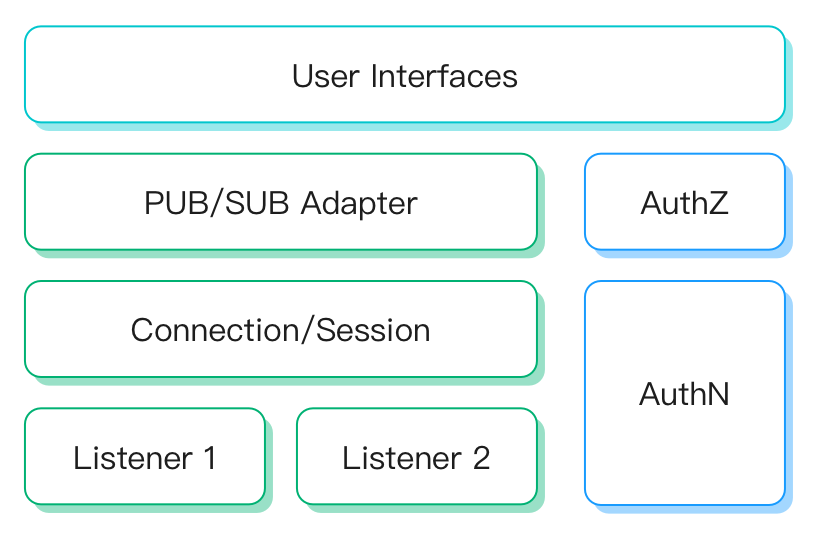

# マルチプロトコルゲートウェイ

EMQX マルチプロトコルゲートウェイは、MQTT以外のすべてのプロトコル接続、認証、およびメッセージの送受信を処理できる機能を提供します。さまざまなプロトコルに対して統一された概念モデルを提供します。

EMQX 5.0以前は、MQTT以外のプロトコルアクセスは個別のプロトコルプラグインによって実装されていました。これらのプラグインは設計や実装が異なり、利用が困難でした。

5.0以降、EMQXはマルチプロトコルゲートウェイを提供し、統一された概念および操作モデルを定義することで、より使いやすくなりました。

マルチプロトコルゲートウェイは、MQTT-SN、STOMP、CoAP、LwM2Mなどのプロトコルをサポートしています。ダッシュボードから直接有効化および設定できるほか、REST APIや`base.hocon`で管理可能です。これらのゲートウェイの有効化方法やビジネスニーズに合わせた設定カスタマイズについては、以下のリンクをご参照ください。

::: warning 重要なお知らせ
ExProtoゲートウェイはEMQX 6.2.0で非推奨となり、EMQX 6.3.0で削除されました。
:::

- [MQTT-SN](./mqttsn.md)
- [STOMP](./stomp.md)
- [CoAP](./coap.md)
- [LwM2M](./lwm2m.md)

- [OCPP](./ocpp.md)
- [GB/T 32960](./gbt32960.md)
- [JT/T 808](./jt808.md)
- [NATS](./nats.md)

## マルチプロトコルゲートウェイの動作

EMQX マルチプロトコルゲートウェイは、リスナー、接続／セッション、パブリッシュ／サブスクライブ、認証、認可などの主要コンポーネントに対して統一された概念および操作モデルを定義しています。

各コンポーネントの概要は以下の通りです：

- **リスナー**：TCP、SSL、UDP、DTLSのリスナータイプをサポートします。各ゲートウェイは複数のリスナーを作成可能です。
- **接続／セッション**：ゲートウェイは受け入れたクライアント接続ごとにセッションを作成し、サブスクリプションリスト、配信／受信キュー、およびクライアントメッセージの再送制御を管理します。
- **パブリッシュ／サブスクライブ**：各ゲートウェイタイプは、MQTTプロトコルのPUB/SUBメッセージモデルに適応する方法を定義します。PUB/SUBを持たないプロトコルではメッセージのトピックやペイロードを設定する必要があり、ゲートウェイごとに異なるメッセージフォーマットを使用する場合があります。
- **認証**：各ゲートウェイは認証機構を設定でき、クライアント情報を用いてログイン認可を行います。

## ゲートウェイリスナー

各ゲートウェイは複数のリスナーを有効化でき、異なるプロトコルゲートウェイは以下のリスナータイプをサポートしています：

|            | TCP  | UDP  | SSL  | DTLS | Websocket | Websocket over TLS |
| ---------- | ---- | ---- | ---- | ---- | --------- | ------------------ |
| MQTT-SN    |      | ✔︎    |      | ✔︎    |           |                    |
| STOMP      | ✔︎    |      | ✔︎    |      |           |                    |
| CoAP       |      | ✔︎    |      | ✔︎    |           |                    |
| LwM2M      |      | ✔︎    |      | ✔︎    |           |                    |
| OCPP       |      |      |      |      | ✔︎         | ✔︎                  |
| GB/T 32960 | ✔︎    |      | ✔︎    |      |           |                    |
| JT/T 808   | ✔︎    |      |      | ✔︎    |           |                    |
| NATS       | ✔︎    |      | ✔︎    |      | ✔︎         | ✔︎                  |

新規作成されるゲートウェイリスナーの名前は1〜64バイトの長さで、ASCIIの英数字で始まり、ASCIIの英数字、ハイフン（`-`）、アンダースコア（`_`）のみを含む必要があります。要件を満たさない場合、REST APIはHTTP `400`レスポンスと`BAD_REQUEST`エラーコードを返します。アップグレード前に存在した64バイトを超える名前のゲートウェイリスナーは、設定の更新や削除は可能ですが、名前の変更はできません。

### バインドアドレス

ゲートウェイリスナーの`bind`設定は、クライアントトラフィックを受信するためのローカルアドレスとポートを指定します。明示的なIPアドレスとポート、またはポートのみを指定できます。

EMQX 6.3.0以降、`bind`がポートのみを指定するゲートウェイリスナーは、ノードレベル設定の`node.default_listener_address`を使用してデフォルトのバインドアドレスを選択します。`bind`に明示的なIPアドレスとポートがある場合はそちらが優先されます。この設定がない場合、ポートのみのバインドは`legacy`および`hardened`セキュリティプロファイルの両方で全ネットワークインターフェースでリッスンします。

ポートのみのバインドで使用するアドレスを変更するには、各ノードの`emqx.conf`または`EMQX_NODE__DEFAULT_LISTENER_ADDRESS`で設定し、変更後にノードを再起動してください。これはMQTTリスナーのポートのみバインドやダッシュボードHTTPリスナーにも影響します。[デフォルトリスナーアドレス](../../guides/access-control/security-profile.md#default-listener-address)でサポートされる値や公式Dockerイメージのデフォルトを確認できます。

### リスナーアドレス情報の確認

ゲートウェイリスナーのアドレスを確認するには、`GET /api/v5/gateways/:name/listeners`を使用します。`:name`はゲートウェイ名（例：`stomp`）に置き換えてください。EMQX 6.3.0以降、各リスナーの`node_status[].status`に`resolved_address`および`resolved_address_from`が含まれます。各`node_status`エントリは対応するノードの値を報告し、クラスター全体の`status`にはこれらのノードローカルフィールドは含まれません。

各`node_status`エントリで`status.running`と`status.resolved_address`を確認し、そのノードでリスナーが稼働しているか判断してください。空の`resolved_address`の解釈については[リスナーアドレス情報の確認](../../guides/configuration/listener.md#view-listener-address-information)を参照してください。ゲートウェイのリストエンドポイントは、MQTTの`emqx ctl listeners`コマンドやゲートウェイの単一リスナー設定エンドポイントよりも推奨されます。

## メッセージフォーマット

PUB/SUBメッセージモデルとの互換性を確保するため、各ゲートウェイタイプは基盤となるプロトコルにPUB/SUBの概念があるかどうかに適応する必要があります。

[MQTT-SN](./mqttsn.md)や[STOMP](./stomp.md)のようにPUB/SUBの概念があるプロトコルでは、クライアントが送信するトピックとペイロードをそのまま使用し、メッセージフォーマットの変換は不要です。

[CoAP](./coap.md)や[LwM2M](./lwm2m.md)のようにPUB/SUBの概念がないプロトコルでは、トピックやパブリッシュ、サブスクライブの定義がありません。この場合、ゲートウェイはメッセージ内容のフォーマットを設計し、ゲートウェイタイプごとに異なるフォーマットを使用することがあります。

- **CoAP**：CoAPゲートウェイは[Publish-Subscribe Broker for the CoAP](https://datatracker.ietf.org/doc/html/draft-ietf-core-coap-pubsub-09)標準で定義されたURIパスとメソッドを使用します。詳細は[メッセージパブリッシュ](./coap.md#message-publish)、[トピックサブスクライブ](./coap.md#topic-subscribe)、[トピックサブスクライブ解除](./coap.md#topic-unsubscribe)を参照してください。
- **LwM2M**：LwM2Mプロトコルのメッセージモデルは[Resources Model and Operations](https://technical.openmobilealliance.org/OMNA/LwM2M/LwM2MRegistry.html)に基づいています。これはMQTTプロトコルのパブリッシュ／サブスクライブモデルとは全く異なります。詳細は[LwM2Mゲートウェイ - メッセージフォーマット](./lwm2m.md#message-format)を参照してください。

## 認証

認証は、システムに接続しようとするクライアントの身元を検証するプロセスです。バージョン5.0以降、ゲートウェイはログイン認可のための認証機構をサポートしています。

ゲートウェイごとにサポートする認証機構は異なりますが、すべてのゲートウェイはHTTPベースの認証をサポートしています。[HTTPベース認証](../../guides/access-control/authn/http.md)。以下の表はサポートされる認証タイプです：

|            | HTTPサーバー | 組み込みデータベース | MySQL | MongoDB | PostgreSQL | Redis | JWT  | LDAP |
| ---------- | ----------- | ----------------- | ----- | ------- | ---------- | ----- | ---- | ---- |
| MQTT-SN    | ✔︎           |                   |       |         |            |       |      |      |
| STOMP      | ✔︎           | ✔︎                 | ✔︎     | ✔︎       | ✔︎          | ✔︎     | ✔︎    | ✔︎    |
| CoAP       | ✔︎           | ✔︎                 | ✔︎     | ✔︎       | ✔︎          | ✔︎     | ✔︎    | ✔︎    |
| LwM2M      | ✔︎           |                   |       |         |            |       |      |      |
| OCPP       | ✔︎           | ✔︎                 | ✔︎     | ✔︎       | ✔︎          | ✔︎     | ✔︎    | ✔︎    |
| GB/T 32960 | ✔︎           |                   |       |         |            |       |      |      |
| JT/T 808   | N/A         | N/A               | N/A   | N/A     | N/A        | N/A   | N/A  |      |
| NATS       | ✔︎           | ✔︎                 | ✔︎     | ✔︎       | ✔︎          | ✔︎     | ✔︎    | ✔︎    |

### ゲートウェイでの認証の仕組み

EMQX マルチプロトコルゲートウェイは、クライアント認証のために接続ごとに`ClientInfo`を作成します。`ClientInfo`には認証で一般的に使用される`Username`や`Password`などの共通フィールドが含まれます。各ゲートウェイはLwM2Mの`Endpoint Name`のようなプロトコル固有のフィールドを追加して認証に利用できます。

認証機構が設定されている場合、ゲートウェイは`ClientInfo`を用いて設定された認証方式およびバックエンドに従いクライアントを検証します。データベースベースのパスワード認証では、認証機構がクライアントの`Username`と`Password`をデータベース内の資格情報と照合します。資格情報が一致すればクライアントは認証され、ゲートウェイへのアクセスが許可されます。認証機構が設定されていない場合、すべてのクライアントがログイン可能です。

EMQX 6.3.1以降、ゲートウェイ認証結果は以下のように適用されます：

- ゲートウェイプロトコルは常にプロトコルで決定されたクライアントIDを使用します。これにより認証結果によってクライアントのIDが変更されることを防ぎ、接続ライフサイクル全体でIDの一貫性を保ちます。認証機構が`clientid_override`を返した場合、EMQXはこのフィールドを無視し、`gateway_authn_clientid_override_not_supported`の警告をログに記録します。
- 認証成功後、EMQXはゲートウェイおよびリスナー単位のマウントポイントテンプレートを、クライアント情報と認証結果の組み合わせを用いて評価します。マウントポイントテンプレートは認証機構が返すクライアント属性（例：`${client_attrs.tenant}/`）を参照できます。

::: tip クライアントIDとセッションの挙動

クライアントIDは異なるゲートウェイ間で重複可能です。同一ゲートウェイ内で重複したクライアントIDで接続した場合、既存のそのクライアントIDに紐づくセッションは切断されます。

:::

## 外部システムとの連携

外部システムとの連携を強化するため、ゲートウェイはEMQXで定義されたフックもサポートしています。

ゲートウェイ間の意味論の異質性により、利用可能なコアフックは一部に限られます。

クライアント接続関連のフックのサポート状況は以下の通りです：

外部システムとの相互運用性向上のため、ゲートウェイはEMQXで定義されたフックをサポートするよう設計されています。

ただし、各ゲートウェイ間の意味論の違いにより、コアフックの一部のみ利用可能です。クライアント接続関連フックのサポート状況は以下の表をご覧ください：

| 名前                   | 必須か否か     | 説明                                                        | 対応プロトコル       |
| ---------------------- | -------------- | ----------------------------------------------------------- | -------------------- |
| `client.connect`       | 任意           | クライアント接続要求数（成功・失敗を含む）                  | 全ゲートウェイ       |
| `client.connack`       | 任意           | クライアントが受信した`CONNACK`メッセージ数                 | 全ゲートウェイ       |
| `client.authenticate`  | 必須           | 認証済みクライアント数                                      |                      |
| `client.connected`     | 必須           | 正常に接続したクライアント数                                | 全ゲートウェイ       |
| `client.disconnected`  | 必須           | 切断したクライアント数（正常・異常切断を含む）              | 全ゲートウェイ       |
| `client.authorize`     | 必須           | 認可されたクライアントのパブリッシュ／サブスクライブ要求数  | 全ゲートウェイ       |
| `client.subscribe`     | 任意           | クライアントのトピックサブスクライブ試行数                  | MQTT-SN STOMP   |
| `client.unsubscribe`   | 任意           | クライアントのトピックサブスクライブ解除試行数              | MQTT-SN STOMP    |

セッションおよびメッセージ関連のフックはプロトコル間の異質性がないため、各ゲートウェイタイプで完全にサポートされています。

フックの詳細な説明は[フック](../../guides/extensions/hooks.md)を参照してください。
