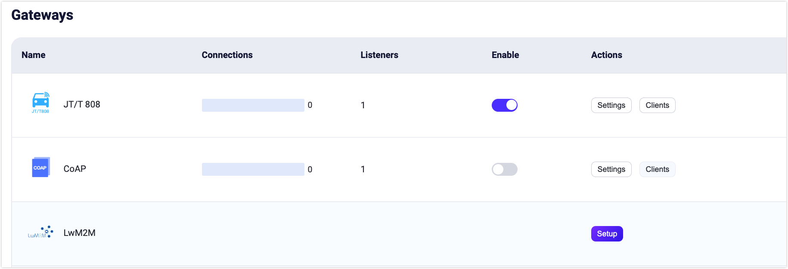
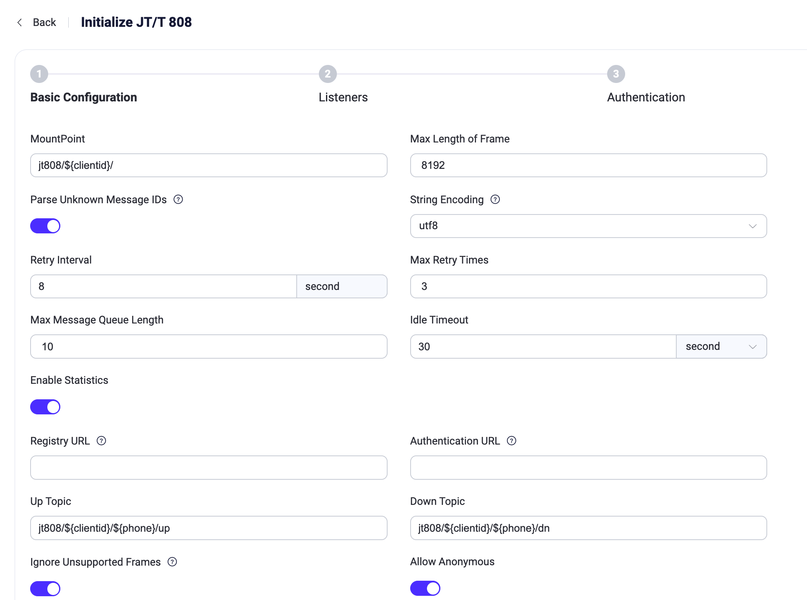
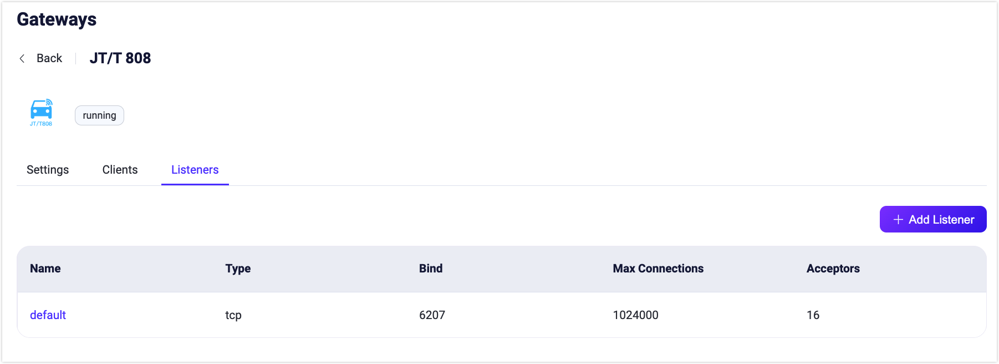

# JT/T 808 ゲートウェイ

EMQX 5.4 は、中国で広く使われている車両端末通信プロトコルである JT/T 808 プロトコルをサポートしています。これは車両と監視センター間のデータ通信に用いられます。EMQX の JT/T 808 ゲートウェイは、JT/T 808 クライアントからの接続を受け入れ、そのイベントやメッセージを MQTT のパブリッシュメッセージに変換します。

現時点の実装には以下の制限があります：

- TCP 送信に基づいています。
- JT/T 808 の 2011、2013、2019 年版のみをサポートし、2021 年版は未対応です。
- 端末の登録および登録解除メッセージを SMS 経由で送信できません。
- EMQX の組み込み認証システムは使用できず、端末登録／アクセス認証用の HTTP サービスアドレスの設定が必要です。

## JT/T 808 ゲートウェイの有効化

JT/T 808 ゲートウェイは、ダッシュボード、REST API、または `base.hocon` 設定ファイルを通じて有効化および設定できます。

### ダッシュボードからのゲートウェイ有効化

このセクションでは、ダッシュボードから JT/T 808 ゲートウェイを有効化する方法を説明します。

EMQX ダッシュボードの左ナビゲーションバーで **管理** -> **ゲートウェイ** をクリックします。**ゲートウェイ** ページにはサポートされているすべてのゲートウェイが一覧表示されます。**JT/T 808** を見つけ、**操作** 列の **設定** ボタンをクリックすると、**JT/T 808 初期化** ページに移動します。

::: tip

EMQX がクラスターで稼働している場合、ダッシュボードや REST API からの設定はクラスター全体に反映されます。単一ノードのみ設定したい場合は、[`base.hocon`](../../guides/configuration/configuration.md) でゲートウェイを設定してください。

:::

設定を簡略化するために、EMQX は **ゲートウェイ** ページのすべての必須フィールドにデフォルト値を提供しています。カスタム設定が不要な場合は、以下の3ステップで JT/T 808 ゲートウェイを有効化できます：

1. **基本パラメータ** ステップページで全てのデフォルト設定を承認し、**次へ** をクリックします。
2. 次に **リスナー** ステップページに遷移し、EMQX はポート 6207 の TCP リスナーを事前設定しています。再度 **次へ** をクリックして設定を確定します。
3. **有効化** ボタンをクリックして JT/T 808 ゲートウェイをアクティブにします。

ゲートウェイの有効化が完了すると、**ゲートウェイ** ページに戻り、JT/T 808 ゲートウェイが **有効** 状態になっていることを確認できます。



### REST API または設定ファイルによるゲートウェイ有効化

JT/T 808 ゲートウェイは REST API または設定ファイルを使っても有効化および設定できます：

:::: tabs type:card

::: tab REST API

```bash
curl -X 'PUT' 'http://127.0.0.1:18083/api/v5/gateways/jt808' \
  -u <your-application-key>:<your-security-key> \
  -H 'Content-Type: application/json' \
  -d '{
  "name": "jt808",
  "frame": {
    "max_length": 8192
  },
  "proto": {
    "auth": {
      "allow_anonymous": true
    },
    "up_topic":"jt808/${clientid}/${phone}/up",
    "dn_topic":"jt808/${clientid}/${phone}/dn"
  },
  "mountpoint": "jt808/${clientid}/",
  "retry_interval": "8s",
  "max_retry_times": 3,
  "message_queue_len": 10,
  "enable_stats": true,
  "idle_timeout": "30s",
  "listeners": [
    {
      "type":"tcp",
      "name":"default",
      "bind":"6207",
      "acceptors":16,
      "max_conn_rate":1000,
      "max_connections":1024000,
      "id":"jt808:tcp:default"
    }
  ]
  }'
```

:::

::: tab Configuration File

```properties
gateway {
  jt808 {
    enable_stats = true
    frame {max_length = 8192}
    idle_timeout = 30s
    listeners {
      tcp {
        default {
          acceptors = 16
          bind = "6207"
          max_conn_rate = 1000
          max_connections = 1024000
        }
      }
    }
    max_retry_times = 3
    message_queue_len = 10
    mountpoint = "jt808/${clientid}/"
    proto {
      auth {allow_anonymous = true}
      dn_topic = "jt808/${clientid}/${phone}/dn"
      up_topic = "jt808/${clientid}/${phone}/up"
    }
    retry_interval = 8s
  }
}
```

:::

::::

::: tip

EMQX がクラスターで稼働している場合、ダッシュボードや REST API からの設定はクラスター全体に反映されます。単一ノードのみ設定したい場合は、[`base.hocon`](../../guides/configuration/configuration.md) でゲートウェイを設定してください。

:::

JT/T 808 ゲートウェイは TCP タイプのリスナーのみをサポートしています。設定可能なパラメータの完全な一覧については、[ゲートウェイ設定 - リスナー](https://docs.emqx.com/en/enterprise/v@EE_VERSION@/hocon/) を参照してください。

## JT/T 808 ゲートウェイのカスタマイズ

デフォルト設定に加えて、EMQX はさまざまな設定オプションを提供し、特定のビジネス要件により適した構成が可能です。このセクションでは、**ゲートウェイ** ページで利用可能な設定オプションを詳しく説明します。

### 基本設定

ゲートウェイページで **JT/T 808** を見つけ、**操作** 列の **設定** をクリックします。**設定** ペインで JT/T 808 ゲートウェイをカスタマイズできます。



- **MountPoint**：パブリッシュやサブスクライブ時にすべてのトピックの前に付加される文字列を設定します。これにより異なるプロトコル間でのメッセージルーティングの分離が可能です。例：`jt808/${clientid}/`。このトピックプレフィックスはゲートウェイが管理し、クライアントはパブリッシュやサブスクライブ時に明示的に追加する必要はありません。
- **Max Length of Frame**：ゲートウェイが処理可能なフレームの最大サイズ（バイト単位）。デフォルトは `8192` バイトです。EMQX 6.0.5 以降では、この制限を超えるフレームは、**Ignore Unsupported Frames** の設定にかかわらず拒否され、クライアントが切断されます。
- **Parse Unknown Message IDs**：標準プロトコルに定義されていないメッセージ ID を解析するかどうか。
  - `true` に設定すると、未知のメッセージ ID を持つメッセージを処理し、ペイロードを Base64 エンコードして転送します。デフォルトは `true`。
  - `false` の場合、メッセージは無視されるか、**Ignore Unsupported Frames** の設定に応じてクライアントが切断されます。
- **String Encoding**：端末から報告される文字列の解析および端末への文字列のパッケージング・配信に使用する文字エンコーディングを指定します。
  - `utf8` に設定すると、UTF-8 エンコーディングで文字列を解析します。デフォルトは `UTF-8`。
  - `gbk` に設定すると、GBK エンコーディングで文字列を解析し、EMQX にパブリッシュする前に UTF-8 に変換します。
- **Retry Interval**：メッセージの配信に失敗した場合の再試行間隔。デフォルトは `8s`。
- **Max Retry Times**：メッセージ配信の最大試行回数。この回数を超えて配信できなかった場合、メッセージは破棄されます。デフォルトは `3`。
- **Max message queue length**：ダウンロードストリームメッセージ配信のための最大メッセージキュー長。デフォルトは `100`。
- **Idle Timeout**：接続中のクライアントが非アクティブとみなされ、切断されるまでの秒数。デフォルトは `30` 秒。
- **Enable Statistics**：ゲートウェイによる統計収集と報告を許可するかどうか。デフォルトは `true`。選択肢は `true` または `false`。
- **Registry**：JT/T 808 端末のレジストリセンター。`allow_anonymous` が `false` に設定されている場合は必須です。ゲートウェイが JT/T 808 登録メッセージを受信すると、このアドレスに HTTP リクエストとして登録情報を送信します。詳細は [クライアント認証・認可の設定](#configure-client-authentication-authorization) を参照してください。
- **Authentication URL**：クライアント認証を行う外部サービスの URL を指定します。
- **Up Topic**：ゲートウェイから EMQX へメッセージをパブリッシュする際の MQTT トピックパターン。JT/T 808 クライアントからのメッセージが上り方向でどのように MQTT トピックにマッピングされるかを定義します。デフォルトは `jt808/${clientid}/${phone}/up`。
- **Down Topic**：ブローカーからゲートウェイを経由して JT/T 808 クライアントへ送信されるメッセージの MQTT トピックパターン。MQTT ブローカーから JT/T 808 クライアントへの下り方向のメッセージルーティングを定義します。デフォルトは `jt808/${clientid}/${phone}/dn`。
- **Ignore Unsupported Frames**：標準プロトコルに準拠しない JT/T 808 フレームの処理方法を決定します。
  - `true` に設定すると、サポートされていないフレームはログに記録されますが、他の有効なメッセージの処理は継続され、カスタムや非標準メッセージによる切断を防ぎます。デフォルトは `true`。
  - `false` の場合、サポートされていないフレームを受信するとクライアントが切断されます。
- **Allow Anonymous**：クライアントが認証なしで接続できるかどうかを設定します。`true` に設定すると、認証情報なしでの接続を許可します。

### リスナーの追加

デフォルトでは、名前が **default** の TCP リスナーがポート `6207` で設定されており、1秒あたり最大 1,000 接続、最大 1,024,000 同時接続をサポートしています。**リスナー** タブをクリックすると、編集、削除、新規追加などのカスタマイズが可能です。



**+ リスナー追加** をクリックすると **リスナー追加** ページが開き、以下の設定項目を入力できます：

**基本設定**

- **名前**：リスナーの一意識別子を設定します。
- **タイプ**：プロトコルタイプを選択します。MQTT-SN の場合は `udp` または `dtls` が選択可能です。
- **バインド**：リスナーが接続を受け入れるポート番号を設定します。
- **MountPoint**（任意）：パブリッシュやサブスクライブ時にすべてのトピックの前に付加される文字列を設定し、異なるプロトコル間でのメッセージルーティング分離を実現します。

**リスナー設定**

- **アクター数**：アクターのプールサイズを設定します。デフォルトは `16`。
- **最大接続数**：リスナーが処理可能な同時接続の最大数。デフォルトは `1024000`。
- **最大接続レート**：リスナーが1秒あたり受け入れ可能な新規接続の最大数。デフォルトは `1000`。
- **プロキシプロトコル**：EMQX クラスターが HAProxy や NGINX の背後に配置されている場合に Proxy Protocol V1/V2 を有効化します。デフォルトは `false`。
- **プロキシプロトコルタイムアウト**：プロキシプロトコルのタイムアウト時間。タイムアウト内にプロキシプロトコルパケットが受信されない場合、EMQX は TCP 接続を切断します。デフォルトは `3` 秒。

**TCP 設定**

- **ActiveN**：ソケットの `{active, N}` オプションを設定します。これはソケットが能動的に処理可能な受信パケット数を示します。詳細は [Erlang ドキュメント - setopts/2](https://www.erlang.org/doc/apps/kernel/inet.html#setopts/2) を参照してください。
- **バッファ**：受信および送信パケットを格納するバッファサイズ（KB単位）を設定します。
- **TCP_NODELAY**：接続に対して TCP_NODELAY フラグを設定します。デフォルトは `false`。
- **SO_REUSEADDR**：ローカルのポート番号再利用を許可するかどうかを設定します。デフォルトは `true`。
- **送信タイムアウト**：接続の TCP 送信タイムアウト時間。デフォルトは `15` 秒。
- **送信タイムアウト時切断**：送信タイムアウト時に接続を切断するかどうか。デフォルトは `true`。

### クライアント認証・認可の設定

JT/T 808 プロトコル仕様における独自の登録／認証ロジックのため、JT/T 808 ゲートウェイは特定の登録サービス HTTP サービスへの登録／認証リクエストのみをサポートしています。

::: tip

ここでの「認証」は JT/T 808 プロトコルで定義された認証を指し、MQTT の Pub/Sub アクセス制御とは異なります。

:::

また、`gateway.jt808.proto.auth.allow_anonymous = true` を設定して匿名認証を有効化し、クライアントの登録／認証ロジックをスキップすることも可能です。

登録／認証リクエストの詳細フォーマットは以下の通りです。

#### 登録リクエスト

```properties
URL: http://127.0.0.1:8991/jt808/registry
Method: POST
Body:
   { "province": 58,
     "city": 59,
     "manufacturer": "Infinity",
     "model": "Q2",
     "license_number": "ZA334455",
     "dev_id": "xx11344",
     "color": 3,
     "phone", "00123456789"
   }
```

**登録レスポンス：**

:::: tabs type:card

::: tab 例 1

```json
{
  "code": 0,
  "authcode": "132456789"
}
```

:::

::: tab 例 2

```json
{
  "code": 1
}
```

:::

::::

戻りコードは以下の通りです：

0: 成功<br/> 1: 車両はすでに登録済み<br/> 2: データベースに該当車両なし<br/> 3: 端末はすでに登録済み<br/> 4: データベースに該当端末なし<br/>

#### 認証リクエスト

```properties
URL: http://127.0.0.1:8991/jt808/auth
Method: POST
Body:
   { "code": "authcode",
     "phone", "00123456789"
   }
```

**認証レスポンス：**

```
HTTP ステータスコード 200: 認証成功
その他: 認証失敗
```

注：認証リクエストは、システムが認証コードを保存していない場合（端末が直接認証メッセージを送信してログインする場合）のみ呼び出されます。

## データ交換フォーマット

詳細は [JT/T 808 ゲートウェイ データ交換フォーマット](./jt808_data_exchange.md) を参照してください。

## ユーザーレイヤーインターフェース

- 詳細な設定手順は、[ゲートウェイ設定 - JT/T 808 ゲートウェイ](https://docs.emqx.com/en/enterprise/v5.4.0/hocon/) を参照してください。
- 詳細な REST API インターフェースは、[REST API - ゲートウェイ](../../guides/api.md) を参照してください。
