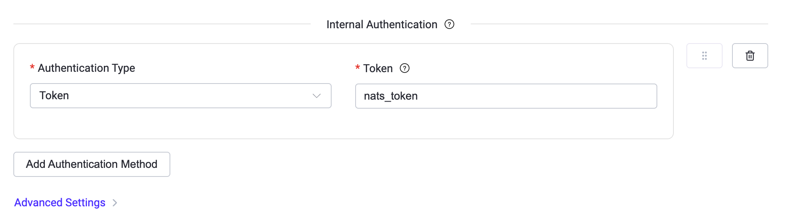
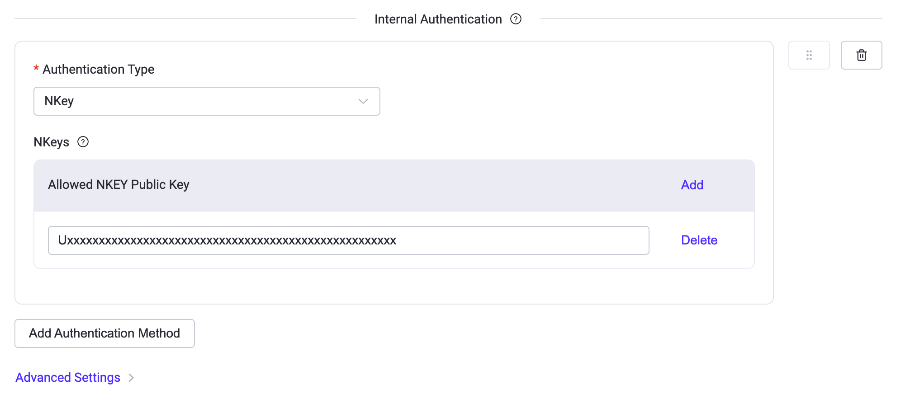
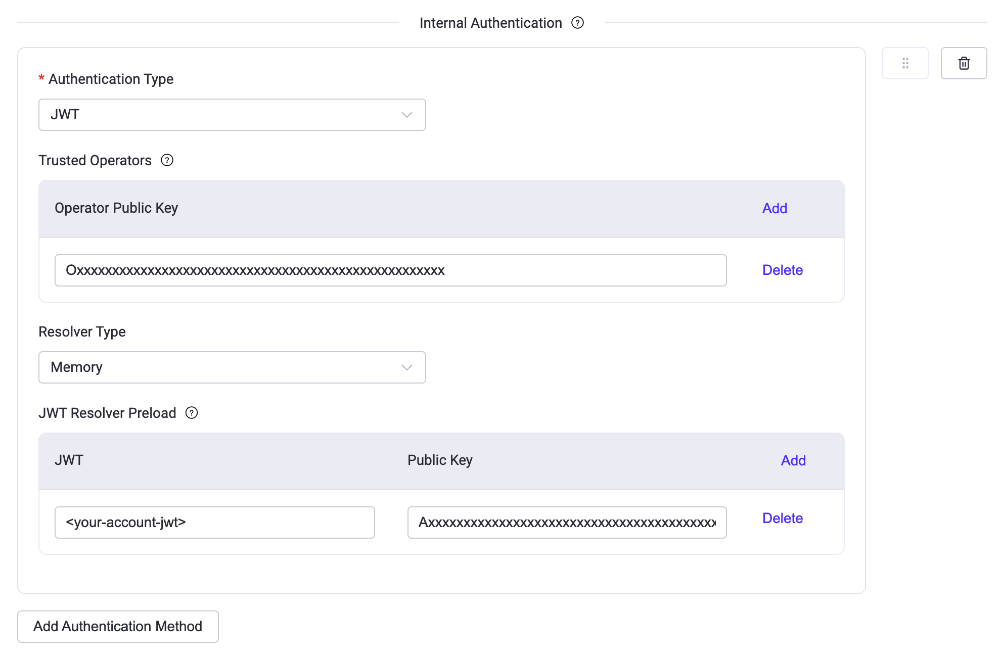

# NATS プロトコルゲートウェイ

EMQX 5.10.0 以降、EMQX は [NATS プロトコル](https://docs.nats.io/reference/reference-protocols/nats-protocol) に基づく NATS プロトコルゲートウェイを導入しました。これにより、EMQX は NATS クライアントからの接続を受け入れ、MQTT とのメッセージ相互運用を実現します。本書ではその機能概要と、NATS ゲートウェイの有効化および設定方法について説明します。

## 機能概要

NATS プロトコルゲートウェイは現在、以下の主要な機能をサポートしています。

### プロトコルサポート

- **NATS プロトコルのメッセージタイプを完全サポート**：
  - 接続およびセッション管理：`INFO`、`CONNECT`
  - メッセージのパブリッシュ／サブスクライブ：`PUB`、`HPUB`、`SUB`、`UNSUB`
  - メッセージ配信および応答：`MSG`、`HMSG`
  - ハートビートおよびステータス：`PING`、`PONG`、`+OK`、`-ERR`
- **Verbose モード対応**：クライアントが `CONNECT verbose=true` で接続した場合に応答確認を有効化。
- **豊富な認証方式をサポート**：Token、NKey、JWT、ユーザー名／パスワード認証に対応。

### MQTT との相互運用性

- **MQTT との双方向メッセージ相互運用**：
  - NATS クライアントからパブリッシュされたメッセージを MQTT パブリッシュに変換。
  - MQTT メッセージを対応するトピックをサブスクライブする NATS クライアントに転送。
- **NATS ワイルドカードサブスクリプションをサポート**し、自動的に MQTT 互換のトピック形式に変換。
- **Queue Group の共有サブスクリプションをサポート**：NATS の Queue Group サブスクリプションを MQTT の共有サブスクリプション形式に変換。
- **リクエスト／リプライモードをサポート**：
  - NATS クライアントからのリクエストを MQTT リクエストに変換。
  - 対象トピックに MQTT サブスクライバーがいない場合は、EMQX が迅速にエラー応答を返す。

### ネットワークおよび接続性

- **複数のトランスポートプロトコルをサポート**：TCP、TLS、WebSocket（WS）、および TLS 上の WebSocket（WSS）。

## NATS と MQTT 間のクロスプロトコルメッセージング

NATS プロトコルはパブリッシュ／サブスクライブメッセージングモデルに完全対応しており、NATS ゲートウェイを介して MQTT メッセージングと相互運用します。変換ルールは以下の通りです。

- **PUB および HPUB メッセージはパブリッシュ操作として扱われます**：
  - トピックは PUB メッセージの `subject` フィールドから派生します。例：`t.a` は MQTT トピック `t/a` に変換されます。
  - メッセージペイロードは PUB メッセージ本文から直接取得します。
  - クライアントが `CONNECT verbose=1` で接続した場合、変換後の MQTT メッセージは QoS 1 を使用し、それ以外は QoS 0 となります。
- **SUB メッセージはサブスクリプション要求として扱われます**：
  - トピックは SUB メッセージの `subject` フィールドから派生します。例：`t.a` は MQTT トピック `t/a` に変換されます。
  - QoS は同様のルールに従い、`verbose=1` で QoS 1、それ以外は QoS 0。
  - ワイルドカードをサポートします。例：`*.b.>` は `+/b/#` に変換されます。
  - Queue Group をサポート。SUB メッセージの Queue Group 値は MQTT 共有サブスクリプションのグループ名に変換されます。
- **UNSUB メッセージはサブスクリプション解除要求として扱われ、サブスクリプション ID（sid）で解除対象を識別します。**

::: tip

NATS ゲートウェイはパブリッシュ／サブスクライブ操作に対する独自のアクセス制御を実装していません。トピックの権限管理は統一された [認可設定](../../guides/access-control/authz/authz.md) を使用してください。

:::

## NATS ゲートウェイの有効化

EMQX 5.10.0 以降、NATS ゲートウェイは以下の3つの方法で有効化できます。

- ダッシュボードから
- REST API を使用して
- `base.hocon` 設定ファイルを編集して

::: tip

クラスター環境では、ダッシュボードまたは REST API で行った設定は自動的に全ノードに適用されます。特定ノードのみに設定を反映したい場合は、そのノードの `base.hocon` 設定ファイルを使用してください。

:::

### ダッシュボードからの有効化

EMQX ダッシュボードから NATS ゲートウェイを素早く有効化する手順は以下の通りです。

1. 左メニューの **管理** -> **ゲートウェイ** に移動します。
2. **ゲートウェイ** ページで **NATS** を見つけ、**操作** 列の **セットアップ** ボタンをクリックして **NATS 初期化** ウィザードを起動します。
3. ウィザードの指示に従います：
   - **基本設定** ステップでデフォルト値を受け入れ、**次へ** をクリック。
   - **リスナー** ステップでリスナーを設定するかスキップして **次へ** をクリック。
     （リスナーの詳細設定は [リスナーの追加](#add-a-listener) を参照してください。）
   - **有効化** をクリックして NATS ゲートウェイを起動。

有効化が完了すると、**ゲートウェイ** ページにリダイレクトされ、NATS ゲートウェイのステータスが **有効** と表示されます。

### REST API からの有効化

REST API を使用して NATS ゲートウェイを有効化する例は以下の通りです。

```bash
curl -X 'PUT' 'http://127.0.0.1:18083/api/v5/gateway/nats' \
  -u <your-application-key>:<your-security-key> \
  -H 'Content-Type: application/json' \
  -d '{
  "name": "nats",
  "enable": true,
  "mountpoint": "nats/",
  "listeners": [
    {
      "type": "tcp",
      "name": "default",
      "bind": "4222",
      "max_conn_rate": 1000,
      "max_connections": 1024000
    }
  ]
}'
```

### 設定ファイルからの有効化

`base.hocon` で NATS ゲートウェイを有効化する設定例は以下の通りです。

```properties
gateway.nats {

  mountpoint = "nats/"

  listeners.tcp.default {
    bind = 4222
    acceptors = 16
    max_connections = 1024000
    max_conn_rate = 1000
  }
}
```

NATS ゲートウェイは TCP、SSL、WS、WSS タイプのリスナーをサポートします。設定可能なパラメーターの完全な一覧は、[EMQX Enterprise 設定マニュアル](https://docs.emqx.com/en/enterprise/v@EE_VERSION@/hocon/) のゲートウェイ設定 - リスナーセクションを参照してください。

## NATS ゲートウェイのカスタマイズ

デフォルト設定に加え、EMQX はビジネスニーズに合わせてさまざまな設定オプションを提供しています。本節では **ゲートウェイ** ページで利用可能なオプションを詳細に解説します。

### 基本設定

1. **ゲートウェイ** ページで **NATS** を見つけ、**操作** 列の **設定** ボタンをクリックします。

2. **設定** タブで、ゲートウェイの接続パラメーター、マウントポイントプレフィックス、クライアント識別情報の上書きを設定できます。

   - **サーバー名**：ゲートウェイの内部参照用の一意識別子。デフォルトは `emq_nats_gateway`。

   - **マウントポイント**：ゲートウェイを通過するすべてのトピックに自動的に付与される文字列プレフィックス。プロトコル間のトピック分離に役立ちます。例：`nats/` を使用すると、クライアントが手動でプレフィックスを含めることなくクロスプロトコルルーティングが可能。

   - **デフォルトハートビート間隔**：サーバーがクライアントの生存確認のために `PING` パケットを送信する間隔。デフォルトは 60 秒。

   - **ハートビートタイムアウト閾値**：クライアントがこの時間内に応答しない場合、切断とみなします。

   - **最大ペイロードサイズ**：許容されるメッセージデータの最大サイズ。`PUB` ではペイロードに適用され、`HPUB` ではヘッダー部とヘッダー＋ペイロードの合計サイズがこの値を超えない必要があります。EMQX は設定値を `INFO.max_payload` として通知します。デフォルトは 1048576 バイト。

   - **最大コントロールライン長** <Badge type="tip" text="6.0.5+" />：CRLF 区切りを除く NATS プロトコルのコントロールラインの最大長。デフォルトは 4096 バイト。最小設定値は 1024 バイト。

   - **アイドルタイムアウト**：非アクティブなクライアント接続が切断されるまでの秒数。デフォルトは 30 秒。

   - **統計収集の有効化**：このゲートウェイの統計収集とレポートを有効にするかどうか。デフォルトは有効。

   - **クライアント情報上書き**：`CONNECT` パケットから認証情報を抽出する方法を定義。

     ::: tip

     認証を有効にする場合は、`username` と `password` に正しいフィールドをマッピングして、認証情報が正しく処理されるようにしてください。

     :::

     - **ユーザー名**：`CONNECT` パケットの `user` フィールドにマッピング。
     - **パスワード**：`CONNECT` パケットの `pass` フィールドにマッピング。
     - **クライアント ID**：`${generated}` で自動生成、または独自ロジックでカスタマイズ可能。

   コントロールラインが `max_control_line` を超えるか、宣言されたメッセージサイズが `max_payload_size` を超える場合、EMQX はフレームを拒否して接続を切断します。メッセージ内容のバッファリング前にサイズを検証します。

3. **更新** をクリックして変更を適用します。

### リスナーの追加

**リスナー** タブでリスナーの編集、削除、新規追加が可能です。

1. **リスナー** タブで **+ リスナー追加** をクリックします。

2. **リスナー追加** ダイアログで以下を設定します。

   **基本設定**

   - **名前**：リスナーを識別する一意の名前。
   - **タイプ**：リスナーの種類を選択。NATS では `tcp`、`ssl`、`ws`、`wss` がサポートされています。
   - **バインド**：リスナーが接続を受け付けるポート番号。

   **リスナー設定**

   - **最大接続数**：同時接続の最大数。デフォルトは 1024000。
   - **最大接続レート（リスナー）**：1秒あたりに受け入れる新規接続の最大数。デフォルトは 1000。
   - **プロキシプロトコル**：Proxy Protocol v1/v2 の有効化。デフォルトは無効（false）。
   - **プロキシプロトコルタイムアウト**：Proxy Protocol ヘッダー受信のタイムアウト。指定時間内にヘッダーが受信されない場合、接続を切断。デフォルトは 3 秒。

   **ピア検証設定**（SSL および WSS リスナーのみ）

   相互 TLS はデフォルトで有効です。TLS 証明書、秘密鍵、CA 証明書を設定する必要があります。これらはアップロードまたは直接フォームに貼り付け可能です。詳細は [SSL/TLS 接続の有効化](../../guides/network/emqx-mqtt-tls.md) を参照してください。

   - **TLS 証明書**：TLS 証明書ファイルのパスまたは内容。
   - **TLS 秘密鍵**：TLS 秘密鍵ファイルのパスまたは内容。
   - **CA 証明書**：CA 証明書ファイルのパスまたは内容。
   - **ピア証明書検証の強制**：クライアント証明書検証を必須にするか。デフォルトは有効（true）。

3. **追加** をクリックしてリスナー作成を完了します。

#### 転送クライアントアドレスの設定

EMQX 6.3.0 以降、`proxy_address_header` と `proxy_port_header` のデフォルトは空文字列 `""` となり、NATS WebSocket リスナーは明示的に転送ヘッダー名を設定しない限り TCP ピアアドレスとポートを使用します。

NATS リスナーが信頼できるプロキシの背後にあり、転送ヘッダーを書き換える場合は、`base.hocon` でヘッダー名を設定してください。例：

```hocon
gateway.nats.listeners.ws.default.websocket {
  proxy_address_header = "x-forwarded-for"
  proxy_port_header = "x-forwarded-port"
}
```

WSS リスナーの場合は `gateway.nats.listeners.wss.<listener-name>.websocket` を使用します。EMQX は設定されたヘッダーの最初（左端）の値を使用し、ヘッダーが存在しないか無効な場合は TCP ピアアドレスまたはポートを使用します。

これらの設定は、信頼できるプロキシがクライアント提供値を書き換える場合のみ行ってください。そうでなければ、クライアントが偽造された送信元アドレスを EMQX に使わせる可能性があります。

EMQX 6.3.0 はゲートウェイ WebSocket リスナーのヘッダー名マッチングも修正しています。6.3.0 より前は設定名がリクエストヘッダーと一致せず、TCP ピアアドレスとポートが使われていました。

### 認証の設定

NATS ゲートウェイは以下の2種類の認証方式をサポートします。

- **ゲートウェイ認証（`authentication`）**：EMQX ゲートウェイ認証器で、通常はユーザー名／パスワード形式のバックエンドに使用。
- **内部ゲートウェイ認証（`internal_authn`）**：NATS ネイティブのユーザー名／パスワード以外の認証。

両方が有効な場合、EMQX は以下の順序で認証を評価します。

1. `internal_authn` のメソッドを上から順に評価。
2. 必要な認証情報が不足している場合は次のメソッドを試行。
3. 認証情報があるが検証に失敗した場合は即座に接続拒否。
4. すべての内部メソッドがスキップされ、`authentication` が設定されていればゲートウェイ認証にフォールバック。
5. 内部メソッドもゲートウェイ認証も設定されていなければ、すべての NATS クライアントの接続を許可。

#### ゲートウェイ認証の設定

他のゲートウェイ同様、NATS ゲートウェイは標準の EMQX 認証器と連携可能です。以下の認証バックエンドをサポートします。

- [組み込みデータベース認証](../../guides/access-control/authn/mnesia.md)
- [MySQL 認証](../../guides/access-control/authn/mysql.md)
- [MongoDB 認証](../../guides/access-control/authn/mongodb.md)
- [PostgreSQL 認証](../../guides/access-control/authn/postgresql.md)
- [Redis 認証](../../guides/access-control/authn/redis.md)
- [HTTP サーバー認証](../../guides/access-control/authn/http.md)
- [JWT 認証](../../guides/access-control/authn/jwt.md)
- [LDAP 認証](../../guides/access-control/authn/ldap.md)

ゲートウェイ認証では、NATS の `CONNECT` パケットから以下のフィールドを抽出します。

- **クライアント ID**：デフォルトで自動生成。
- **ユーザー名**：`user` フィールドの値。
- **パスワード**：`pass` フィールドの値。

MQTT プロトコルとは異なり、ゲートウェイ認証は単一の認証器のみをサポートし、認証器のリスト（チェーン）はサポートしません。

##### ダッシュボードでの設定

以下は HTTP サーバーを使ったパスワード認証の設定例です。

1. NATS ゲートウェイ設定の **認証** タブに移動。
2. **+ 認証作成** をクリックし、メカニズムに **パスワードベース** を選択、データソースに **HTTP サーバー** を選択して **次へ**。
3. 設定パラメーターを入力します。詳細は [HTTP パスワード認証](../../guides/access-control/authn/http.md) を参照してください。
4. **作成** をクリックし、設定内容を確認して **更新** をクリック。

##### REST API での設定

以下は組み込みデータベース認証を REST API で設定する例です。

```bash
curl -X 'POST' \
  'http://127.0.0.1:18083/api/v5/gateway/nats/authentication' \
  -u <your-application-key>:<your-security-key> \
  -H 'accept: application/json' \
  -H 'Content-Type: application/json' \
  -d '{
  "backend": "built_in_database",
  "mechanism": "password_based",
  "password_hash_algorithm": {
    "name": "sha256",
    "salt_position": "suffix"
  },
  "user_id_type": "username"
}'
```

##### 設定ファイルでの設定

以下は設定ファイルで組み込みデータベース認証を設定する例です。

```properties
gateway.nats {

  authentication {
    backend = built_in_database
    mechanism = password_based
    password_hash_algorithm {
      name = sha256
      salt_position = suffix
    }
    user_id_type = username
  }
}
```

その他の認証タイプについては、[EMQX 認証器](../../guides/access-control/authn/authn.md#emqx-authenticators) のドキュメントを参照してください。

#### 内部認証（`internal_authn`）の設定

これは NATS ゲートウェイ固有の認証機能で、NATS サーバーの標準的な3つの認証方式をサポートします。

##### トークン認証

- NATS の `CONNECT` パケットの `auth_token` フィールドを使用。
- プレーンなトークンと bcrypt ハッシュ（`$2a$`、`$2b$`、`$2y$`）をサポート。
- NATS リファレンス：[Token authentication](https://docs.nats.io/running-a-nats-service/configuration/securing_nats/auth_intro/tokens)

ダッシュボード設定例：



設定ファイル例：

```properties
gateway.nats {
  internal_authn = [
    {
      type = token
      token = "nats_token"
    }
  ]
}
```

##### NKey 認証

- NATS の `CONNECT` パケットの `nkey` + `sig` チャレンジ／レスポンスを使用。
- `nkeys` は有効な NATS ユーザーパブリックキー（`U...`）である必要があります。
- NATS リファレンス：[NKey authentication](https://docs.nats.io/running-a-nats-service/configuration/securing_nats/auth_intro/nkey_auth)

ダッシュボード設定例：



設定ファイル例：

```properties
gateway.nats {
  internal_authn = [
    {
      type = nkey
      nkeys = [
        "Uxxxxxxxxxxxxxxxxxxxxxxxxxxxxxxxxxxxxxxxxxxxxxxxxxxxx"
      ]
    }
  ]
}
```

##### JWT 認証（ACL サポート付き）

- NATS の `CONNECT` パケットの `jwt` + `sig`（およびオプションの `nkey`）を使用。
- 信頼されたオペレーターリストと JWT プリロードリストの両方が必要。
- リゾルバータイプは現在 `memory` のみ対応。つまり有効なアカウント JWT を設定でプリロードする方式。
- NATS リファレンス：[JWT authentication](https://docs.nats.io/running-a-nats-service/configuration/securing_nats/auth_intro/jwt)

ダッシュボード設定例：



設定ファイル例：

```properties
gateway.nats {
  internal_authn = [
    {
      type = jwt
      trusted_operators = [
        "Oxxxxxxxxxxxxxxxxxxxxxxxxxxxxxxxxxxxxxxxxxxxxxxxxxxxx"
      ]
      resolver {
        type = memory
        resolver_preload = [
          {
            pubkey = "Axxxxxxxxxxxxxxxxxxxxxxxxxxxxxxxxxxxxxxxxxxxxxxxxxxxx"
            jwt = "<your-account-jwt>"
          }
        ]
      }
    }
  ]
}
```

JWT のユーザークレームは ACL ルールも保持可能です。EMQX は `permissions` と `nats.pub` / `nats.sub` クレームをサポートし、最終的な認可結果は JWT ACL と EMQX 認可ルールの積集合となります。

JWT ACL クレームの例：

```json
{
  "sub": "Uxxxxxxxxxxxxxxxxxxxxxxxxxxxxxxxxxxxxxxxxxxxxxxxxxxxx",
  "iss": "Axxxxxxxxxxxxxxxxxxxxxxxxxxxxxxxxxxxxxxxxxxxxxxxxxxxx",
  "nats": {
    "pub": {
      "allow": ["sensors.>"],
      "deny": ["sensors.secret.>"]
    },
    "sub": {
      "allow": ["alerts.>"],
      "deny": ["alerts.internal.>"]
    }
  }
}
```

### ユーザーレベルインターフェースの設定

- 設定の完全なリファレンスは：[NATS ゲートウェイ設定](https://docs.emqx.com/en/enterprise/v@EE_VERSION@/hocon/)
- REST API の詳細は：[ゲートウェイ REST API ドキュメント](https://docs.emqx.com/en/enterprise/v@EE_MINOR_VERSION@/admin/api-docs)

## さらに詳しく

NATS プロトコルゲートウェイとそのユースケースについては、以下のブログ記事をご覧ください。

[EMQX NATS Gateway: MQTT-NATS 双方向相互運用の実現](https://www.emqx.com/en/blog/emqx-nats-gateway)
