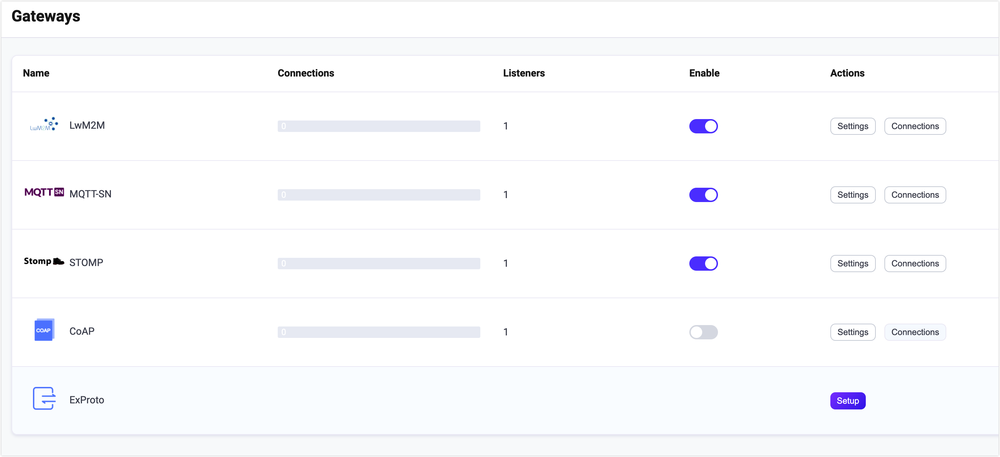

# STOMP ゲートウェイ

EMQX STOMP ゲートウェイは、[STOMP](https://stomp.github.io/stomp-specification-1.2.html) と MQTT プロトコル間のギャップを埋めるメッセージングプロトコルトランスレーターであり、これらのプロトコルを使用するクライアント同士の通信を可能にします。

この STOMP ゲートウェイは、クライアントとサーバーのための軽量でシンプルなメッセージングソリューションを提供し、多様なメッセージング環境でのメッセージ交換を実現します。TCP および SSL タイプのリスナーをサポートしており、STOMP ゲートウェイは柔軟かつ多用途なメッセージングシステム構築ツールです。

::: tip

STOMP ゲートウェイは [Stomp v1.2](https://stomp.github.io/stomp-specification-1.2.html) をベースにしており、STOMP v1.0 および v1.1 の仕様と互換性があります。

:::

## STOMP ゲートウェイの有効化

EMQX 5 では、STOMP ゲートウェイはダッシュボード、REST API、および設定ファイル `base.hocon` を通じて設定および有効化できます。本節では、ダッシュボードを使った設定例を示し、操作手順を説明します。

EMQX ダッシュボードの左ナビゲーションメニューで **Management** -> **Gateways** をクリックします。**Gateways** ページにはサポートされているすべてのゲートウェイが一覧表示されます。**STOMP** を探し、**Actions** 列の **Setup** をクリックすると、**Initialize STOMP** ページに遷移します。

::: tip

EMQX をクラスターで稼働している場合、ダッシュボードや REST API で行った設定はクラスター全体に影響します。特定のノードだけ設定を変更したい場合は、[`base.hocon`](../../guides/configuration/configuration.md) で設定してください。

:::

設定を簡略化するため、EMQX は **Gateways** ページのすべての必須フィールドにデフォルト値を提供しています。大幅なカスタマイズが不要な場合、STOMP ゲートウェイはわずか3クリックで有効化できます。

1. **Basic Configuration** タブで **Next** をクリックし、すべてのデフォルト設定を受け入れます。
2. 次に **Listeners** タブに遷移し、EMQX がポート `61613` で UDP リスナーを事前設定しています。ここでも **Next** をクリックして設定を確定します。
3. 最後に **Enable** ボタンをクリックして STOMP ゲートウェイを有効化します。

ゲートウェイの有効化が完了すると、**Gateways** ページに戻り、STOMP ゲートウェイのステータスが **Enabled** と表示されていることを確認できます。



EMQX 5.0 では、ダッシュボードを通じて Stomp ゲートウェイを設定および有効化できます。

上記の設定は REST API でも行えます。

**例:**

```bash
curl -X 'PUT' 'http://127.0.0.1:18083/api/v5/gateways/stomp' \
  -u <your-application-key>:<your-security-key> \
  -H 'Content-Type: application/json' \
  -d '{
  "name": "stomp",
  "enable": true,
  "mountpoint": "stomp/",
  "listeners": [
    {
      "type": "tcp",
      "name": "default",
      "bind": "61613",
      "max_conn_rate": 1000,
      "max_connections": 1024000
    }
  ]
}'
```

## STOMP クライアントとの連携

### クライアントライブラリ

STOMP ゲートウェイを構築した後、STOMP クライアントツールを使って接続をテストし、正常に動作しているか確認できます。例えば [stomp.py](https://github.com/jasonrbriggs/stomp.py) などがあります。

### パブリッシュ／サブスクライブ

STOMP プロトコルは PUB/SUB メッセージングモデルと完全に互換性があり、STOMP ゲートウェイは以下を使用します。

- STOMP プロトコルの `SEND` メッセージをメッセージパブリッシュに使用します。`SEND` メッセージの `destination` フィールドがトピックを指定し、メッセージ内容は `SEND` メッセージのボディに含まれます。QoS（サービス品質）は固定で 0 です。
- STOMP プロトコルの `SUBSCRIBE` メッセージをサブスクライブ要求に使用します。`SUBSCRIBE` メッセージの `destination` フィールドがトピックを指定します。QoS は固定で 0 であり、MQTT プロトコルで定義されているワイルドカードをサポートします。
- STOMP プロトコルの `UNSUBSCRIBE` メッセージをサブスクライブ解除要求に使用します。`UNSUBSCRIBE` メッセージの `destination` フィールドがトピックを指定します。

## STOMP ゲートウェイのカスタマイズ

デフォルト設定に加え、EMQX はさまざまな設定オプションを提供し、特定のビジネス要件により適合させることができます。本節では **Gateways** ページで利用可能な各種フィールドについて詳しく解説します。

### 基本設定

**Basic Configuration** タブでは、許容する最大ヘッダー数、ヘッダー長、統計情報の有効化、ゲートウェイの MountPoint 文字列設定が行えます。以下に各フィールドの詳細を示します。

<!--スクリーンショットは後日追加予定-->

1. **Max Header**: 許容する最大 STOMP ヘッダー数を設定します。デフォルトは `10` です。

2. **Max Each Header Length**: STOMP ヘッダー名と値の合計最大長をバイト単位で設定します。デフォルトは `1024` バイトです。

3. **Max Body Length**: STOMP フレームボディの最大サイズをバイト単位で設定します。デフォルトは `65536` バイトです。

4. **Idle Timeout**: 非アクティブ状態が続いた場合に接続を切断するまでの最大待機時間（秒）を設定します。

5. **Enable Statistics**: ゲートウェイが統計情報を収集・報告するかどうかを設定します。デフォルトは `true`、選択肢は `true` または `false` です。

6. **MountPoint**: パブリッシュやサブスクライブ時にすべてのトピックの先頭に付加される文字列を設定します。これにより異なるプロトコル間でのメッセージルーティングの分離を実現できます。例：`stomp/`

   **注意**: このトピックプレフィックスはゲートウェイ側で管理されるため、クライアントはパブリッシュやサブスクライブ時に明示的にこのプレフィックスを追加する必要はありません。

### STOMP トランザクションの制限 <Badge type="tip" text="6.0.5+" />

`gateway.stomp.transaction` を使って、各 STOMP 接続が保持するトランザクション状態を制限できます。トランザクション設定が省略された場合、EMQX は以下のデフォルト値を適用します。

| オプション | デフォルト | 説明 |
| --- | --- | --- |
| `max_transactions` | `100` | 1 接続あたり同時に開けるトランザクションの最大数 |
| `max_actions_per_transaction` | `1000` | 1 トランザクション内でバッファ可能な `SEND`、`ACK`、`NACK` フレームの最大数 |
| `max_retained_bytes` | `16777216` バイト | 1 接続あたりすべての開いているトランザクションが保持できる合計バイト数の最大値 |
| `timeout` | `60s` | 開いているトランザクションが期限切れとなり EMQX が破棄するまでの時間。0 より大きい値である必要があります。 |

設定されたトランザクション数、バッファフレーム数、または保持バイト数の制限を超えた場合、EMQX は STOMP の `ERROR` フレームを送信し、接続を切断します。

### リスナーの追加

ポート `61613` で名前が **default** の TCP リスナーがすでに設定されており、プール内のアセプター数は最大 16、同時接続数は最大 1,024,000 まで対応可能です。よりカスタマイズした設定を行う場合は **Settings** をクリックし、リスナーを削除する場合は **Delete** をクリック、新しいリスナーを追加する場合は **+ Add Listener** をクリックしてください。

::: tip

STOMP ゲートウェイは TCP および SSL タイプのリスナーのみをサポートしています。

:::

**Add Listener** をクリックすると **Add Listener** ページが開き、以下の設定が可能です。

**基本設定**

- **Name**: リスナーの一意識別子を設定します。
- **Type**: プロトコルタイプを選択します。STOMP では **tcp** または **ssl** を選択可能です。
- **Bind**: リスナーが着信接続を受け付けるポート番号を設定します。
- **MountPoint**（任意）: パブリッシュやサブスクライブ時にすべてのトピックの先頭に付加される文字列を設定し、異なるプロトコル間でのメッセージルーティング分離を実現します。

**リスナー設定**

- **Acceptor**: アセプタープールのサイズを設定します。デフォルトは **16** です。
- **Max Connections**: リスナーが処理可能な同時接続数の最大値を設定します。デフォルトは **1024000** です。
- **Max Connection Rate**: リスナーが秒間に受け入れ可能な新規接続の最大レートを設定します。デフォルトは **1000** です。
- **Proxy Protocol**: EMQX が [ロードバランサー](../../guides/cluster/lb.md) の背後にある場合に、プロトコル V1/V2 を有効にします。
- **Proxy Protocol Timeout**: 非アクティブ状態のため接続を切断するまでの、プロキシプロトコルパッケージの最大待機時間（秒）を設定します。デフォルトは **3秒** です。

**TCP 設定**

- **ActiveN**: ソケットの `{active, N}` オプションを設定します。これはソケットが能動的に処理可能な受信パケット数を意味します。詳細は [Erlang Documentation - setopts/2](https://www.erlang.org/doc/apps/kernel/inet.html#setopts/2) を参照してください。
- **Buffer**: 受信および送信パケットを格納するバッファサイズを KB 単位で設定します。
- **TCP_NODELAY**: 接続に対して `TCP_NODELAY` フラグを有効にするかどうかを設定します。これは、クライアントが前のデータのアックを待たずに追加データを送信できるかどうかを制御します。デフォルトは **false**、選択肢は **true** または **false** です。
- **SO_REUSEADDR**: ポート番号のローカル再利用を許可するかどうかを設定します。
- **Send Timeout**: 非アクティブ状態のため接続を切断するまでの送信タイムアウト時間（秒）を設定します。デフォルトは **15秒** です。
- **Send Timeout**: 送信タイムアウト時に接続を切断するかどうかを設定します。

**SSL 設定**（SSL リスナーのみ）

TLS 検証を有効にするかどうかをトグルスイッチで設定できます。ただし、その前に関連する **TLS Cert**、**TLS Key**、および **CA Cert** の情報を、ファイル内容の入力または **Select File** ボタンでのアップロードにより設定する必要があります。詳細は [Enable SSL/TLS Connections](../../guides/network/emqx-mqtt-tls.md) を参照してください。

その後、以下の設定を続けます。

- **SSL Versions**: サポートする SSL バージョンを設定します。デフォルトは **tlsv1.3**、**tlsv1.2**、**tlsv1.1**、および **tlsv1** です。
- **Fail If No Peer Cert**: クライアントが空の証明書を送信した場合に EMQX が接続を拒否するかどうかを設定します。デフォルトは **false**、選択肢は **true** または **false** です。
- **Intermediate Certificate Depth**: ピア証明書に続く有効な認証パスに含まれる自己発行でない中間証明書の最大数を設定します。デフォルトは **10** です。
- **Key Password**: プライベートキーがパスワード保護されている場合に使用するユーザーパスワードを設定します。

## 認証の設定

STOMP プロトコルの接続メッセージにはすでにユーザー名とパスワードの概念が定義されているため、STOMP は以下のような多様な認証タイプをサポートしています。

- [組み込みデータベース認証](../../guides/access-control/authn/mnesia.md)
- [MySQL 認証](../../guides/access-control/authn/mysql.md)
- [MongoDB 認証](../../guides/access-control/authn/mongodb.md)
- [PostgreSQL 認証](../../guides/access-control/authn/postgresql.md)
- [Redis 認証](../../guides/access-control/authn/redis.md)
- [HTTP サーバー認証](../../guides/access-control/authn/http.md)
- [JWT 認証](../../guides/access-control/authn/jwt.md)
- [LDAP 認証](../../guides/access-control/authn/ldap.md)

STOMP ゲートウェイは STOMP プロトコルの `CONNECT` または `STOMP` メッセージ内の情報を使ってクライアントの認証フィールドを生成します。

- クライアント ID: ランダムに生成される文字列
- ユーザー名: `CONNECT` または `STOMP` メッセージヘッダーの `login` フィールドの値
- パスワード: `CONNECT` または `STOMP` メッセージヘッダーの `passcode` フィールドの値

REST API を使って Stomp ゲートウェイ用の組み込みデータベース認証を作成することも可能です。

**例:**

```bash
curl -X 'POST' \
  'http://127.0.0.1:18083/api/v5/gateway/stomp/authentication' \
  -u <your-application-key>:<your-security-key> \
  -H 'accept: application/json' \
  -H 'Content-Type: application/json' \
  -d '{
  "backend": "built_in_database",
  "mechanism": "password_based",
  "password_hash_algorithm": {
    "name": "sha256",
    "salt_position": "suffix"
  },
  "user_id_type": "username"
}'
```

::: tip

MQTT プロトコルとは異なり、**ゲートウェイは認証器の作成のみをサポートし、認証器のリスト（または認証チェーン）はサポートしていません**。

認証器が有効化されていない場合、すべての STOMP クライアントはログインが許可されます。

:::
