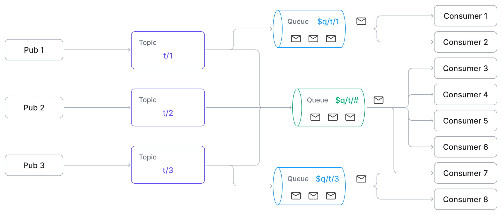

# メッセージキュー

EMQX 6.0で導入されたメッセージキュー機能は、MQTTのサブスクライブ／パブリッシュパターンを耐久性のあるキューセマンティクスで拡張し、信頼性の高い非同期メッセージ配信を可能にします。RabbitMQのようなエンタープライズグレードのメッセージキューで一般的に見られる機能を、追加のインフラなしでネイティブなMQTT機能に付加します。

このページでは、EMQXのメッセージキュー機能の設計動機、主要概念、内部アーキテクチャ、メッセージフロー、実際の応用シナリオについて包括的に解説します。

## メッセージキューとは？

EMQXのメッセージキューは、サブスクライバーの有無に関わらずMQTTメッセージを保持する耐久性のあるサーバー側バッファです。各キューは特定のトピックフィルターに紐づいており、その寿命の間にフィルターにマッチするすべてのメッセージを自動的に保存します。

従来のMQTTの動作とは異なり、メッセージキューはクライアントがオンラインでない場合でもメッセージを永続化します。クライアントは特別な`$q/{topic}`形式をサブスクライブすることでこれらのメッセージを消費できます。

メッセージキューは組み込みの耐久ストレージを使用します。メッセージキューを有効にする前に、EMQXのデータディレクトリがローカルファイルシステムを使用していることを確認してください。[組み込み耐久ストレージのバックエンド](../design/durable-storage.md#embedded-backends)はNFSやSMB/CIFSなどのネットワークファイルシステムをサポートしていません。

## なぜメッセージキューを使うのか？

MQTTは軽量で広く採用されているパブリッシュ／サブスクライブプロトコルです。しかし、そのデフォルトの動作はメッセージ配信をサブスクライバーの可用性に強く依存しており、非同期や遅延消費のシナリオでは制約となることがあります。

### MQTTの制限

MQTTは[共有サブスクリプション](../../get-started/messaging/mqtt-shared-subscription.md)（`$share/{group}/topic`）を通じてキューのような機能を一部サポートしていますが、以下の制限があります：

- サブスクライバーがオンラインでない場合、**メッセージは保持されません**。
- TTL（有効期限）、キューサイズ制限、オーバーフロー制御の**組み込みサポートがありません**。
- キーごとに最新の値のみを保持するような**メッセージの重複排除機能がありません**。
- キューの明示的なライフサイクル管理がありません。

これらの制限により、以下のようなパターンの実装が困難です：

- デバイスがオンラインになる前にコマンドを送信する。
- 常時接続していないワーカーにタスクを送る。
- 最新の状態や設定更新のみを保持する。

### メッセージキューでMQTTを拡張

メッセージキューはEMQXのMQTTプロトコルを拡張し、サブスクライバーのオンライン状態に関わらずメッセージを永続化して後続処理を可能にします。主な特徴は以下の通りです：

- **クライアントがオフラインでもメッセージを永続化**：キューは厳密な順序付けを保証しませんが、信頼性の高い非同期配信を実現し、軽量MQTT通信と高度なエンタープライズメッセージングの橋渡しをします。
- **明示的なキュー宣言とプロパティ設定**：各キューはTTL、サイズ制限、ディスパッチ戦略などの設定が可能で、メッセージの保持と配信を細かく制御できます。
- **オプションのラストバリューセマンティクス**：同じキーを持つメッセージが前のものを上書きし、最新の状態や設定更新のみを保持する用途に最適です。

## メッセージキューの概念

- **キュー名**  
  キューを識別するMQTTトピックまたはトピックフィルター。マッチするトピックにパブリッシュされたメッセージは自動的にキューに格納されます。
- **キュー宣言**  
  耐久性のあるキューを作成し、動作を設定可能なプロパティで定義するプロセス。
- **キュー削除**  
  キューとその保存されているすべてのメッセージを削除する操作。
- **ラストバリューセマンティクス**  
  キュー宣言時に**キューキー式**を設定して有効化するオプション機能。EMQXはキューに入るメッセージから`queue key`を抽出し、同じキーの新しいメッセージが未消費の既存メッセージを上書きします。状態管理や設定更新で最新値のみを保持し、古いメッセージを破棄できる用途に適しています。
- **トピックプレフィックス**  
  キューのサブスクリプションは、通常のMQTTサブスクライブと区別するために特別な`$q/{topic}`プレフィックスを使用します。
- **キュープロパティ**  
  メッセージ保持時間やディスパッチ戦略など、キューの動作を制御するカスタマイズ可能な設定。
- **QoS（サービス品質）**  
  メッセージキュー内のすべてのメッセージは、パブリッシュやサブスクライブ時のQoSレベルに関わらずQoS 1（少なくとも1回配信）で配信されます。これにより信頼性の高い配信が保証され、キューの配信動作が統一されます。
- **メッセージの永続化**  
  サブスクライバーが接続していなくてもメッセージは保持されます。デフォルトではラストバリューセマンティクスが適用されます。キー式が設定されていない通常のキューでは、受信順にメッセージが保存されます。

## メッセージキューの動作

EMQXのメッセージキュー機能は疎結合な拡張として実装されており、内部フックを使ってパブリッシュおよびサブスクライブ操作をインターセプトします。これらのフックはレジストリやストレージ層と連携し、メッセージの永続化と配信を信頼性高く実現します。

### 主なコンポーネント

以下の主要コンポーネントが関与します：

- **メッセージキューレジストリ**  
  すべてのメッセージキューのライフサイクルを管理。キューの作成、削除、検索を担当。
- **メッセージキューメッセージDB**  
  キューにパブリッシュされた実際のメッセージを保存。EMQXの[耐久ストレージ](../../guides/durability/durability_introduction.md#durable-storage-architecture)上に構築。
- **メッセージキューステートストレージ**  
  消費進捗やキューメタデータ（TTLやプロパティなど）を永続化。
- **メッセージキューコンシューマー**  
  キューからメッセージを取得し、接続されたサブスクライバーにディスパッチ戦略に基づいて配信。
- **メッセージキューサブスクリプションレジストリ**  
  どのチャネル（クライアント）がどのキューにサブスクライブしているかを追跡。各チャネルのコンテキストにサブスクリプション状態を保存。
- **メッセージキューフック**  
  パブリッシュおよびサブスクライブイベントにフックし、メッセージをキューやコンシューマーにルーティング。

### メッセージキューデータフローダイアグラム

以下の図は主要コンポーネント間のデータフローを示しています：

### パブリッシュのワークフロー

1. クライアントが`some/topic`のような通常のトピックにメッセージをパブリッシュします。
2. 内部のMQフックがトリガーされ、メッセージを処理します。
3. フックはメッセージキューレジストリで、パブリッシュされたトピックにマッチするキューを検索します。
4. マッチするキューがあれば、そのメッセージをキューのメッセージDBに書き込みます。

### サブスクライブおよび消費のワークフロー

1. クライアントがトピックをサブスクライブします。
2. MQフックがサブスクリプションを処理します。
3. トピックがメッセージキューのトピック（`$q/some/topic`）であれば、フックはクライアントセッションのコンテキストにサブスクリプションを初期化し、メッセージキューコンシューマーへの接続を確立します。
4. キューに対応するコンシューマーが存在しなければ、新たにメッセージキューコンシューマーを起動します。
5. コンシューマーはメッセージ消費の進捗を復元し、メッセージDBからデータの取得を開始します。
6. コンシューマーは設定されたディスパッチ戦略に基づき、受信したメッセージをサブスクライバーのクライアントセッションに配信します。
7. サブスクライバーのクライアントセッションは標準MQTTメカニズムを通じてクライアントにメッセージを届けます。

## メッセージキューのコア機能

EMQXのメッセージキュー機能は、信頼性が高く疎結合で設定可能なメッセージ配信を実現する一連のコア機能を提供します。

- **メッセージのエンキュー**  
  宣言されたキューにマッチするトピックにパブリッシュされたメッセージは自動的にキューに格納されます。

  キューキー式（ラストバリューセマンティクス用）が設定されている場合、EMQXは各メッセージに対して式を評価します：

  - キーが導出されれば、同じキーの未消費メッセージを置き換えます。
  - ラストバリューキューでキーが評価できない場合、そのメッセージは破棄されます。

- **メッセージのデキュー**  
  サブスクライブしたクライアントは設定されたディスパッチ戦略に従ってキューからメッセージを受け取ります。すべてのメッセージはQoS 1で配信され、アック（ACK）によりキューからのメッセージ削除がトリガーされます。

- **ディスパッチ戦略**  
  メッセージのサブスクライバー間の配布方法を定義できます：

  - `random`：ランダムに配布。
  - `round_robin`：利用可能なサブスクライバー間で順番に配布。
  - `least_inflight`：処理中メッセージが少ないサブスクライバーを優先。

- **キュー管理**  
  作成、更新、削除、クエリなどのキューのライフサイクル操作はREST APIで利用可能です。

## ユースケース

メッセージキューは、デバイスやコンシューマーが常時オンラインでない多くのIoTやイベント駆動型アプリケーションで重要な、信頼性の高い非同期メッセージングパターンを実現します。

- **デバイスコマンドキューイング**：クラウドアプリケーションがIoTデバイス向けにコマンドをキューイングし、デバイスがオフラインでもコマンドが失われないようにします。
- **バッチ処理**：大規模データやワークロードを小さなタスクに分割し、ワーカークライアントに並列または遅延処理させます。
- **センサーデータ処理**：高頻度のセンサーデータを一時的にキューイングし、後でバッチ処理や集計、分析を行います。
- **最新設定の配信**：デバイスが常に最新の設定コマンドを取得・処理するようにし、同じ設定項目／キーの古い未処理コマンドはキュー内で上書きまたは無効化されます。

## 関連機能リファレンス

メッセージキューはMQTTを基盤とし、EMQXの他のメッセージング機能を補完します：

- [共有サブスクリプション](../../get-started/messaging/mqtt-shared-subscription.md)：複数サブスクライバー間でメッセージを分配しますが、クライアントがオンラインでない場合はメッセージを保持しません。
- [保持メッセージ](../../get-started/messaging/mqtt-retained-message.md)：トピックごとに最後のメッセージを保存しますが、新規サブスクライバーに1件のみ配信します。
- [MQTT耐久セッション](../../guides/durability/durability_introduction.md)：クライアントごとのセッション状態（サブスクリプションやQoS 1/2メッセージ）を再接続間で保持します。
- [ルールエンジン](../data-integration/rules.md)：SQLライクなルールでキュー内メッセージのフィルタリングや処理、変換、転送を可能にします。

## セキュリティ上の考慮事項

クライアントがキューをサブスクライブする際、EMQXは`$q/`プレフィックスを含む完全なサブスクリプショントピックフィルターの認可を行います。その完全なフィルターに対する書き込み認可ルールを作成してください。EMQXはクライアントのサブスクリプション作成前にキューが保存したメッセージも配信可能です。

### キューサブスクリプションには専用ルールが必要

通常のトピックスペース用に書かれたルールは、対応するキューサブスクリプションをカバーしません：

- `t/#`に対するルールは`$q/t/#`には適用されません。EMQXは両者を異なるトピックとして扱います。
- `#`や`+`で始まる認可トピックフィルターは、`$`で始まるサブスクリプショントピックフィルターにマッチしません。`#`を拒否するルールは`$q/#`を拒否しません。

したがって、`#`が拒否されているクライアントでも`$q/#`をサブスクライブして、`$`以外のすべてのトピックのメッセージを受信可能です。`$q/`プレフィックスを使うサブスクリプションには明示的な認可ルールを追加し、キューのトピックフィルターでカバーされる通常トピックのルールと同等かそれ以上に厳格にしてください。

### 自動作成はクライアント指定のトピックフィルターを許可

キューの自動作成が有効な場合、サブスクライブするクライアントが新規キューのトピックフィルターを決定します。EMQXは`$q/<topic_filter>`の`<topic_filter>`を使ってキューを作成し、クライアントが直接`<topic_filter>`をサブスクライブする権限があるかは別途チェックしません。

例えば、`$q/#`のサブスクライブが許可されているクライアントは、`#`をトピックフィルターとするキューを作成できます。このキューは`$`以外のすべてのトピックのメッセージを保存します。そのため、クライアントは直接サブスクライブ権限のないトピックのメッセージを受信する可能性があります。

自動作成はラストバリューキューではデフォルトで有効、通常キューでは無効です。信頼できないクライアントを受け入れる環境では、自動作成を無効にし、クライアントが使用するキューを事前作成し、それらのキューへのサブスクリプションのみを許可し、`$q/#`にマッチするその他のサブスクリプションはすべて拒否してください。設定方法は[メッセージキュー設定の構成](./message-queue-task.md#configure-message-queue-settings)を参照してください。

### ネームスペースのトピック分離は別途設定が必要

ネームスペースは単独ではトピックスペースを分割しません。トピック分離にはマウントポイントが必要です。マウントポイントがない場合、異なるネームスペースのクライアントは単一のトピックスペースを共有し、一方のネームスペースで作成されたキューが他方のネームスペースでパブリッシュされたメッセージをキャプチャします。詳細は[ネームスペース概要](../../guides/multi-tenancy/namespace-overview.md)を参照してください。

## 次のステップ

メッセージキューの基本を理解したら、実際の活用方法を学びましょう：

- [キューの作成と設定](./message-queue-task.md)：ダッシュボードやREST APIを使ったキューの宣言、ディスパッチ戦略の定義、保持ポリシーの設定方法を解説。
- [クイックスタートチュートリアル](./message-queue-quick-start.md)：MQTTXを使った実践的なパブリッシャー／サブスクライバーシナリオのステップバイステップガイド。
