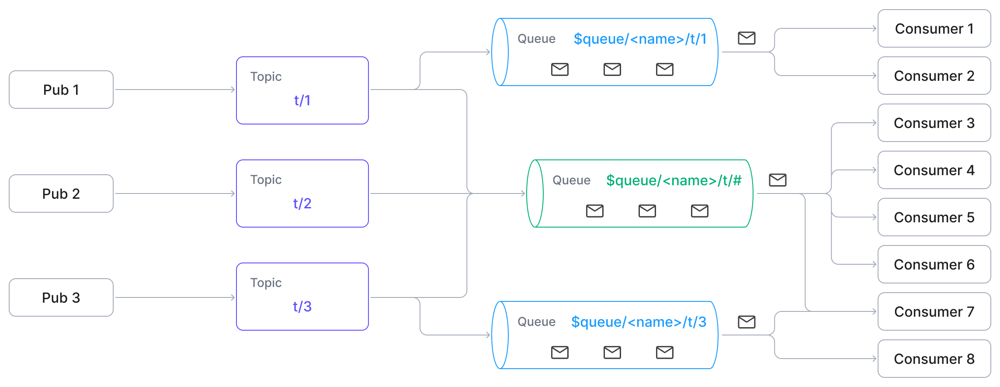
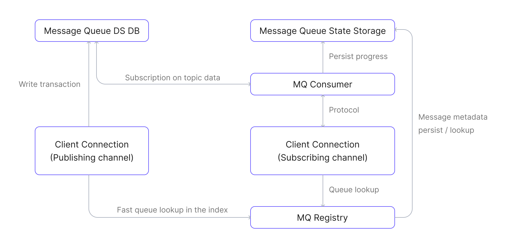

# メッセージキュー

EMQX 6.0で導入されたメッセージキュー機能は、MQTTのサブスクライブ／パブリッシュパターンを耐久性のあるキューセマンティクスで拡張し、信頼性の高い非同期メッセージ配信を可能にします。RabbitMQなどのエンタープライズグレードのメッセージキューで一般的に見られる機能を、追加のインフラなしでネイティブMQTT機能に付加します。

本ページでは、EMQXのメッセージキュー機能の設計動機、主要概念、内部アーキテクチャ、メッセージフロー、実際の適用シナリオを包括的に解説します。

## メッセージキューとは？

EMQXのメッセージキューは、サブスクライバーの有無に関わらずMQTTメッセージをサーバー側で耐久的にバッファリングする名前付きのキューです。各キューは一意のキュー名で識別され、トピックフィルターはパブリッシュされたどのメッセージがキューに格納されるかを定義します（キューの識別子としては機能しません）。設定されたトピックフィルターに一致するメッセージは、キューの保持および配信ポリシーに従って自動的に永続化されます。

従来のMQTTの動作とは異なり、メッセージキューはクライアントがオンラインでない場合でもメッセージを保持します。クライアントは特別な`$queue/<name>`または`$queue/<name>/<topic_filter>`形式のサブスクライブでこれらのメッセージを消費できます。

メッセージキューは組み込みの耐久ストレージを使用します。メッセージキューを有効にする前に、EMQXのデータディレクトリがローカルファイルシステムを使用していることを確認してください。[組み込み耐久ストレージのバックエンド](../design/durable-storage.md#embedded-backends)はNFSやSMB/CIFSなどのネットワークファイルシステムをサポートしていません。

::: warning リスナーマウントポイントとの非互換性
メッセージキューは、[マウントポイント](../../guides/configuration/listener.md#mountpoint)が設定されたリスナー経由で接続されたクライアントでは動作しません。EMQXは`$queue/`プレフィックスのマッチング前にマウントポイントを適用するため、サブスクリプションはマウントされたリテラルトピックへの通常のサブスクリプションとして扱われます。クライアントにはエラーは報告されません。
:::



## なぜメッセージキューを使うのか？

MQTTは軽量で広く採用されているパブリッシュ／サブスクライブプロトコルですが、そのデフォルトの動作はメッセージ配信をサブスクライバーのオンライン状態に強く依存しており、非同期や遅延消費のシナリオでは制約となることがあります。

### MQTTの制約

MQTTは[共有サブスクリプション](../../get-started/messaging/mqtt-shared-subscription.md)（`$share/{group}/topic`）を通じてキューのような機能を一部サポートしていますが、以下の制限があります。

- サブスクライバーがオンラインでない場合、メッセージは保持されません。
- TTL（有効期限）、キューサイズ制限、オーバーフロー制御の組み込みサポートがありません。
- キーごとに最新値のみを保持するようなメッセージの重複排除機能がありません。
- キューの明示的なライフサイクル管理がありません。

これらの制約により、以下のようなパターンの実装が困難です。

- デバイスがオンラインになる前にコマンドを送信する。
- 常時接続していないワーカーにタスクを送る。
- 最新の状態や設定更新のみを保持する。

### メッセージキューによるMQTTの拡張

EMQXのメッセージキューはMQTTプロトコルを拡張し、サブスクライバーのオンライン状態に関わらずメッセージを永続化して後続処理を可能にします。主な特徴は以下の通りです。

- **クライアントがオフラインでもメッセージを永続化**：キューは厳密な順序付けはしませんが、信頼性のある非同期配信を目的とし、軽量MQTT通信と高度なエンタープライズメッセージングの橋渡しをします。
- **明示的なキュー宣言とプロパティ設定**：TTL、サイズ制限、配信戦略などの設定が可能で、メッセージの保持と配信を細かく制御できます。
- **オプションのラストバリューセマンティクス**：同じキーを持つメッセージは前の未消費メッセージを上書きし、最新の状態や設定更新のみを保持する用途に最適です。

## メッセージキューの概念

- **キュー名**

   メッセージキューを一意に識別する名前です。

   キュー名に使用できる文字は以下に限定されます。

   - 英数字（`A–Z`、`a–z`、`0–9`）
   - アンダースコア（`_`）
   - ハイフン（`-`）
   - ドット（`.`）

   ::: tip

   EMQX 6.1.1以降、キューはトピックフィルターではなく名前でアドレス指定されます。トピックフィルターはキューの設定の一部であり、キューの識別子ではありません。

   :::

- **トピックフィルター**

   `devices/+/command`のようなMQTTトピックフィルターで、どのパブリッシュメッセージがキューに書き込まれるかを決定します。設定されたフィルターに一致するメッセージのみがキューに格納されます。1つのパブリッシュメッセージが複数のキューにマッチし、複数のキューに書き込まれることもあります。

   ::: tip

   トピックフィルターは名前付きキューの設定メタデータであり、キュー作成後に変更できません。

   :::

- **キューサブスクリプション**

   キューからメッセージを消費するための特別なMQTTサブスクリプションです。クライアントは以下の形式でサブスクライブします。

   ```
   SUBSCRIBE $queue/<name>
   SUBSCRIBE $queue/<name>/<topic_filter>
   ```

   ここで、

   - `<name>` はキュー名（必須）
   - `<topic_filter>` は既存キューにサブスクライブする場合は省略可能
   - 自動作成が有効な場合、`$queue/<name>/<topic_filter>`はキューが存在しなければ指定されたトピックフィルターでキューを作成します。

   キューサブスクリプションは通常のMQTTサブスクリプションとは独立して動作し、メッセージキューのコンシューマーメカニズムで処理されます。

- **ラストバリューセマンティクス**

   キュー宣言時に**キューキー式**を設定して有効化できるオプション機能です。有効化すると、EMQXは各メッセージから`キューキー`を抽出し、同じキーの新しいメッセージが未消費の既存メッセージを上書きします。この動作は状態管理や設定更新など、最新値のみが重要で古いメッセージを破棄してよい場合に適しています。

   詳細は[キューキー式](./message-queue-task.md#queue-key-expression)をご参照ください。

- **キュー宣言**

   耐久キューを作成し、トピックフィルター、配信戦略、保持制限、オプションのキー式などのプロパティを設定して動作を定義するプロセスです。

- **キュー削除**

   キューとその格納メッセージおよび関連状態をすべて削除する操作です。

- **キュープロパティ**

   メッセージ保持時間や配信戦略など、キューの動作を制御するカスタマイズ可能な設定です。

- **QoS（サービス品質）**

   メッセージキュー内のすべてのメッセージは、パブリッシュやサブスクライブ時のQoSレベルに関わらず、QoS 1（少なくとも1回配信）で配信されます。これにより信頼性の高いメッセージ配信が保証され、キューの配信動作が統一されます。

- **メッセージ永続化**

   サブスクライバーが接続していなくてもメッセージは保持されます。デフォルトではラストバリューセマンティクスが適用されます。キー式を設定しない通常のキューでは、受信順にメッセージが保存されます。

## メッセージキューの動作

EMQXのメッセージキュー機能は疎結合の拡張として実装されており、内部フックを使ってパブリッシュおよびサブスクライブ操作をインターセプトします。これらのフックはレジストリやストレージ層と連携し、メッセージの永続化と配信を信頼性高く行います。

### 主なコンポーネント

以下の主要コンポーネントが関与します。

- **メッセージキューレジストリ**：すべてのメッセージキューのライフサイクルを管理し、キューの作成、削除、検索を担当します。
- **メッセージキューメッセージDB**：キューにパブリッシュされたメッセージを格納し、EMQXの[耐久ストレージ](../../guides/durability/durability_introduction.md#durable-storage-architecture)上に構築されています。
- **メッセージキュー状態ストレージ**：消費進捗やキューメタデータ（TTLやプロパティなど）を永続化します。
- **メッセージキューコンシューマー**：キューからメッセージを取得し、設定された配信戦略に基づいて接続されたサブスクライバーに配信します。
- **メッセージキューサブスクリプションレジストリ**：どのチャネル（クライアント）がどのキューにサブスクライブしているかを追跡し、各チャネルのコンテキストにサブスクリプション状態を保存します。
- **メッセージキューフック**：パブリッシュおよびサブスクライブイベントにフックし、メッセージをキューやコンシューマーへルーティングします。

### メッセージキューデータフローダイアグラム

以下の図は主要コンポーネント間のデータフローを示しています。



### パブリッシュのワークフロー

1. クライアントが`some/topic`などの通常トピックにメッセージをパブリッシュします。
2. 内部のMQフックがトリガーされ、メッセージ処理を開始します。
3. フックはメッセージキューレジストリを参照し、パブリッシュトピックにマッチするキューを検索します。
4. マッチするキューがあれば、メッセージをキューのメッセージDBに書き込みます。

### サブスクライブおよび消費のワークフロー

1. クライアントが`$queue/<name>`または`$queue/<name>/<topic_filter>`でキューにサブスクライブします。
2. MQフックがトリガーされ、サブスクリプション処理を行います。
3. フックはキュー名でキューを解決し、クライアントセッションのコンテキスト内にサブスクリプションを初期化し、メッセージキューコンシューマーへの接続を確立します。
4. キューに対応するコンシューマープロセスが存在しなければ、新たに起動します。
5. コンシューマーはメッセージ消費の進捗を復元し、メッセージDBからデータ取得を開始します。
6. コンシューマーは設定された配信戦略に従い、受信したメッセージをサブスクライバーのクライアントセッションに配信します。
7. サブスクライバーのクライアントセッションは標準MQTTメカニズムでクライアントにメッセージを届けます。

## メッセージキューのコア機能

EMQXのメッセージキューは、信頼性が高く疎結合で設定可能なメッセージ配信を実現する一連のコア機能を提供します。

- **メッセージのエンキュー**

  キューのトピックフィルターにマッチするトピックにパブリッシュされたメッセージは自動的にキューに格納されます。

  キューキー式が設定されている場合（ラストバリューセマンティクス）、EMQXは各メッセージに対して式を評価します。

  - キーが導出されると、同じキーの未消費メッセージを置き換えます。
  - ラストバリューキューでキーが評価できない場合、そのメッセージは破棄されます。

- **メッセージのデキュー**

  サブスクライブしているクライアントは設定された配信戦略に従いキューからメッセージを受け取ります。すべてのメッセージはQoS 1（少なくとも1回配信）で配信され、信頼性を確保します。クライアントがメッセージをアックすると、そのメッセージはキューから削除されます。

- **配信戦略**

   メッセージのサブスクライバー間の配布方法を以下から選択できます。

  - `random`：ランダムに配布
  - `round_robin`：利用可能なサブスクライバー間で順番に配布
  - `least_inflight`：処理中メッセージ数が少ないサブスクライバーを優先

- **キュー管理**

   キューの作成、更新、削除、照会などのフルライフサイクル操作がREST APIで可能です。

## ユースケース

メッセージキューは、デバイスやコンシューマーが常にオンラインでない多くのIoTやイベント駆動型アプリケーションシナリオで重要な、信頼性の高い非同期メッセージングパターンを実現します。

- **デバイスコマンドキューイング**：クラウドアプリケーションがIoTデバイス向けにコマンドをキューイングし、デバイスがオフラインでもコマンドが失われないようにする。
- **バッチ処理**：大規模データセットやワークロードを小さなタスクに分割し、ワーカークライアントに並列または遅延処理させる。
- **センサーデータ処理**：高頻度のセンサーデータを一時的にキューイングし、後でバッチ処理、集約、分析を行う。
- **最新設定の配信**：デバイスが常に最新の設定コマンドを取得・処理するようにし、同じ設定項目／キーの古い未処理コマンドはキュー内で上書きまたは無効化する。

## 関連機能リファレンス

メッセージキューはMQTTを基盤とし、EMQXの他のメッセージング機能を補完します。

- [共有サブスクリプション](../../get-started/messaging/mqtt-shared-subscription.md)：複数サブスクライバー間でメッセージを分配しますが、クライアントがオンラインでない場合はメッセージを保持しません。
- [保持メッセージ](../../get-started/messaging/mqtt-retained-message.md)：トピックごとに最後のメッセージを保存しますが、新規サブスクライバーに1つの保持メッセージのみ配信します。
- [MQTT耐久セッション](../../guides/durability/durability_introduction.md)：個々のクライアントのセッション状態（サブスクリプションやQoS 1/2メッセージ）を再接続間で保持します。
- [ルールエンジン](../data-integration/rules.md)：SQLライクなルールでキュー内メッセージをフィルタリング・処理し、変換や転送を行います。

## セキュリティ考慮事項

EMQXはキューサブスクリプションを、`$queue/`プレフィックスとキュー名を含む完全なサブスクリプショントピックフィルターに対して認可します。そのため、その完全なフィルターに対する書き込み認可ルールを作成してください。キューサブスクリプションは、サブスクライブ作成前にキューが保持していたメッセージも配信します。

### キューサブスクリプションには専用ルールが必要

通常のトピック空間用のルールは対応するキューサブスクリプションをカバーしません。

- `t/#`のルールは`$queue/orders/t/#`には適用されません。EMQXはこれらを異なるトピックとして扱います。
- `#`や`+`で始まる認可トピックフィルターは`$`で始まるサブスクリプショントピックフィルターにマッチしません。デフォルトの`acl.conf`にある`{eq, "#"}`ルールを含む`#`拒否ルールは`$queue/orders/#`を拒否しません。

したがって、`#`が拒否されているクライアントでも`$queue/orders/#`にサブスクライブしてキュー内のすべてのメッセージを受信可能です。`$queue/`ネームスペースに対して明示的なルールを追加し、キューのトピックフィルターの通常トピックに対する認可ルールと同等かそれ以上に厳しくしてください。

```erlang
%% 自動作成を許可せず、事前作成済みの"orders"キューを1つのコンシューマーに許可
{allow, {username, "order_worker"}, subscribe, ["$queue/orders"]}.

%% その他すべてのキューサブスクリプションを拒否（非推奨プレフィックスも含む）
{deny, all, subscribe, ["$queue/#", "$q/#"]}.
```

クライアントがまだ使用している限り、非推奨の`$q/`プレフィックスもルールに残してください。[非推奨プレフィックス](#deprecated-prefix)参照。

この動作は[共有サブスクリプション](../../get-started/messaging/mqtt-shared-subscription.md)とは異なります。`$share/<group>/t/#`の場合、EMQXはプレフィックスを除去して`t/#`を認可しますが、`$queue/<name>/t/#`の場合は完全なサブスクリプショントピックフィルターを認可します。

### 自動作成はクライアント指定のトピックフィルターを許可

キューの自動作成が有効な場合、サブスクライブするクライアントが新規キューのトピックフィルターを決定します。EMQXは`$queue/<name>/<topic_filter>`の`<topic_filter>`を使ってキューを作成し、クライアントが直接`<topic_filter>`にサブスクライブする権限があるかは別途チェックしません。

例えば、クライアントが`$queue/+/#`へのサブスクライブを許可されている場合、`$queue/orders/#`にサブスクライブできます。`orders`キューが存在しなければ、EMQXは`#`をトピックフィルターとしてキューを作成します。これにより、`$`で始まらないすべてのトピックのメッセージをキューが保持し、クライアントは直接サブスクライブ権限のないトピックのメッセージを受信する可能性があります。

自動作成はラストバリューキューでデフォルト有効、通常キューで無効ですが、メッセージキュー機能が有効な間のみ有効です。デフォルト設定`mq.enable = auto`では少なくとも1つのキューが存在してからメッセージキューが有効になるため、最初のキューはサブスクライブで作成できません。信頼できないクライアントを受け入れる環境では、`$queue/orders`など特定の事前作成キューのみアクセスを許可し、`$queue/#`や`$q/#`にマッチするその他のサブスクリプションは拒否してください。あるいは自動作成を無効にして、ダッシュボードやREST APIからキューを作成してください。[ダッシュボードからの自動キュー作成](./message-queue-task.md#automatically-create-queues-via-dashboard)参照。

### ネームスペーストピック分離は別途設定が必要

ネームスペース自体はトピック空間を分割しません。トピック分離にはマウントポイントが必要です。マウントポイントがなければ異なるネームスペースのクライアントも単一のトピック空間を共有し、あるネームスペースで作成されたキューは別のネームスペースでパブリッシュされたメッセージもキャプチャします。詳細は[ネームスペース概要](../../guides/multi-tenancy/namespace-overview.md)を参照してください。

## 互換性に関する注意点

本節はEMQX 6.1.1で導入された互換性に関する考慮事項をまとめています。

### 名前付きキュー

EMQX 6.1.1以降、すべてのキューは明示的に名前付きリソースとなりました。キューの識別は一意の名前に基づき、トピックフィルターではありません。

### 旧式キュー

以前に作成された名前なしキューには、トピックフィルターから派生した名前が自動的に割り当てられます。

派生名の形式：

```
/<topic_filter>
```

> この派生名は既存の`$q/<topic_filter>`サブスクリプションとの後方互換性を維持します。

### 非推奨プレフィックス

`$q`プレフィックスは旧式サブスクリプション向けに引き続きサポートされますが非推奨です。

新規デプロイメントでは以下を使用してください。

```
$queue/<name>
```

### 共有サブスクリプション制限

メッセージキューが有効な場合、`$queue/`プレフィックスはキューサブスクリプション専用に予約され、共有サブスクリプションには使用できません。

## 次のステップ

メッセージキューの基本を理解したら、実際の活用方法を学びましょう。

- [キューの作成と設定](./message-queue-task.md)：ダッシュボードやREST APIでのキュー宣言、配信戦略や保持ポリシーの定義方法を解説します。
- [クイックスタートチュートリアル](./message-queue-quick-start.md)：MQTTXを使った実践的なパブリッシャー／サブスクライバーシナリオをステップバイステップで紹介します。
