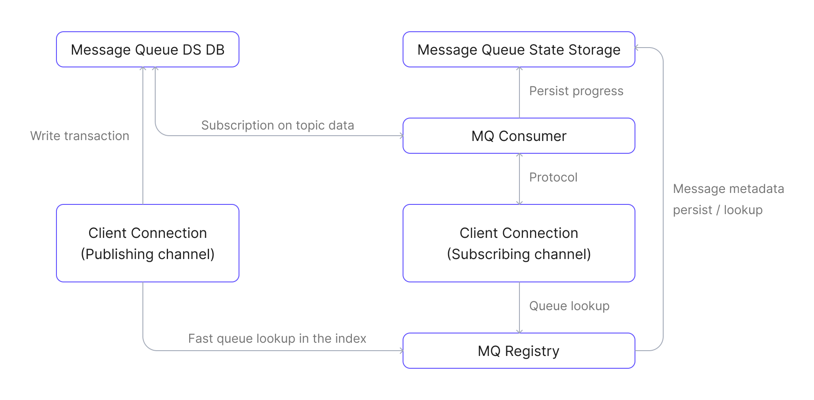

# メッセージキュー

EMQX 6.0で導入されたメッセージキュー機能は、MQTTのサブスクライブ／パブリッシュパターンを耐久性のあるキューセマンティクスで拡張し、信頼性の高い非同期メッセージ配信を可能にします。RabbitMQなどのエンタープライズグレードのメッセージキューで一般的に見られる機能を、追加のインフラなしでネイティブMQTTの機能に加えています。

本ページでは、EMQXのメッセージキュー機能の設計動機、主要概念、内部アーキテクチャ、メッセージフロー、実際の適用シナリオについて包括的に解説します。

## メッセージキューとは？

EMQXのメッセージキューは、クライアントのサブスクライバーの有無に依存せずMQTTメッセージを保存する名前付きの耐久性のあるサーバー側バッファです。各キューは一意のキュー名で識別され、トピックフィルターはどのパブリッシュされたメッセージをキューに格納するかを定義します（キューの識別子にはなりません）。設定されたトピックフィルターにマッチしたメッセージは、キューの保持および配信ポリシーに従って自動的に永続化されます。

従来のMQTTの動作とは異なり、メッセージキューはクライアントがオンラインでない場合でもメッセージを永続化します。クライアントは特別なトピック形式 `$queue/<name>` または `$queue/<name>/<topic_filter>` をサブスクライブすることでこれらのメッセージを消費できます。

メッセージキューは組み込みの耐久ストレージを使用します。メッセージキューを有効にする前に、EMQXのデータディレクトリがローカルファイルシステムを使用していることを確認してください。[組み込み耐久ストレージのバックエンド](../design/durable-storage.md#embedded-backends)はNFSやSMB/CIFSなどのネットワークファイルシステムをサポートしていません。

::: warning リスナーマウントポイントとの非互換性
メッセージキューは、[マウントポイント](../../guides/configuration/listener.md#mountpoint)が設定されたリスナー経由で接続されたクライアントには対応していません。EMQXはマウントポイントを`$queue/`プレフィックスのマッチング前に適用するため、サブスクリプションはマウントされたリテラルトピックへの通常のサブスクリプションとして扱われ、クライアントにエラーは報告されません。
:::


## なぜメッセージキューを使うのか？

MQTTは軽量で広く採用されているパブリッシュ／サブスクライブプロトコルですが、デフォルトの動作ではメッセージ配信がサブスクライバーのオンライン状態に強く依存しており、非同期や遅延消費のシナリオには制約があります。

### MQTTの制限

MQTTは[共有サブスクリプション](../../get-started/messaging/mqtt-shared-subscription.md)（`$share/{group}/topic`）を通じてキューのような機能を一部サポートしていますが、以下の制限があります。

- オンラインのサブスクライバーがいない場合、メッセージは保持されません。
- TTL（有効期限）、キューサイズ制限、オーバーフロー制御の組み込みサポートがありません。
- キーごとに最新値のみを保持するようなメッセージ重複排除機能がありません。
- キューの明示的なライフサイクル管理がありません。

これらの制限により、以下のようなパターンの実装が困難です。

- デバイスがオンラインになる前にコマンドを送信する。
- 常に接続していないワーカーにタスクを送信する。
- 最新の状態や設定更新のみを保持する。

### メッセージキューによるMQTTの拡張

EMQXのメッセージキューはMQTTプロトコルを拡張し、サブスクライバーのオンライン状態に関係なくメッセージを永続化し、後続処理を可能にします。主な特徴は以下の通りです。

- **クライアントがオフラインでもメッセージを永続化**：キューは厳密な順序付けを保証しませんが、信頼性の高い非同期配信を実現し、軽量なMQTT通信と高度なエンタープライズメッセージングのギャップを埋めます。
- **明示的なキュー宣言とプロパティ設定**：各キューはTTL、サイズ制限、配信戦略などの設定が可能で、メッセージの保持と配信を細かく制御できます。
- **オプションの最新値セマンティクス**：同じキーを持つメッセージは前のものを上書きし、最新の状態や設定更新のみを保持する用途に最適です。

## メッセージキューの概念

- **キュー名**

   メッセージキューを明示的に識別する一意の識別子です。

   キュー名に使用できる文字は以下のみです。

   - 英数字（`A–Z`、`a–z`、`0–9`）
   - アンダースコア（`_`）
   - ハイフン（`-`）
   - ドット（`.`）

   ::: tip

   EMQX 6.1.1以降、キューはトピックフィルターではなく名前で指定します。トピックフィルターはキューの設定の一部であり、識別子ではありません。

   :::

- **トピックフィルター**

   `devices/+/command` のようなMQTTトピックフィルターで、どのパブリッシュメッセージをキューに書き込むかを決定します。設定されたフィルターにマッチするメッセージのみがキューに格納されます。1つのパブリッシュメッセージが複数のキューにマッチし、複数のキューに書き込まれることもあります。

   ::: tip

   トピックフィルターは名前付きキューの設定メタデータであり、キュー作成後に変更できません。

   :::

- **キューサブスクリプション**

   キューからメッセージを消費するための特別なMQTTサブスクリプションです。クライアントは以下の形式でサブスクライブします。

   ```
   SUBSCRIBE $queue/<name>
   SUBSCRIBE $queue/<name>/<topic_filter>
   ```

   ここで、

   - `<name>` はキュー名（必須）
   - `<topic_filter>` は既存キューにサブスクライブする場合は省略可能
   - 自動作成が有効な場合、`$queue/<name>/<topic_filter>` で指定したトピックフィルターを使ってキューが存在しなければ作成されます。

   キューサブスクリプションは通常のMQTTサブスクリプションとは独立して動作し、メッセージキューのコンシューマーメカニズムで処理されます。

- **最新値セマンティクス**

   キュー宣言時に**キューキー式**を設定することで有効化できるオプション機能です。有効化すると、EMQXはメッセージごとにキューキーを抽出し、同じキーを持つ新しいメッセージが未消費の既存メッセージを上書きします。状態管理や設定更新など、最新の値のみが重要で古いメッセージを破棄してよい場合に適しています。

   詳細は[キューキー式](./message-queue-task.md#queue-key-expression)をご参照ください。

- **キュー宣言**

   耐久性のあるキューを作成し、トピックフィルター、配信戦略、保持制限、キー式などのプロパティを設定して動作を定義するプロセスです。

- **キュー削除**

   キューとその保存されたすべてのメッセージおよび関連状態を削除する操作です。

- **キュープロパティ**

   メッセージ保持時間や配信戦略など、キューの動作を制御するカスタマイズ可能な設定です。

- **QoS（サービス品質）**

   メッセージキュー内のすべてのメッセージは、パブリッシュやサブスクライブ時のQoSに関わらずQoS 1（少なくとも1回配信）で配信されます。これにより信頼性の高いメッセージ配信が保証され、キューの配信動作が統一されます。

- **メッセージ永続化**

   サブスクライバーが接続していなくてもメッセージは保持されます。デフォルトでは最新値セマンティクスが適用されます。キー式を設定しない通常のキューでは、受信順にメッセージが保存されます。

## メッセージキューの動作

EMQXのメッセージキュー機能は疎結合な拡張として実装されており、内部フックを使ってパブリッシュおよびサブスクライブ操作をインターセプトします。これらのフックはレジストリやストレージ層と連携し、メッセージの永続化と配信を信頼性高く実現します。

### 主なコンポーネント

以下の主要コンポーネントが関与します。

- **メッセージキューレジストリ**：すべてのメッセージキューのライフサイクルを管理し、キューの作成、削除、検索を担当します。
- **メッセージキューメッセージDB**：キューにパブリッシュされた実際のメッセージを保存し、EMQXの[耐久ストレージ](../../guides/durability/durability_introduction.md#durable-storage-architecture)上に構築されています。
- **メッセージキューステートストレージ**：消費進捗やキューのメタデータ（TTL、プロパティなど）を永続化します。
- **メッセージキューコンシューマー**：キューからメッセージを取得し、接続されたサブスクライバーに配信戦略に従って配信します。
- **メッセージキューサブスクリプションレジストリ**：どのチャネル（クライアント）がどのキューにサブスクライブしているかを追跡し、各チャネルのコンテキストにサブスクリプション状態を保存します。
- **メッセージキューフック**：パブリッシュおよびサブスクライブイベントにフックし、メッセージをキューやコンシューマーにルーティングします。

### メッセージキューデータフローダイアグラム

以下の図は主要なメッセージキューコンポーネント間のデータフローを示します。



### パブリッシュのワークフロー

1. クライアントが通常のトピック（例：`some/topic`）にメッセージをパブリッシュします。
2. 内部のMQフックがトリガーされ、メッセージ処理を開始します。
3. フックはメッセージキューレジストリで、パブリッシュされたトピックにマッチするキューを検索します。
4. マッチするキューがあれば、メッセージをそのキューのメッセージDBに書き込みます。

### サブスクライブと消費のワークフロー

1. クライアントが `$queue/<name>` または `$queue/<name>/<topic_filter>` にサブスクライブします。
2. MQフックがトリガーされ、サブスクリプション処理を行います。
3. フックはキュー名でキューを解決し、クライアントセッションのコンテキスト内にサブスクリプションを初期化し、メッセージキューコンシューマーへの接続を確立します。
4. そのキューに対応するコンシューマープロセスが存在しない場合、新たにメッセージキューコンシューマーを起動します。
5. コンシューマーはメッセージ消費の進捗を復元し、メッセージDBからデータの取得を開始します。
6. コンシューマーは設定された配信戦略に従い、受信したメッセージをサブスクライアークライアントセッションに配信します。
7. サブスクライアークライアントセッションは標準のMQTTメカニズムを通じてクライアントにメッセージを届けます。

## メッセージキューのコア機能

EMQXのメッセージキュー機能は、信頼性が高く分離された設定可能なメッセージ配信を実現する一連のコア機能を提供します。

- **メッセージのエンキュー**

  キューの設定トピックフィルターにマッチするトピックにパブリッシュされたメッセージは自動的にキューに格納されます。

  キューキー式（最新値セマンティクス用）が設定されている場合、EMQXは各メッセージに対して式を評価します。

  - キーが導出されれば、同じキーを持つ未消費メッセージを置き換えます。
  - 最新値キューでキーの評価に失敗した場合、そのメッセージは破棄されます。

- **メッセージのデキュー**

  サブスクライブしたクライアントは設定された配信戦略に従いキューからメッセージを受信します。メッセージはすべてQoS 1（少なくとも1回配信）で配信され、クライアントがアック（ACK）を返すとキューから削除されます。

- **配信戦略**

   メッセージのサブスクライバー間の配布方法を以下から選択できます。

  - `random`：ランダムに配布
  - `round_robin`：利用可能なサブスクライバー間で順番に配布
  - `least_inflight`：処理中メッセージ数が少ないサブスクライバーを優先

- **キュー管理**

   作成、更新、削除、クエリなどの完全なキューライフサイクル操作はREST APIで利用可能です。

## ユースケース

メッセージキューは、デバイスやコンシューマーが常にオンラインでない多くのIoTやイベント駆動型アプリケーションで重要な信頼性の高い非同期メッセージングパターンを実現します。

- **デバイスコマンドキューイング**：クラウドアプリケーションがIoTデバイス向けのコマンドをキューに蓄積し、デバイスがオフラインでもコマンドが失われないようにします。
- **バッチ処理**：大規模なデータセットやワークロードを小さなタスクに分割し、ワーカークライアントに並列または遅延処理のために配布します。
- **センサーデータ処理**：高頻度のセンサーデータを一時的にキューに蓄積し、後でバッチ処理や集約、分析を行います。
- **最新設定の配信**：デバイスが常に最新の設定コマンドを取得・処理するようにし、同じ設定項目／キーの古い未処理コマンドはキュー内で上書きまたは無効化されます。

## 関連機能リファレンス

メッセージキューはMQTTを基盤とし、EMQXの他のメッセージング機能を補完します。

- [共有サブスクリプション](../../get-started/messaging/mqtt-shared-subscription.md)：複数のサブスクライバー間でメッセージを分散しますが、クライアントがオンラインでない場合はメッセージを保持しません。
- [保持メッセージ](../../get-started/messaging/mqtt-retained-message.md)：トピックごとの最新メッセージを保存しますが、新規サブスクライバーに対して1つの保持メッセージのみを配信します。
- [MQTT耐久セッション](../../guides/durability/durability_introduction.md)：個々のクライアントの再接続時にサブスクリプションやQoS 1/2メッセージの状態を保持します。
- [ルールエンジン](../data-integration/rules.md)：SQLライクなルールでキュー内のメッセージをフィルタリング・処理し、変換や転送を可能にします。

## セキュリティ上の考慮事項

EMQXはキューサブスクリプションに対して、`$queue/`プレフィックスとキュー名を含む完全なサブスクリプショントピックフィルターで認可を行います。書き込みの認可ルールはこの完全なフィルターに対して設定してください。キューサブスクリプションはサブスクリプション作成前にキューが保存したメッセージも配信します。

### キューサブスクリプションは専用のルールが必要

通常のトピック空間に対するルールは対応するキューサブスクリプションには適用されません。

- `t/#` に対するルールは `$queue/orders/t/#` には適用されません。EMQXはこれらを異なるトピックとして扱います。
- `#` や `+` で始まる認可トピックフィルターは `$` で始まるサブスクリプショントピックフィルターにマッチしません。デフォルトの `acl.conf` にある `{eq, "#"}` ルールを含む `#` の拒否ルールは `$queue/orders/#` を拒否しません。

したがって、`#` のサブスクライブを拒否されたクライアントでも `$queue/orders/#` にサブスクライブしてキュー内のすべてのメッセージを受信できます。`$queue/` ネームスペースに対して明示的なルールを追加し、キューのトピックフィルターに対する通常のトピックの認可ルールと同等かそれ以上に厳しくしてください。

```erlang
%% 自動作成を許可せず、事前作成済みの "orders" キューを1つのコンシューマーに読み取り許可。
{allow, {username, "order_worker"}, subscribe, ["$queue/orders"]}.

%% その他すべてのキューサブスクリプションを拒否（非推奨プレフィックスも含む）。
{deny, all, subscribe, ["$queue/#", "$q/#"]}.
```

クライアントがまだ `$q/` プレフィックスを使用している間はルールに含めてください。[非推奨プレフィックス](#deprecated-prefix)も参照してください。

この動作は[共有サブスクリプション](../../get-started/messaging/mqtt-shared-subscription.md)とは異なります。`$share/<group>/t/#` の場合、EMQXはプレフィックスを除去して `t/#` の認可を行いますが、`$queue/<name>/t/#` は完全なサブスクリプショントピックフィルターで認可されます。

### 自動作成はクライアント指定のトピックフィルターを許可

キューの自動作成が有効な場合、サブスクライブするクライアントが新規キューのトピックフィルターを決定します。EMQXは `$queue/<name>/<topic_filter>` の `<topic_filter>` を使ってキューを作成し、クライアントが `<topic_filter>` に直接サブスクライブする権限があるかは別途チェックしません。

例えば、`$queue/+/#` にサブスクライブ許可があるクライアントは `$queue/orders/#` にサブスクライブできます。`orders` キューが存在しなければ、EMQXはトピックフィルター `#` でキューを作成します。キューは `$` で始まらないすべてのトピックのメッセージを保存するため、クライアントは直接サブスクライブ権限のないトピックのメッセージを受信する可能性があります。

自動作成はデフォルトで最新値キューでは有効、通常キューでは無効ですが、メッセージキュー機能が有効な間のみ有効です。デフォルト設定 `mq.enable = auto` では、少なくとも1つのキューが存在した後にメッセージキューが有効になるため、サブスクリプションで最初のキューを作成することはできません。信頼できないクライアントを受け入れるデプロイでは、`$queue/orders` のような事前作成済みキューのみアクセスを許可し、`$queue/#` や `$q/#` にマッチするその他のサブスクリプションはすべて拒否してください。あるいは自動作成を無効にし、ダッシュボードやREST APIからキューを作成してください。[ダッシュボードによるキューの自動作成](./message-queue-task.md#automatically-create-queues-via-dashboard)も参照してください。

### ネームスペースによるトピック分離は別途設定が必要

ネームスペースは単独ではトピック空間を分割しません。トピック分離にはマウントポイントが必要です。マウントポイントがない場合、異なるネームスペースのクライアントは単一のトピック空間を共有し、あるネームスペースで作成されたキューは別のネームスペースでパブリッシュされたメッセージをキャプチャします。詳細は[ネームスペース概要](../../guides/multi-tenancy/namespace-overview.md)をご覧ください。

## 互換性に関する注意

本節はEMQX 6.1.1で導入された互換性に関する考慮点をまとめています。

### 名前付きキュー

EMQX 6.1.1以降、すべてのキューは明示的に名前付きリソースとなりました。キューの識別は一意の名前に基づき、トピックフィルターではありません。

### レガシーキュー

以前に作成された名前なしキューには、トピックフィルターから派生した名前が自動的に割り当てられます。

派生名の形式：

```
/<topic_filter>
```

> この派生名は既存の `$q/<topic_filter>` サブスクリプションとの後方互換性を維持します。

### 非推奨プレフィックス

`$q` プレフィックスはレガシーサブスクリプション向けに引き続きサポートされていますが非推奨です。

新規デプロイでは以下を使用してください。

```
$queue/<name>
```

### 共有サブスクリプションの制限

メッセージキューが有効な場合、`$queue/` プレフィックスはキューサブスクリプション専用となり、共有サブスクリプションには使用できません。

## 次のステップ

メッセージキューの基本を理解したら、実際の利用方法を学びましょう。

- [キューの作成と設定](./message-queue-task.md)：ダッシュボードやREST APIでのキュー宣言、配信戦略の定義、保持ポリシーの設定方法を解説します。
- [クイックスタートチュートリアル](./message-queue-quick-start.md)：MQTTXを使った実践的なパブリッシャー／サブスクライバーシナリオのステップバイステップガイドです。
