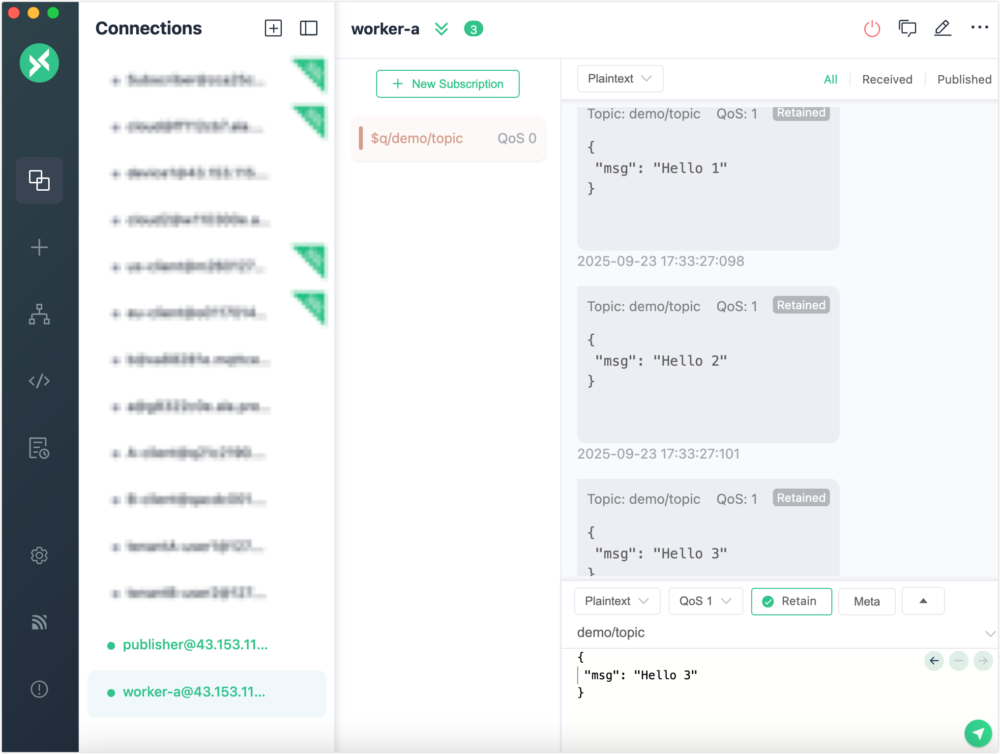

# メッセージキュー クイックスタート

このページでは、メッセージキュー機能の基本的な使い方を説明します。MQTTXを使ってクライアントをシミュレートし、EMQXダッシュボードからメッセージキューを作成・管理し、メッセージがどのように確実に保存および配信されるかを確認します。

## 目的

このクイックスタートでは、EMQXメッセージキューが以下を実現できることを紹介します。

- サブスクライバーがオフラインでもメッセージを永続化する
- 設定可能なディスパッチ戦略をサポートする
- メッセージの圧縮にLast-Value Semanticsを有効にする

## 前提条件

開始前に以下を準備してください。

- EMQX 6.0以上が稼働している（メッセージキュー機能が有効）
- [MQTTX](https://mqttx.app/)（またはMQTT 5.0対応のクライアント）
- EMQXダッシュボードへのアクセス（デフォルト: `http://localhost:18083`）

## メッセージキューの基本機能を試す

このセクションでは、EMQXメッセージキューがメッセージをどのように永続化し配信するかを示します。MQTTXを使ってクライアントをシミュレートし、サブスクライバーがオフラインの間もメッセージが保持・配信される様子を確認します。

### ステップ1：キューを作成する

1. 左メニューの **Queues** に移動します。
2. ページ右上の **Create** ボタンをクリックします。

3. **Create Queue** ダイアログで以下の設定を行います。
   - **Name**: `my_queue`
   - **Topic Filter**: `demo/topic`
   - **Dispatch Strategy**: `Random`
   - **Data Retention Period**: `7` 日
   - **Last Value Semantics**: `Disabled`
4. **Create** をクリックします。

### ステップ2：メッセージをパブリッシュする

MQTTXを使って**パブリッシャー**としてクライアントをシミュレートします。

1. MQTTXを開き、クライアント（例：`publisher`）を作成します。
2. EMQXに接続します（`mqtt://localhost:1883`）。
3. トピック `demo/topic` にQoS 1でメッセージをパブリッシュします。

例：

```
Topic: demo/topic
QoS: 1
Payload: {"msg": "Hello 1"}
```

続けて `{"msg": "Hello 2"}` などのペイロードで複数回パブリッシュしてください。

この時点ではサブスクライバーはいません。メッセージはEMQXによってキューに蓄積・永続化されます。

### ステップ3：サブスクライブしてメッセージを受信する

MQTTXを使って**サブスクライバー**としてクライアントをシミュレートします。

1. 2つ目のクライアント（例：`worker-a`）を開きます。

2. EMQXに接続します。

3. キュートピックをサブスクライブします。

   ```json
   Topic: $queue/my_queue/demo/topic
   QoS: 1
   ```

これでキューに蓄積された過去のメッセージをすべて受信できます。



## 複数サブスクライバーとディスパッチ戦略のシミュレーション

このセクションでは、同じメッセージキューに複数のサブスクライバーが接続した場合の動作をシミュレートし、異なるディスパッチ戦略がメッセージ配信に与える影響を確認します。

1. `publisher` クライアントで、元のトピック（`$queue/` プレフィックスなし）に複数のメッセージをパブリッシュします。

   ```bash
   for i in {1..10}; do
     mqttx pub -t demo/topic -m "message-$i" -q 1
   done
   ```

2. もう1つMQTTXクライアント（例：`worker-b`）を作成します。

3. EMQXに接続し、同じキュートピックをサブスクライブします。

   ```json
   Topic: $queue/my_queue/demo/topic
   QoS: 1
   ```

   これで `worker-a` と `worker-b` の両方が同じキューからメッセージを消費します。

4. 両サブスクライバーのメッセージ受信状況を観察してください。

### ディスパッチ戦略が配信に与える影響

キューの**Dispatch Strategy**によってメッセージ配信の挙動が変わります。

| Dispatch Strategy           | 挙動                                                         | ユースケース                           |
| --------------------------- | ------------------------------------------------------------ | ------------------------------------ |
| `Least Inflight Subscriber` | 未アック（未確認）メッセージが少ないサブスクライバーを優先 | 不均一な消費者間の負荷分散            |
| `Round Robin`               | 各サブスクライバーに順番にメッセージを配信                   | 速度に関係なく公平に配信したい場合    |
| `Random` (デフォルト)       | ランダムに選んだサブスクライバーにメッセージを配信           | デモや予測不能な配信シナリオ          |

これらの挙動は、`worker-a` と `worker-b` のメッセージ受信パターンを観察することで確認できます。

### ディスパッチ戦略の変更

ディスパッチ戦略は動的に変更可能です。

1. ダッシュボードの **Queues** に移動します。
2. 対象キューの **Edit** をクリックします。
3. 新しい **Dispatch Strategy** を選択して保存します。

ただし、サブスクライバーがオンラインの間は新しい戦略は適用されません。クライアントを切断し、再接続する必要があります。

切り替え後、再度メッセージパブリッシュを試し、サブスクライバー間の配信パターンの違いを確認してください。

## Last-Value Semantics のテスト

このセクションでは、**Last-Value Semantics** を有効にする方法を示します。これはキーごとに最新のメッセージのみをキューに保持し、デバイス設定の更新などに最適です。

### ステップ1：既存キューの削除

1. EMQXダッシュボードの **Queues** に移動します。
2. トピックフィルターが `demo/topic` のキューを探します。
3. **Actions** 列の **Delete** をクリックします。
4. 確認ダイアログで削除を承認します。
5. キュー一覧から該当キューが消えるまで待ちます。

EMQX 6.3.3以降では、削除確認時にキューは削除マークが付けられ、バックグラウンドでクリーンアップが行われます。クリーンアップ完了までキューは一覧に残ります。

### ステップ2：Last-Value Semanticsを有効にしたキューを作成

1. **Queues** ページで **Create** をクリックします。
2. **Create Queue** ダイアログで以下を設定します。
   - **Name**: `my_queue`
   - **Topic Filter**: `device/config`
   - **Dispatch Strategy**: `Random`（または任意）
   - **Data Retention Period**: `7` 日
   - **Last Value Semantics**: 有効にする
   - **Queue Key Expression**: `message.from`（またはキーとして使う任意のフィールド名）
3. **Create** をクリックします。

「Queue Key Expression」は、EMQXが各メッセージからキーを抽出してLast-Valueキュー内で重複排除に使う方法を定義します。このフィールドは[Variform式](../../guides/configuration/configuration.md#variform-expressions)で設定可能です。

このクイックスタートでは `message.from` を使い、メッセージパブリッシャーのクライアントIDをキーとして抽出します。

> カスタムキーやメッセージ構造の詳細な例については、[Queue Key Expression](./message-queue-task.md#queue-key-expression)を参照してください。

### ステップ3：メッセージをパブリッシュする

1. MQTTXを開き、クライアント（例：`publisher`）を選択または作成します。

2. EMQXに接続します（`mqtt://localhost:1883`）。

3. `device/config` にメッセージをパブリッシュします。

   例：

   | フィールド   | 値                  |
   | ------------ | ------------------- |
   | **Topic**    | `device/config`     |
   | **QoS**      | 1                   |
   | **Payload**  | `{"ssid": "wifi1"}` |

4. 同じクライアント（同じクライアントID）で内容を更新したメッセージをパブリッシュします。

   ```json
   Payload: {"ssid": "wifi2"}
   ```

**Queue Key Expression** が `message.from` に設定されているため、EMQXは各メッセージからクライアントIDを自動抽出し、同じクライアントからのメッセージはキュー内の未消費メッセージを上書きします。

### ステップ4：キューをサブスクライブする

1. 2つ目のMQTTXクライアント（例：`subscriber`）を作成し、EMQXに接続します。

3. キュートピックをサブスクライブします。

   ```json
   Topic: $queue/my_queue/device/config
   QoS: 1
   ```

**期待される動作**：
最新のメッセージのみが配信されます。この場合、`{"ssid": "wifi2"}` のみが受信されます。
