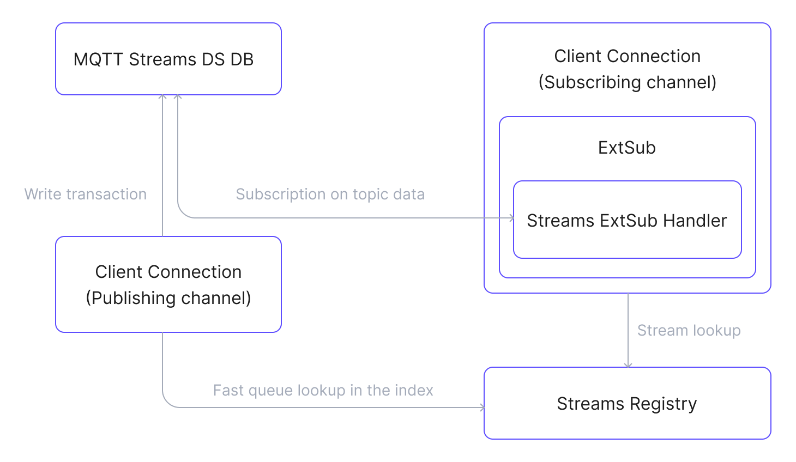

# MQTT Streams

::: warning Important Notice
MQTT Streamsは現在ベータ機能です。その機能やインターフェースは大幅に変更される可能性があります。
:::

EMQX 6.1では、MQTT Streamsというストリーミングおよびリプレイ機能を導入しました。これは、MQTTのリアルタイムなパブリッシュ／サブスクライブモデルを拡張し、永続的でリプレイ可能なメッセージストリームを提供します。Kafkaのようなストリーミング機能を実現しつつ、MQTTのセマンティクスを保持しています。

本ページでは、EMQXのMQTT Streams機能の全体像を、設計の動機、主要な概念、内部アーキテクチャ、メッセージフロー、実際の利用シナリオにわたって解説します。

::: warning Listener Mountpointとの非互換性
[mountpoint](../../guides/configuration/listener.md#mountpoint)が設定されたリスナー経由で接続されたクライアントでは、ストリームのリプレイは動作しません。EMQXはマウントポイントを`$stream/`プレフィックスのマッチング前に適用するため、`$stream/<name>`へのサブスクライブはマウントされたリテラルトピックへの通常のサブスクライブとして扱われ、クライアントにはエラーが通知されません。メッセージの取り込みも影響を受け、パブリッシュされたトピックにはマウントポイントのプレフィックスが付与されるため、そのプレフィックスを含むトピックフィルターを持つストリームにのみマッチします。
:::

## MQTT Streamとは？

MQTT Streamは、名前付きの論理リソースであり、設定されたトピックフィルターにマッチするMQTTメッセージを継続的に収集します。メッセージはストリームの保持ポリシーに従って永続的に保存され、後からサブスクライブしたクライアントによってリプレイ可能です。

ストリームは一意の名前で識別されます。トピックフィルターはストリームの設定の一部ですが、識別子ではありません。

各ストリームは以下を持ちます：

- 一意の名前
- 設定されたトピックフィルター
- 保持ポリシー（時間ベースおよび／またはサイズベース）
- オプションのLast-Valueセマンティクス
- 明示的なライフサイクル（作成、更新、削除）

## なぜMQTT Streamsを使うのか？

MQTTはリアルタイムメッセージングに最適化されていますが、以下のような制約があります：

- メッセージは通常オンラインのサブスクライバーにのみ配信される。
- 過去データのリプレイはネイティブにサポートされていない。
- 過去データの再処理には外部システムが必要。
- 順序付けられたリプレイ可能なメッセージ履歴の維持が困難。

MQTT StreamsはMQTTに耐久的なメッセージ保存とリプレイ機能を追加します。これにより、MQTTクライアントのパブリッシュやサブスクライブ方法を変えずに、過去のメッセージを読み取ったりデバイスの最新状態を取得したりできます。

## MQTT Streamsの主要概念

- **MQTT Stream**

  名前で識別・アドレス指定され、明示的なライフサイクルで管理される論理リソースです。有効な間、設定された時間またはサイズの制限内でマッチするメッセージを継続的に保存します。保存されたメッセージは、パブリッシャー側の変更なしにサブスクライブするコンシューマーによってリプレイ可能です。

  ストリーム名に使用できる文字は以下のみです：

  - 英数字（`A–Z`、`a–z`、`0–9`）
  - アンダースコア（`_`）
  - ハイフン（`-`）
  - ドット（`.`）

  2種類のストリームタイプをサポートしています：

  - **通常ストリーム**：過去のデータを上書きせずにすべてのマッチするメッセージを保存します。`stream-offset`サブスクリプションプロパティを使い、指定したタイムスタンプやオフセットからメッセージをリプレイ可能です。
  - **Last-Valueストリーム**：[Last-Valueセマンティクス](#last-value-semantics)を有効にしたストリームです。同じストリームキーを持つメッセージは新しいものが古いものを上書きし、各キーに関連付けられた最新のメッセージのみを保持します。詳細は[ストリームキー式](./mqtt-stream-task.md#stream-key-expression)を参照してください。

- **トピックフィルター**

  `sensors/+/data`のようなMQTTトピックフィルターで、どのパブリッシュメッセージをストリームに取り込むかを決定します。マッチするメッセージのみが取り込まれ、1つのメッセージが複数のストリームに属することもあります。

  ::: tip

  トピックフィルターはストリームの識別子ではなく、名前付きストリームの設定メタデータです。

  :::

- **ストリームサブスクリプション**

  ストリームからメッセージを消費するための特別なMQTTサブスクリプションです。クライアントは以下のいずれかの形式でサブスクライブします：

    ```
  SUBSCRIBE $stream/<name>
  SUBSCRIBE $stream/<name>/<topic_filter>
    ```

   ここで：

    - `<name>`はストリーム名（必須）
    - `<topic_filter>`は既存ストリームにサブスクライブする際は省略可能
    - 自動作成が有効な場合、`$stream/<name>/<topic_filter>`は存在しないストリームを指定されたトピックフィルターでEMQXが作成します。

  ストリームサブスクリプションは通常のMQTTサブスクリプションとは独立して動作し、External Subscription機構を通じて配信されます。

- **ストリームオフセット（リプレイ開始位置）**

  リプレイ開始位置はトピックパスではなく、MQTT 5のユーザーサブスクリプションプロパティ`stream-offset`で指定します。

  `stream-offset`はリプレイ開始位置を決定します。例：

  - タイムスタンプ
  - 論理オフセット
  - 最も古い位置や最新位置などの特別な位置（対応している場合）

  この設計により、オフセットのパースをトピック文字列から分離し、MQTT 5のプロパティにリプレイ制御を統合しています。

- **キー式**

  各受信メッセージに対して評価されるユーザー定義式で、キーを抽出します。式はメッセージの内容やメタデータを参照可能です。抽出されたキーはストレージパーティション内のメッセージ順序保証に使われます。Last-Valueセマンティクスが有効な場合は、同じキーの新しいメッセージが古いメッセージを上書きする範囲を定義します。

## MQTT Streamsのアーキテクチャ

MQTT Streamsは、ブローカーコアと疎結合で動作する独立したEMQXアプリケーションとして実装されており、既存のインフラを再利用しています。EMQXとの統合は内部フックとExternal Subscriptionフレームワークを通じて行われます。

::: tip

External Subscriptionは、ライブMQTTパブリッシュ経路外から発生するメッセージソースをMQTTクライアントセッションに接続し、クライアントの動作を変えずに標準MQTTサブスクリプション経由でメッセージを配信するEMQXの仕組みです。

:::

### 主なコンポーネント

- **Streams Registry**：MQTTストリームのライフサイクルを管理し、ストリーム名、トピックフィルター、保持ポリシー、キー式などのメタデータを保持します。Mnesiaテーブルを使い効率的にストリームを検索します。
- **Streams Message Database**：ストリームメッセージの耐久的ストレージを提供し、EMQXの[パーシステントストレージ](../design/durable-storage.md)上に構築されています。メッセージを永続化し、保持制限を適用し、Last-Valueセマンティクスが有効な場合はそれを適用し、保持ポリシーに従って効率的にメッセージを取得可能です。
- **Streams ExtSub Handler**：メッセージストリームをMQTTクライアントセッションと統合します。パーシステントストレージからメッセージを取得し、External Subscriptionフレームワークを通じてサブスクライブクライアントに配信します。

### MQTT Streamsのデータフローダイアグラム

以下の図はMQTT Streamsコンポーネント間のデータフローを示しています：



### パブリッシュフロー

1. クライアントがMQTTトピックにメッセージをパブリッシュする。
2. MQTT Streamsフックがパブリッシュ処理をトリガーする。
3. フックがStreams Registryを照会し、メッセージトピックにマッチするストリームを特定する。
4. マッチした各ストリームに対して、メッセージをストリームに書き込み、パーシステントストレージに永続化する。

### サブスクライブおよび消費フロー

1. クライアントがストリームトピック（`$stream/<name>`または`$stream/<name>/<topic_filter>`）にサブスクライブし、オプションで`stream-offset`サブスクリプションプロパティを含める。

   ::: warning Deprecated

   後方互換のために旧形式の`$s/<offset>/<topic_filter>`もサポートされていますが非推奨です。詳細は[互換性に関する注意](#compatibility-notes)を参照してください。

   :::

2. External Subscriptionフレームワークがサブスクリプションを処理し、ストリームトピック用のStreams ExtSubハンドラーを初期化する。
3. ハンドラーは指定された`stream-offset`および保持ルールに従い、パーシステントストレージからメッセージを取得する。
4. 取得したメッセージをExternal Subscriptionフレームワークに渡す。
5. ExtSubアプリケーションが標準MQTT配信を通じてクライアントにメッセージを届ける。

## MQTT Streamsのコア機能

MQTT Streamsは、メッセージの保存、順序付け、保持、リプレイ消費のための配信方法を定義する一連のコア機能を提供します。

- **オフセットベースのリプレイ**

  リプレイ開始位置はトピックパスではなく、`stream-offset`サブスクリプションプロパティで指定します。指定オフセットより前にパブリッシュされたメッセージはスキップされます。

- **保持**

  ストリームの保持ポリシーはメッセージのリプレイ範囲を制限します。メッセージは時間またはサイズの制限内で保持され、期限切れのメッセージは消費済みかどうかに関わらず自動的に削除されます。

- **キーごとの順序保証**

  MQTT Streamsは単一のグローバルな配信順序を保証しません。同じキーを持つメッセージは常にパブリッシュされた順序で配信されます。異なるキーのメッセージは任意の順序で配信される可能性があります。

- **Last-Valueセマンティクス**

  ストリームはLast-Valueセマンティクスを有効にできます。同じキーを持つメッセージは新しいものが古いものを上書きし、最新の値のみを保持します。キーが解決できないメッセージは通常通り保存されます。

- **MQTTネイティブ配信**

  ストリームメッセージは標準のMQTTメカニズムを使って配信されます。パブリッシャーは動作を変える必要がありません。サブスクライバーへのメッセージ配信はExternal Subscriptionを通じて統合されています。

## セキュリティ上の考慮事項

EMQXはストリームサブスクリプションを、`$stream/`プレフィックスとストリーム名を含む完全なサブスクリプショントピックフィルターに対して認可します。ストリームサブスクリプションの認可は、サブスクリプション作成前にストリームに保存されたメッセージのリプレイも許可する可能性があります。

### ストリームサブスクリプションには専用のルールが必要

通常のトピックスペース用のルールは対応するストリームサブスクリプションをカバーしません：

- `t/#`用のルールは`$stream/events/t/#`には適用されません。EMQXはこれらを別のトピックとして扱います。
- 認可トピックフィルターが`#`や`+`で始まる場合、`$`で始まるサブスクリプショントピックフィルターにはマッチしません。デフォルトの`acl.conf`にある`{eq, "#"}`ルールを含む`#`拒否ルールは`$stream/events/#`を拒否しません。

したがって、`#`が拒否されているクライアントでも`$stream/events/#`にサブスクライブでき、`stream-offset`を`earliest`に設定してストリームにまだ保存されているすべてのメッセージをリプレイ可能です。`$stream/`用に明示的なルールを追加し、ストリームのトピックフィルターにマッチするトピックのルールと同等以上の厳しさにしてください：

```erlang
%% 自動作成を許可せず、事前作成済みの"events"ストリームを1つのコンシューマーにリプレイ許可。
{allow, {username, "event_reader"}, subscribe, ["$stream/events"]}.

%% その他すべてのストリームサブスクリプション（非推奨プレフィックス含む）を拒否。
{deny, all, subscribe, ["$stream/#", "$s/#"]}.
```

クライアントがまだ旧プレフィックス`$s/`を使っている間はルールに含めてください。[Deprecated Prefix](#deprecated-prefix)参照。

この動作は[共有サブスクリプション](../../get-started/messaging/mqtt-shared-subscription.md)とは異なります。`$share/<group>/t/#`の場合、EMQXはプレフィックスを除去して`t/#`を認可しますが、`$stream/<name>/t/#`の場合は完全なサブスクリプショントピックフィルターを認可します。

### 自動作成はクライアント指定のトピックフィルターを許可

ストリームの自動作成が有効な場合、サブスクライブするクライアントが新規ストリームのトピックフィルターを決定します。EMQXは`$stream/<name>/<topic_filter>`の`<topic_filter>`を使ってストリームを作成し、クライアントが直接`<topic_filter>`にサブスクライブする権限があるかは別途チェックしません。

例えば、`$stream/+/#`にサブスクライブ許可があるクライアントは`$stream/events/#`にサブスクライブできます。`events`ストリームが存在しなければ、EMQXは`#`をトピックフィルターとして作成します。すると、そのストリームは`$`で始まらないすべてのトピックのメッセージを保存します。クライアントは直接サブスクライブ権限のないトピックのメッセージもリプレイできる可能性があります。

自動作成はLast-Valueストリームでデフォルトで有効、通常ストリームでは無効ですが、MQTT Streamsが有効な場合のみ機能します。MQTT Streamsはデフォルトで無効（`streams.enable = false`）です。信頼できないクライアントを受け入れる環境では、`$stream/events`のような特定の事前作成済みストリームへのアクセスのみ許可し、`$stream/#`や`$s/#`にマッチするその他のサブスクリプションはすべて拒否してください。あるいは自動作成を無効にし、ダッシュボードやREST APIからストリームを作成してください。[ダッシュボード経由でのストリーム自動作成](./mqtt-stream-task.md#automatically-create-streams-via-dashboard)参照。

## 互換性に関する注意

既存環境の互換性について説明します。

### 名前付きストリーム

- すべてのストリームは明示的に名前付きリソースとなりました。
- ストリーム名は許可された文字セットのルールに従う必要があります。

### 旧ストリーム

以前に作成された名前なしストリームには、トピックフィルターから派生した名前が自動的に割り当てられます。

派生名は`/<topic_filter>`となります。

### 非推奨プレフィックス

ストリームサブスクライブ用の`$s`プレフィックスは後方互換のためにまだサポートされていますが非推奨です。

新規環境では`$stream/<name>`を使用してください。

## 典型的なユースケース

- **過去データのリプレイ**：過去のMQTTイベントをデバッグや新しいビジネスロジックのために再処理。
- **時系列分析**：センサーデータを保存・リプレイし、分析や予知保全に活用。
- **イベントソーシング**：すべての状態変化を不変のイベントログとして永続化。
- **IoTデジタルツイン**：物理デバイスの最新状態をデジタルで保持。
- **設定同期**：デバイスが常に最新の設定を受け取ることを保証。

## 次のステップ

MQTT Streamsの基本を理解したら、実際の活用方法を学びましょう：

- [ストリームの作成と設定](./mqtt-stream-task.md)：ダッシュボードやREST APIでストリームを宣言し、Last-Valueセマンティクスや保持ポリシーを設定する方法を解説。
- [クイックスタートチュートリアル](./mqtt-stream-quick-start.md)：MQTTXを使った実践的なパブリッシャー／サブスクライバーシナリオをステップバイステップで案内。
