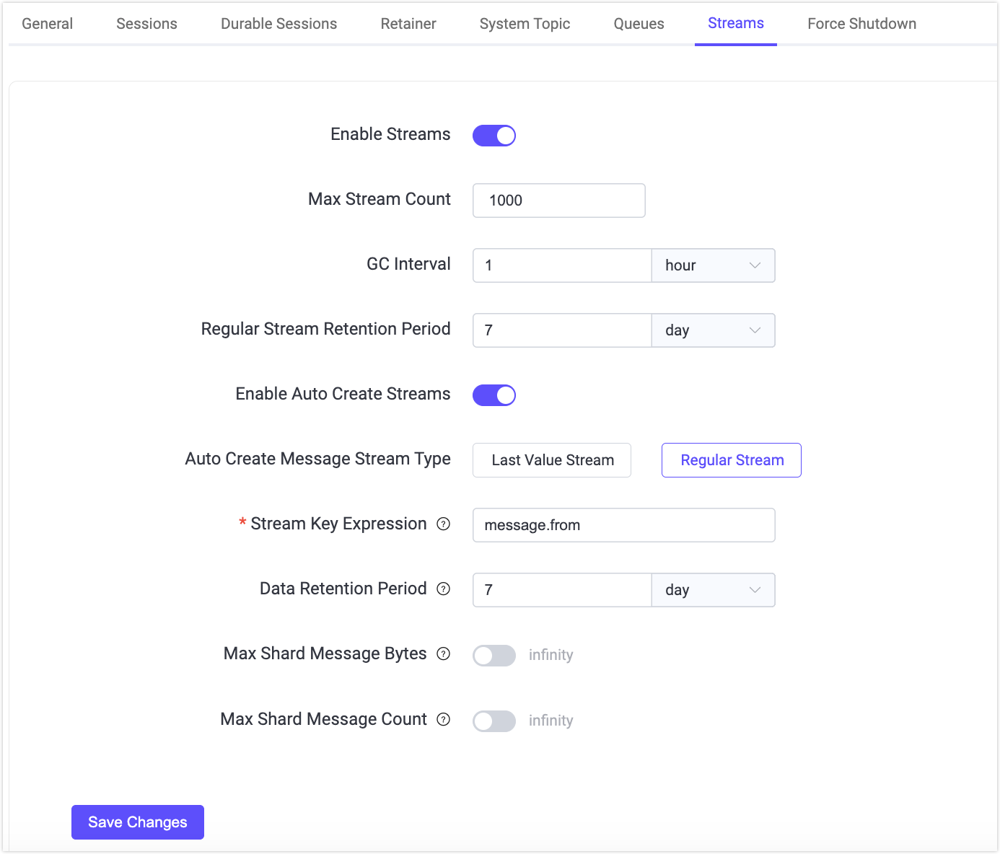
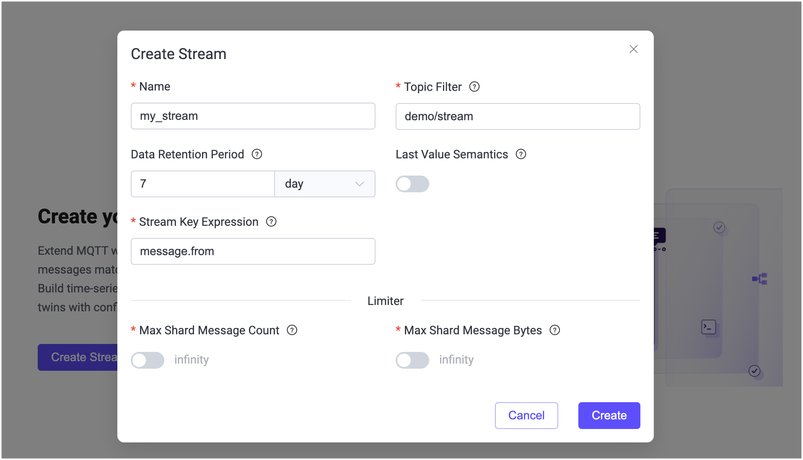
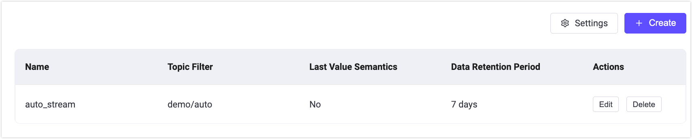

# MQTT Streams クイックスタート

::: warning 重要なお知らせ
MQTT Streams は現在ベータ機能です。その機能やインターフェースは大幅に変更される可能性があります。
:::

このページでは、EMQX 6.1 の MQTT Streams 機能の使い方を説明します。MQTTX を使ってクライアントをシミュレートし、EMQX ダッシュボードからストリームの作成・管理を行い、メッセージの保存、再生、圧縮の動作を体験します。

## 目的

このクイックスタートでは、EMQX MQTT Streams が以下を実現する方法を示します。

- サブスクライバーの有無に関わらずメッセージを永続化する
- タイムスタンプに基づく再生をサポートする
- 状態指向のメッセージングに適した Last-Value セマンティクスを有効にする
- `$stream/` プレフィックスのサブスクライブによりストリームを自動生成する

## 前提条件

開始前に以下を準備してください。

- EMQX 6.1 以上が稼働していること
- [MQTTX](https://mqttx.app/)（または MQTT 5.0 対応の任意のクライアント）
- EMQX ダッシュボードへのアクセス（デフォルト：`http://localhost:18083`）

## MQTT Streams 基本機能のテスト（レギュラーストリーム）

このセクションでは、MQTT Streams がメッセージを保存し、コンシューマーが過去のデータを再生できることを示します。

### 前提条件

開始前に、MQTT Streams 機能が有効であり、自動生成の設定がこの例に干渉しないことを確認してください。

1. 左メニューの **Streams** に移動します。

2. メッセージストリームが無効の場合は **Settings** をクリックします。**Management** -> **MQTT Settings** -> **Streams** ページにリダイレクトされます。

3. **Enable Streams** スイッチをオンに切り替えます。

4. 自動生成設定を確認し、**Regular Stream** が使用されるようにします。

   - **Enable Auto Create Streams** が無効、または

   - **Auto Create Stream Type** が **Regular Stream** に設定されていること。

   > これにより、ストリームが Last-Value Stream として自動生成されず、キーごとに最新のメッセージのみを保持する動作を防ぎます。

4. 変更を加えた場合は **Save Changes** をクリックして適用します。

   

### ステップ 1: 名前付きストリームの作成

1. 左メニューの **Streams** に移動します。

2. ページ内の **Create Stream** または右上の **Create** をクリックします。

3. **Create Stream** ダイアログで以下を設定します。
   - **Name**: `my_stream`
   - **Topic Filter**: `demo/stream`
   - **Last-Value Semantics**: 無効
   - **Stream Key Expression**: `message.from`

   他のオプションはデフォルトのままにします。

4. **Create** をクリックします。

   

### ステップ 2: メッセージのパブリッシュ

MQTTX CLI を使ってパブリッシャークライアントをシミュレートします。

1. MQTTX CLI がインストールされていることを確認します。詳細は [インストール](https://mqttx.app/docs/cli/downloading-and-installation) を参照してください。

2. EMQX に接続します。

   ```bash
   mqttx conn -h 'localhost' -p 1883
   ```

3. トピック `demo/stream` に QoS 1 で複数のメッセージをパブリッシュします。

   例:

   ```bash
   mqttx pub -t 'demo/stream' -h 'localhost' -p 1883 -q 1 -m '{"value": 1}'
   mqttx pub -t 'demo/stream' -h 'localhost' -p 1883 -q 1 -m '{"value": 2}'
   mqttx pub -t 'demo/stream' -h 'localhost' -p 1883 -q 1 -m '{"value": 3}'
   ```

   期待される出力:

   ```bash
   ✔ Connected
   ✔ Message published
   ```

このストリームはレギュラーストリームなので、すべてのパブリッシュされたメッセージは保持ポリシーに従って保存されます。

### ステップ 3: ストリームからすべてのメッセージを再生

MQTTX CLI を使い、`stream-offset` MQTT 5 サブスクリプションユーザープロパティを設定してストリームをサブスクライブし、最初からメッセージを再生します。

```bash
mqttx sub -t \$stream/my_stream  -q 1  -h localhost -up "stream-offset: 0"
```

**期待される動作**:

これまでにパブリッシュされたすべてのメッセージがパブリッシュ順に受信されます。

```bash
topic: demo/stream, qos: 0, size: 10B, userProperties: [
  { key: 'key', value: 'mqttx_28c50267' },
  { key: 'ts', value: '1772161077594532' }
]
{"value": 1}

topic: demo/stream, qos: 0, size: 10B, userProperties: [
  { key: 'key', value: 'mqttx_1989d120' },
  { key: 'ts', value: '1772161084921509' }
]
{"value": 2}

topic: demo/stream, qos: 0, size: 10B, userProperties: [
  { key: 'key', value: 'mqttx_085ea00d' },
  { key: 'ts', value: '1772161094020511' }
]
{"value": 3}
```

これにより以下が確認できます。

- ストリームはレギュラーストリームであること
- `stream-offset` サブスクリプションプロパティが正しく機能していること
- メッセージが圧縮や上書きされていないこと

## 異なる位置からのメッセージ再生

MQTT Streams では、サブスクライブ時に `stream-offset` を指定することで、メッセージ再生の開始位置を制御できます。

この例では、特定の時点以降にパブリッシュされたメッセージのみを再生する方法を示します。

### ステップ 1: 現在のタイムスタンプを取得

新しいメッセージをパブリッシュする前に、現在の Unix タイムスタンプ（マイクロ秒単位）を記録します。

ミリ秒単位の現在時刻は以下で取得可能です。

- **Linux / macOS**:

  ```bash
  date +%s000
  ```

- **JavaScript**:

  ```javascript
  Date.now()
  ```

例:

```
1772162409000
```

この値に 1000 を掛けてマイクロ秒単位に変換し、保存してください。これが再生開始位置として使われます。

### ステップ 2: 新しいメッセージをパブリッシュ

ストリームにさらにメッセージをパブリッシュします。

```bash
mqttx pub -t 'demo/stream' -h 'localhost' -p 1883 -q 1 -m '{"value": 4}'
mqttx pub -t 'demo/stream' -h 'localhost' -p 1883 -q 1 -m '{"value": 5}'
```

### ステップ 3: 記録したタイムスタンプから再生

保存したタイムスタンプを `stream-offset` として指定し、ストリームをサブスクライブします。

```bash
mqttx sub -t \$stream/my_stream  -q 1  -h localhost -up "stream-offset: 1772162409000000"
```

**期待される動作**:

この時刻以降にパブリッシュされたメッセージのみがサブスクライバーに配信されます。

```bash
topic: demo/stream, qos: 1, size: 12B, userProperties: [
  { key: 'key', value: 'mqttx_a5508c54' },
  { key: 'ts', value: '1772163340159513' }
]
{"value": 4}

topic: demo/stream, qos: 1, size: 12B, userProperties: [
  { key: 'key', value: 'mqttx_e0848366' },
  { key: 'ts', value: '1772163350666523' }
]
{"value": 5}
```

異なるコンシューマーは同じストリームを異なる位置から独立して再生できます。

- あるコンシューマーは最初から（`earliest`）再生
- 別のコンシューマーは特定のタイムスタンプから再生
- また別のコンシューマーは新しいメッセージのみ（`latest`）受信

それぞれの再生位置は独立しており、他のサブスクライバーに影響しません。

これにより、MQTT Streams のコンシューマー制御による再生が実証されます。

## Last-Value セマンティクスのテスト

このセクションでは、Last-Value MQTT Streams がキーごとに最新のメッセージのみを保持し、状態を表現するのに適していることを示します。

### ステップ 1: 既存ストリームの削除

1. ダッシュボードの **Streams** に移動します。
2. ストリーム `my_stream` を探します。
3. **Delete** をクリックして確認します。

### ステップ 2: Last-Value メッセージストリームの作成

1. **Streams** ページで **Create** をクリックします。
2. 以下の設定を行います。
   - **Name**: `device_stream`
   - **Topic Filter**: `device/state`
   - **Data Retention Period**: `7` 日
   - **Last-Value Semantics**: 有効
   - **Stream Key Expression**: `message.from`
3. **Create** をクリックします。

キー式が `message.from` に設定されているため、同じキーのストリームでは最新のメッセージのみが保持されます。

### ステップ 3: 状態更新のパブリッシュ

同じクライアント ID `-i device-1` からメッセージをパブリッシュします。

```bash
mqttx pub -t 'device/state' -h 'localhost' -p 1883 -q 1 -i device-1 -m '{"status": "online"}'

mqttx pub -t 'device/state' -h 'localhost' -p 1883 -q 1 -i device-1 -m '{"status": "offline"}'
```

ストリームキー式がメッセージメタデータのクライアント ID を抽出しているため、両メッセージは同じキーを共有し、2つ目のメッセージが1つ目を上書きします。

### ステップ 4: ストリームのサブスクライブ

ストリームをサブスクライブし、最初から再生します。

```bash
mqttx sub -t '$stream/device_stream' -h 'localhost' -p 1883 -q 1 -up "stream-offset: 0"
```

**期待される動作**:

最新のメッセージのみが配信されます。

```bash
topic: device/state, qos: 1, size: 21B, userProperties: [
  { key: 'key', value: 'device-1' },
  { key: 'ts', value: '1772173666097076' }
]
{"status": "offline"}
```

これにより、MQTT Streams が Last-Value セマンティクスを使った状態指向メッセージングパターンをサポートしていることが示されます。

## ストリームの自動生成

EMQX の MQTT Streams は、クライアントが `$stream/` プレフィックス付きトピックをサブスクライブすると自動的にストリームを生成できます。これにより、ダッシュボードで手動作成せずにストリームを動的にプロビジョニング可能です。

このセクションでは、自動生成の有効化とテスト方法を示します。

1. ダッシュボードの **Management** -> **MQTT Settings** -> **Streams** に移動します。

2. **Enable Auto Create Streams** がオンになっていることを確認します。

3. ストリームタイプを選択します。

   - **Regular Stream**
   - **Last-Value Stream**

   > 自動生成で有効にできるのは一度に1種類のみです。

4. 他のオプションはデフォルトのままにします。

5. **Save Changes** をクリックします。

6. 以下のコマンドでサブスクライブし、自動生成をトリガーします。

   ```bash
   mqttx sub -h localhost -p 1883 -q 1 -t '$stream/auto_stream/demo/auto' -up "stream-offset: earliest"
   ```

   手動作成ストリームとは異なり、自動生成ストリームではサブスクライブ時にトピックフィルター（この例では `demo/auto`）が必要です。

   ストリームが存在しない場合、EMQX は以下を実行します。

   - `auto_stream` という名前の新しいストリームを作成
   - トピックフィルターを `demo/auto` に設定
   - 設定された自動生成タイプ（レギュラーまたは Last-Value）を適用

7. ダッシュボードの **Streams** ページで自動生成が確認できます。ストリーム一覧に「auto_stream」が表示されているはずです。

   
